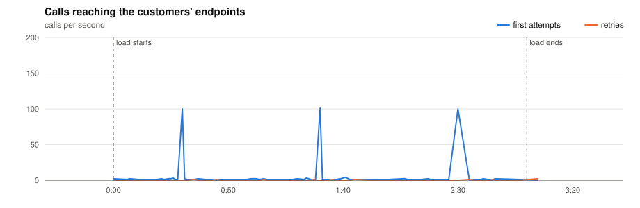
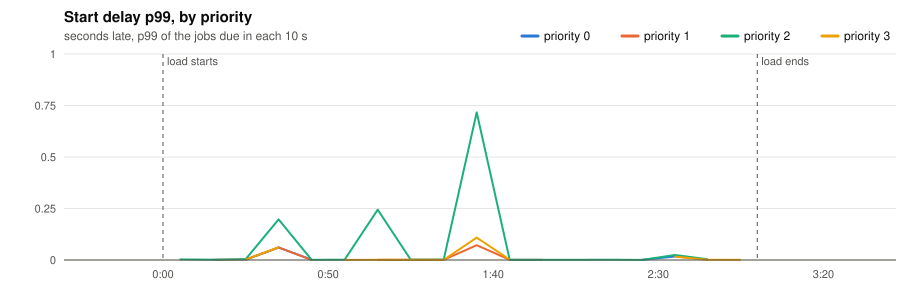
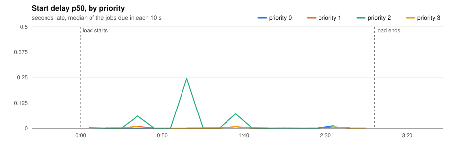
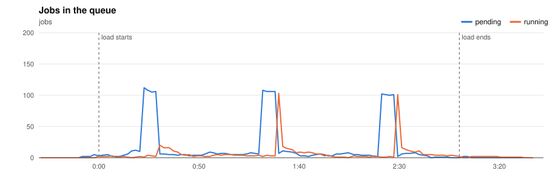
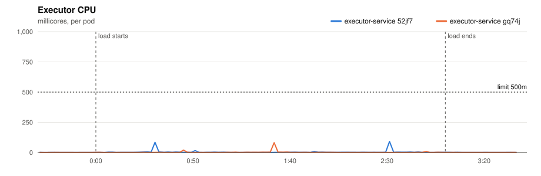
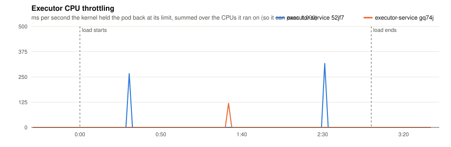
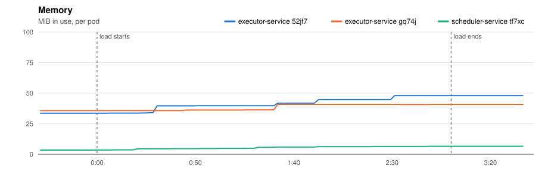
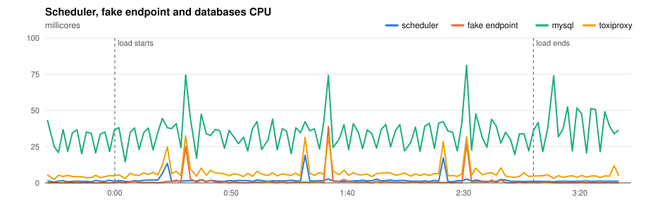
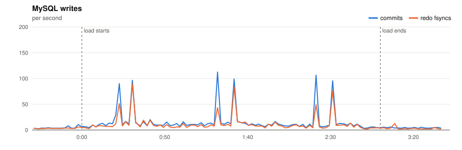
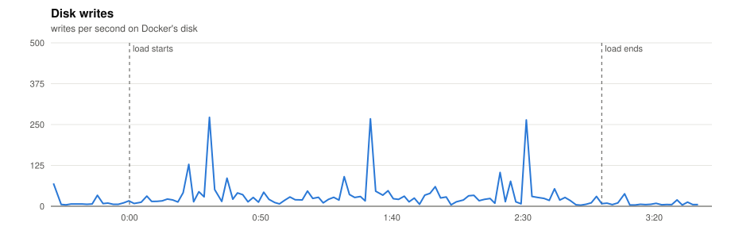

# P1 · Smoke test

> Does every job run once, and on time, when nothing is going on?

**Load:** 10% of the model, 3 min
**Status:** run on 2026-11-10.

## What we test

A tenth of the platform model for 3 minutes on the base deployment, 2 executors: 100 crons every minute, 400 every 5 minutes, and a trickle of one-off tasks. The endpoints have the usual mix, so a few jobs fail on purpose (the flaky and the down endpoints).

It is the first test after calibration: if anything is wrong with the scheduler, the executor or the bench, it shows here, where nothing else gets in the way.

**What to look at:**

- Every job finishes: *succeeded* + *dead* = *created*, and nothing is left pending or running.
- No job runs twice: *duplicate successes* is 0.
- p99 start delay ≤ 1 s for every priority.
- The dead jobs are the ones whose endpoint is down or kept failing after 3 attempts.

## Results

- **Load:** 180 s of the platform model at scale 0.1: 100 minute, 400 five, 1,000 hour, 1,500 day, 100 at tasks; 3,100 tasks seeded.
- **Deployment:** 2 executors; executor-service: `JOB_TIME_LIMIT_SECONDS=1 WORKER_COUNT=10000 JOB_QUEUE_SIZE=10000 PPROF_ADDR=:6060`; scheduler-service: `SCHEDULE_INTERVAL=1s SCHEDULE_LOOKAHEAD=10s PPROF_ADDR=:6060`
- **Raw data:** `bench/results/P1-smoke/runs/20261110T191929Z/` (local, not committed)

### Jobs

| Created | Succeeded | Dead | Still pending or running | Retried | Duplicate successes | Timed out, done anyway | Calls per second (first attempts) |
|---|---|---|---|---|---|---|---|
| 400 | 397 | 3 | 0 | 7 | 0 | 4 | 2.3 |

*Duplicate successes*: the endpoint answered 200 twice for one job, which only a failure should cause. *Timed out, done anyway*: the executor gave up after the timeout while the endpoint finished the work, so the retry made the customer process the job again.

**Start delay** (when the call reached the endpoint minus when the job was due, first attempts):

| Priority | Jobs | p50 | p90 | p99 | max |
|---|---|---|---|---|---|
| 0 | 12 | 0.001 s | 0.017 s | 0.060 s | 0.060 s |
| 1 | 51 | 0.006 s | 0.060 s | 0.072 s | 0.072 s |
| 2 | 244 | 0.008 s | 0.071 s | 0.244 s | 0.717 s |
| 3 | 93 | 0.007 s | 0.062 s | 0.303 s | 0.303 s |
| all | 400 | 0.008 s | 0.071 s | 0.244 s | 0.717 s |

### Charts

Time is minutes:seconds from the start of the load.





















### Resources

| Component | CPU avg (millicores) | CPU max | Throttled max (ms/s) | Memory max (MiB) |
|---|---|---|---|---|
| executor-service 52jf7 | 3 | 92 | 317 | 48 |
| executor-service gq74j | 2 | 81 | 119 | 41 |
| scheduler-service tf7xc | 2 | 19 | 0 | 6 |
| fake-endpoint bcdlv | 1 | 39 | 0 | 12 |
| mysql | 34 | 81 | 0 | 689 |
| cassandra | 93 | 320 | 0 | 810 |
| toxiproxy | 7 | 32 | 0 | 19 |

MySQL: up to 112 commits/s, 90 redo fsyncs/s, 0 row lock waits/s, 16 connections.

### CPU profiles

<details><summary>CPU profile: executor, 20 s from 1:31</summary>

```text
      flat  flat%   sum%        cum   cum%
      10ms   100%   100%       10ms   100%  runtime.stealWork
         0     0%   100%       10ms   100%  runtime.findRunnable
         0     0%   100%       10ms   100%  runtime.mcall
         0     0%   100%       10ms   100%  runtime.park_m
         0     0%   100%       10ms   100%  runtime.schedule
```

</details>

<details><summary>CPU profile: scheduler, 20 s from 1:31</summary>

```text
      flat  flat%   sum%        cum   cum%
      10ms 50.00% 50.00%       10ms 50.00%  internal/runtime/syscall.Syscall6
      10ms 50.00%   100%       10ms 50.00%  runtime.chanrecv
         0     0%   100%       10ms 50.00%  database/sql.(*DB).execDC
         0     0%   100%       10ms 50.00%  database/sql.(*Tx).ExecContext
         0     0%   100%       10ms 50.00%  database/sql.(*Tx).awaitDone
         0     0%   100%       10ms 50.00%  database/sql.(*driverStmt).Close
         0     0%   100%       10ms 50.00%  github.com/JoelTeoGom/distributed-scheduler/scheduler-service/internal/adapters/out/mysql.(*SchedulerRepository).ScheduleJobs
         0     0%   100%       10ms 50.00%  github.com/JoelTeoGom/distributed-scheduler/scheduler-service/internal/service.(*SchedulerService).Start
         0     0%   100%       10ms 50.00%  github.com/go-sql-driver/mysql.(*mysqlConn).writeCommandPacketUint32
         0     0%   100%       10ms 50.00%  github.com/go-sql-driver/mysql.(*mysqlConn).writePacket
         0     0%   100%       10ms 50.00%  github.com/go-sql-driver/mysql.(*mysqlConn).writeWithTimeout
         0     0%   100%       10ms 50.00%  github.com/go-sql-driver/mysql.(*mysqlStmt).Close
```

</details>

Run page: [reports/20261110T191929Z/report.md](reports/20261110T191929Z/report.md)

## Conclusions

**Yes.** With a tenth of the model, every job ran exactly once and on time:

- 400 jobs: 397 succeeded and 3 ended `dead`, the three on the always-down endpoint, as they should. Nothing was left pending, and no job succeeded twice.
- p99 start delay 0.24 s, inside the 1 s objective for every priority. The bursts of 100 jobs on second :00 started within 0.11 s.
- Nothing came close to a limit: each executor peaked under 100 millicores of its 500.
