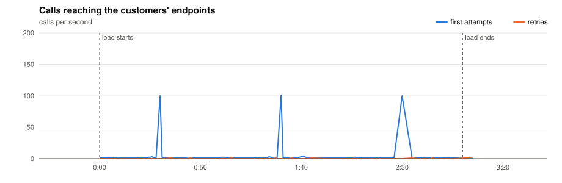
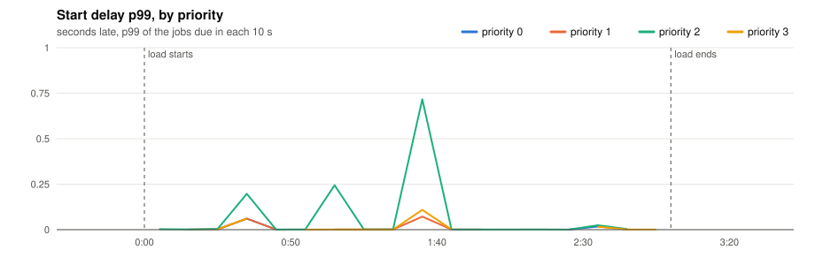
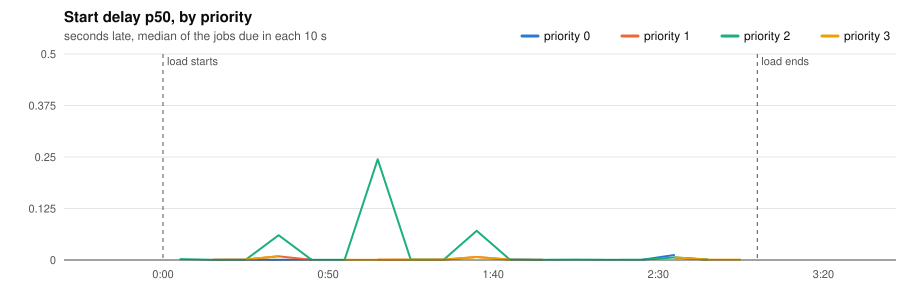
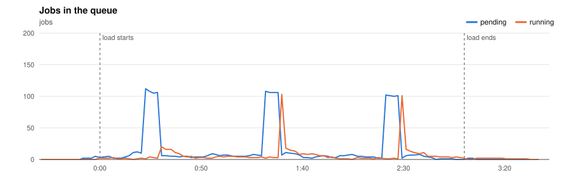
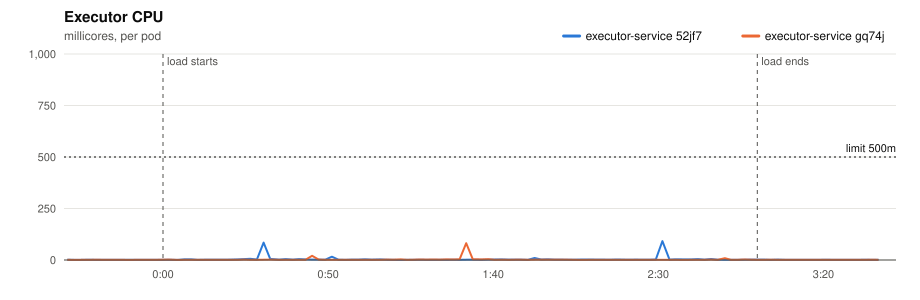
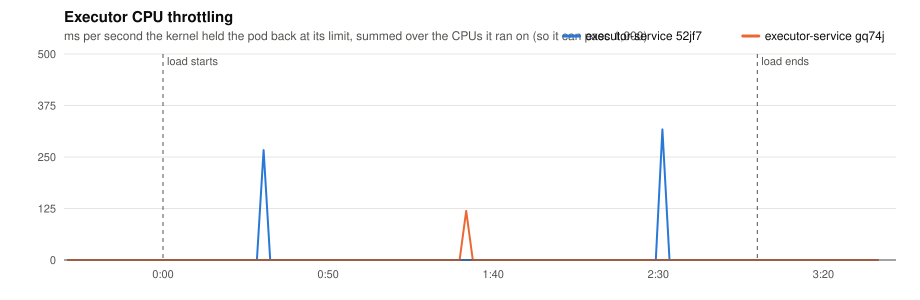
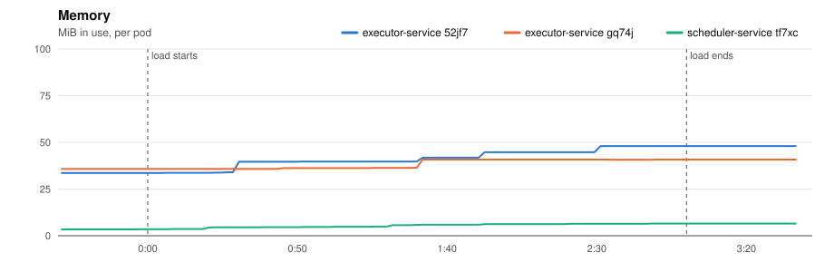
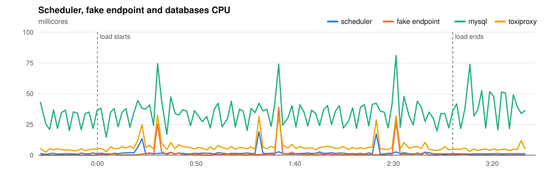
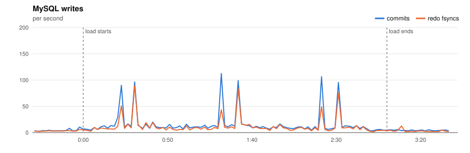
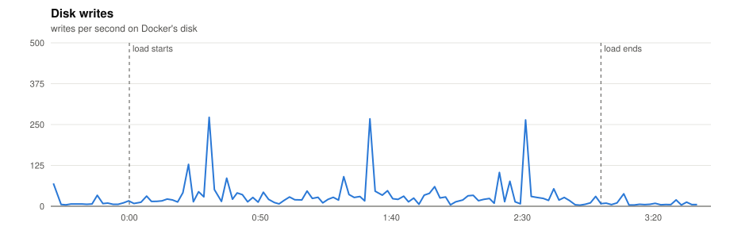

# P1 · 20261110T191929Z

- **Load:** 180 s of the platform model at scale 0.1: 100 minute, 400 five, 1,000 hour, 1,500 day, 100 at tasks; 3,100 tasks seeded.
- **Deployment:** 2 executors; executor-service: `JOB_TIME_LIMIT_SECONDS=1 WORKER_COUNT=10000 JOB_QUEUE_SIZE=10000 PPROF_ADDR=:6060`; scheduler-service: `SCHEDULE_INTERVAL=1s SCHEDULE_LOOKAHEAD=10s PPROF_ADDR=:6060`
- **Raw data:** `bench/results/P1-smoke/runs/20261110T191929Z/` (local, not committed)

## Jobs

| Created | Succeeded | Dead | Still pending or running | Retried | Duplicate successes | Timed out, done anyway | Calls per second (first attempts) |
|---|---|---|---|---|---|---|---|
| 400 | 397 | 3 | 0 | 7 | 0 | 4 | 2.3 |

*Duplicate successes*: the endpoint answered 200 twice for one job, which only a failure should cause. *Timed out, done anyway*: the executor gave up after the timeout while the endpoint finished the work, so the retry made the customer process the job again.

**Start delay** (when the call reached the endpoint minus when the job was due, first attempts):

| Priority | Jobs | p50 | p90 | p99 | max |
|---|---|---|---|---|---|
| 0 | 12 | 0.001 s | 0.017 s | 0.060 s | 0.060 s |
| 1 | 51 | 0.006 s | 0.060 s | 0.072 s | 0.072 s |
| 2 | 244 | 0.008 s | 0.071 s | 0.244 s | 0.717 s |
| 3 | 93 | 0.007 s | 0.062 s | 0.303 s | 0.303 s |
| all | 400 | 0.008 s | 0.071 s | 0.244 s | 0.717 s |

## Charts

Time is minutes:seconds from the start of the load.





















## Resources

| Component | CPU avg (millicores) | CPU max | Throttled max (ms/s) | Memory max (MiB) |
|---|---|---|---|---|
| executor-service 52jf7 | 3 | 92 | 317 | 48 |
| executor-service gq74j | 2 | 81 | 119 | 41 |
| scheduler-service tf7xc | 2 | 19 | 0 | 6 |
| fake-endpoint bcdlv | 1 | 39 | 0 | 12 |
| mysql | 34 | 81 | 0 | 689 |
| cassandra | 93 | 320 | 0 | 810 |
| toxiproxy | 7 | 32 | 0 | 19 |

MySQL: up to 112 commits/s, 90 redo fsyncs/s, 0 row lock waits/s, 16 connections.

## CPU profile: executor, 20 s from 1:31

```text
      flat  flat%   sum%        cum   cum%
      10ms   100%   100%       10ms   100%  runtime.stealWork
         0     0%   100%       10ms   100%  runtime.findRunnable
         0     0%   100%       10ms   100%  runtime.mcall
         0     0%   100%       10ms   100%  runtime.park_m
         0     0%   100%       10ms   100%  runtime.schedule
```

## CPU profile: scheduler, 20 s from 1:31

```text
      flat  flat%   sum%        cum   cum%
      10ms 50.00% 50.00%       10ms 50.00%  internal/runtime/syscall.Syscall6
      10ms 50.00%   100%       10ms 50.00%  runtime.chanrecv
         0     0%   100%       10ms 50.00%  database/sql.(*DB).execDC
         0     0%   100%       10ms 50.00%  database/sql.(*Tx).ExecContext
         0     0%   100%       10ms 50.00%  database/sql.(*Tx).awaitDone
         0     0%   100%       10ms 50.00%  database/sql.(*driverStmt).Close
         0     0%   100%       10ms 50.00%  github.com/JoelTeoGom/distributed-scheduler/scheduler-service/internal/adapters/out/mysql.(*SchedulerRepository).ScheduleJobs
         0     0%   100%       10ms 50.00%  github.com/JoelTeoGom/distributed-scheduler/scheduler-service/internal/service.(*SchedulerService).Start
         0     0%   100%       10ms 50.00%  github.com/go-sql-driver/mysql.(*mysqlConn).writeCommandPacketUint32
         0     0%   100%       10ms 50.00%  github.com/go-sql-driver/mysql.(*mysqlConn).writePacket
         0     0%   100%       10ms 50.00%  github.com/go-sql-driver/mysql.(*mysqlConn).writeWithTimeout
         0     0%   100%       10ms 50.00%  github.com/go-sql-driver/mysql.(*mysqlStmt).Close
```

## Conclusions

*(to be written)*
