# P10 · The ceiling

> With the scheduler fixed, how many jobs per second can 1, 2 and 3 executors run, and how many workers do they need?

**Load:** fast endpoints, 1,000 → 4,000 jobs/s in 30-second steps on 1, 2 and 3 executors, then 250 to 30,000 workers per executor at 1,000 and 400 jobs/s, ~35 min
**Status:** run on 2026-11-19.

## What we test

Round 2, after the scheduler's N+1 was fixed. The resources stay as in round 1: 0.5 vCPU per executor, 2 CPUs for MySQL, and GOMAXPROCS left as round 1 had it (12, see the note in [P0](../P0-calibration/README.md)).

One setting changes: the scheduler ticks every 200 ms instead of every second. Each tick creates at most 1,000 jobs, so at one tick per second the scheduler would cap the test at 1,000 jobs/s by configuration; at 200 ms it can create 5,000.

1. **The ladder.** For 1, 2 and 3 executors, one-off jobs with fast endpoints (~50 ms) for 30 s per step: 1,000, 2,000, 3,000 and 4,000 jobs per second, stopping at the first step that sustains less than 90% of the load or passes 2 s of p99. P2 already covers the rates below 1,000.
2. **The workers.** Two executors with 250, 1,000, 10,000 and 30,000 workers each, at 1,000 jobs per second (beyond what they keep up with) and at 400 (within it). A job holds its worker from the claim, up to a second before it is due, until its result is saved, so each executor needs about its share of the rate × ~1.1 s workers.

Every run deletes its jobs from MySQL when it ends, so each step starts from the same small table.

**What to look at:**

- Sustained against offered jobs per second, per executor count (the capacity chart), and the p99 at each step.
- What saturates first at each knee: executor CPU and throttling, MySQL commits and `fsync`s, the fake endpoint, or the 5 database connections of each executor.
- Whether a third executor still adds throughput, or something shared (MySQL) has become the limit.
- How few workers are too few, and whether 30,000 costs memory or CPU for nothing.

## Results

| Run | Jobs | Succeeded | Dead | Unfinished | Duplicates | Calls/s | Start delay p50 / p90 / p99 / max |
|---|---|---|---|---|---|---|---|
| [1x-1000](reports/20261119T205322Z-1x-1000/report.md) | 30,000 | 30,000 | 0 | 0 | 48 | 330.6 | 4.26 / 55.50 / 63.03 / 64.83 s |
| [2x-1000](reports/20261119T205530Z-2x-1000/report.md) | 30,000 | 30,000 | 0 | 0 | 0 | 874.0 | 0.48 / 2.03 / 2.93 / 6.33 s |
| [3x-1000](reports/20261119T205642Z-3x-1000/report.md) | 30,000 | 30,000 | 0 | 0 | 0 | 1019.4 | 0.18 / 0.47 / 1.23 / 1.25 s |
| [3x-2000](reports/20261119T205737Z-3x-2000/report.md) | 60,000 | 60,000 | 0 | 0 | 313 | 803.4 | 5.55 / 23.94 / 43.54 / 44.12 s |
| [2x-1000-w250](reports/20261119T205934Z-2x-1000-w250/report.md) | 30,000 | 30,000 | 0 | 0 | 0 | 469.9 | 6.13 / 42.45 / 47.57 / 48.45 s |
| [2x-1000-w1000](reports/20261119T210102Z-2x-1000-w1000/report.md) | 30,000 | 30,000 | 0 | 0 | 0 | 902.3 | 0.20 / 6.49 / 11.98 / 12.35 s |
| [2x-1000-w10000](reports/20261119T210202Z-2x-1000-w10000/report.md) | 30,000 | 30,000 | 0 | 0 | 0 | 855.7 | 0.62 / 3.12 / 9.31 / 10.41 s |
| [2x-1000-w30000](reports/20261119T210314Z-2x-1000-w30000/report.md) | 30,000 | 30,000 | 0 | 0 | 0 | 801.0 | 1.04 / 4.73 / 7.73 / 13.31 s |
| [2x-400-w250](reports/20261119T210435Z-2x-400-w250/report.md) | 12,000 | 12,000 | 0 | 0 | 0 | 397.6 | 0.01 / 0.67 / 4.47 / 5.19 s |
| [2x-400-w1000](reports/20261119T210532Z-2x-400-w1000/report.md) | 12,000 | 12,000 | 0 | 0 | 0 | 415.6 | 0.08 / 0.28 / 0.39 / 0.49 s |
| [2x-400-w10000](reports/20261119T210628Z-2x-400-w10000/report.md) | 12,000 | 12,000 | 0 | 0 | 0 | 413.5 | 0.01 / 0.08 / 0.37 / 0.37 s |
| [2x-400-w30000](reports/20261119T210723Z-2x-400-w30000/report.md) | 12,000 | 12,000 | 0 | 0 | 0 | 410.4 | 0.01 / 0.24 / 1.01 / 1.01 s |

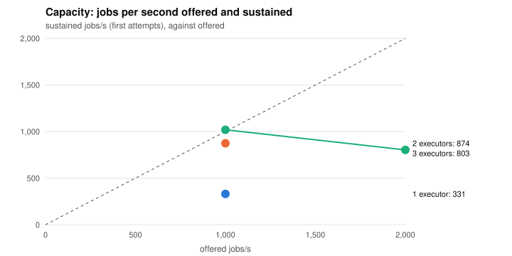

### 1x-1000

- **Load:** 30 s of 1000 one-off jobs per second, endpoint `lat=50&dist=lognormal`, timeout 30 s; 30,000 tasks seeded.
- **Deployment:** 1 executors; executor-service: `JOB_TIME_LIMIT_SECONDS=1 WORKER_COUNT=10000 JOB_QUEUE_SIZE=10000 PPROF_ADDR=:6060`; scheduler-service: `SCHEDULE_INTERVAL=200ms SCHEDULE_LOOKAHEAD=10s PPROF_ADDR=:6060`
- **Raw data:** `bench/results/P10-ceiling/runs/20261119T205322Z-1x-1000/` (local, not committed)

#### Jobs

| Created | Succeeded | Dead | Still pending or running | Retried | Duplicate successes | Timed out, done anyway | Calls per second (first attempts) |
|---|---|---|---|---|---|---|---|
| 30,000 | 30,000 | 0 | 0 | 2,171 | 48 | 0 | 330.6 |

*Duplicate successes*: the endpoint answered 200 twice for one job, which only a failure should cause. *Timed out, done anyway*: the executor gave up after the timeout while the endpoint finished the work, so the retry made the customer process the job again.

**Start delay** (when the call reached the endpoint minus when the job was due, first attempts):

| Priority | Jobs | p50 | p90 | p99 | max |
|---|---|---|---|---|---|
| 0 | 6,453 | 2.868 s | 22.871 s | 30.796 s | 34.795 s |
| 1 | 6,669 | 3.764 s | 43.195 s | 45.603 s | 48.399 s |
| 2 | 7,280 | 42.003 s | 53.401 s | 55.596 s | 57.400 s |
| 3 | 7,475 | 53.457 s | 61.628 s | 63.926 s | 64.828 s |
| all | 27,877 | 4.264 s | 55.501 s | 63.027 s | 64.828 s |

<details><summary>Charts</summary>

Time is minutes:seconds from the start of the load.

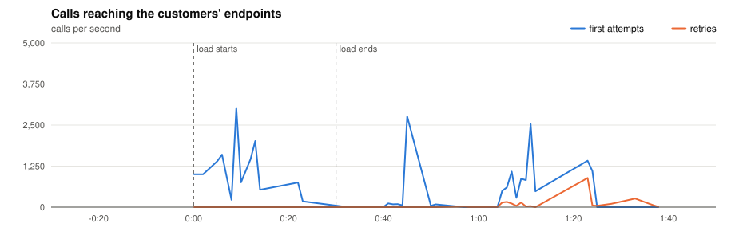

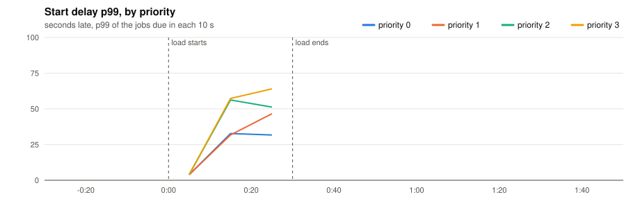

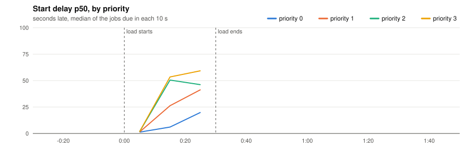

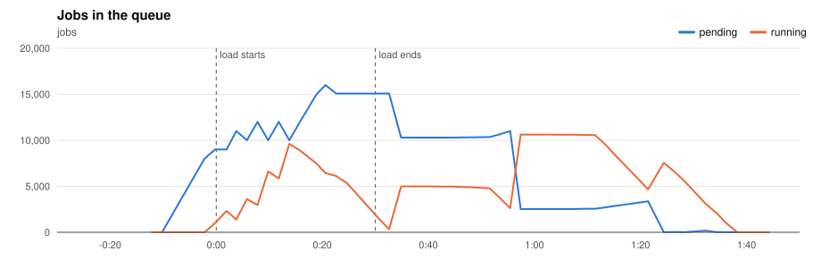

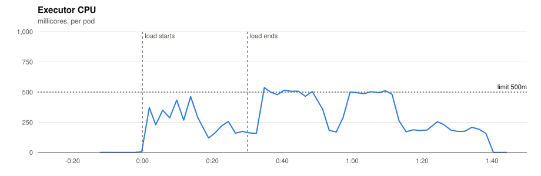

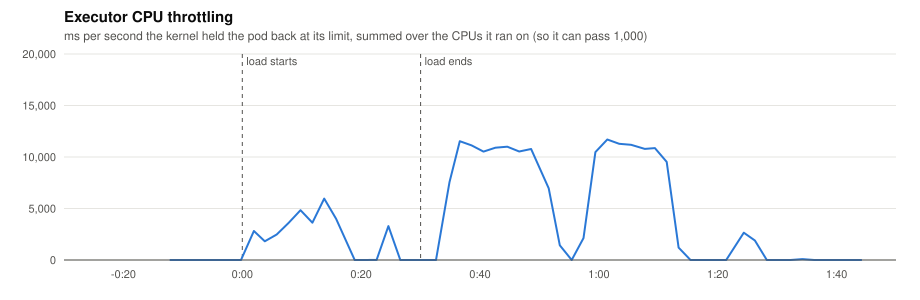

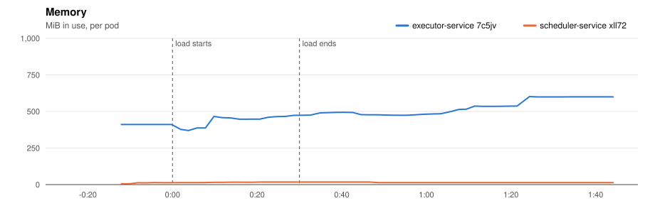

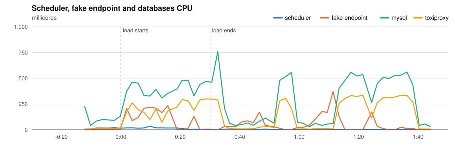

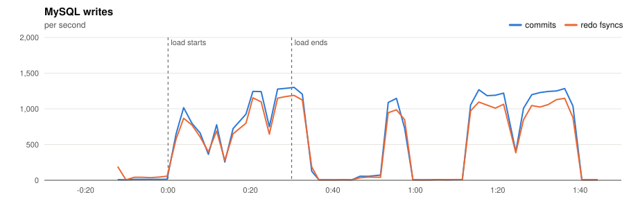

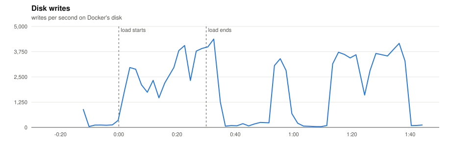

</details>

#### Resources

| Component | CPU avg (millicores) | CPU max | Throttled max (ms/s) | Memory max (MiB) |
|---|---|---|---|---|
| executor-service 7c5jv | 262 | 538 | 11697 | 602 |
| scheduler-service xll72 | 8 | 34 | 0 | 18 |
| fake-endpoint cf55t | 60 | 371 | 0 | 388 |
| mysql | 287 | 760 | 0 | 1264 |
| cassandra | 97 | 307 | 0 | 1078 |
| toxiproxy | 145 | 335 | 0 | 22 |

MySQL: up to 1300 commits/s, 1188 redo fsyncs/s, 2 row lock waits/s, 10 connections.

#### CPU profiles

<details><summary>CPU profile: executor, 20 s from 0:07</summary>

```text
      flat  flat%   sum%        cum   cum%
     1.01s 38.40% 38.40%      1.01s 38.40%  internal/runtime/syscall.Syscall6
     0.28s 10.65% 49.05%      0.28s 10.65%  runtime.futex
     0.05s  1.90% 50.95%      0.05s  1.90%  runtime.memmove
     0.05s  1.90% 52.85%      0.06s  2.28%  runtime.step
     0.04s  1.52% 54.37%      0.05s  1.90%  runtime.findObject
     0.04s  1.52% 55.89%      0.04s  1.52%  runtime.gopark
     0.04s  1.52% 57.41%      0.04s  1.52%  runtime.memclrNoHeapPointers
     0.03s  1.14% 58.56%      0.03s  1.14%  internal/runtime/atomic.(*Uint32).CompareAndSwap
     0.03s  1.14% 59.70%      0.03s  1.14%  runtime.nextFreeFast
     0.02s  0.76% 60.46%      0.12s  4.56%  internal/poll.(*FD).Read
     0.02s  0.76% 61.22%      0.02s  0.76%  internal/runtime/maps.(*Map).Used
     0.02s  0.76% 61.98%      0.04s  1.52%  internal/sync.(*Mutex).Lock
```

</details>

<details><summary>CPU profile: scheduler, 20 s from 0:07</summary>

```text
      flat  flat%   sum%        cum   cum%
      30ms 30.00% 30.00%       30ms 30.00%  runtime.futex
      10ms 10.00% 40.00%       10ms 10.00%  database/sql.NullTime.Value
      10ms 10.00% 50.00%       10ms 10.00%  internal/runtime/atomic.(*Uint32).Add
      10ms 10.00% 60.00%       10ms 10.00%  internal/runtime/syscall.Syscall6
      10ms 10.00% 70.00%       10ms 10.00%  runtime.(*mcache).nextFree
      10ms 10.00% 80.00%       10ms 10.00%  runtime.(*mspan).writeHeapBitsSmall
      10ms 10.00% 90.00%       10ms 10.00%  runtime.(*randomEnum).next
      10ms 10.00%   100%       10ms 10.00%  runtime.lock2
         0     0%   100%       10ms 10.00%  database/sql.(*DB).execDC
         0     0%   100%       10ms 10.00%  database/sql.(*DB).execDC.func2
         0     0%   100%       20ms 20.00%  database/sql.(*DB).queryDC
         0     0%   100%       10ms 10.00%  database/sql.(*Rows).Close
```

</details>

Run page: [reports/20261119T205322Z-1x-1000/report.md](reports/20261119T205322Z-1x-1000/report.md)

### 2x-1000

- **Load:** 30 s of 1000 one-off jobs per second, endpoint `lat=50&dist=lognormal`, timeout 30 s; 30,000 tasks seeded.
- **Deployment:** 2 executors; executor-service: `JOB_TIME_LIMIT_SECONDS=1 WORKER_COUNT=10000 JOB_QUEUE_SIZE=10000 PPROF_ADDR=:6060`; scheduler-service: `SCHEDULE_INTERVAL=200ms SCHEDULE_LOOKAHEAD=10s PPROF_ADDR=:6060`
- **Raw data:** `bench/results/P10-ceiling/runs/20261119T205530Z-2x-1000/` (local, not committed)

#### Jobs

| Created | Succeeded | Dead | Still pending or running | Retried | Duplicate successes | Timed out, done anyway | Calls per second (first attempts) |
|---|---|---|---|---|---|---|---|
| 30,000 | 30,000 | 0 | 0 | 0 | 0 | 0 | 874.0 |

*Duplicate successes*: the endpoint answered 200 twice for one job, which only a failure should cause. *Timed out, done anyway*: the executor gave up after the timeout while the endpoint finished the work, so the retry made the customer process the job again.

**Start delay** (when the call reached the endpoint minus when the job was due, first attempts):

| Priority | Jobs | p50 | p90 | p99 | max |
|---|---|---|---|---|---|
| 0 | 7,500 | 0.392 s | 1.931 s | 2.727 s | 4.423 s |
| 1 | 7,500 | 0.478 s | 2.027 s | 2.929 s | 4.123 s |
| 2 | 7,500 | 0.482 s | 2.029 s | 4.426 s | 6.326 s |
| 3 | 7,500 | 0.483 s | 2.228 s | 2.822 s | 5.921 s |
| all | 30,000 | 0.479 s | 2.027 s | 2.929 s | 6.326 s |

<details><summary>Charts</summary>

Time is minutes:seconds from the start of the load.

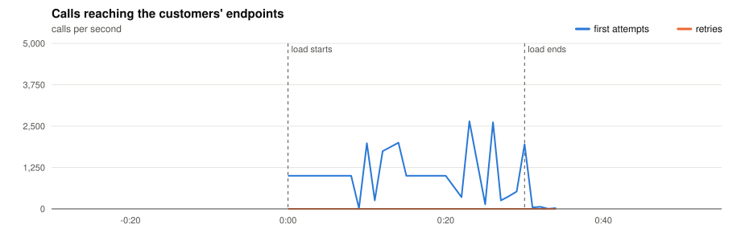

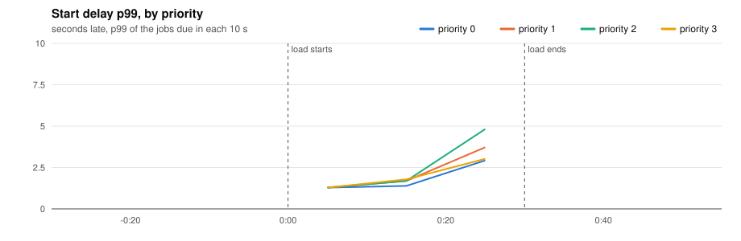

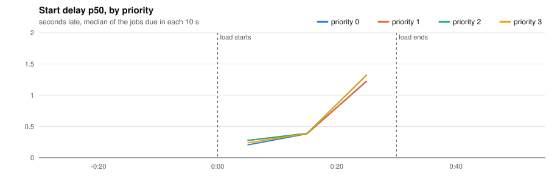

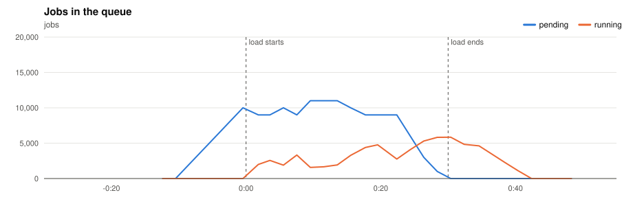

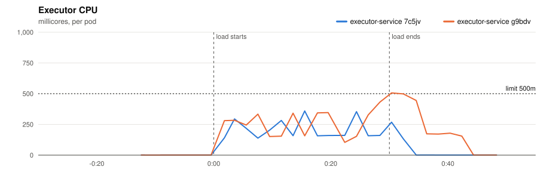

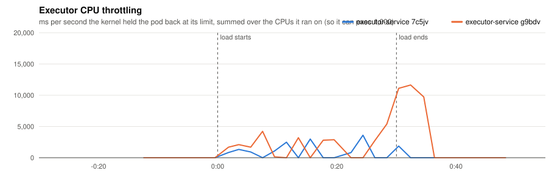

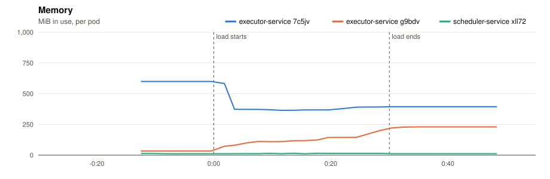

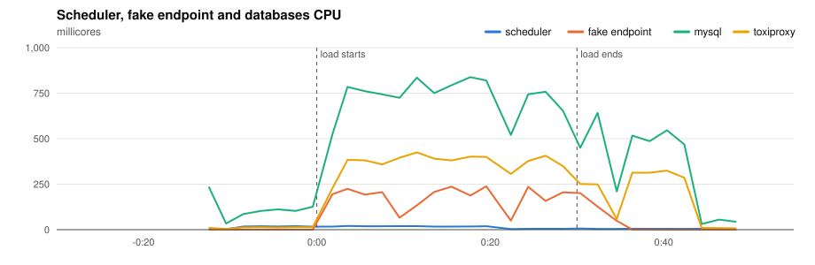

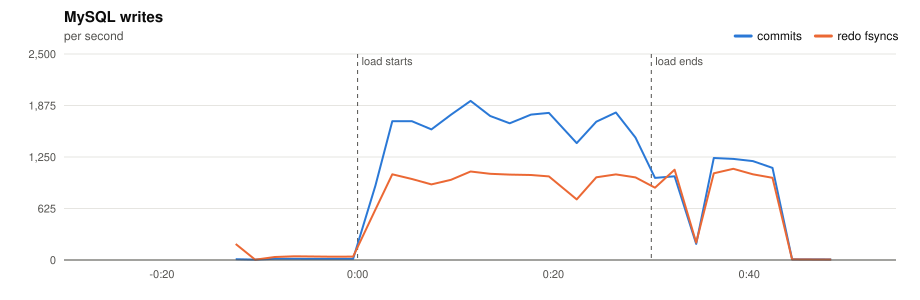

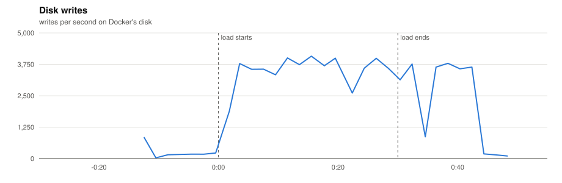

</details>

#### Resources

| Component | CPU avg (millicores) | CPU max | Throttled max (ms/s) | Memory max (MiB) |
|---|---|---|---|---|
| executor-service 7c5jv | 108 | 359 | 3598 | 600 |
| executor-service g9bdv | 187 | 506 | 11643 | 230 |
| scheduler-service xll72 | 11 | 20 | 0 | 16 |
| fake-endpoint cf55t | 94 | 238 | 0 | 388 |
| mysql | 468 | 838 | 0 | 1284 |
| cassandra | 103 | 284 | 0 | 1076 |
| toxiproxy | 228 | 425 | 0 | 23 |

MySQL: up to 1931 commits/s, 1106 redo fsyncs/s, 1 row lock waits/s, 14 connections.

#### CPU profiles

<details><summary>CPU profile: executor, 20 s from 0:08</summary>

```text
      flat  flat%   sum%        cum   cum%
     0.73s 32.59% 32.59%      0.73s 32.59%  internal/runtime/syscall.Syscall6
     0.37s 16.52% 49.11%      0.37s 16.52%  runtime.futex
     0.05s  2.23% 51.34%      0.10s  4.46%  runtime.lock2
     0.04s  1.79% 53.12%      0.04s  1.79%  runtime.memclrNoHeapPointers
     0.04s  1.79% 54.91%      0.04s  1.79%  runtime.memmove
     0.04s  1.79% 56.70%      0.04s  1.79%  runtime.procyield
     0.04s  1.79% 58.48%      0.04s  1.79%  runtime.usleep
     0.03s  1.34% 59.82%      0.26s 11.61%  github.com/go-sql-driver/mysql.(*buffer).fill
     0.03s  1.34% 61.16%      0.04s  1.79%  runtime.gopark
     0.02s  0.89% 62.05%      0.02s  0.89%  net.(*TCPConn).Write
     0.02s  0.89% 62.95%      0.19s  8.48%  net.(*netFD).dial
     0.02s  0.89% 63.84%      0.02s  0.89%  runtime.(*mspan).writeHeapBitsSmall
```

</details>

<details><summary>CPU profile: scheduler, 20 s from 0:08</summary>

```text
      flat  flat%   sum%        cum   cum%
      20ms 28.57% 28.57%       20ms 28.57%  internal/runtime/syscall.Syscall6
      10ms 14.29% 42.86%       10ms 14.29%  runtime.(*mspan).refillAllocCache
      10ms 14.29% 57.14%       10ms 14.29%  runtime.futex
      10ms 14.29% 71.43%       10ms 14.29%  runtime.memmove
      10ms 14.29% 85.71%       10ms 14.29%  runtime.publicationBarrier
      10ms 14.29%   100%       10ms 14.29%  runtime.sellock
         0     0%   100%       20ms 28.57%  database/sql.(*DB).execDC
         0     0%   100%       20ms 28.57%  database/sql.(*DB).queryDC
         0     0%   100%       10ms 14.29%  database/sql.(*Rows).Close
         0     0%   100%       10ms 14.29%  database/sql.(*Rows).Next
         0     0%   100%       10ms 14.29%  database/sql.(*Rows).close
         0     0%   100%       10ms 14.29%  database/sql.(*Rows).close.func1
```

</details>

Run page: [reports/20261119T205530Z-2x-1000/report.md](reports/20261119T205530Z-2x-1000/report.md)

### 3x-1000

- **Load:** 30 s of 1000 one-off jobs per second, endpoint `lat=50&dist=lognormal`, timeout 30 s; 30,000 tasks seeded.
- **Deployment:** 3 executors; executor-service: `JOB_TIME_LIMIT_SECONDS=1 WORKER_COUNT=10000 JOB_QUEUE_SIZE=10000 PPROF_ADDR=:6060`; scheduler-service: `SCHEDULE_INTERVAL=200ms SCHEDULE_LOOKAHEAD=10s PPROF_ADDR=:6060`
- **Raw data:** `bench/results/P10-ceiling/runs/20261119T205642Z-3x-1000/` (local, not committed)

#### Jobs

| Created | Succeeded | Dead | Still pending or running | Retried | Duplicate successes | Timed out, done anyway | Calls per second (first attempts) |
|---|---|---|---|---|---|---|---|
| 30,000 | 30,000 | 0 | 0 | 0 | 0 | 0 | 1019.4 |

*Duplicate successes*: the endpoint answered 200 twice for one job, which only a failure should cause. *Timed out, done anyway*: the executor gave up after the timeout while the endpoint finished the work, so the retry made the customer process the job again.

**Start delay** (when the call reached the endpoint minus when the job was due, first attempts):

| Priority | Jobs | p50 | p90 | p99 | max |
|---|---|---|---|---|---|
| 0 | 7,500 | 0.179 s | 0.476 s | 1.238 s | 1.252 s |
| 1 | 7,500 | 0.175 s | 0.473 s | 1.233 s | 1.252 s |
| 2 | 7,500 | 0.178 s | 0.473 s | 1.233 s | 1.252 s |
| 3 | 7,500 | 0.176 s | 0.472 s | 1.232 s | 1.252 s |
| all | 30,000 | 0.177 s | 0.473 s | 1.233 s | 1.252 s |

<details><summary>Charts</summary>

Time is minutes:seconds from the start of the load.

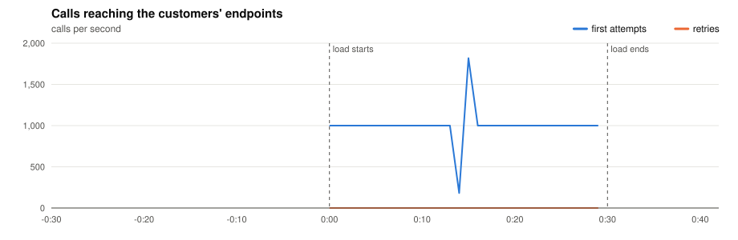

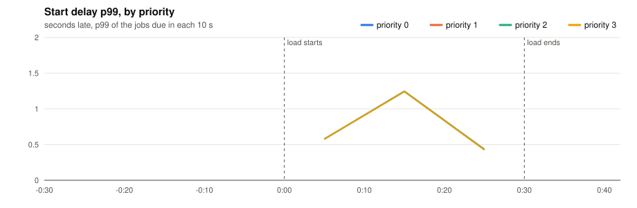

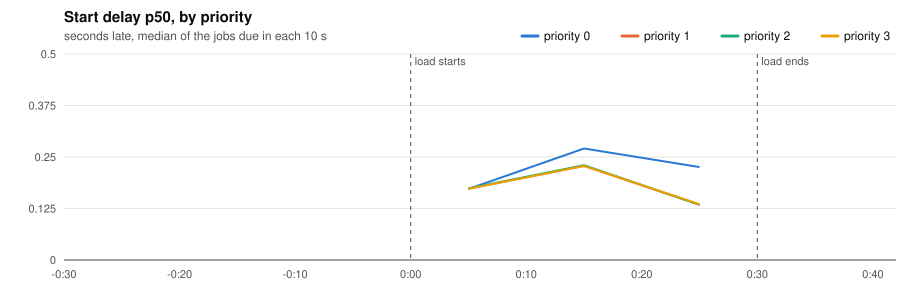

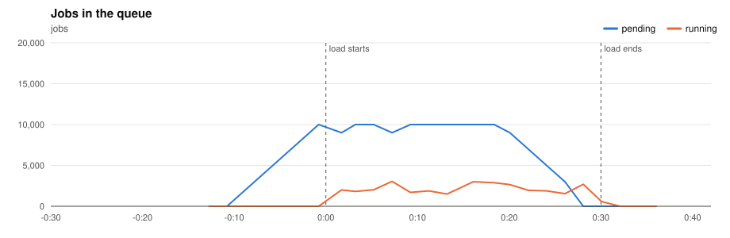

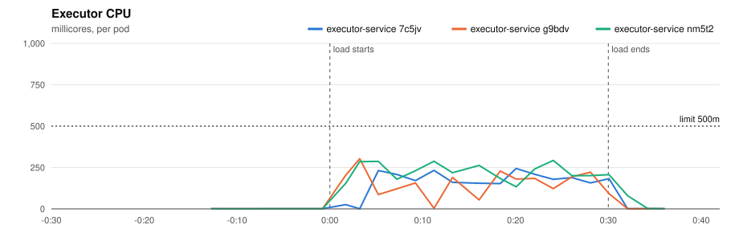

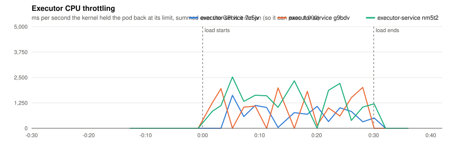

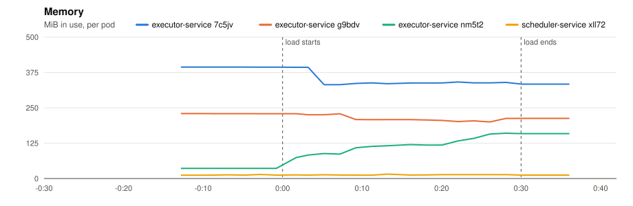

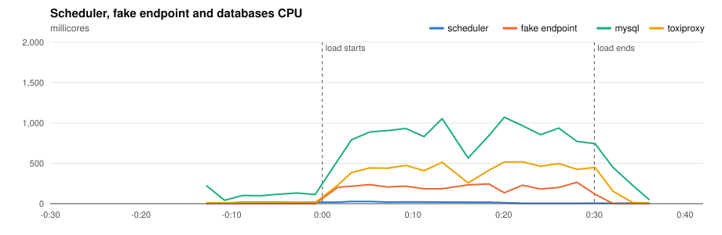

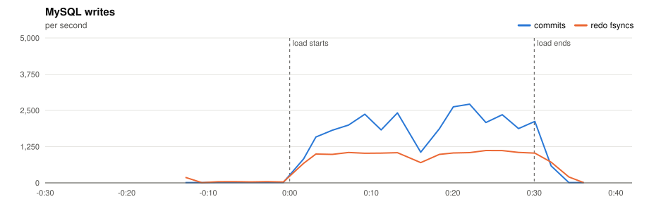

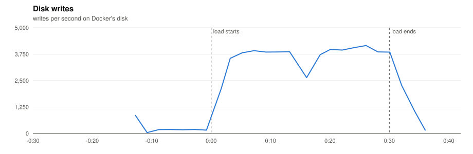

</details>

#### Resources

| Component | CPU avg (millicores) | CPU max | Throttled max (ms/s) | Memory max (MiB) |
|---|---|---|---|---|
| executor-service 7c5jv | 100 | 244 | 1622 | 394 |
| executor-service g9bdv | 94 | 303 | 2011 | 230 |
| executor-service nm5t2 | 138 | 293 | 2523 | 160 |
| scheduler-service xll72 | 14 | 28 | 0 | 16 |
| fake-endpoint cf55t | 122 | 265 | 0 | 334 |
| mysql | 570 | 1071 | 0 | 1304 |
| cassandra | 103 | 317 | 0 | 1065 |
| toxiproxy | 268 | 518 | 0 | 25 |

MySQL: up to 2715 commits/s, 1116 redo fsyncs/s, 1 row lock waits/s, 20 connections.

#### CPU profiles

<details><summary>CPU profile: executor, 20 s from 0:08</summary>

```text
      flat  flat%   sum%        cum   cum%
     690ms 35.20% 35.20%      690ms 35.20%  internal/runtime/syscall.Syscall6
     280ms 14.29% 49.49%      280ms 14.29%  runtime.futex
      50ms  2.55% 52.04%      410ms 20.92%  runtime.schedule
      30ms  1.53% 53.57%       30ms  1.53%  runtime.findObject
      30ms  1.53% 55.10%       30ms  1.53%  runtime.procyield
      30ms  1.53% 56.63%       80ms  4.08%  runtime.scanobject
      30ms  1.53% 58.16%       90ms  4.59%  runtime.selectgo
      30ms  1.53% 59.69%       30ms  1.53%  runtime.stealWork
      20ms  1.02% 60.71%      400ms 20.41%  database/sql.resultFromStatement
      20ms  1.02% 61.73%      460ms 23.47%  github.com/go-sql-driver/mysql.(*mysqlConn).writePacket
      20ms  1.02% 62.76%       20ms  1.02%  runtime.(*mcache).prepareForSweep
      20ms  1.02% 63.78%       40ms  2.04%  runtime.(*unwinder).resolveInternal
```

</details>

<details><summary>CPU profile: scheduler, 20 s from 0:08</summary>

```text
      flat  flat%   sum%        cum   cum%
      40ms 30.77% 30.77%       40ms 30.77%  runtime.futex
      20ms 15.38% 46.15%       20ms 15.38%  internal/runtime/syscall.Syscall6
      20ms 15.38% 61.54%       30ms 23.08%  runtime.scanobject
      10ms  7.69% 69.23%       10ms  7.69%  github.com/go-sql-driver/mysql.converter.ConvertValue
      10ms  7.69% 76.92%       10ms  7.69%  reflect.(*rtype).Bits
      10ms  7.69% 84.62%       10ms  7.69%  runtime.(*mspan).divideByElemSize (inline)
      10ms  7.69% 92.31%       10ms  7.69%  runtime.acquirem
      10ms  7.69%   100%       10ms  7.69%  runtime.sweepone
         0     0%   100%       10ms  7.69%  database/sql.(*DB).execDC
         0     0%   100%       40ms 30.77%  database/sql.(*DB).queryDC
         0     0%   100%       10ms  7.69%  database/sql.(*Rows).Next
         0     0%   100%       10ms  7.69%  database/sql.(*Rows).Next.func1
```

</details>

Run page: [reports/20261119T205642Z-3x-1000/report.md](reports/20261119T205642Z-3x-1000/report.md)

### 3x-2000

- **Load:** 30 s of 2000 one-off jobs per second, endpoint `lat=50&dist=lognormal`, timeout 30 s; 60,000 tasks seeded.
- **Deployment:** 3 executors; executor-service: `JOB_TIME_LIMIT_SECONDS=1 WORKER_COUNT=10000 JOB_QUEUE_SIZE=10000 PPROF_ADDR=:6060`; scheduler-service: `SCHEDULE_INTERVAL=200ms SCHEDULE_LOOKAHEAD=10s PPROF_ADDR=:6060`
- **Raw data:** `bench/results/P10-ceiling/runs/20261119T205737Z-3x-2000/` (local, not committed)

#### Jobs

| Created | Succeeded | Dead | Still pending or running | Retried | Duplicate successes | Timed out, done anyway | Calls per second (first attempts) |
|---|---|---|---|---|---|---|---|
| 60,000 | 60,000 | 0 | 0 | 7,544 | 313 | 0 | 803.4 |

*Duplicate successes*: the endpoint answered 200 twice for one job, which only a failure should cause. *Timed out, done anyway*: the executor gave up after the timeout while the endpoint finished the work, so the retry made the customer process the job again.

**Start delay** (when the call reached the endpoint minus when the job was due, first attempts):

| Priority | Jobs | p50 | p90 | p99 | max |
|---|---|---|---|---|---|
| 0 | 12,346 | 4.144 s | 12.144 s | 17.250 s | 18.254 s |
| 1 | 11,923 | 5.282 s | 16.043 s | 22.846 s | 24.345 s |
| 2 | 13,565 | 9.286 s | 30.303 s | 31.247 s | 31.396 s |
| 3 | 14,935 | 13.646 s | 42.955 s | 43.814 s | 44.125 s |
| all | 52,769 | 5.548 s | 23.938 s | 43.536 s | 44.125 s |

<details><summary>Charts</summary>

Time is minutes:seconds from the start of the load.

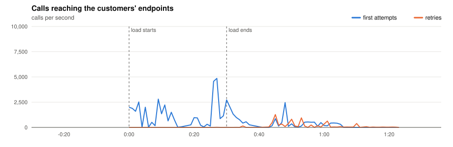

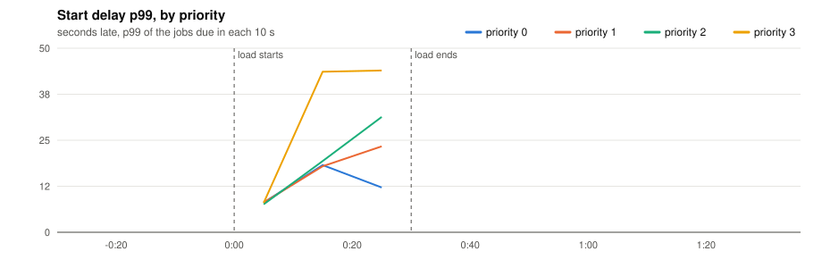

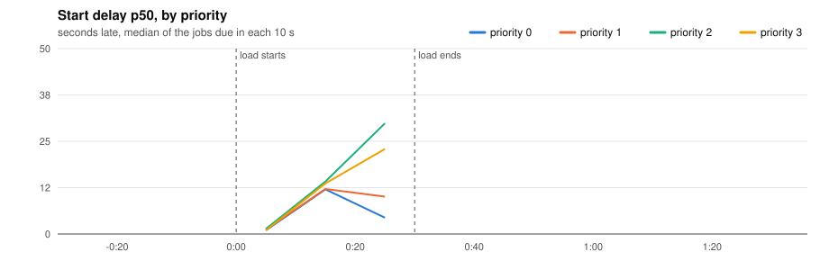

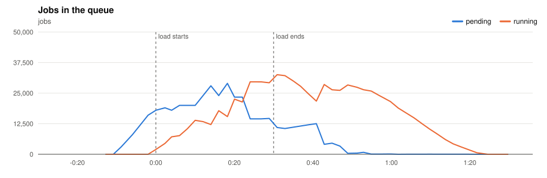

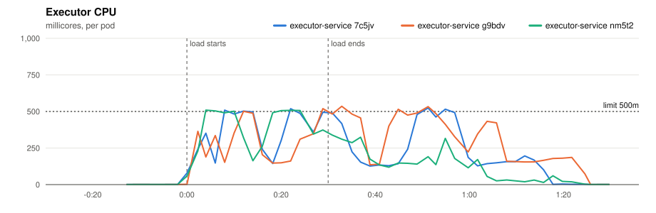

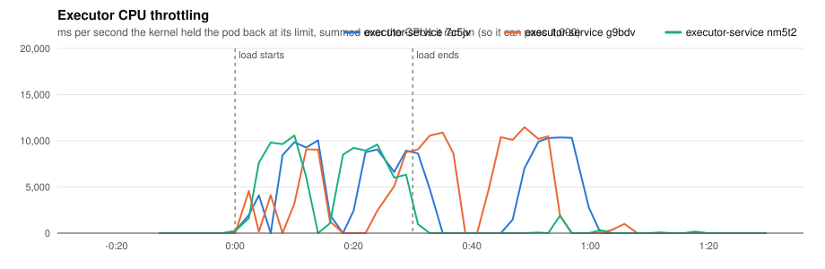

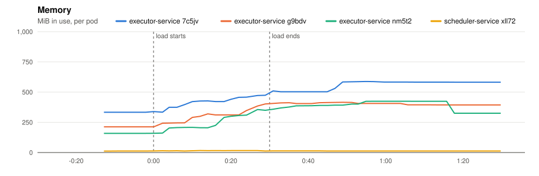

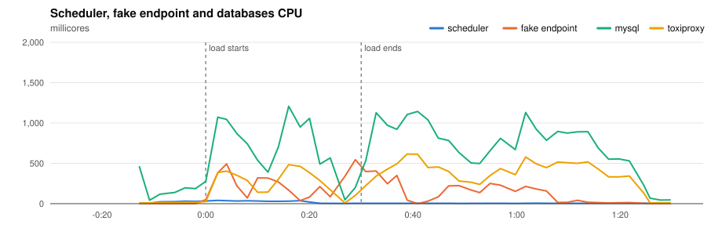

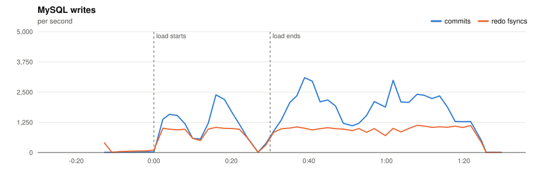

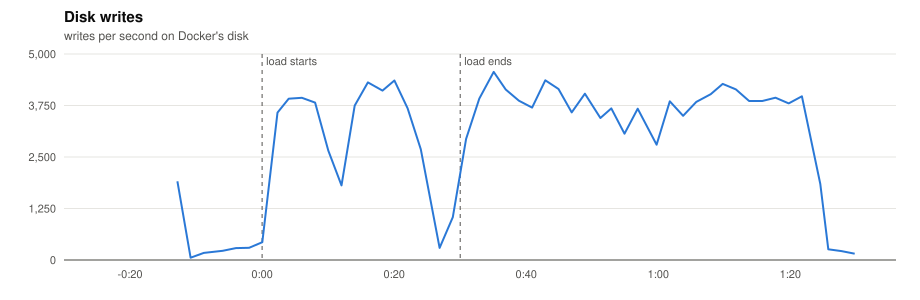

</details>

#### Resources

| Component | CPU avg (millicores) | CPU max | Throttled max (ms/s) | Memory max (MiB) |
|---|---|---|---|---|
| executor-service 7c5jv | 221 | 524 | 10364 | 588 |
| executor-service g9bdv | 254 | 536 | 11474 | 416 |
| executor-service nm5t2 | 183 | 509 | 10573 | 424 |
| scheduler-service xll72 | 12 | 41 | 0 | 16 |
| fake-endpoint cf55t | 142 | 544 | 0 | 461 |
| mysql | 640 | 1207 | 88 | 1365 |
| cassandra | 111 | 398 | 0 | 1068 |
| toxiproxy | 297 | 616 | 0 | 26 |

MySQL: up to 3096 commits/s, 1127 redo fsyncs/s, 6 row lock waits/s, 20 connections.

#### CPU profiles

<details><summary>CPU profile: executor, 20 s from 0:08</summary>

```text
      flat  flat%   sum%        cum   cum%
     3.12s 71.56% 71.56%      3.12s 71.56%  internal/runtime/syscall.Syscall6
     0.14s  3.21% 74.77%      0.14s  3.21%  runtime.futex
     0.04s  0.92% 75.69%      0.05s  1.15%  runtime.findObject
     0.03s  0.69% 76.38%      0.03s  0.69%  runtime.(*gcBits).bitp (inline)
     0.03s  0.69% 77.06%      0.06s  1.38%  runtime.pcvalue
     0.03s  0.69% 77.75%      0.07s  1.61%  runtime.scanblock
     0.03s  0.69% 78.44%      0.03s  0.69%  runtime.stackpoolalloc
     0.03s  0.69% 79.13%      0.41s  9.40%  runtime.systemstack
     0.02s  0.46% 79.59%      0.22s  5.05%  github.com/go-sql-driver/mysql.(*mysqlConn).writePacket
     0.02s  0.46% 80.05%      0.03s  0.69%  runtime.releaseSudog
     0.02s  0.46% 80.50%      0.03s  0.69%  runtime.step
     0.01s  0.23% 80.73%      0.06s  1.38%  internal/poll.(*FD).Read
```

</details>

<details><summary>CPU profile: scheduler, 20 s from 0:08</summary>

```text
      flat  flat%   sum%        cum   cum%
      50ms 45.45% 45.45%       50ms 45.45%  runtime.tgkill
      10ms  9.09% 54.55%       10ms  9.09%  internal/runtime/syscall.Syscall6
      10ms  9.09% 63.64%       10ms  9.09%  runtime.(*mspan).writeHeapBitsSmall
      10ms  9.09% 72.73%       10ms  9.09%  runtime.findfunc
      10ms  9.09% 81.82%       10ms  9.09%  runtime.futex
      10ms  9.09% 90.91%       10ms  9.09%  runtime.procyield
      10ms  9.09%   100%       10ms  9.09%  runtime.typePointers.nextFast
         0     0%   100%       10ms  9.09%  database/sql.(*DB).execDC
         0     0%   100%       10ms  9.09%  database/sql.(*Tx).ExecContext
         0     0%   100%       10ms  9.09%  database/sql.ctxDriverStmtExec
         0     0%   100%       10ms  9.09%  database/sql.resultFromStatement
         0     0%   100%       20ms 18.18%  github.com/JoelTeoGom/distributed-scheduler/scheduler-service/internal/adapters/out/mysql.(*SchedulerRepository).ScheduleJobs
```

</details>

Run page: [reports/20261119T205737Z-3x-2000/report.md](reports/20261119T205737Z-3x-2000/report.md)

### 2x-1000-w250

- **Load:** 30 s of 1000 one-off jobs per second, endpoint `lat=50&dist=lognormal`, timeout 30 s; 30,000 tasks seeded.
- **Deployment:** 2 executors; executor-service: `JOB_TIME_LIMIT_SECONDS=1 WORKER_COUNT=250 JOB_QUEUE_SIZE=10000 PPROF_ADDR=:6060`; scheduler-service: `SCHEDULE_INTERVAL=200ms SCHEDULE_LOOKAHEAD=10s PPROF_ADDR=:6060`
- **Raw data:** `bench/results/P10-ceiling/runs/20261119T205934Z-2x-1000-w250/` (local, not committed)

#### Jobs

| Created | Succeeded | Dead | Still pending or running | Retried | Duplicate successes | Timed out, done anyway | Calls per second (first attempts) |
|---|---|---|---|---|---|---|---|
| 30,000 | 30,000 | 0 | 0 | 0 | 0 | 0 | 469.9 |

*Duplicate successes*: the endpoint answered 200 twice for one job, which only a failure should cause. *Timed out, done anyway*: the executor gave up after the timeout while the endpoint finished the work, so the retry made the customer process the job again.

**Start delay** (when the call reached the endpoint minus when the job was due, first attempts):

| Priority | Jobs | p50 | p90 | p99 | max |
|---|---|---|---|---|---|
| 0 | 7,500 | 0.006 s | 0.062 s | 0.806 s | 0.807 s |
| 1 | 7,500 | 5.941 s | 6.025 s | 6.029 s | 6.126 s |
| 2 | 7,500 | 25.029 s | 31.028 s | 32.803 s | 32.821 s |
| 3 | 7,500 | 40.645 s | 46.647 s | 48.423 s | 48.446 s |
| all | 30,000 | 6.126 s | 42.448 s | 47.569 s | 48.446 s |

<details><summary>Charts</summary>

Time is minutes:seconds from the start of the load.

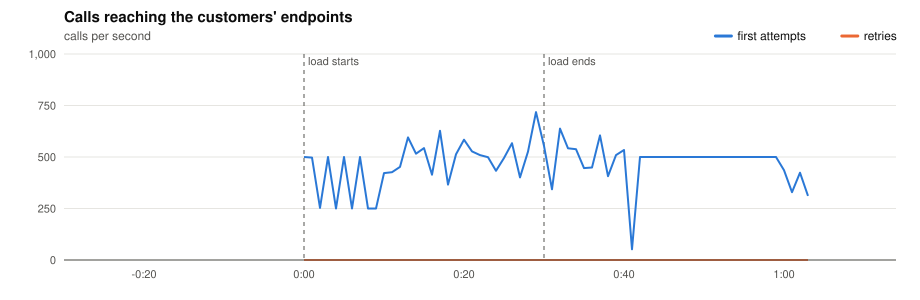

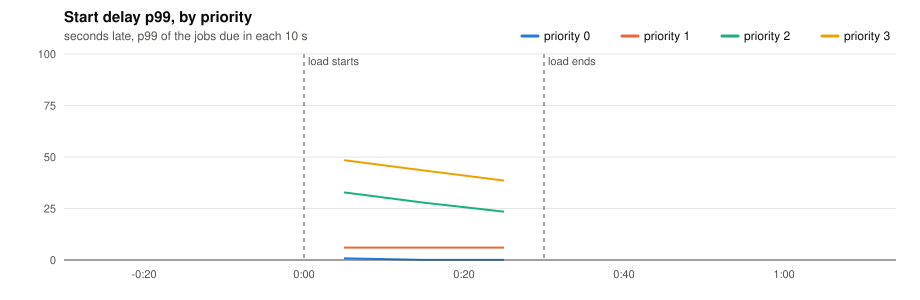

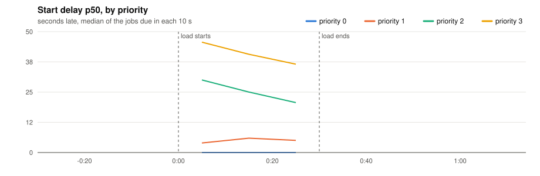

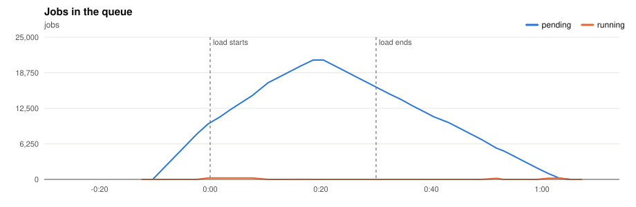

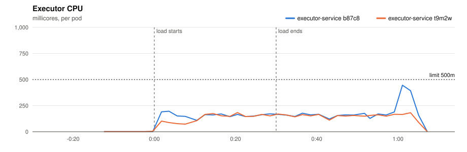

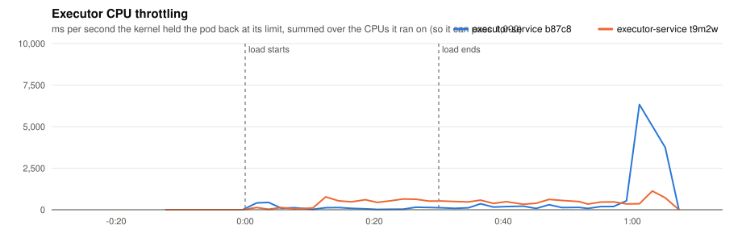

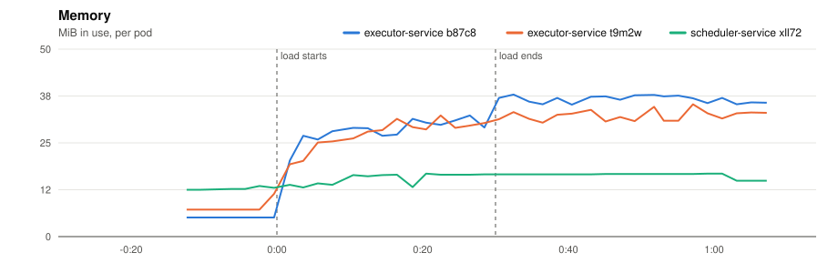

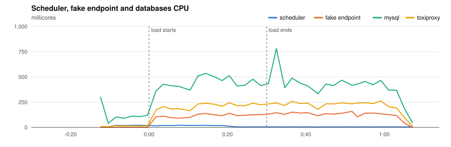

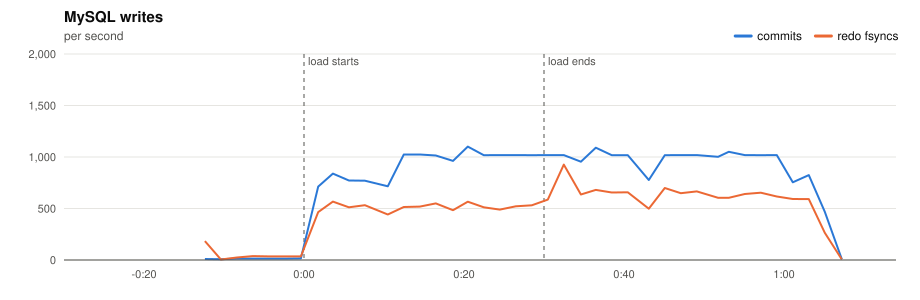


</details>

#### Resources

| Component | CPU avg (millicores) | CPU max | Throttled max (ms/s) | Memory max (MiB) |
|---|---|---|---|---|
| executor-service b87c8 | 141 | 446 | 6330 | 38 |
| executor-service t9m2w | 116 | 184 | 1125 | 35 |
| scheduler-service xll72 | 10 | 21 | 0 | 17 |
| fake-endpoint cf55t | 100 | 159 | 0 | 476 |
| mysql | 371 | 781 | 0 | 1396 |
| cassandra | 111 | 366 | 0 | 1074 |
| toxiproxy | 177 | 262 | 0 | 22 |

MySQL: up to 1101 commits/s, 926 redo fsyncs/s, 0 row lock waits/s, 14 connections.

#### CPU profiles

<details><summary>CPU profile: executor, 20 s from 0:07</summary>

```text
      flat  flat%   sum%        cum   cum%
     1.16s 53.21% 53.21%      1.16s 53.21%  internal/runtime/syscall.Syscall6
     0.22s 10.09% 63.30%      0.22s 10.09%  runtime.futex
     0.04s  1.83% 65.14%      0.04s  1.83%  runtime.nextFreeFast
     0.03s  1.38% 66.51%      0.14s  6.42%  runtime.selectgo
     0.02s  0.92% 67.43%      0.08s  3.67%  internal/poll.(*FD).Read
     0.02s  0.92% 68.35%      0.04s  1.83%  runtime.(*mcache).refill
     0.02s  0.92% 69.27%      0.02s  0.92%  runtime.(*mspan).base
     0.02s  0.92% 70.18%      0.02s  0.92%  runtime.mutexSampleContention (inline)
     0.02s  0.92% 71.10%      0.05s  2.29%  runtime.stealWork
     0.02s  0.92% 72.02%      0.02s  0.92%  runtime.usleep
     0.01s  0.46% 72.48%      0.02s  0.92%  context.(*cancelCtx).Done
     0.01s  0.46% 72.94%      0.09s  4.13%  github.com/go-sql-driver/mysql.(*buffer).fill
```

</details>

<details><summary>CPU profile: scheduler, 20 s from 0:07</summary>

```text
      flat  flat%   sum%        cum   cum%
      20ms 33.33% 33.33%       20ms 33.33%  internal/runtime/syscall.Syscall6
      10ms 16.67% 50.00%       10ms 16.67%  context.WithCancel.func1
      10ms 16.67% 66.67%       10ms 16.67%  internal/poll.(*FD).readUnlock
      10ms 16.67% 83.33%       10ms 16.67%  runtime.futex
      10ms 16.67%   100%       10ms 16.67%  runtime.nextFreeFast (inline)
         0     0%   100%       10ms 16.67%  database/sql.(*DB).queryDC
         0     0%   100%       20ms 33.33%  database/sql.(*Rows).Close
         0     0%   100%       20ms 33.33%  database/sql.(*Rows).Next
         0     0%   100%       20ms 33.33%  database/sql.(*Rows).close
         0     0%   100%       10ms 16.67%  database/sql.(*Tx).QueryContext
         0     0%   100%       20ms 33.33%  database/sql.(*Tx).Rollback
         0     0%   100%       20ms 33.33%  database/sql.(*Tx).rollback
```

</details>

Run page: [reports/20261119T205934Z-2x-1000-w250/report.md](reports/20261119T205934Z-2x-1000-w250/report.md)

### 2x-1000-w1000

- **Load:** 30 s of 1000 one-off jobs per second, endpoint `lat=50&dist=lognormal`, timeout 30 s; 30,000 tasks seeded.
- **Deployment:** 2 executors; executor-service: `JOB_TIME_LIMIT_SECONDS=1 WORKER_COUNT=1000 JOB_QUEUE_SIZE=10000 PPROF_ADDR=:6060`; scheduler-service: `SCHEDULE_INTERVAL=200ms SCHEDULE_LOOKAHEAD=10s PPROF_ADDR=:6060`
- **Raw data:** `bench/results/P10-ceiling/runs/20261119T210102Z-2x-1000-w1000/` (local, not committed)

#### Jobs

| Created | Succeeded | Dead | Still pending or running | Retried | Duplicate successes | Timed out, done anyway | Calls per second (first attempts) |
|---|---|---|---|---|---|---|---|
| 30,000 | 30,000 | 0 | 0 | 0 | 0 | 0 | 902.3 |

*Duplicate successes*: the endpoint answered 200 twice for one job, which only a failure should cause. *Timed out, done anyway*: the executor gave up after the timeout while the endpoint finished the work, so the retry made the customer process the job again.

**Start delay** (when the call reached the endpoint minus when the job was due, first attempts):

| Priority | Jobs | p50 | p90 | p99 | max |
|---|---|---|---|---|---|
| 0 | 7,500 | 0.052 s | 0.302 s | 0.766 s | 0.847 s |
| 1 | 7,500 | 0.092 s | 0.373 s | 0.766 s | 0.976 s |
| 2 | 7,500 | 0.332 s | 1.393 s | 1.951 s | 1.957 s |
| 3 | 7,500 | 5.650 s | 11.152 s | 12.347 s | 12.351 s |
| all | 30,000 | 0.200 s | 6.493 s | 11.981 s | 12.351 s |

<details><summary>Charts</summary>

Time is minutes:seconds from the start of the load.


</details>

#### Resources

| Component | CPU avg (millicores) | CPU max | Throttled max (ms/s) | Memory max (MiB) |
|---|---|---|---|---|
| executor-service m4mg4 | 159 | 464 | 7204 | 74 |
| executor-service sddt8 | 168 | 330 | 2873 | 76 |
| scheduler-service xll72 | 13 | 22 | 0 | 17 |
| fake-endpoint cf55t | 119 | 245 | 0 | 292 |
| mysql | 498 | 821 | 0 | 1408 |
| cassandra | 101 | 272 | 0 | 1060 |
| toxiproxy | 246 | 430 | 0 | 23 |

MySQL: up to 2044 commits/s, 1074 redo fsyncs/s, 0 row lock waits/s, 14 connections.

#### CPU profiles

<details><summary>CPU profile: executor, 20 s from 0:08</summary>

```text
      flat  flat%   sum%        cum   cum%
        1s 37.31% 37.31%         1s 37.31%  internal/runtime/syscall.Syscall6
     0.34s 12.69% 50.00%      0.34s 12.69%  runtime.futex
     0.06s  2.24% 52.24%      0.17s  6.34%  runtime.selectgo
     0.04s  1.49% 53.73%      0.04s  1.49%  runtime.findObject
     0.04s  1.49% 55.22%      0.04s  1.49%  runtime.nextFreeFast
     0.04s  1.49% 56.72%      0.09s  3.36%  runtime.stealWork
     0.03s  1.12% 57.84%      0.03s  1.12%  internal/runtime/atomic.(*Uint32).CompareAndSwap
     0.03s  1.12% 58.96%      0.03s  1.12%  runtime.procyield
     0.02s  0.75% 59.70%      0.02s  0.75%  database/sql.(*driverConn).expired
     0.02s  0.75% 60.45%      0.32s 11.94%  github.com/go-sql-driver/mysql.(*mysqlStmt).Close
     0.02s  0.75% 61.19%      0.02s  0.75%  github.com/go-sql-driver/mysql.converter.ConvertValue
     0.02s  0.75% 61.94%      0.02s  0.75%  runtime.(*mspan).writeHeapBitsSmall
```

</details>

<details><summary>CPU profile: scheduler, 20 s from 0:08</summary>

```text
      flat  flat%   sum%        cum   cum%
      40ms 30.77% 30.77%       40ms 30.77%  internal/runtime/syscall.Syscall6
      20ms 15.38% 46.15%       20ms 15.38%  runtime.futex
      10ms  7.69% 53.85%       10ms  7.69%  github.com/go-sql-driver/mysql.(*mysqlConn).readColumns
      10ms  7.69% 61.54%       20ms 15.38%  github.com/go-sql-driver/mysql.(*mysqlStmt).writeExecutePacket
      10ms  7.69% 69.23%       10ms  7.69%  internal/runtime/maps.(*Iter).Next
      10ms  7.69% 76.92%       20ms 15.38%  runtime.futexsleep
      10ms  7.69% 84.62%       10ms  7.69%  runtime.lock2
      10ms  7.69% 92.31%       10ms  7.69%  runtime.memclrNoHeapPointers
      10ms  7.69%   100%       10ms  7.69%  runtime.memmove
         0     0%   100%       10ms  7.69%  context.(*cancelCtx).cancel
         0     0%   100%       10ms  7.69%  context.WithCancel.func1
         0     0%   100%       40ms 30.77%  database/sql.(*DB).execDC
```

</details>

Run page: [reports/20261119T210102Z-2x-1000-w1000/report.md](reports/20261119T210102Z-2x-1000-w1000/report.md)

### 2x-1000-w10000

- **Load:** 30 s of 1000 one-off jobs per second, endpoint `lat=50&dist=lognormal`, timeout 30 s; 30,000 tasks seeded.
- **Deployment:** 2 executors; executor-service: `JOB_TIME_LIMIT_SECONDS=1 WORKER_COUNT=10000 JOB_QUEUE_SIZE=10000 PPROF_ADDR=:6060`; scheduler-service: `SCHEDULE_INTERVAL=200ms SCHEDULE_LOOKAHEAD=10s PPROF_ADDR=:6060`
- **Raw data:** `bench/results/P10-ceiling/runs/20261119T210202Z-2x-1000-w10000/` (local, not committed)

#### Jobs

| Created | Succeeded | Dead | Still pending or running | Retried | Duplicate successes | Timed out, done anyway | Calls per second (first attempts) |
|---|---|---|---|---|---|---|---|
| 30,000 | 30,000 | 0 | 0 | 726 | 0 | 0 | 855.7 |

*Duplicate successes*: the endpoint answered 200 twice for one job, which only a failure should cause. *Timed out, done anyway*: the executor gave up after the timeout while the endpoint finished the work, so the retry made the customer process the job again.

**Start delay** (when the call reached the endpoint minus when the job was due, first attempts):

| Priority | Jobs | p50 | p90 | p99 | max |
|---|---|---|---|---|---|
| 0 | 7,269 | 0.614 s | 2.915 s | 8.822 s | 10.315 s |
| 1 | 7,292 | 0.620 s | 2.927 s | 9.116 s | 10.221 s |
| 2 | 7,319 | 0.618 s | 3.223 s | 9.314 s | 10.221 s |
| 3 | 7,394 | 0.617 s | 3.318 s | 9.330 s | 10.415 s |
| all | 29,274 | 0.616 s | 3.121 s | 9.314 s | 10.415 s |

<details><summary>Charts</summary>

Time is minutes:seconds from the start of the load.


</details>

#### Resources

| Component | CPU avg (millicores) | CPU max | Throttled max (ms/s) | Memory max (MiB) |
|---|---|---|---|---|
| executor-service hff8c | 209 | 528 | 9960 | 270 |
| executor-service q82h8 | 144 | 410 | 4602 | 174 |
| scheduler-service xll72 | 11 | 27 | 0 | 16 |
| fake-endpoint cf55t | 119 | 552 | 0 | 326 |
| mysql | 450 | 875 | 0 | 1426 |
| cassandra | 101 | 284 | 0 | 1074 |
| toxiproxy | 224 | 428 | 0 | 22 |

MySQL: up to 2054 commits/s, 1122 redo fsyncs/s, 2 row lock waits/s, 14 connections.

#### CPU profiles

<details><summary>CPU profile: executor, 20 s from 0:08</summary>

```text
      flat  flat%   sum%        cum   cum%
     1.46s 52.33% 52.33%      1.46s 52.33%  internal/runtime/syscall.Syscall6
     0.39s 13.98% 66.31%      0.39s 13.98%  runtime.futex
     0.04s  1.43% 67.74%      0.04s  1.43%  runtime.procyield
     0.04s  1.43% 69.18%      0.14s  5.02%  runtime.selectgo
     0.03s  1.08% 70.25%      0.08s  2.87%  context.value
     0.03s  1.08% 71.33%      0.32s 11.47%  runtime.findRunnable
     0.03s  1.08% 72.40%      0.03s  1.08%  runtime.memclrNoHeapPointers
     0.02s  0.72% 73.12%      0.30s 10.75%  database/sql.resultFromStatement
     0.02s  0.72% 73.84%      0.97s 34.77%  net.(*Dialer).DialContext
     0.02s  0.72% 74.55%      0.03s  1.08%  runtime.(*mcache).prepareForSweep
     0.02s  0.72% 75.27%      0.04s  1.43%  runtime.execute
     0.02s  0.72% 75.99%      0.08s  2.87%  runtime.lock2
```

</details>

<details><summary>CPU profile: scheduler, 20 s from 0:08</summary>

```text
      flat  flat%   sum%        cum   cum%
      30ms 33.33% 33.33%       30ms 33.33%  internal/runtime/syscall.Syscall6
      10ms 11.11% 44.44%       10ms 11.11%  runtime.casgstatus
      10ms 11.11% 55.56%       10ms 11.11%  runtime.futex
      10ms 11.11% 66.67%       10ms 11.11%  runtime.memmove
      10ms 11.11% 77.78%       10ms 11.11%  runtime.scanobject
      10ms 11.11% 88.89%       10ms 11.11%  runtime.sellock
      10ms 11.11%   100%       10ms 11.11%  runtime.unlock2
         0     0%   100%       20ms 22.22%  database/sql.(*DB).queryDC
         0     0%   100%       10ms 11.11%  database/sql.(*Rows).Close
         0     0%   100%       10ms 11.11%  database/sql.(*Rows).Next
         0     0%   100%       10ms 11.11%  database/sql.(*Rows).awaitDone
         0     0%   100%       10ms 11.11%  database/sql.(*Rows).close
```

</details>

Run page: [reports/20261119T210202Z-2x-1000-w10000/report.md](reports/20261119T210202Z-2x-1000-w10000/report.md)

### 2x-1000-w30000

- **Load:** 30 s of 1000 one-off jobs per second, endpoint `lat=50&dist=lognormal`, timeout 30 s; 30,000 tasks seeded.
- **Deployment:** 2 executors; executor-service: `JOB_TIME_LIMIT_SECONDS=1 WORKER_COUNT=30000 JOB_QUEUE_SIZE=10000 PPROF_ADDR=:6060`; scheduler-service: `SCHEDULE_INTERVAL=200ms SCHEDULE_LOOKAHEAD=10s PPROF_ADDR=:6060`
- **Raw data:** `bench/results/P10-ceiling/runs/20261119T210314Z-2x-1000-w30000/` (local, not committed)

#### Jobs

| Created | Succeeded | Dead | Still pending or running | Retried | Duplicate successes | Timed out, done anyway | Calls per second (first attempts) |
|---|---|---|---|---|---|---|---|
| 30,000 | 30,000 | 0 | 0 | 146 | 0 | 0 | 801.0 |

*Duplicate successes*: the endpoint answered 200 twice for one job, which only a failure should cause. *Timed out, done anyway*: the executor gave up after the timeout while the endpoint finished the work, so the retry made the customer process the job again.

**Start delay** (when the call reached the endpoint minus when the job was due, first attempts):

| Priority | Jobs | p50 | p90 | p99 | max |
|---|---|---|---|---|---|
| 0 | 7,446 | 1.036 s | 3.933 s | 9.538 s | 13.312 s |
| 1 | 7,449 | 1.036 s | 4.726 s | 7.236 s | 13.310 s |
| 2 | 7,474 | 1.036 s | 4.933 s | 7.133 s | 8.832 s |
| 3 | 7,485 | 1.127 s | 5.027 s | 8.032 s | 9.635 s |
| all | 29,854 | 1.036 s | 4.731 s | 7.726 s | 13.312 s |

<details><summary>Charts</summary>

Time is minutes:seconds from the start of the load.


</details>

#### Resources

| Component | CPU avg (millicores) | CPU max | Throttled max (ms/s) | Memory max (MiB) |
|---|---|---|---|---|
| executor-service jglpd | 113 | 399 | 3788 | 282 |
| executor-service rvh2r | 195 | 588 | 10865 | 364 |
| scheduler-service xll72 | 11 | 22 | 0 | 18 |
| fake-endpoint cf55t | 123 | 1081 | 0 | 378 |
| mysql | 429 | 904 | 0 | 1462 |
| cassandra | 93 | 283 | 0 | 1061 |
| toxiproxy | 211 | 478 | 0 | 22 |

MySQL: up to 2264 commits/s, 1158 redo fsyncs/s, 2 row lock waits/s, 14 connections.

#### CPU profiles

<details><summary>CPU profile: executor, 20 s from 0:08</summary>

```text
      flat  flat%   sum%        cum   cum%
     0.78s 38.05% 38.05%      0.78s 38.05%  internal/runtime/syscall.Syscall6
     0.39s 19.02% 57.07%      0.39s 19.02%  runtime.futex
     0.05s  2.44% 59.51%      0.05s  2.44%  internal/runtime/atomic.(*Uint32).CompareAndSwap (inline)
     0.04s  1.95% 61.46%      0.05s  2.44%  runtime.findObject
     0.03s  1.46% 62.93%      0.05s  2.44%  runtime.(*unwinder).resolveInternal
     0.03s  1.46% 64.39%      0.03s  1.46%  runtime.gopark
     0.03s  1.46% 65.85%      0.20s  9.76%  runtime.selectgo
     0.03s  1.46% 67.32%      0.03s  1.46%  runtime.write1
     0.02s  0.98% 68.29%      0.22s 10.73%  github.com/go-sql-driver/mysql.(*buffer).fill
     0.02s  0.98% 69.27%      0.28s 13.66%  runtime.findRunnable
     0.02s  0.98% 70.24%      0.02s  0.98%  runtime.funcdata
     0.02s  0.98% 71.22%      0.02s  0.98%  runtime.procyield
```

</details>

<details><summary>CPU profile: scheduler, 20 s from 0:08</summary>

```text
      flat  flat%   sum%        cum   cum%
      10ms 33.33% 33.33%       10ms 33.33%  internal/runtime/syscall.Syscall6
      10ms 33.33% 66.67%       10ms 33.33%  runtime.madvise
      10ms 33.33%   100%       10ms 33.33%  runtime.stealWork
         0     0%   100%       10ms 33.33%  database/sql.(*Rows).Close
         0     0%   100%       10ms 33.33%  database/sql.(*Rows).Next
         0     0%   100%       10ms 33.33%  database/sql.(*Rows).close
         0     0%   100%       10ms 33.33%  database/sql.(*driverStmt).Close
         0     0%   100%       10ms 33.33%  github.com/JoelTeoGom/distributed-scheduler/scheduler-service/internal/adapters/out/mysql.(*SchedulerRepository).ScheduleJobs
         0     0%   100%       10ms 33.33%  github.com/JoelTeoGom/distributed-scheduler/scheduler-service/internal/adapters/out/mysql.selectScheduledTasks
         0     0%   100%       10ms 33.33%  github.com/JoelTeoGom/distributed-scheduler/scheduler-service/internal/service.(*SchedulerService).Start
         0     0%   100%       10ms 33.33%  github.com/go-sql-driver/mysql.(*mysqlConn).writeCommandPacketUint32
         0     0%   100%       10ms 33.33%  github.com/go-sql-driver/mysql.(*mysqlConn).writePacket
```

</details>

Run page: [reports/20261119T210314Z-2x-1000-w30000/report.md](reports/20261119T210314Z-2x-1000-w30000/report.md)

### 2x-400-w250

- **Load:** 30 s of 400 one-off jobs per second, endpoint `lat=50&dist=lognormal`, timeout 30 s; 12,000 tasks seeded.
- **Deployment:** 2 executors; executor-service: `JOB_TIME_LIMIT_SECONDS=1 WORKER_COUNT=250 JOB_QUEUE_SIZE=10000 PPROF_ADDR=:6060`; scheduler-service: `SCHEDULE_INTERVAL=200ms SCHEDULE_LOOKAHEAD=10s PPROF_ADDR=:6060`
- **Raw data:** `bench/results/P10-ceiling/runs/20261119T210435Z-2x-400-w250/` (local, not committed)

#### Jobs

| Created | Succeeded | Dead | Still pending or running | Retried | Duplicate successes | Timed out, done anyway | Calls per second (first attempts) |
|---|---|---|---|---|---|---|---|
| 12,000 | 12,000 | 0 | 0 | 0 | 0 | 0 | 397.6 |

*Duplicate successes*: the endpoint answered 200 twice for one job, which only a failure should cause. *Timed out, done anyway*: the executor gave up after the timeout while the endpoint finished the work, so the retry made the customer process the job again.

**Start delay** (when the call reached the endpoint minus when the job was due, first attempts):

| Priority | Jobs | p50 | p90 | p99 | max |
|---|---|---|---|---|---|
| 0 | 3,000 | 0.008 s | 0.096 s | 0.117 s | 0.203 s |
| 1 | 3,000 | 0.009 s | 0.097 s | 0.455 s | 0.456 s |
| 2 | 3,000 | 0.007 s | 0.194 s | 0.459 s | 1.459 s |
| 3 | 3,000 | 0.665 s | 3.473 s | 4.481 s | 5.187 s |
| all | 12,000 | 0.009 s | 0.669 s | 4.470 s | 5.187 s |

<details><summary>Charts</summary>

Time is minutes:seconds from the start of the load.


</details>

#### Resources

| Component | CPU avg (millicores) | CPU max | Throttled max (ms/s) | Memory max (MiB) |
|---|---|---|---|---|
| executor-service 29zb4 | 82 | 195 | 473 | 33 |
| executor-service x84vt | 71 | 162 | 764 | 29 |
| scheduler-service z8c97 | 8 | 14 | 0 | 11 |
| fake-endpoint cf55t | 58 | 142 | 0 | 378 |
| mysql | 231 | 374 | 0 | 1467 |
| cassandra | 86 | 246 | 0 | 1071 |
| toxiproxy | 116 | 199 | 0 | 22 |

MySQL: up to 894 commits/s, 685 redo fsyncs/s, 0 row lock waits/s, 14 connections.

#### CPU profiles

<details><summary>CPU profile: executor, 20 s from 0:08</summary>

```text
      flat  flat%   sum%        cum   cum%
     710ms 43.03% 43.03%      710ms 43.03%  internal/runtime/syscall.Syscall6
     230ms 13.94% 56.97%      230ms 13.94%  runtime.futex
      30ms  1.82% 58.79%       30ms  1.82%  runtime.memclrNoHeapPointers
      30ms  1.82% 60.61%       30ms  1.82%  runtime.nextFreeFast (inline)
      30ms  1.82% 62.42%      100ms  6.06%  runtime.selectgo
      20ms  1.21% 63.64%      100ms  6.06%  github.com/go-sql-driver/mysql.(*mysqlStmt).writeExecutePacket
      20ms  1.21% 64.85%      310ms 18.79%  net.(*netFD).connect
      20ms  1.21% 66.06%       20ms  1.21%  runtime.findObject
      20ms  1.21% 67.27%       20ms  1.21%  runtime.memmove
      20ms  1.21% 68.48%      110ms  6.67%  runtime.newobject
      20ms  1.21% 69.70%       40ms  2.42%  runtime.pcvalue
      20ms  1.21% 70.91%       20ms  1.21%  runtime.releasem (inline)
```

</details>

<details><summary>CPU profile: scheduler, 20 s from 0:08</summary>

```text
      flat  flat%   sum%        cum   cum%
      20ms 33.33% 33.33%       20ms 33.33%  internal/runtime/syscall.Syscall6
      10ms 16.67% 50.00%       10ms 16.67%  runtime.(*stkframe).getStackMap
      10ms 16.67% 66.67%       10ms 16.67%  runtime.futex
      10ms 16.67% 83.33%       10ms 16.67%  runtime.pcvalue
      10ms 16.67%   100%       10ms 16.67%  runtime.typePointers.next
         0     0%   100%       10ms 16.67%  database/sql.(*Rows).Next
         0     0%   100%       10ms 16.67%  database/sql.(*Rows).Next.func1
         0     0%   100%       10ms 16.67%  database/sql.(*Rows).nextLocked
         0     0%   100%       10ms 16.67%  database/sql.withLock
         0     0%   100%       10ms 16.67%  github.com/JoelTeoGom/distributed-scheduler/scheduler-service/internal/adapters/out/mysql.(*SchedulerRepository).ScheduleJobs
         0     0%   100%       10ms 16.67%  github.com/JoelTeoGom/distributed-scheduler/scheduler-service/internal/adapters/out/mysql.selectScheduledTasks
         0     0%   100%       10ms 16.67%  github.com/JoelTeoGom/distributed-scheduler/scheduler-service/internal/service.(*SchedulerService).Start
```

</details>

Run page: [reports/20261119T210435Z-2x-400-w250/report.md](reports/20261119T210435Z-2x-400-w250/report.md)

### 2x-400-w1000

- **Load:** 30 s of 400 one-off jobs per second, endpoint `lat=50&dist=lognormal`, timeout 30 s; 12,000 tasks seeded.
- **Deployment:** 2 executors; executor-service: `JOB_TIME_LIMIT_SECONDS=1 WORKER_COUNT=1000 JOB_QUEUE_SIZE=10000 PPROF_ADDR=:6060`; scheduler-service: `SCHEDULE_INTERVAL=200ms SCHEDULE_LOOKAHEAD=10s PPROF_ADDR=:6060`
- **Raw data:** `bench/results/P10-ceiling/runs/20261119T210532Z-2x-400-w1000/` (local, not committed)

#### Jobs

| Created | Succeeded | Dead | Still pending or running | Retried | Duplicate successes | Timed out, done anyway | Calls per second (first attempts) |
|---|---|---|---|---|---|---|---|
| 12,000 | 12,000 | 0 | 0 | 0 | 0 | 0 | 415.6 |

*Duplicate successes*: the endpoint answered 200 twice for one job, which only a failure should cause. *Timed out, done anyway*: the executor gave up after the timeout while the endpoint finished the work, so the retry made the customer process the job again.

**Start delay** (when the call reached the endpoint minus when the job was due, first attempts):

| Priority | Jobs | p50 | p90 | p99 | max |
|---|---|---|---|---|---|
| 0 | 3,000 | 0.083 s | 0.195 s | 0.389 s | 0.487 s |
| 1 | 3,000 | 0.084 s | 0.282 s | 0.389 s | 0.487 s |
| 2 | 3,000 | 0.084 s | 0.216 s | 0.387 s | 0.487 s |
| 3 | 3,000 | 0.084 s | 0.281 s | 0.388 s | 0.487 s |
| all | 12,000 | 0.084 s | 0.281 s | 0.388 s | 0.487 s |

<details><summary>Charts</summary>

Time is minutes:seconds from the start of the load.


</details>

#### Resources

| Component | CPU avg (millicores) | CPU max | Throttled max (ms/s) | Memory max (MiB) |
|---|---|---|---|---|
| executor-service dkjbt | 40 | 188 | 1250 | 45 |
| executor-service hcnnq | 136 | 307 | 2474 | 54 |
| scheduler-service z8c97 | 9 | 18 | 0 | 13 |
| fake-endpoint cf55t | 75 | 196 | 0 | 379 |
| mysql | 243 | 411 | 0 | 1471 |
| cassandra | 90 | 268 | 0 | 1068 |
| toxiproxy | 124 | 223 | 0 | 22 |

MySQL: up to 916 commits/s, 804 redo fsyncs/s, 0 row lock waits/s, 14 connections.

#### CPU profiles

<details><summary>CPU profile: executor, 20 s from 0:08</summary>

```text
      flat  flat%   sum%        cum   cum%
     240ms 44.44% 44.44%      240ms 44.44%  internal/runtime/syscall.Syscall6
     140ms 25.93% 70.37%      140ms 25.93%  runtime.futex
      20ms  3.70% 74.07%       40ms  7.41%  runtime.stealWork
      10ms  1.85% 75.93%       10ms  1.85%  bytes.Cut
      10ms  1.85% 77.78%       60ms 11.11%  database/sql.withLock
      10ms  1.85% 79.63%       10ms  1.85%  internal/runtime/atomic.(*Int64).Swap
      10ms  1.85% 81.48%       10ms  1.85%  net.wrapSyscallError (inline)
      10ms  1.85% 83.33%       10ms  1.85%  net/http.(*Transport).tryPutIdleConn
      10ms  1.85% 85.19%       10ms  1.85%  runtime.(*mspan).init
      10ms  1.85% 87.04%       10ms  1.85%  runtime.execute
      10ms  1.85% 88.89%       60ms 11.11%  runtime.injectglist.func1
      10ms  1.85% 90.74%       10ms  1.85%  runtime.memclrNoHeapPointers
```

</details>

<details><summary>CPU profile: scheduler, 20 s from 0:08</summary>

```text
      flat  flat%   sum%        cum   cum%
      10ms 50.00% 50.00%       10ms 50.00%  internal/runtime/syscall.Syscall6
      10ms 50.00%   100%       10ms 50.00%  runtime.mallocgcSmallScanNoHeader
         0     0%   100%       10ms 50.00%  crypto/internal/sysrand.Read
         0     0%   100%       10ms 50.00%  crypto/internal/sysrand.read
         0     0%   100%       10ms 50.00%  crypto/rand.(*reader).Read
         0     0%   100%       20ms   100%  github.com/JoelTeoGom/distributed-scheduler/scheduler-service/internal/adapters/out/mysql.(*SchedulerRepository).ScheduleJobs
         0     0%   100%       20ms   100%  github.com/JoelTeoGom/distributed-scheduler/scheduler-service/internal/adapters/out/mysql.insertJobs
         0     0%   100%       20ms   100%  github.com/JoelTeoGom/distributed-scheduler/scheduler-service/internal/service.(*SchedulerService).Start
         0     0%   100%       10ms 50.00%  github.com/google/uuid.NewRandom
         0     0%   100%       10ms 50.00%  github.com/google/uuid.NewRandomFromReader
         0     0%   100%       10ms 50.00%  github.com/google/uuid.NewV7
         0     0%   100%       10ms 50.00%  internal/syscall/unix.GetRandom
```

</details>

Run page: [reports/20261119T210532Z-2x-400-w1000/report.md](reports/20261119T210532Z-2x-400-w1000/report.md)

### 2x-400-w10000

- **Load:** 30 s of 400 one-off jobs per second, endpoint `lat=50&dist=lognormal`, timeout 30 s; 12,000 tasks seeded.
- **Deployment:** 2 executors; executor-service: `JOB_TIME_LIMIT_SECONDS=1 WORKER_COUNT=10000 JOB_QUEUE_SIZE=10000 PPROF_ADDR=:6060`; scheduler-service: `SCHEDULE_INTERVAL=200ms SCHEDULE_LOOKAHEAD=10s PPROF_ADDR=:6060`
- **Raw data:** `bench/results/P10-ceiling/runs/20261119T210628Z-2x-400-w10000/` (local, not committed)

#### Jobs

| Created | Succeeded | Dead | Still pending or running | Retried | Duplicate successes | Timed out, done anyway | Calls per second (first attempts) |
|---|---|---|---|---|---|---|---|
| 12,000 | 12,000 | 0 | 0 | 0 | 0 | 0 | 413.5 |

*Duplicate successes*: the endpoint answered 200 twice for one job, which only a failure should cause. *Timed out, done anyway*: the executor gave up after the timeout while the endpoint finished the work, so the retry made the customer process the job again.

**Start delay** (when the call reached the endpoint minus when the job was due, first attempts):

| Priority | Jobs | p50 | p90 | p99 | max |
|---|---|---|---|---|---|
| 0 | 3,000 | 0.008 s | 0.080 s | 0.368 s | 0.370 s |
| 1 | 3,000 | 0.007 s | 0.080 s | 0.273 s | 0.369 s |
| 2 | 3,000 | 0.008 s | 0.135 s | 0.273 s | 0.369 s |
| 3 | 3,000 | 0.009 s | 0.117 s | 0.369 s | 0.369 s |
| all | 12,000 | 0.008 s | 0.083 s | 0.368 s | 0.370 s |

<details><summary>Charts</summary>

Time is minutes:seconds from the start of the load.


</details>

#### Resources

| Component | CPU avg (millicores) | CPU max | Throttled max (ms/s) | Memory max (MiB) |
|---|---|---|---|---|
| executor-service plxb7 | 31 | 228 | 1643 | 66 |
| executor-service w4fdb | 121 | 239 | 1928 | 90 |
| scheduler-service z8c97 | 8 | 14 | 0 | 13 |
| fake-endpoint cf55t | 52 | 172 | 0 | 300 |
| mysql | 253 | 452 | 0 | 1475 |
| cassandra | 92 | 258 | 0 | 1066 |
| toxiproxy | 129 | 262 | 0 | 22 |

MySQL: up to 970 commits/s, 858 redo fsyncs/s, 0 row lock waits/s, 14 connections.

#### CPU profiles

<details><summary>CPU profile: executor, 20 s from 0:09</summary>

```text
      flat  flat%   sum%        cum   cum%
```

</details>

<details><summary>CPU profile: scheduler, 20 s from 0:09</summary>

```text
      flat  flat%   sum%        cum   cum%
      10ms 20.00% 20.00%       10ms 20.00%  internal/runtime/syscall.Syscall6
      10ms 20.00% 40.00%       10ms 20.00%  runtime.(*gList).push
      10ms 20.00% 60.00%       10ms 20.00%  runtime.(*mcache).prepareForSweep
      10ms 20.00% 80.00%       10ms 20.00%  runtime.nanotime
      10ms 20.00%   100%       10ms 20.00%  runtime.scanobject
         0     0%   100%       10ms 20.00%  database/sql.(*DB).execDC
         0     0%   100%       10ms 20.00%  database/sql.(*Tx).ExecContext
         0     0%   100%       10ms 20.00%  database/sql.ctxDriverStmtExec
         0     0%   100%       10ms 20.00%  database/sql.resultFromStatement
         0     0%   100%       10ms 20.00%  github.com/JoelTeoGom/distributed-scheduler/scheduler-service/internal/adapters/out/mysql.(*SchedulerRepository).ScheduleJobs
         0     0%   100%       10ms 20.00%  github.com/JoelTeoGom/distributed-scheduler/scheduler-service/internal/adapters/out/mysql.insertJobs
         0     0%   100%       10ms 20.00%  github.com/JoelTeoGom/distributed-scheduler/scheduler-service/internal/service.(*SchedulerService).Start
```

</details>

Run page: [reports/20261119T210628Z-2x-400-w10000/report.md](reports/20261119T210628Z-2x-400-w10000/report.md)

### 2x-400-w30000

- **Load:** 30 s of 400 one-off jobs per second, endpoint `lat=50&dist=lognormal`, timeout 30 s; 12,000 tasks seeded.
- **Deployment:** 2 executors; executor-service: `JOB_TIME_LIMIT_SECONDS=1 WORKER_COUNT=30000 JOB_QUEUE_SIZE=10000 PPROF_ADDR=:6060`; scheduler-service: `SCHEDULE_INTERVAL=200ms SCHEDULE_LOOKAHEAD=10s PPROF_ADDR=:6060`
- **Raw data:** `bench/results/P10-ceiling/runs/20261119T210723Z-2x-400-w30000/` (local, not committed)

#### Jobs

| Created | Succeeded | Dead | Still pending or running | Retried | Duplicate successes | Timed out, done anyway | Calls per second (first attempts) |
|---|---|---|---|---|---|---|---|
| 12,000 | 12,000 | 0 | 0 | 0 | 0 | 0 | 410.4 |

*Duplicate successes*: the endpoint answered 200 twice for one job, which only a failure should cause. *Timed out, done anyway*: the executor gave up after the timeout while the endpoint finished the work, so the retry made the customer process the job again.

**Start delay** (when the call reached the endpoint minus when the job was due, first attempts):

| Priority | Jobs | p50 | p90 | p99 | max |
|---|---|---|---|---|---|
| 0 | 3,000 | 0.009 s | 0.243 s | 1.006 s | 1.009 s |
| 1 | 3,000 | 0.009 s | 0.214 s | 1.006 s | 1.009 s |
| 2 | 3,000 | 0.009 s | 0.242 s | 1.006 s | 1.009 s |
| 3 | 3,000 | 0.010 s | 0.256 s | 1.006 s | 1.009 s |
| all | 12,000 | 0.009 s | 0.243 s | 1.006 s | 1.009 s |

<details><summary>Charts</summary>

Time is minutes:seconds from the start of the load.


</details>

#### Resources

| Component | CPU avg (millicores) | CPU max | Throttled max (ms/s) | Memory max (MiB) |
|---|---|---|---|---|
| executor-service 4mrl2 | 56 | 312 | 2074 | 150 |
| executor-service jvwlr | 117 | 351 | 2194 | 169 |
| scheduler-service z8c97 | 9 | 17 | 0 | 14 |
| fake-endpoint cf55t | 66 | 163 | 0 | 267 |
| mysql | 275 | 507 | 0 | 1480 |
| cassandra | 94 | 338 | 0 | 1068 |
| toxiproxy | 142 | 290 | 0 | 22 |

MySQL: up to 1120 commits/s, 881 redo fsyncs/s, 0 row lock waits/s, 14 connections.

#### CPU profiles

<details><summary>CPU profile: executor, 20 s from 0:07</summary>

```text
      flat  flat%   sum%        cum   cum%
     0.48s 47.52% 47.52%      0.48s 47.52%  internal/runtime/syscall.Syscall6
     0.11s 10.89% 58.42%      0.11s 10.89%  runtime.futex
     0.04s  3.96% 62.38%      0.04s  3.96%  runtime.memclrNoHeapPointers
     0.02s  1.98% 64.36%      0.02s  1.98%  runtime.(*lfstack).pop (inline)
     0.02s  1.98% 66.34%      0.02s  1.98%  runtime.(*m).clearAllpSnapshot
     0.02s  1.98% 68.32%      0.02s  1.98%  runtime.findfunc
     0.01s  0.99% 69.31%      0.02s  1.98%  context.(*cancelCtx).Done
     0.01s  0.99% 70.30%      0.41s 40.59%  github.com/JoelTeoGom/distributed-scheduler/executor-service/internal/service.(*WorkerService).executeJob
     0.01s  0.99% 71.29%      0.01s  0.99%  internal/runtime/atomic.(*Uint32).Load
     0.01s  0.99% 72.28%      0.01s  0.99%  net/http.(*persistConn).waitForContinue
     0.01s  0.99% 73.27%      0.01s  0.99%  net/http/httptrace.ContextClientTrace
     0.01s  0.99% 74.26%      0.01s  0.99%  net/textproto.isASCIISpace
```

</details>

<details><summary>CPU profile: scheduler, 20 s from 0:07</summary>

```text
      flat  flat%   sum%        cum   cum%
      10ms 25.00% 25.00%       10ms 25.00%  runtime.bool2int (inline)
      10ms 25.00% 50.00%       10ms 25.00%  runtime.futex
      10ms 25.00% 75.00%       10ms 25.00%  runtime.memclrNoHeapPointers
      10ms 25.00%   100%       10ms 25.00%  runtime.spanOf
         0     0%   100%       10ms 25.00%  database/sql.(*DB).execDC
         0     0%   100%       10ms 25.00%  database/sql.(*DB).execDC.func2
         0     0%   100%       10ms 25.00%  database/sql.(*Tx).ExecContext
         0     0%   100%       10ms 25.00%  database/sql.driverArgsConnLocked
         0     0%   100%       10ms 25.00%  database/sql.withLock
         0     0%   100%       20ms 50.00%  github.com/JoelTeoGom/distributed-scheduler/scheduler-service/internal/adapters/out/mysql.(*SchedulerRepository).ScheduleJobs
         0     0%   100%       20ms 50.00%  github.com/JoelTeoGom/distributed-scheduler/scheduler-service/internal/adapters/out/mysql.insertJobs
         0     0%   100%       20ms 50.00%  github.com/JoelTeoGom/distributed-scheduler/scheduler-service/internal/service.(*SchedulerService).Start
```

</details>

Run page: [reports/20261119T210723Z-2x-400-w30000/report.md](reports/20261119T210723Z-2x-400-w30000/report.md)

## Conclusions

**About 1,000 jobs per second on this machine, with 3 executors. The limit is the executors' CPU, and past it throughput falls instead of levelling off.**

| Executors | Kept up with | Throughput at overload |
|---|---|---|
| 1 | below 1,000/s (330/s at 1,000 offered) | 330/s |
| 2 | below 1,000/s (874/s at 1,000 offered, p99 2.9 s) | 874/s |
| 3 | 1,000/s (1,019/s, p99 1.23 s) | 803/s at 2,000 offered |

- **Each executor at 0.5 vCPU fires about 330 to 440 jobs per second.** In every overloaded step the executors sat at their quota and were throttled 6 to 11 s per second. Nothing else was near its limit: MySQL never passed 1,207 of its 2,000 millicores, and the fake endpoint, Toxiproxy and the scheduler had room.
- **Past the knee, throughput collapses.** Three executors did 1,019/s at 1,000 offered and 803/s at 2,000. With 10,000 free workers, each claim takes up to 10,000 jobs, far more than 0.5 vCPU can fire: up to 29,600 jobs were `running` at once, and the CPU went on claiming and holding jobs instead of calling.
- **Overload brings duplicates.** 48 jobs at 1x-1000 and 313 at 3x-2000 succeeded twice. The first call went out on time and succeeded, but its result was not saved before the lease ran out, 60 s after the job was due; the reconciler gave the job back and it ran again, 61 to 82 s late. The lease covers the call, not the wait of the result for one of the executor's 5 database connections behind claims of thousands of rows. That last part is likely, not traced.
- **MySQL held up.** At 1,000 jobs/s: at most 2,715 commits/s with ~1,100 redo `fsync`s/s (group commit absorbs the rest), 854 millicores on average and 0 to 2 row lock waits per second.

**Workers.** A job holds a worker from its claim, up to a second before it is due, until its result is saved.

| Workers per executor | At 400/s: sustained, p99 | At 1,000/s: sustained, p99 |
|---|---|---|
| 250 | 398/s, 4.47 s | 470/s, 47.6 s |
| 1,000 | 416/s, 0.39 s | 902/s, 12.0 s |
| 10,000 (the tests' setting) | 414/s, 0.37 s | 856/s, 9.3 s |
| 30,000 | 410/s, 1.01 s | 801/s, 7.7 s |

- **Too few is a hard cap.** 250 workers cannot hold a second of jobs plus their calls: at 400/s jobs wait for a free worker (p99 4.5 s), and at 1,000/s they cap the pair at 470/s.
- **About 1,000 is enough** at these rates, roughly the executor's share of the rate × 1.1 s plus margin. It matched 10,000 at 400/s and gave the best throughput at 1,000/s.
- **More only costs.** 30,000 workers used 150 to 340 MiB instead of 30 to 90, gave the worst p99 at 400/s and the lowest throughput at 1,000/s. Workers are not capacity; CPU is. The worker count acts as the executor's admission limit, and 10,000 per 0.5 vCPU admits far more than it can fire.
