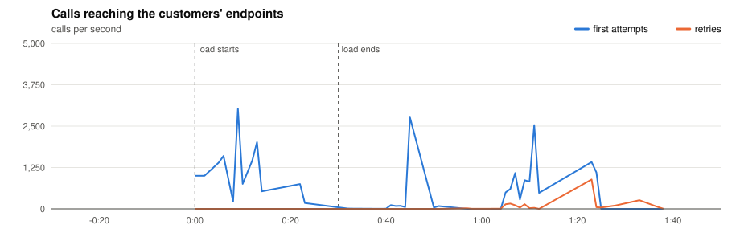
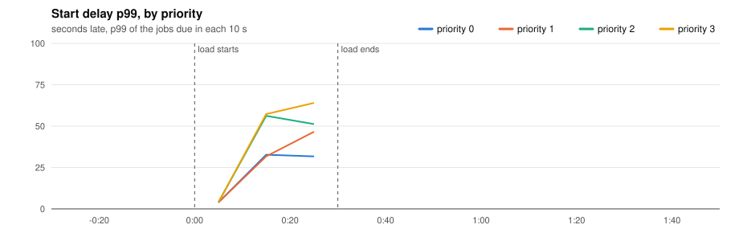
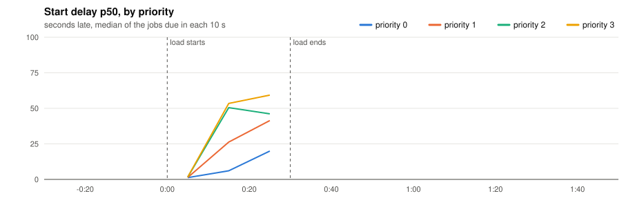
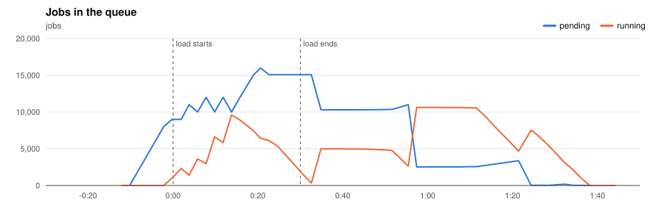
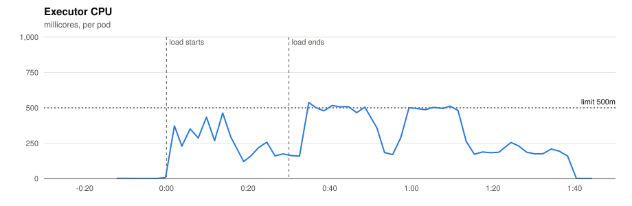
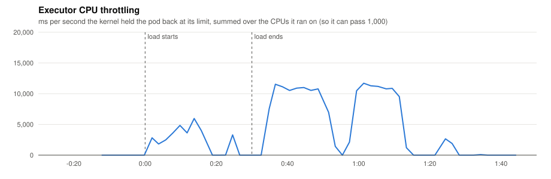
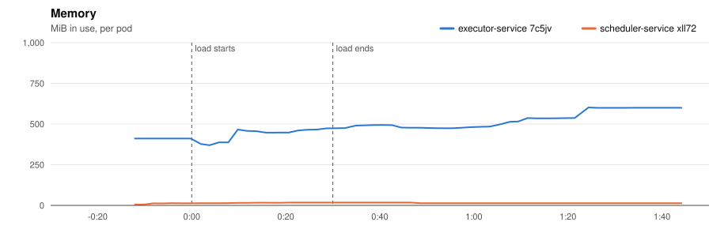
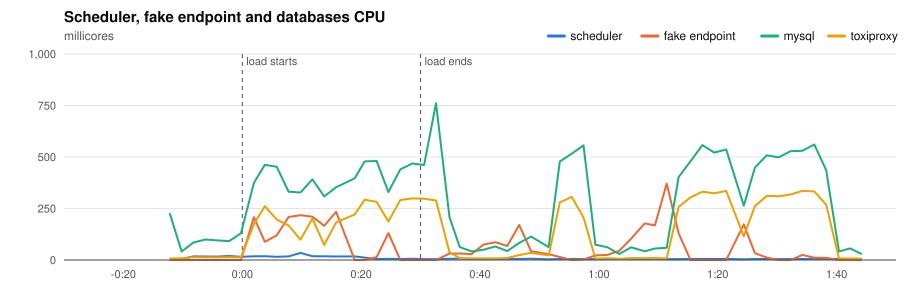
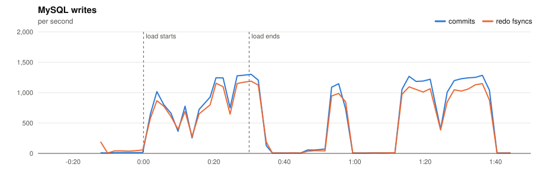
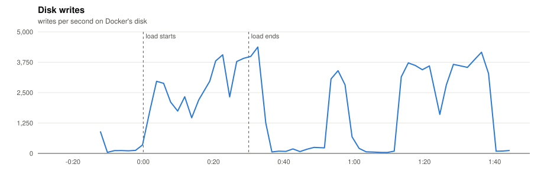

# P10 · 20261119T205322Z-1x-1000 (1x-1000)

- **Load:** 30 s of 1000 one-off jobs per second, endpoint `lat=50&dist=lognormal`, timeout 30 s; 30,000 tasks seeded.
- **Deployment:** 1 executors; executor-service: `JOB_TIME_LIMIT_SECONDS=1 WORKER_COUNT=10000 JOB_QUEUE_SIZE=10000 PPROF_ADDR=:6060`; scheduler-service: `SCHEDULE_INTERVAL=200ms SCHEDULE_LOOKAHEAD=10s PPROF_ADDR=:6060`
- **Raw data:** `bench/results/P10-ceiling/runs/20261119T205322Z-1x-1000/` (local, not committed)

## Jobs

| Created | Succeeded | Dead | Still pending or running | Retried | Duplicate successes | Timed out, done anyway | Calls per second (first attempts) |
|---|---|---|---|---|---|---|---|
| 30,000 | 30,000 | 0 | 0 | 2,171 | 48 | 0 | 330.6 |

*Duplicate successes*: the endpoint answered 200 twice for one job, which only a failure should cause. *Timed out, done anyway*: the executor gave up after the timeout while the endpoint finished the work, so the retry made the customer process the job again.

**Start delay** (when the call reached the endpoint minus when the job was due, first attempts):

| Priority | Jobs | p50 | p90 | p99 | max |
|---|---|---|---|---|---|
| 0 | 6,453 | 2.868 s | 22.871 s | 30.796 s | 34.795 s |
| 1 | 6,669 | 3.764 s | 43.195 s | 45.603 s | 48.399 s |
| 2 | 7,280 | 42.003 s | 53.401 s | 55.596 s | 57.400 s |
| 3 | 7,475 | 53.457 s | 61.628 s | 63.926 s | 64.828 s |
| all | 27,877 | 4.264 s | 55.501 s | 63.027 s | 64.828 s |

## Charts

Time is minutes:seconds from the start of the load.





















## Resources

| Component | CPU avg (millicores) | CPU max | Throttled max (ms/s) | Memory max (MiB) |
|---|---|---|---|---|
| executor-service 7c5jv | 262 | 538 | 11697 | 602 |
| scheduler-service xll72 | 8 | 34 | 0 | 18 |
| fake-endpoint cf55t | 60 | 371 | 0 | 388 |
| mysql | 287 | 760 | 0 | 1264 |
| cassandra | 97 | 307 | 0 | 1078 |
| toxiproxy | 145 | 335 | 0 | 22 |

MySQL: up to 1300 commits/s, 1188 redo fsyncs/s, 2 row lock waits/s, 10 connections.

## CPU profile: executor, 20 s from 0:07

```text
      flat  flat%   sum%        cum   cum%
     1.01s 38.40% 38.40%      1.01s 38.40%  internal/runtime/syscall.Syscall6
     0.28s 10.65% 49.05%      0.28s 10.65%  runtime.futex
     0.05s  1.90% 50.95%      0.05s  1.90%  runtime.memmove
     0.05s  1.90% 52.85%      0.06s  2.28%  runtime.step
     0.04s  1.52% 54.37%      0.05s  1.90%  runtime.findObject
     0.04s  1.52% 55.89%      0.04s  1.52%  runtime.gopark
     0.04s  1.52% 57.41%      0.04s  1.52%  runtime.memclrNoHeapPointers
     0.03s  1.14% 58.56%      0.03s  1.14%  internal/runtime/atomic.(*Uint32).CompareAndSwap
     0.03s  1.14% 59.70%      0.03s  1.14%  runtime.nextFreeFast
     0.02s  0.76% 60.46%      0.12s  4.56%  internal/poll.(*FD).Read
     0.02s  0.76% 61.22%      0.02s  0.76%  internal/runtime/maps.(*Map).Used
     0.02s  0.76% 61.98%      0.04s  1.52%  internal/sync.(*Mutex).Lock
```

## CPU profile: scheduler, 20 s from 0:07

```text
      flat  flat%   sum%        cum   cum%
      30ms 30.00% 30.00%       30ms 30.00%  runtime.futex
      10ms 10.00% 40.00%       10ms 10.00%  database/sql.NullTime.Value
      10ms 10.00% 50.00%       10ms 10.00%  internal/runtime/atomic.(*Uint32).Add
      10ms 10.00% 60.00%       10ms 10.00%  internal/runtime/syscall.Syscall6
      10ms 10.00% 70.00%       10ms 10.00%  runtime.(*mcache).nextFree
      10ms 10.00% 80.00%       10ms 10.00%  runtime.(*mspan).writeHeapBitsSmall
      10ms 10.00% 90.00%       10ms 10.00%  runtime.(*randomEnum).next
      10ms 10.00%   100%       10ms 10.00%  runtime.lock2
         0     0%   100%       10ms 10.00%  database/sql.(*DB).execDC
         0     0%   100%       10ms 10.00%  database/sql.(*DB).execDC.func2
         0     0%   100%       20ms 20.00%  database/sql.(*DB).queryDC
         0     0%   100%       10ms 10.00%  database/sql.(*Rows).Close
```
