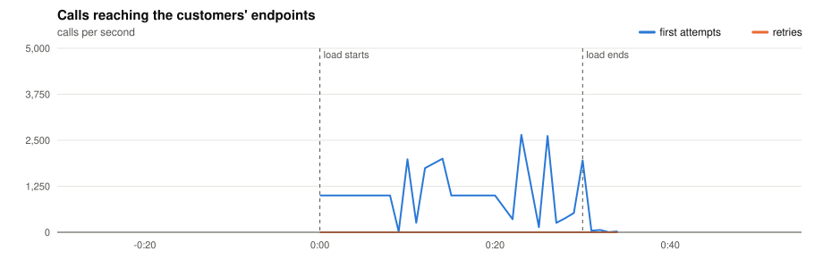
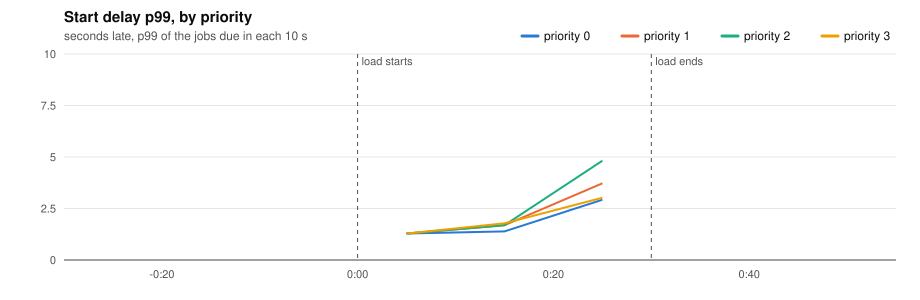
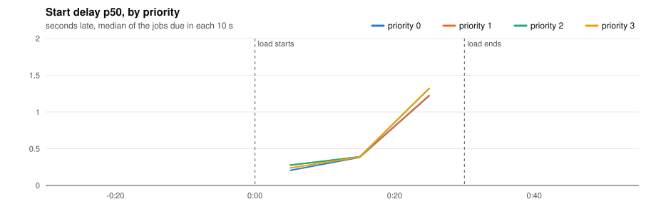
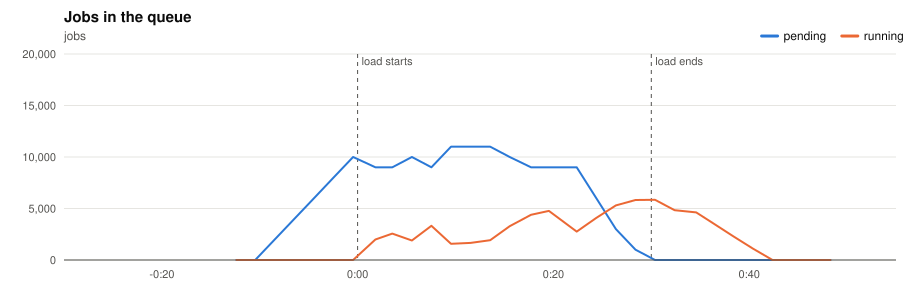
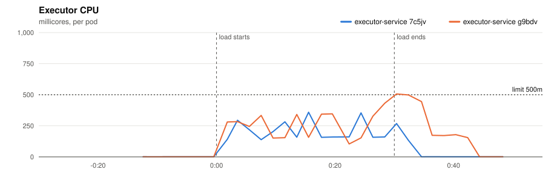
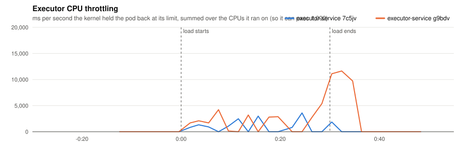
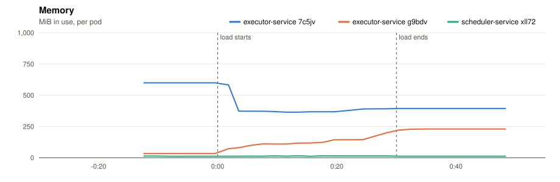
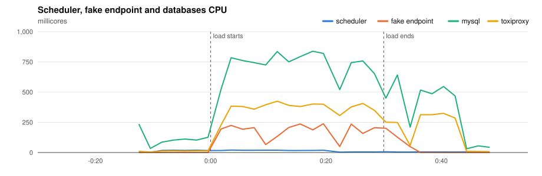
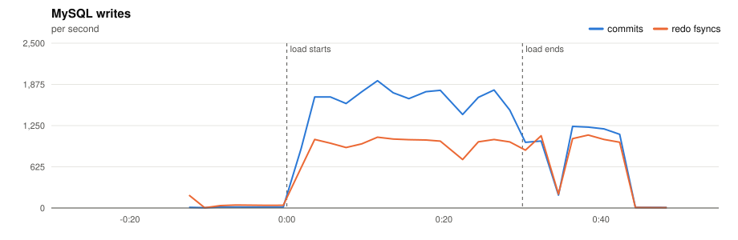
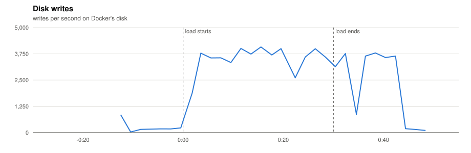

# P10 · 20261119T205530Z-2x-1000 (2x-1000)

- **Load:** 30 s of 1000 one-off jobs per second, endpoint `lat=50&dist=lognormal`, timeout 30 s; 30,000 tasks seeded.
- **Deployment:** 2 executors; executor-service: `JOB_TIME_LIMIT_SECONDS=1 WORKER_COUNT=10000 JOB_QUEUE_SIZE=10000 PPROF_ADDR=:6060`; scheduler-service: `SCHEDULE_INTERVAL=200ms SCHEDULE_LOOKAHEAD=10s PPROF_ADDR=:6060`
- **Raw data:** `bench/results/P10-ceiling/runs/20261119T205530Z-2x-1000/` (local, not committed)

## Jobs

| Created | Succeeded | Dead | Still pending or running | Retried | Duplicate successes | Timed out, done anyway | Calls per second (first attempts) |
|---|---|---|---|---|---|---|---|
| 30,000 | 30,000 | 0 | 0 | 0 | 0 | 0 | 874.0 |

*Duplicate successes*: the endpoint answered 200 twice for one job, which only a failure should cause. *Timed out, done anyway*: the executor gave up after the timeout while the endpoint finished the work, so the retry made the customer process the job again.

**Start delay** (when the call reached the endpoint minus when the job was due, first attempts):

| Priority | Jobs | p50 | p90 | p99 | max |
|---|---|---|---|---|---|
| 0 | 7,500 | 0.392 s | 1.931 s | 2.727 s | 4.423 s |
| 1 | 7,500 | 0.478 s | 2.027 s | 2.929 s | 4.123 s |
| 2 | 7,500 | 0.482 s | 2.029 s | 4.426 s | 6.326 s |
| 3 | 7,500 | 0.483 s | 2.228 s | 2.822 s | 5.921 s |
| all | 30,000 | 0.479 s | 2.027 s | 2.929 s | 6.326 s |

## Charts

Time is minutes:seconds from the start of the load.





















## Resources

| Component | CPU avg (millicores) | CPU max | Throttled max (ms/s) | Memory max (MiB) |
|---|---|---|---|---|
| executor-service 7c5jv | 108 | 359 | 3598 | 600 |
| executor-service g9bdv | 187 | 506 | 11643 | 230 |
| scheduler-service xll72 | 11 | 20 | 0 | 16 |
| fake-endpoint cf55t | 94 | 238 | 0 | 388 |
| mysql | 468 | 838 | 0 | 1284 |
| cassandra | 103 | 284 | 0 | 1076 |
| toxiproxy | 228 | 425 | 0 | 23 |

MySQL: up to 1931 commits/s, 1106 redo fsyncs/s, 1 row lock waits/s, 14 connections.

## CPU profile: executor, 20 s from 0:08

```text
      flat  flat%   sum%        cum   cum%
     0.73s 32.59% 32.59%      0.73s 32.59%  internal/runtime/syscall.Syscall6
     0.37s 16.52% 49.11%      0.37s 16.52%  runtime.futex
     0.05s  2.23% 51.34%      0.10s  4.46%  runtime.lock2
     0.04s  1.79% 53.12%      0.04s  1.79%  runtime.memclrNoHeapPointers
     0.04s  1.79% 54.91%      0.04s  1.79%  runtime.memmove
     0.04s  1.79% 56.70%      0.04s  1.79%  runtime.procyield
     0.04s  1.79% 58.48%      0.04s  1.79%  runtime.usleep
     0.03s  1.34% 59.82%      0.26s 11.61%  github.com/go-sql-driver/mysql.(*buffer).fill
     0.03s  1.34% 61.16%      0.04s  1.79%  runtime.gopark
     0.02s  0.89% 62.05%      0.02s  0.89%  net.(*TCPConn).Write
     0.02s  0.89% 62.95%      0.19s  8.48%  net.(*netFD).dial
     0.02s  0.89% 63.84%      0.02s  0.89%  runtime.(*mspan).writeHeapBitsSmall
```

## CPU profile: scheduler, 20 s from 0:08

```text
      flat  flat%   sum%        cum   cum%
      20ms 28.57% 28.57%       20ms 28.57%  internal/runtime/syscall.Syscall6
      10ms 14.29% 42.86%       10ms 14.29%  runtime.(*mspan).refillAllocCache
      10ms 14.29% 57.14%       10ms 14.29%  runtime.futex
      10ms 14.29% 71.43%       10ms 14.29%  runtime.memmove
      10ms 14.29% 85.71%       10ms 14.29%  runtime.publicationBarrier
      10ms 14.29%   100%       10ms 14.29%  runtime.sellock
         0     0%   100%       20ms 28.57%  database/sql.(*DB).execDC
         0     0%   100%       20ms 28.57%  database/sql.(*DB).queryDC
         0     0%   100%       10ms 14.29%  database/sql.(*Rows).Close
         0     0%   100%       10ms 14.29%  database/sql.(*Rows).Next
         0     0%   100%       10ms 14.29%  database/sql.(*Rows).close
         0     0%   100%       10ms 14.29%  database/sql.(*Rows).close.func1
```
