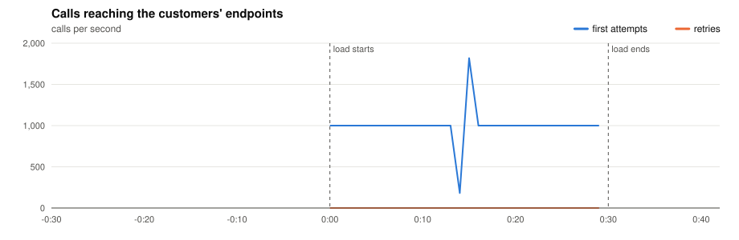
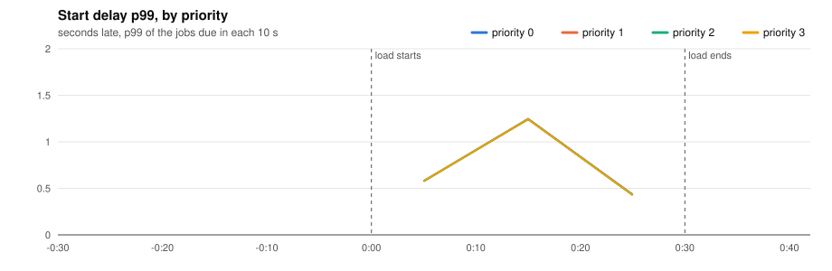
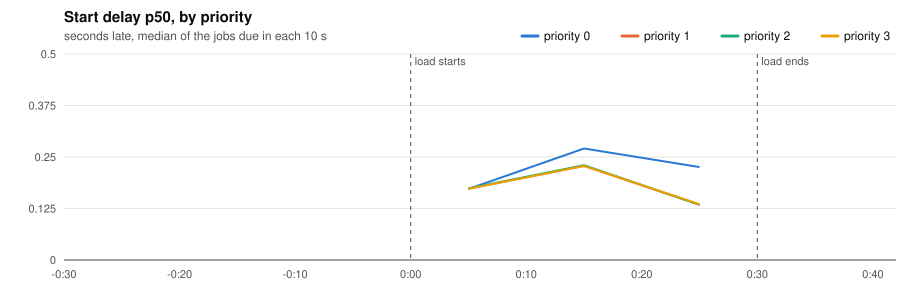
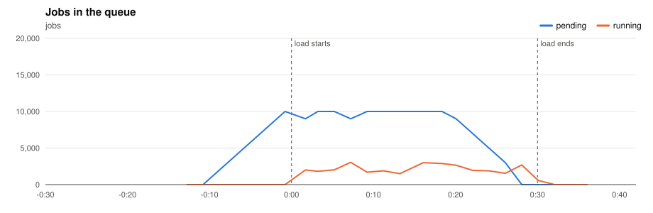
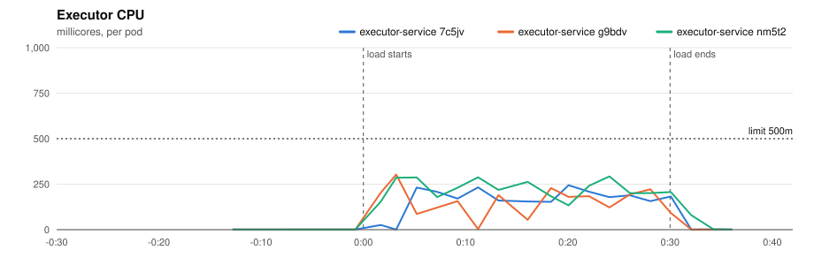
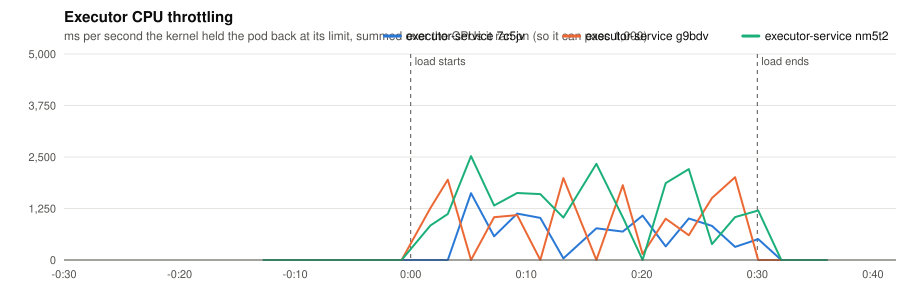
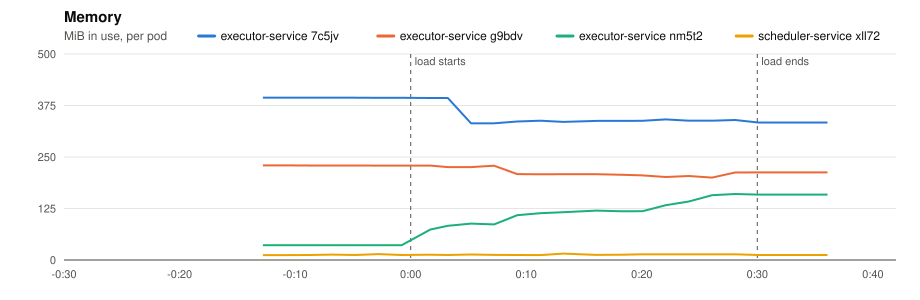
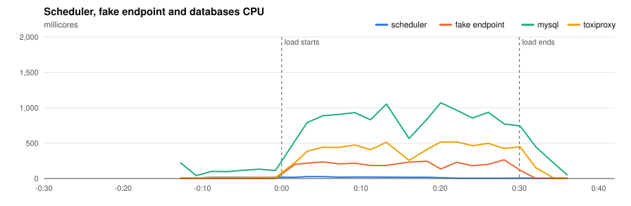
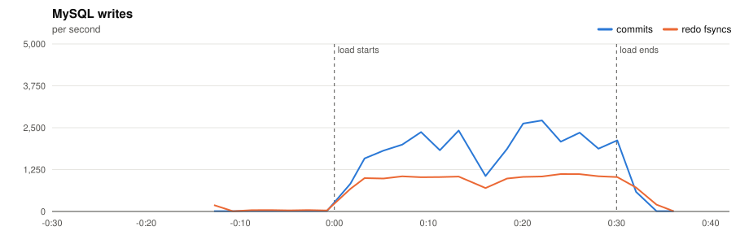
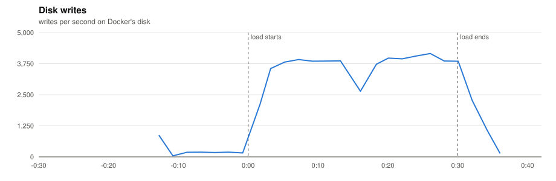

# P10 · 20261119T205642Z-3x-1000 (3x-1000)

- **Load:** 30 s of 1000 one-off jobs per second, endpoint `lat=50&dist=lognormal`, timeout 30 s; 30,000 tasks seeded.
- **Deployment:** 3 executors; executor-service: `JOB_TIME_LIMIT_SECONDS=1 WORKER_COUNT=10000 JOB_QUEUE_SIZE=10000 PPROF_ADDR=:6060`; scheduler-service: `SCHEDULE_INTERVAL=200ms SCHEDULE_LOOKAHEAD=10s PPROF_ADDR=:6060`
- **Raw data:** `bench/results/P10-ceiling/runs/20261119T205642Z-3x-1000/` (local, not committed)

## Jobs

| Created | Succeeded | Dead | Still pending or running | Retried | Duplicate successes | Timed out, done anyway | Calls per second (first attempts) |
|---|---|---|---|---|---|---|---|
| 30,000 | 30,000 | 0 | 0 | 0 | 0 | 0 | 1019.4 |

*Duplicate successes*: the endpoint answered 200 twice for one job, which only a failure should cause. *Timed out, done anyway*: the executor gave up after the timeout while the endpoint finished the work, so the retry made the customer process the job again.

**Start delay** (when the call reached the endpoint minus when the job was due, first attempts):

| Priority | Jobs | p50 | p90 | p99 | max |
|---|---|---|---|---|---|
| 0 | 7,500 | 0.179 s | 0.476 s | 1.238 s | 1.252 s |
| 1 | 7,500 | 0.175 s | 0.473 s | 1.233 s | 1.252 s |
| 2 | 7,500 | 0.178 s | 0.473 s | 1.233 s | 1.252 s |
| 3 | 7,500 | 0.176 s | 0.472 s | 1.232 s | 1.252 s |
| all | 30,000 | 0.177 s | 0.473 s | 1.233 s | 1.252 s |

## Charts

Time is minutes:seconds from the start of the load.





















## Resources

| Component | CPU avg (millicores) | CPU max | Throttled max (ms/s) | Memory max (MiB) |
|---|---|---|---|---|
| executor-service 7c5jv | 100 | 244 | 1622 | 394 |
| executor-service g9bdv | 94 | 303 | 2011 | 230 |
| executor-service nm5t2 | 138 | 293 | 2523 | 160 |
| scheduler-service xll72 | 14 | 28 | 0 | 16 |
| fake-endpoint cf55t | 122 | 265 | 0 | 334 |
| mysql | 570 | 1071 | 0 | 1304 |
| cassandra | 103 | 317 | 0 | 1065 |
| toxiproxy | 268 | 518 | 0 | 25 |

MySQL: up to 2715 commits/s, 1116 redo fsyncs/s, 1 row lock waits/s, 20 connections.

## CPU profile: executor, 20 s from 0:08

```text
      flat  flat%   sum%        cum   cum%
     690ms 35.20% 35.20%      690ms 35.20%  internal/runtime/syscall.Syscall6
     280ms 14.29% 49.49%      280ms 14.29%  runtime.futex
      50ms  2.55% 52.04%      410ms 20.92%  runtime.schedule
      30ms  1.53% 53.57%       30ms  1.53%  runtime.findObject
      30ms  1.53% 55.10%       30ms  1.53%  runtime.procyield
      30ms  1.53% 56.63%       80ms  4.08%  runtime.scanobject
      30ms  1.53% 58.16%       90ms  4.59%  runtime.selectgo
      30ms  1.53% 59.69%       30ms  1.53%  runtime.stealWork
      20ms  1.02% 60.71%      400ms 20.41%  database/sql.resultFromStatement
      20ms  1.02% 61.73%      460ms 23.47%  github.com/go-sql-driver/mysql.(*mysqlConn).writePacket
      20ms  1.02% 62.76%       20ms  1.02%  runtime.(*mcache).prepareForSweep
      20ms  1.02% 63.78%       40ms  2.04%  runtime.(*unwinder).resolveInternal
```

## CPU profile: scheduler, 20 s from 0:08

```text
      flat  flat%   sum%        cum   cum%
      40ms 30.77% 30.77%       40ms 30.77%  runtime.futex
      20ms 15.38% 46.15%       20ms 15.38%  internal/runtime/syscall.Syscall6
      20ms 15.38% 61.54%       30ms 23.08%  runtime.scanobject
      10ms  7.69% 69.23%       10ms  7.69%  github.com/go-sql-driver/mysql.converter.ConvertValue
      10ms  7.69% 76.92%       10ms  7.69%  reflect.(*rtype).Bits
      10ms  7.69% 84.62%       10ms  7.69%  runtime.(*mspan).divideByElemSize (inline)
      10ms  7.69% 92.31%       10ms  7.69%  runtime.acquirem
      10ms  7.69%   100%       10ms  7.69%  runtime.sweepone
         0     0%   100%       10ms  7.69%  database/sql.(*DB).execDC
         0     0%   100%       40ms 30.77%  database/sql.(*DB).queryDC
         0     0%   100%       10ms  7.69%  database/sql.(*Rows).Next
         0     0%   100%       10ms  7.69%  database/sql.(*Rows).Next.func1
```
