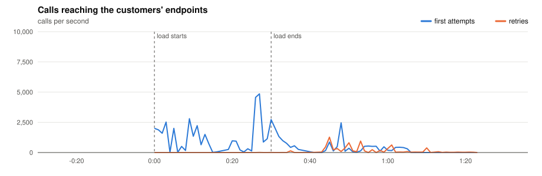
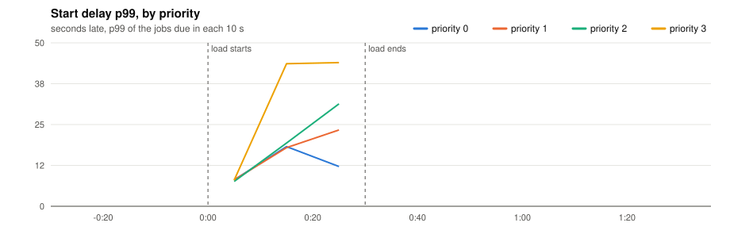
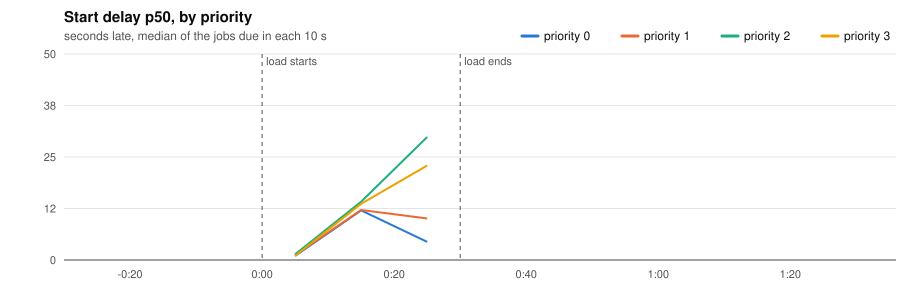
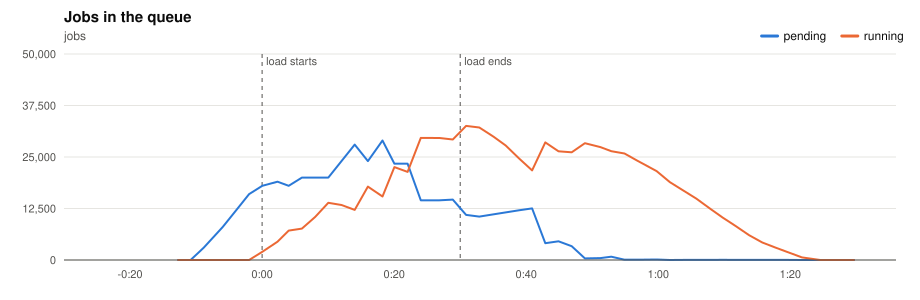
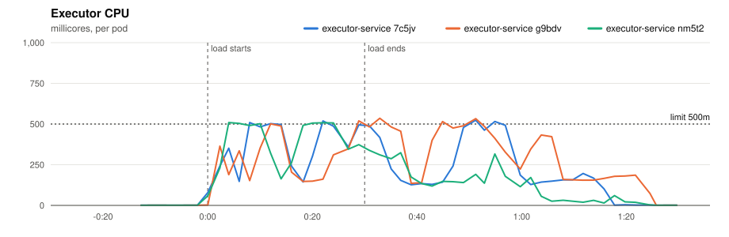
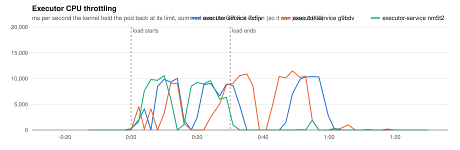
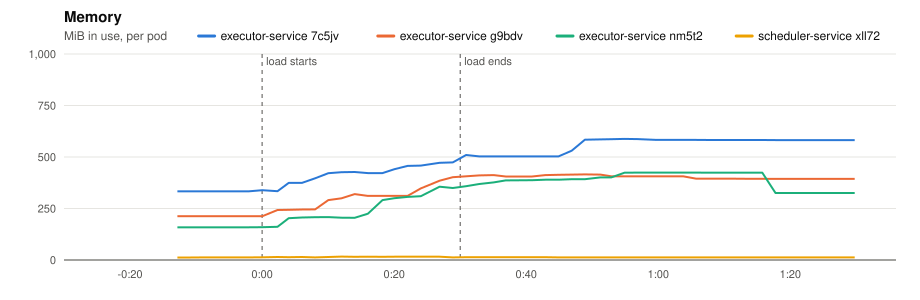
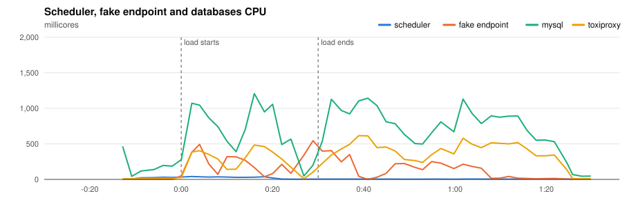
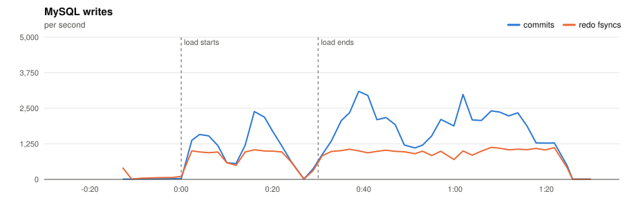
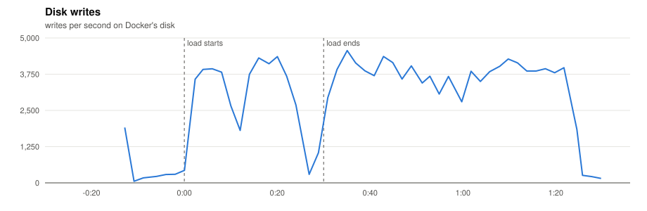

# P10 · 20261119T205737Z-3x-2000 (3x-2000)

- **Load:** 30 s of 2000 one-off jobs per second, endpoint `lat=50&dist=lognormal`, timeout 30 s; 60,000 tasks seeded.
- **Deployment:** 3 executors; executor-service: `JOB_TIME_LIMIT_SECONDS=1 WORKER_COUNT=10000 JOB_QUEUE_SIZE=10000 PPROF_ADDR=:6060`; scheduler-service: `SCHEDULE_INTERVAL=200ms SCHEDULE_LOOKAHEAD=10s PPROF_ADDR=:6060`
- **Raw data:** `bench/results/P10-ceiling/runs/20261119T205737Z-3x-2000/` (local, not committed)

## Jobs

| Created | Succeeded | Dead | Still pending or running | Retried | Duplicate successes | Timed out, done anyway | Calls per second (first attempts) |
|---|---|---|---|---|---|---|---|
| 60,000 | 60,000 | 0 | 0 | 7,544 | 313 | 0 | 803.4 |

*Duplicate successes*: the endpoint answered 200 twice for one job, which only a failure should cause. *Timed out, done anyway*: the executor gave up after the timeout while the endpoint finished the work, so the retry made the customer process the job again.

**Start delay** (when the call reached the endpoint minus when the job was due, first attempts):

| Priority | Jobs | p50 | p90 | p99 | max |
|---|---|---|---|---|---|
| 0 | 12,346 | 4.144 s | 12.144 s | 17.250 s | 18.254 s |
| 1 | 11,923 | 5.282 s | 16.043 s | 22.846 s | 24.345 s |
| 2 | 13,565 | 9.286 s | 30.303 s | 31.247 s | 31.396 s |
| 3 | 14,935 | 13.646 s | 42.955 s | 43.814 s | 44.125 s |
| all | 52,769 | 5.548 s | 23.938 s | 43.536 s | 44.125 s |

## Charts

Time is minutes:seconds from the start of the load.





















## Resources

| Component | CPU avg (millicores) | CPU max | Throttled max (ms/s) | Memory max (MiB) |
|---|---|---|---|---|
| executor-service 7c5jv | 221 | 524 | 10364 | 588 |
| executor-service g9bdv | 254 | 536 | 11474 | 416 |
| executor-service nm5t2 | 183 | 509 | 10573 | 424 |
| scheduler-service xll72 | 12 | 41 | 0 | 16 |
| fake-endpoint cf55t | 142 | 544 | 0 | 461 |
| mysql | 640 | 1207 | 88 | 1365 |
| cassandra | 111 | 398 | 0 | 1068 |
| toxiproxy | 297 | 616 | 0 | 26 |

MySQL: up to 3096 commits/s, 1127 redo fsyncs/s, 6 row lock waits/s, 20 connections.

## CPU profile: executor, 20 s from 0:08

```text
      flat  flat%   sum%        cum   cum%
     3.12s 71.56% 71.56%      3.12s 71.56%  internal/runtime/syscall.Syscall6
     0.14s  3.21% 74.77%      0.14s  3.21%  runtime.futex
     0.04s  0.92% 75.69%      0.05s  1.15%  runtime.findObject
     0.03s  0.69% 76.38%      0.03s  0.69%  runtime.(*gcBits).bitp (inline)
     0.03s  0.69% 77.06%      0.06s  1.38%  runtime.pcvalue
     0.03s  0.69% 77.75%      0.07s  1.61%  runtime.scanblock
     0.03s  0.69% 78.44%      0.03s  0.69%  runtime.stackpoolalloc
     0.03s  0.69% 79.13%      0.41s  9.40%  runtime.systemstack
     0.02s  0.46% 79.59%      0.22s  5.05%  github.com/go-sql-driver/mysql.(*mysqlConn).writePacket
     0.02s  0.46% 80.05%      0.03s  0.69%  runtime.releaseSudog
     0.02s  0.46% 80.50%      0.03s  0.69%  runtime.step
     0.01s  0.23% 80.73%      0.06s  1.38%  internal/poll.(*FD).Read
```

## CPU profile: scheduler, 20 s from 0:08

```text
      flat  flat%   sum%        cum   cum%
      50ms 45.45% 45.45%       50ms 45.45%  runtime.tgkill
      10ms  9.09% 54.55%       10ms  9.09%  internal/runtime/syscall.Syscall6
      10ms  9.09% 63.64%       10ms  9.09%  runtime.(*mspan).writeHeapBitsSmall
      10ms  9.09% 72.73%       10ms  9.09%  runtime.findfunc
      10ms  9.09% 81.82%       10ms  9.09%  runtime.futex
      10ms  9.09% 90.91%       10ms  9.09%  runtime.procyield
      10ms  9.09%   100%       10ms  9.09%  runtime.typePointers.nextFast
         0     0%   100%       10ms  9.09%  database/sql.(*DB).execDC
         0     0%   100%       10ms  9.09%  database/sql.(*Tx).ExecContext
         0     0%   100%       10ms  9.09%  database/sql.ctxDriverStmtExec
         0     0%   100%       10ms  9.09%  database/sql.resultFromStatement
         0     0%   100%       20ms 18.18%  github.com/JoelTeoGom/distributed-scheduler/scheduler-service/internal/adapters/out/mysql.(*SchedulerRepository).ScheduleJobs
```
