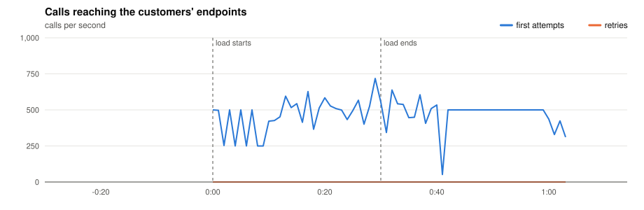
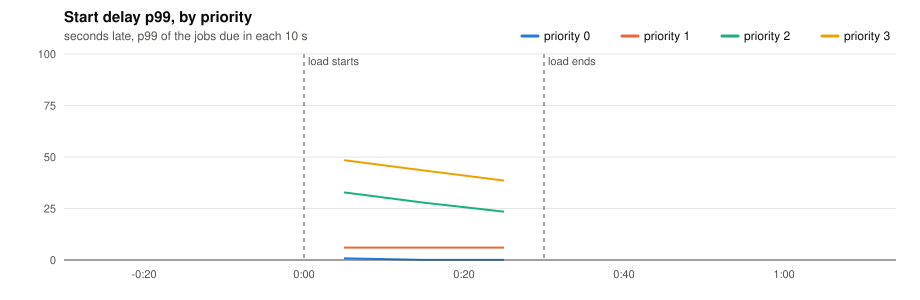
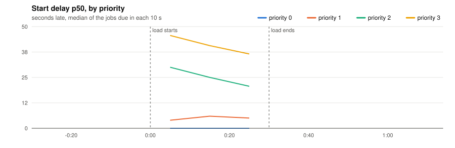
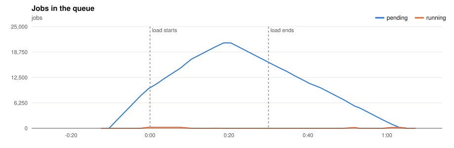
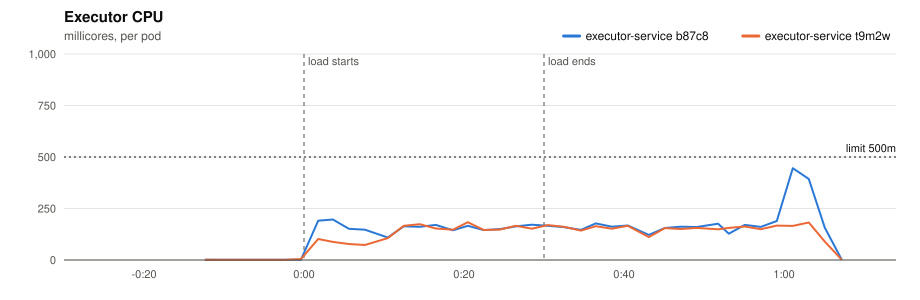
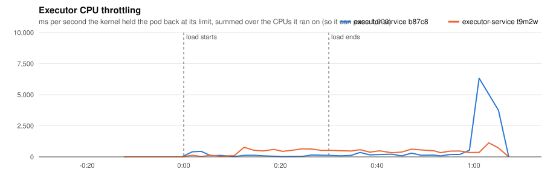
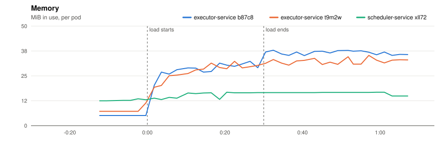
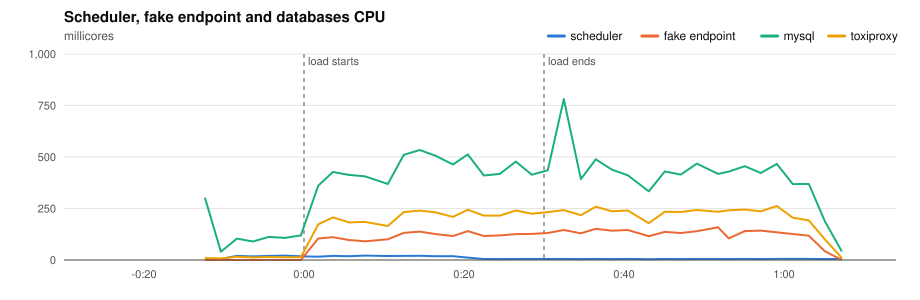
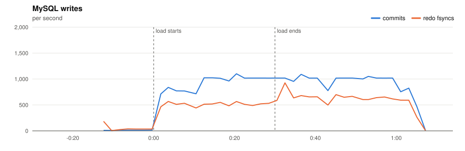
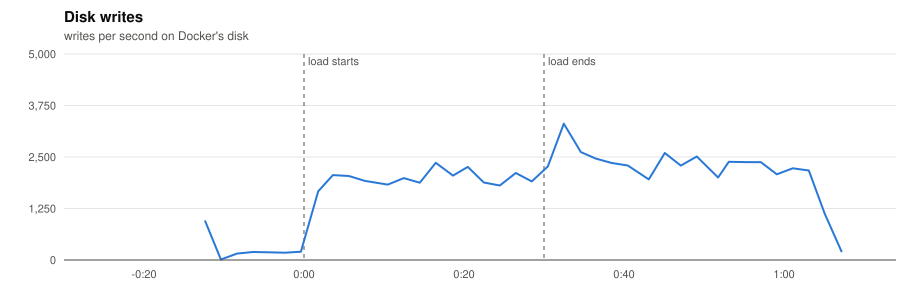

# P10 · 20261119T205934Z-2x-1000-w250 (2x-1000-w250)

- **Load:** 30 s of 1000 one-off jobs per second, endpoint `lat=50&dist=lognormal`, timeout 30 s; 30,000 tasks seeded.
- **Deployment:** 2 executors; executor-service: `JOB_TIME_LIMIT_SECONDS=1 WORKER_COUNT=250 JOB_QUEUE_SIZE=10000 PPROF_ADDR=:6060`; scheduler-service: `SCHEDULE_INTERVAL=200ms SCHEDULE_LOOKAHEAD=10s PPROF_ADDR=:6060`
- **Raw data:** `bench/results/P10-ceiling/runs/20261119T205934Z-2x-1000-w250/` (local, not committed)

## Jobs

| Created | Succeeded | Dead | Still pending or running | Retried | Duplicate successes | Timed out, done anyway | Calls per second (first attempts) |
|---|---|---|---|---|---|---|---|
| 30,000 | 30,000 | 0 | 0 | 0 | 0 | 0 | 469.9 |

*Duplicate successes*: the endpoint answered 200 twice for one job, which only a failure should cause. *Timed out, done anyway*: the executor gave up after the timeout while the endpoint finished the work, so the retry made the customer process the job again.

**Start delay** (when the call reached the endpoint minus when the job was due, first attempts):

| Priority | Jobs | p50 | p90 | p99 | max |
|---|---|---|---|---|---|
| 0 | 7,500 | 0.006 s | 0.062 s | 0.806 s | 0.807 s |
| 1 | 7,500 | 5.941 s | 6.025 s | 6.029 s | 6.126 s |
| 2 | 7,500 | 25.029 s | 31.028 s | 32.803 s | 32.821 s |
| 3 | 7,500 | 40.645 s | 46.647 s | 48.423 s | 48.446 s |
| all | 30,000 | 6.126 s | 42.448 s | 47.569 s | 48.446 s |

## Charts

Time is minutes:seconds from the start of the load.





















## Resources

| Component | CPU avg (millicores) | CPU max | Throttled max (ms/s) | Memory max (MiB) |
|---|---|---|---|---|
| executor-service b87c8 | 141 | 446 | 6330 | 38 |
| executor-service t9m2w | 116 | 184 | 1125 | 35 |
| scheduler-service xll72 | 10 | 21 | 0 | 17 |
| fake-endpoint cf55t | 100 | 159 | 0 | 476 |
| mysql | 371 | 781 | 0 | 1396 |
| cassandra | 111 | 366 | 0 | 1074 |
| toxiproxy | 177 | 262 | 0 | 22 |

MySQL: up to 1101 commits/s, 926 redo fsyncs/s, 0 row lock waits/s, 14 connections.

## CPU profile: executor, 20 s from 0:07

```text
      flat  flat%   sum%        cum   cum%
     1.16s 53.21% 53.21%      1.16s 53.21%  internal/runtime/syscall.Syscall6
     0.22s 10.09% 63.30%      0.22s 10.09%  runtime.futex
     0.04s  1.83% 65.14%      0.04s  1.83%  runtime.nextFreeFast
     0.03s  1.38% 66.51%      0.14s  6.42%  runtime.selectgo
     0.02s  0.92% 67.43%      0.08s  3.67%  internal/poll.(*FD).Read
     0.02s  0.92% 68.35%      0.04s  1.83%  runtime.(*mcache).refill
     0.02s  0.92% 69.27%      0.02s  0.92%  runtime.(*mspan).base
     0.02s  0.92% 70.18%      0.02s  0.92%  runtime.mutexSampleContention (inline)
     0.02s  0.92% 71.10%      0.05s  2.29%  runtime.stealWork
     0.02s  0.92% 72.02%      0.02s  0.92%  runtime.usleep
     0.01s  0.46% 72.48%      0.02s  0.92%  context.(*cancelCtx).Done
     0.01s  0.46% 72.94%      0.09s  4.13%  github.com/go-sql-driver/mysql.(*buffer).fill
```

## CPU profile: scheduler, 20 s from 0:07

```text
      flat  flat%   sum%        cum   cum%
      20ms 33.33% 33.33%       20ms 33.33%  internal/runtime/syscall.Syscall6
      10ms 16.67% 50.00%       10ms 16.67%  context.WithCancel.func1
      10ms 16.67% 66.67%       10ms 16.67%  internal/poll.(*FD).readUnlock
      10ms 16.67% 83.33%       10ms 16.67%  runtime.futex
      10ms 16.67%   100%       10ms 16.67%  runtime.nextFreeFast (inline)
         0     0%   100%       10ms 16.67%  database/sql.(*DB).queryDC
         0     0%   100%       20ms 33.33%  database/sql.(*Rows).Close
         0     0%   100%       20ms 33.33%  database/sql.(*Rows).Next
         0     0%   100%       20ms 33.33%  database/sql.(*Rows).close
         0     0%   100%       10ms 16.67%  database/sql.(*Tx).QueryContext
         0     0%   100%       20ms 33.33%  database/sql.(*Tx).Rollback
         0     0%   100%       20ms 33.33%  database/sql.(*Tx).rollback
```
