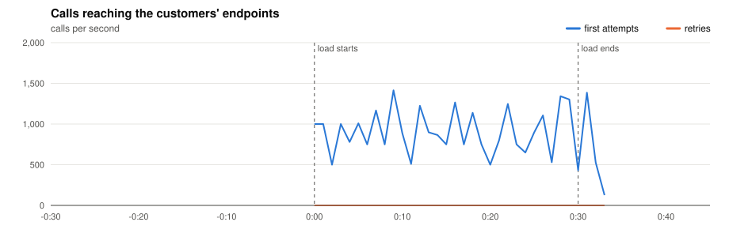
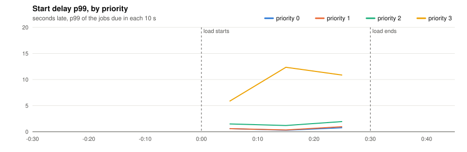
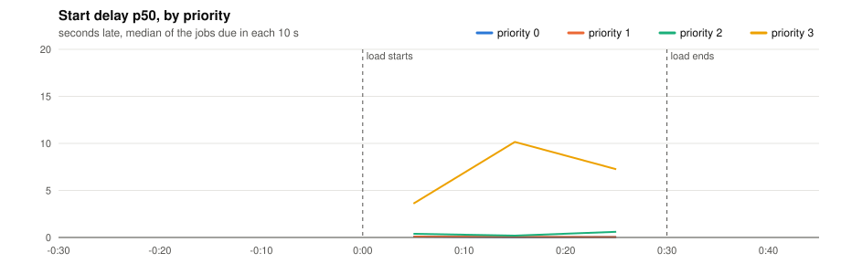
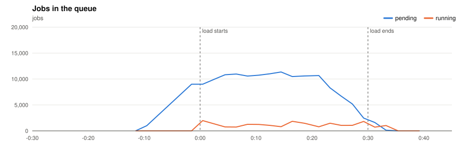
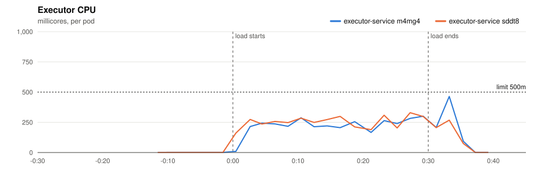
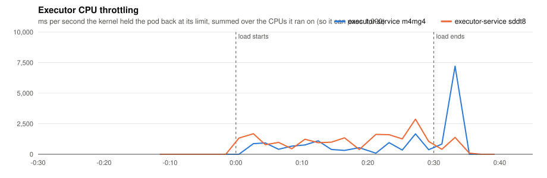
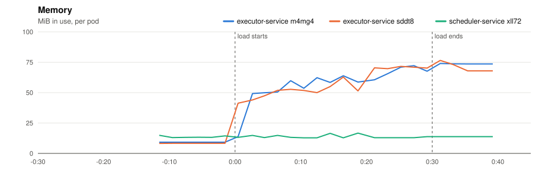
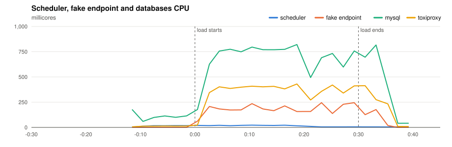
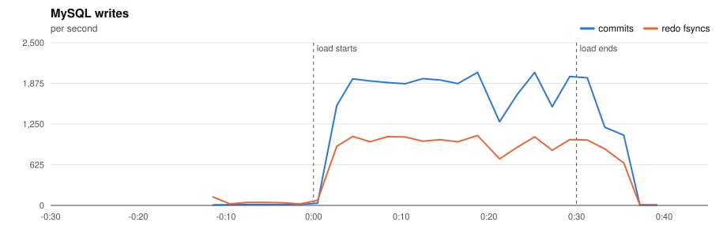
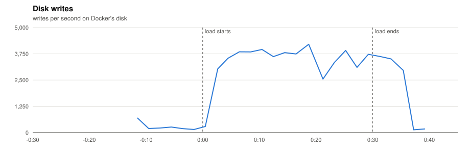

# P10 · 20261119T210102Z-2x-1000-w1000 (2x-1000-w1000)

- **Load:** 30 s of 1000 one-off jobs per second, endpoint `lat=50&dist=lognormal`, timeout 30 s; 30,000 tasks seeded.
- **Deployment:** 2 executors; executor-service: `JOB_TIME_LIMIT_SECONDS=1 WORKER_COUNT=1000 JOB_QUEUE_SIZE=10000 PPROF_ADDR=:6060`; scheduler-service: `SCHEDULE_INTERVAL=200ms SCHEDULE_LOOKAHEAD=10s PPROF_ADDR=:6060`
- **Raw data:** `bench/results/P10-ceiling/runs/20261119T210102Z-2x-1000-w1000/` (local, not committed)

## Jobs

| Created | Succeeded | Dead | Still pending or running | Retried | Duplicate successes | Timed out, done anyway | Calls per second (first attempts) |
|---|---|---|---|---|---|---|---|
| 30,000 | 30,000 | 0 | 0 | 0 | 0 | 0 | 902.3 |

*Duplicate successes*: the endpoint answered 200 twice for one job, which only a failure should cause. *Timed out, done anyway*: the executor gave up after the timeout while the endpoint finished the work, so the retry made the customer process the job again.

**Start delay** (when the call reached the endpoint minus when the job was due, first attempts):

| Priority | Jobs | p50 | p90 | p99 | max |
|---|---|---|---|---|---|
| 0 | 7,500 | 0.052 s | 0.302 s | 0.766 s | 0.847 s |
| 1 | 7,500 | 0.092 s | 0.373 s | 0.766 s | 0.976 s |
| 2 | 7,500 | 0.332 s | 1.393 s | 1.951 s | 1.957 s |
| 3 | 7,500 | 5.650 s | 11.152 s | 12.347 s | 12.351 s |
| all | 30,000 | 0.200 s | 6.493 s | 11.981 s | 12.351 s |

## Charts

Time is minutes:seconds from the start of the load.





















## Resources

| Component | CPU avg (millicores) | CPU max | Throttled max (ms/s) | Memory max (MiB) |
|---|---|---|---|---|
| executor-service m4mg4 | 159 | 464 | 7204 | 74 |
| executor-service sddt8 | 168 | 330 | 2873 | 76 |
| scheduler-service xll72 | 13 | 22 | 0 | 17 |
| fake-endpoint cf55t | 119 | 245 | 0 | 292 |
| mysql | 498 | 821 | 0 | 1408 |
| cassandra | 101 | 272 | 0 | 1060 |
| toxiproxy | 246 | 430 | 0 | 23 |

MySQL: up to 2044 commits/s, 1074 redo fsyncs/s, 0 row lock waits/s, 14 connections.

## CPU profile: executor, 20 s from 0:08

```text
      flat  flat%   sum%        cum   cum%
        1s 37.31% 37.31%         1s 37.31%  internal/runtime/syscall.Syscall6
     0.34s 12.69% 50.00%      0.34s 12.69%  runtime.futex
     0.06s  2.24% 52.24%      0.17s  6.34%  runtime.selectgo
     0.04s  1.49% 53.73%      0.04s  1.49%  runtime.findObject
     0.04s  1.49% 55.22%      0.04s  1.49%  runtime.nextFreeFast
     0.04s  1.49% 56.72%      0.09s  3.36%  runtime.stealWork
     0.03s  1.12% 57.84%      0.03s  1.12%  internal/runtime/atomic.(*Uint32).CompareAndSwap
     0.03s  1.12% 58.96%      0.03s  1.12%  runtime.procyield
     0.02s  0.75% 59.70%      0.02s  0.75%  database/sql.(*driverConn).expired
     0.02s  0.75% 60.45%      0.32s 11.94%  github.com/go-sql-driver/mysql.(*mysqlStmt).Close
     0.02s  0.75% 61.19%      0.02s  0.75%  github.com/go-sql-driver/mysql.converter.ConvertValue
     0.02s  0.75% 61.94%      0.02s  0.75%  runtime.(*mspan).writeHeapBitsSmall
```

## CPU profile: scheduler, 20 s from 0:08

```text
      flat  flat%   sum%        cum   cum%
      40ms 30.77% 30.77%       40ms 30.77%  internal/runtime/syscall.Syscall6
      20ms 15.38% 46.15%       20ms 15.38%  runtime.futex
      10ms  7.69% 53.85%       10ms  7.69%  github.com/go-sql-driver/mysql.(*mysqlConn).readColumns
      10ms  7.69% 61.54%       20ms 15.38%  github.com/go-sql-driver/mysql.(*mysqlStmt).writeExecutePacket
      10ms  7.69% 69.23%       10ms  7.69%  internal/runtime/maps.(*Iter).Next
      10ms  7.69% 76.92%       20ms 15.38%  runtime.futexsleep
      10ms  7.69% 84.62%       10ms  7.69%  runtime.lock2
      10ms  7.69% 92.31%       10ms  7.69%  runtime.memclrNoHeapPointers
      10ms  7.69%   100%       10ms  7.69%  runtime.memmove
         0     0%   100%       10ms  7.69%  context.(*cancelCtx).cancel
         0     0%   100%       10ms  7.69%  context.WithCancel.func1
         0     0%   100%       40ms 30.77%  database/sql.(*DB).execDC
```
