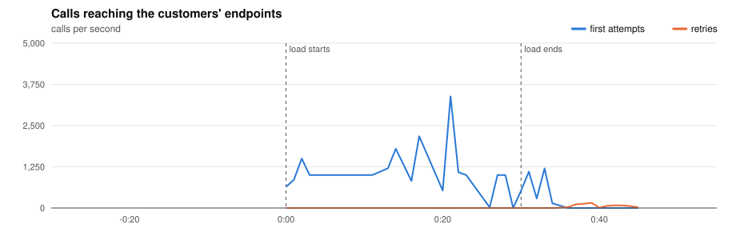
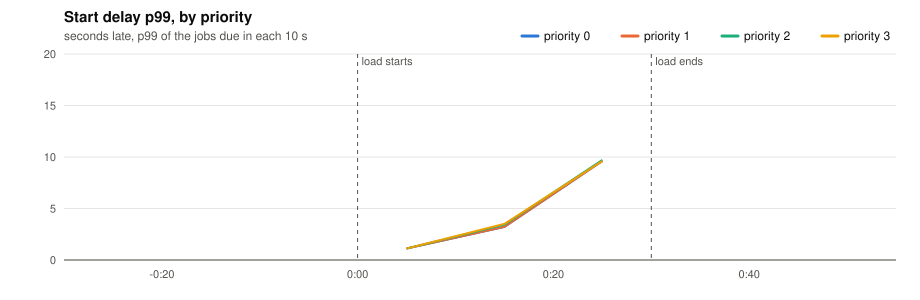
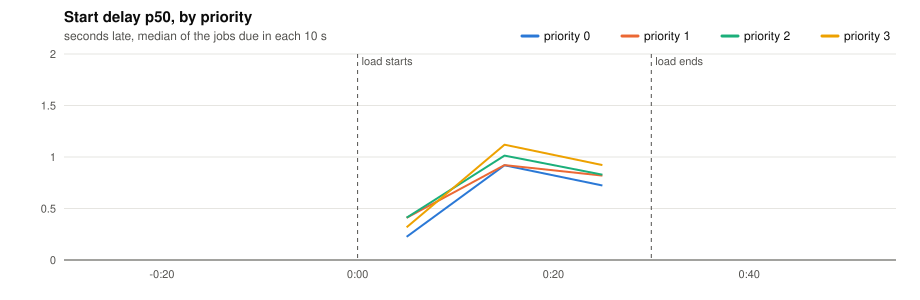
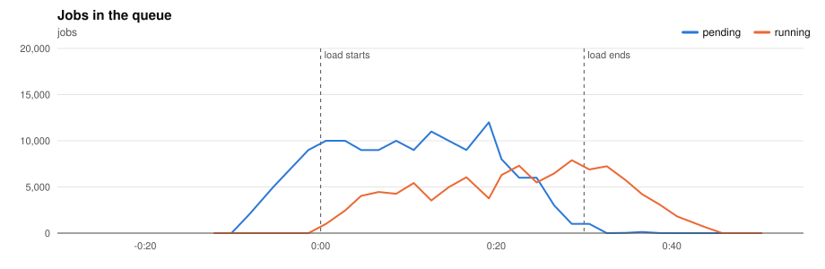
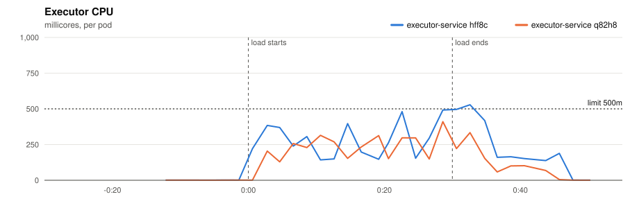
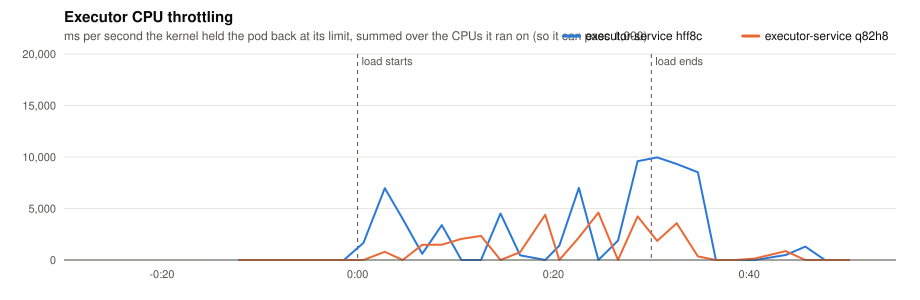
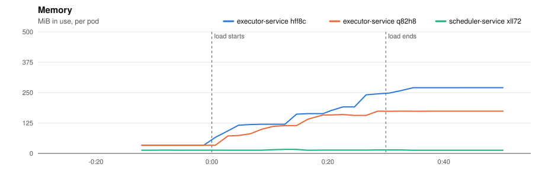
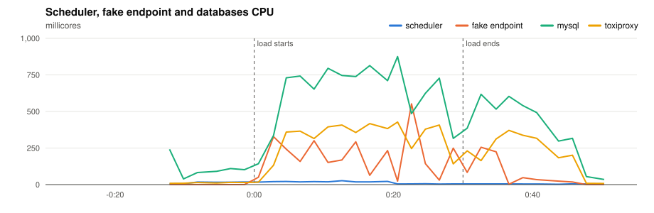
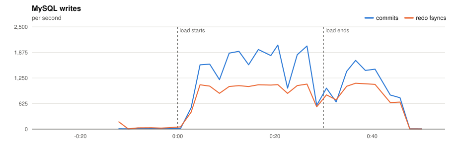
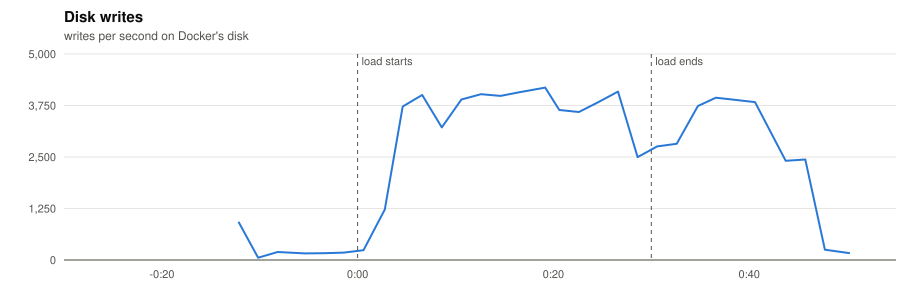

# P10 · 20261119T210202Z-2x-1000-w10000 (2x-1000-w10000)

- **Load:** 30 s of 1000 one-off jobs per second, endpoint `lat=50&dist=lognormal`, timeout 30 s; 30,000 tasks seeded.
- **Deployment:** 2 executors; executor-service: `JOB_TIME_LIMIT_SECONDS=1 WORKER_COUNT=10000 JOB_QUEUE_SIZE=10000 PPROF_ADDR=:6060`; scheduler-service: `SCHEDULE_INTERVAL=200ms SCHEDULE_LOOKAHEAD=10s PPROF_ADDR=:6060`
- **Raw data:** `bench/results/P10-ceiling/runs/20261119T210202Z-2x-1000-w10000/` (local, not committed)

## Jobs

| Created | Succeeded | Dead | Still pending or running | Retried | Duplicate successes | Timed out, done anyway | Calls per second (first attempts) |
|---|---|---|---|---|---|---|---|
| 30,000 | 30,000 | 0 | 0 | 726 | 0 | 0 | 855.7 |

*Duplicate successes*: the endpoint answered 200 twice for one job, which only a failure should cause. *Timed out, done anyway*: the executor gave up after the timeout while the endpoint finished the work, so the retry made the customer process the job again.

**Start delay** (when the call reached the endpoint minus when the job was due, first attempts):

| Priority | Jobs | p50 | p90 | p99 | max |
|---|---|---|---|---|---|
| 0 | 7,269 | 0.614 s | 2.915 s | 8.822 s | 10.315 s |
| 1 | 7,292 | 0.620 s | 2.927 s | 9.116 s | 10.221 s |
| 2 | 7,319 | 0.618 s | 3.223 s | 9.314 s | 10.221 s |
| 3 | 7,394 | 0.617 s | 3.318 s | 9.330 s | 10.415 s |
| all | 29,274 | 0.616 s | 3.121 s | 9.314 s | 10.415 s |

## Charts

Time is minutes:seconds from the start of the load.





















## Resources

| Component | CPU avg (millicores) | CPU max | Throttled max (ms/s) | Memory max (MiB) |
|---|---|---|---|---|
| executor-service hff8c | 209 | 528 | 9960 | 270 |
| executor-service q82h8 | 144 | 410 | 4602 | 174 |
| scheduler-service xll72 | 11 | 27 | 0 | 16 |
| fake-endpoint cf55t | 119 | 552 | 0 | 326 |
| mysql | 450 | 875 | 0 | 1426 |
| cassandra | 101 | 284 | 0 | 1074 |
| toxiproxy | 224 | 428 | 0 | 22 |

MySQL: up to 2054 commits/s, 1122 redo fsyncs/s, 2 row lock waits/s, 14 connections.

## CPU profile: executor, 20 s from 0:08

```text
      flat  flat%   sum%        cum   cum%
     1.46s 52.33% 52.33%      1.46s 52.33%  internal/runtime/syscall.Syscall6
     0.39s 13.98% 66.31%      0.39s 13.98%  runtime.futex
     0.04s  1.43% 67.74%      0.04s  1.43%  runtime.procyield
     0.04s  1.43% 69.18%      0.14s  5.02%  runtime.selectgo
     0.03s  1.08% 70.25%      0.08s  2.87%  context.value
     0.03s  1.08% 71.33%      0.32s 11.47%  runtime.findRunnable
     0.03s  1.08% 72.40%      0.03s  1.08%  runtime.memclrNoHeapPointers
     0.02s  0.72% 73.12%      0.30s 10.75%  database/sql.resultFromStatement
     0.02s  0.72% 73.84%      0.97s 34.77%  net.(*Dialer).DialContext
     0.02s  0.72% 74.55%      0.03s  1.08%  runtime.(*mcache).prepareForSweep
     0.02s  0.72% 75.27%      0.04s  1.43%  runtime.execute
     0.02s  0.72% 75.99%      0.08s  2.87%  runtime.lock2
```

## CPU profile: scheduler, 20 s from 0:08

```text
      flat  flat%   sum%        cum   cum%
      30ms 33.33% 33.33%       30ms 33.33%  internal/runtime/syscall.Syscall6
      10ms 11.11% 44.44%       10ms 11.11%  runtime.casgstatus
      10ms 11.11% 55.56%       10ms 11.11%  runtime.futex
      10ms 11.11% 66.67%       10ms 11.11%  runtime.memmove
      10ms 11.11% 77.78%       10ms 11.11%  runtime.scanobject
      10ms 11.11% 88.89%       10ms 11.11%  runtime.sellock
      10ms 11.11%   100%       10ms 11.11%  runtime.unlock2
         0     0%   100%       20ms 22.22%  database/sql.(*DB).queryDC
         0     0%   100%       10ms 11.11%  database/sql.(*Rows).Close
         0     0%   100%       10ms 11.11%  database/sql.(*Rows).Next
         0     0%   100%       10ms 11.11%  database/sql.(*Rows).awaitDone
         0     0%   100%       10ms 11.11%  database/sql.(*Rows).close
```
