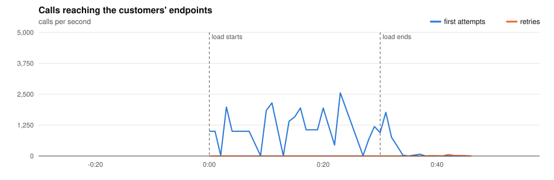
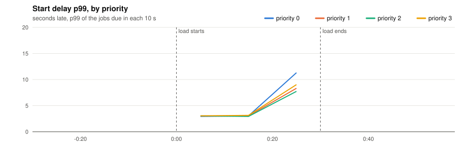
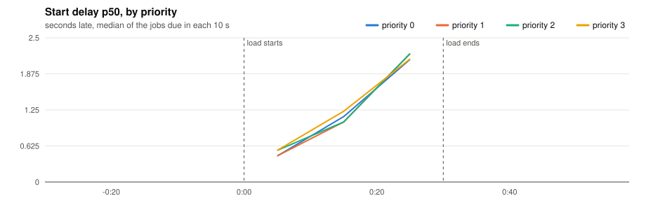
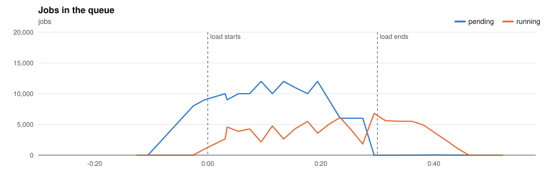
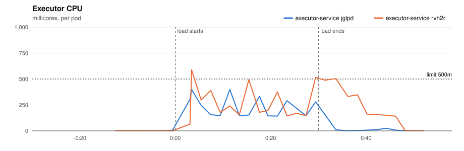
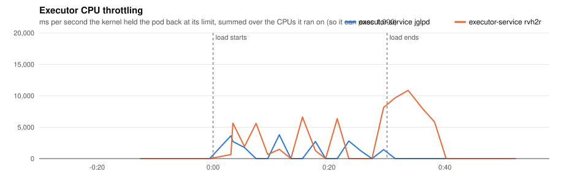
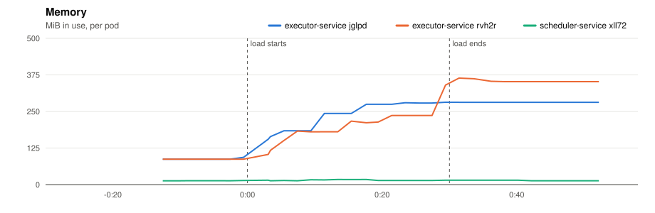
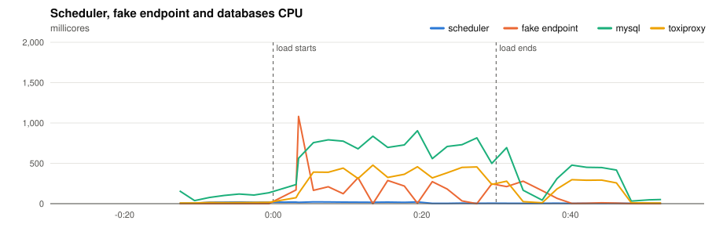
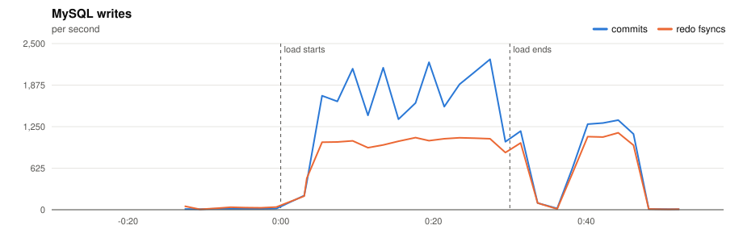
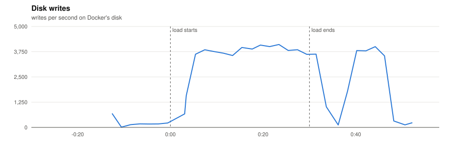

# P10 · 20261119T210314Z-2x-1000-w30000 (2x-1000-w30000)

- **Load:** 30 s of 1000 one-off jobs per second, endpoint `lat=50&dist=lognormal`, timeout 30 s; 30,000 tasks seeded.
- **Deployment:** 2 executors; executor-service: `JOB_TIME_LIMIT_SECONDS=1 WORKER_COUNT=30000 JOB_QUEUE_SIZE=10000 PPROF_ADDR=:6060`; scheduler-service: `SCHEDULE_INTERVAL=200ms SCHEDULE_LOOKAHEAD=10s PPROF_ADDR=:6060`
- **Raw data:** `bench/results/P10-ceiling/runs/20261119T210314Z-2x-1000-w30000/` (local, not committed)

## Jobs

| Created | Succeeded | Dead | Still pending or running | Retried | Duplicate successes | Timed out, done anyway | Calls per second (first attempts) |
|---|---|---|---|---|---|---|---|
| 30,000 | 30,000 | 0 | 0 | 146 | 0 | 0 | 801.0 |

*Duplicate successes*: the endpoint answered 200 twice for one job, which only a failure should cause. *Timed out, done anyway*: the executor gave up after the timeout while the endpoint finished the work, so the retry made the customer process the job again.

**Start delay** (when the call reached the endpoint minus when the job was due, first attempts):

| Priority | Jobs | p50 | p90 | p99 | max |
|---|---|---|---|---|---|
| 0 | 7,446 | 1.036 s | 3.933 s | 9.538 s | 13.312 s |
| 1 | 7,449 | 1.036 s | 4.726 s | 7.236 s | 13.310 s |
| 2 | 7,474 | 1.036 s | 4.933 s | 7.133 s | 8.832 s |
| 3 | 7,485 | 1.127 s | 5.027 s | 8.032 s | 9.635 s |
| all | 29,854 | 1.036 s | 4.731 s | 7.726 s | 13.312 s |

## Charts

Time is minutes:seconds from the start of the load.





















## Resources

| Component | CPU avg (millicores) | CPU max | Throttled max (ms/s) | Memory max (MiB) |
|---|---|---|---|---|
| executor-service jglpd | 113 | 399 | 3788 | 282 |
| executor-service rvh2r | 195 | 588 | 10865 | 364 |
| scheduler-service xll72 | 11 | 22 | 0 | 18 |
| fake-endpoint cf55t | 123 | 1081 | 0 | 378 |
| mysql | 429 | 904 | 0 | 1462 |
| cassandra | 93 | 283 | 0 | 1061 |
| toxiproxy | 211 | 478 | 0 | 22 |

MySQL: up to 2264 commits/s, 1158 redo fsyncs/s, 2 row lock waits/s, 14 connections.

## CPU profile: executor, 20 s from 0:08

```text
      flat  flat%   sum%        cum   cum%
     0.78s 38.05% 38.05%      0.78s 38.05%  internal/runtime/syscall.Syscall6
     0.39s 19.02% 57.07%      0.39s 19.02%  runtime.futex
     0.05s  2.44% 59.51%      0.05s  2.44%  internal/runtime/atomic.(*Uint32).CompareAndSwap (inline)
     0.04s  1.95% 61.46%      0.05s  2.44%  runtime.findObject
     0.03s  1.46% 62.93%      0.05s  2.44%  runtime.(*unwinder).resolveInternal
     0.03s  1.46% 64.39%      0.03s  1.46%  runtime.gopark
     0.03s  1.46% 65.85%      0.20s  9.76%  runtime.selectgo
     0.03s  1.46% 67.32%      0.03s  1.46%  runtime.write1
     0.02s  0.98% 68.29%      0.22s 10.73%  github.com/go-sql-driver/mysql.(*buffer).fill
     0.02s  0.98% 69.27%      0.28s 13.66%  runtime.findRunnable
     0.02s  0.98% 70.24%      0.02s  0.98%  runtime.funcdata
     0.02s  0.98% 71.22%      0.02s  0.98%  runtime.procyield
```

## CPU profile: scheduler, 20 s from 0:08

```text
      flat  flat%   sum%        cum   cum%
      10ms 33.33% 33.33%       10ms 33.33%  internal/runtime/syscall.Syscall6
      10ms 33.33% 66.67%       10ms 33.33%  runtime.madvise
      10ms 33.33%   100%       10ms 33.33%  runtime.stealWork
         0     0%   100%       10ms 33.33%  database/sql.(*Rows).Close
         0     0%   100%       10ms 33.33%  database/sql.(*Rows).Next
         0     0%   100%       10ms 33.33%  database/sql.(*Rows).close
         0     0%   100%       10ms 33.33%  database/sql.(*driverStmt).Close
         0     0%   100%       10ms 33.33%  github.com/JoelTeoGom/distributed-scheduler/scheduler-service/internal/adapters/out/mysql.(*SchedulerRepository).ScheduleJobs
         0     0%   100%       10ms 33.33%  github.com/JoelTeoGom/distributed-scheduler/scheduler-service/internal/adapters/out/mysql.selectScheduledTasks
         0     0%   100%       10ms 33.33%  github.com/JoelTeoGom/distributed-scheduler/scheduler-service/internal/service.(*SchedulerService).Start
         0     0%   100%       10ms 33.33%  github.com/go-sql-driver/mysql.(*mysqlConn).writeCommandPacketUint32
         0     0%   100%       10ms 33.33%  github.com/go-sql-driver/mysql.(*mysqlConn).writePacket
```
