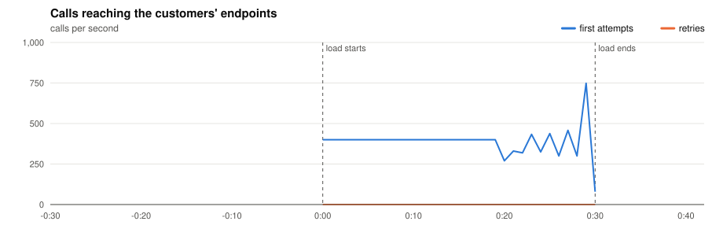
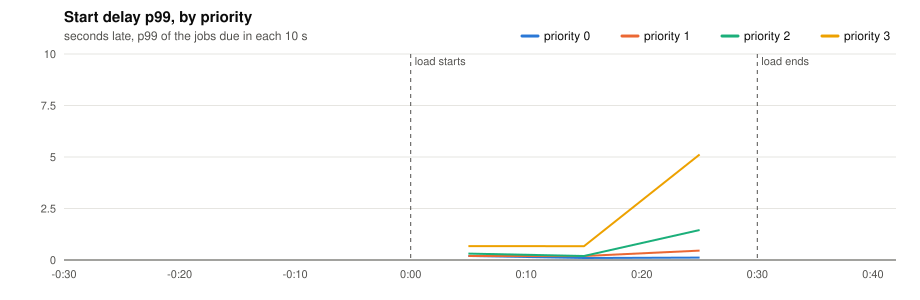
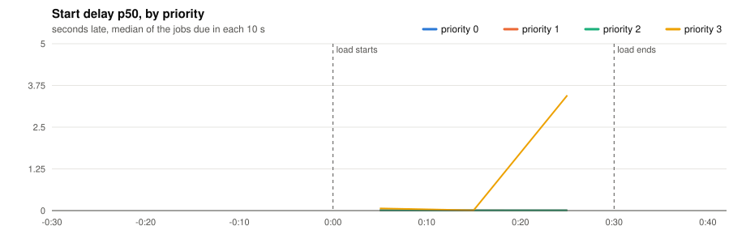
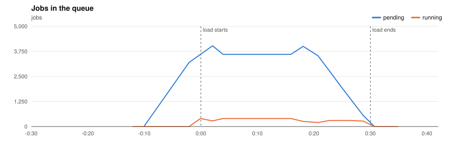
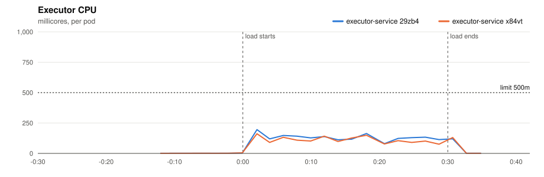
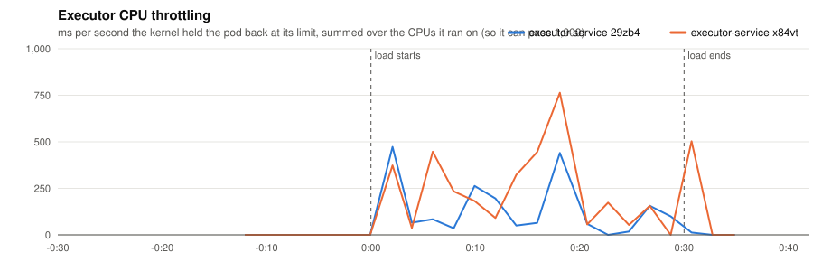
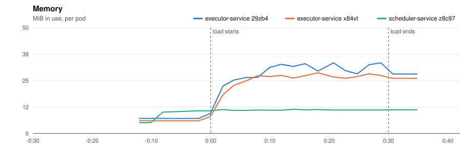
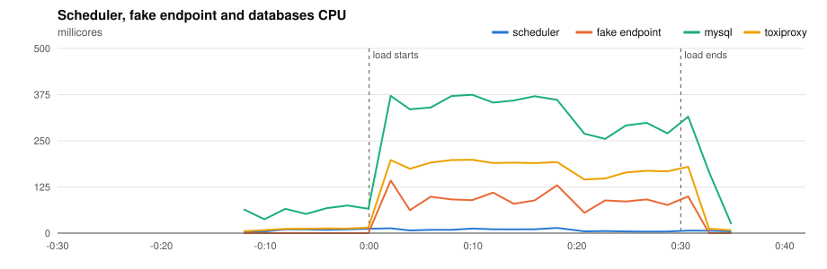
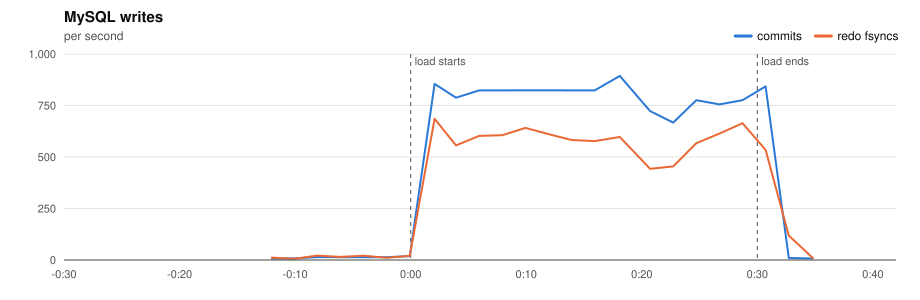
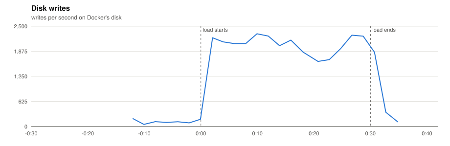

# P10 · 20261119T210435Z-2x-400-w250 (2x-400-w250)

- **Load:** 30 s of 400 one-off jobs per second, endpoint `lat=50&dist=lognormal`, timeout 30 s; 12,000 tasks seeded.
- **Deployment:** 2 executors; executor-service: `JOB_TIME_LIMIT_SECONDS=1 WORKER_COUNT=250 JOB_QUEUE_SIZE=10000 PPROF_ADDR=:6060`; scheduler-service: `SCHEDULE_INTERVAL=200ms SCHEDULE_LOOKAHEAD=10s PPROF_ADDR=:6060`
- **Raw data:** `bench/results/P10-ceiling/runs/20261119T210435Z-2x-400-w250/` (local, not committed)

## Jobs

| Created | Succeeded | Dead | Still pending or running | Retried | Duplicate successes | Timed out, done anyway | Calls per second (first attempts) |
|---|---|---|---|---|---|---|---|
| 12,000 | 12,000 | 0 | 0 | 0 | 0 | 0 | 397.6 |

*Duplicate successes*: the endpoint answered 200 twice for one job, which only a failure should cause. *Timed out, done anyway*: the executor gave up after the timeout while the endpoint finished the work, so the retry made the customer process the job again.

**Start delay** (when the call reached the endpoint minus when the job was due, first attempts):

| Priority | Jobs | p50 | p90 | p99 | max |
|---|---|---|---|---|---|
| 0 | 3,000 | 0.008 s | 0.096 s | 0.117 s | 0.203 s |
| 1 | 3,000 | 0.009 s | 0.097 s | 0.455 s | 0.456 s |
| 2 | 3,000 | 0.007 s | 0.194 s | 0.459 s | 1.459 s |
| 3 | 3,000 | 0.665 s | 3.473 s | 4.481 s | 5.187 s |
| all | 12,000 | 0.009 s | 0.669 s | 4.470 s | 5.187 s |

## Charts

Time is minutes:seconds from the start of the load.





















## Resources

| Component | CPU avg (millicores) | CPU max | Throttled max (ms/s) | Memory max (MiB) |
|---|---|---|---|---|
| executor-service 29zb4 | 82 | 195 | 473 | 33 |
| executor-service x84vt | 71 | 162 | 764 | 29 |
| scheduler-service z8c97 | 8 | 14 | 0 | 11 |
| fake-endpoint cf55t | 58 | 142 | 0 | 378 |
| mysql | 231 | 374 | 0 | 1467 |
| cassandra | 86 | 246 | 0 | 1071 |
| toxiproxy | 116 | 199 | 0 | 22 |

MySQL: up to 894 commits/s, 685 redo fsyncs/s, 0 row lock waits/s, 14 connections.

## CPU profile: executor, 20 s from 0:08

```text
      flat  flat%   sum%        cum   cum%
     710ms 43.03% 43.03%      710ms 43.03%  internal/runtime/syscall.Syscall6
     230ms 13.94% 56.97%      230ms 13.94%  runtime.futex
      30ms  1.82% 58.79%       30ms  1.82%  runtime.memclrNoHeapPointers
      30ms  1.82% 60.61%       30ms  1.82%  runtime.nextFreeFast (inline)
      30ms  1.82% 62.42%      100ms  6.06%  runtime.selectgo
      20ms  1.21% 63.64%      100ms  6.06%  github.com/go-sql-driver/mysql.(*mysqlStmt).writeExecutePacket
      20ms  1.21% 64.85%      310ms 18.79%  net.(*netFD).connect
      20ms  1.21% 66.06%       20ms  1.21%  runtime.findObject
      20ms  1.21% 67.27%       20ms  1.21%  runtime.memmove
      20ms  1.21% 68.48%      110ms  6.67%  runtime.newobject
      20ms  1.21% 69.70%       40ms  2.42%  runtime.pcvalue
      20ms  1.21% 70.91%       20ms  1.21%  runtime.releasem (inline)
```

## CPU profile: scheduler, 20 s from 0:08

```text
      flat  flat%   sum%        cum   cum%
      20ms 33.33% 33.33%       20ms 33.33%  internal/runtime/syscall.Syscall6
      10ms 16.67% 50.00%       10ms 16.67%  runtime.(*stkframe).getStackMap
      10ms 16.67% 66.67%       10ms 16.67%  runtime.futex
      10ms 16.67% 83.33%       10ms 16.67%  runtime.pcvalue
      10ms 16.67%   100%       10ms 16.67%  runtime.typePointers.next
         0     0%   100%       10ms 16.67%  database/sql.(*Rows).Next
         0     0%   100%       10ms 16.67%  database/sql.(*Rows).Next.func1
         0     0%   100%       10ms 16.67%  database/sql.(*Rows).nextLocked
         0     0%   100%       10ms 16.67%  database/sql.withLock
         0     0%   100%       10ms 16.67%  github.com/JoelTeoGom/distributed-scheduler/scheduler-service/internal/adapters/out/mysql.(*SchedulerRepository).ScheduleJobs
         0     0%   100%       10ms 16.67%  github.com/JoelTeoGom/distributed-scheduler/scheduler-service/internal/adapters/out/mysql.selectScheduledTasks
         0     0%   100%       10ms 16.67%  github.com/JoelTeoGom/distributed-scheduler/scheduler-service/internal/service.(*SchedulerService).Start
```
