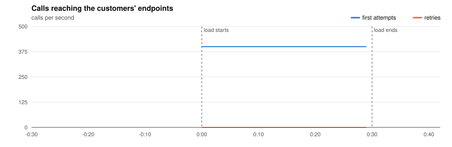
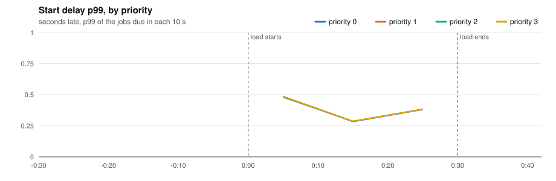
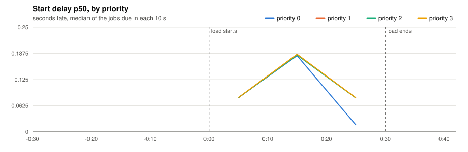
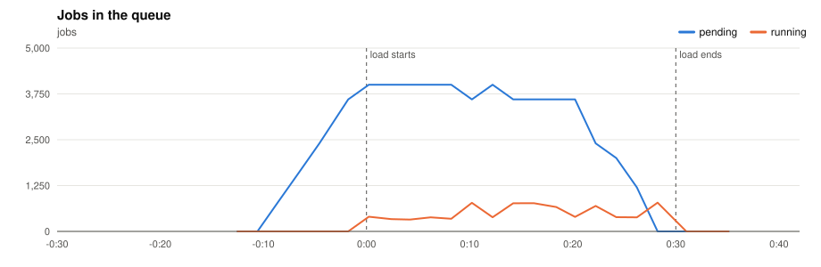
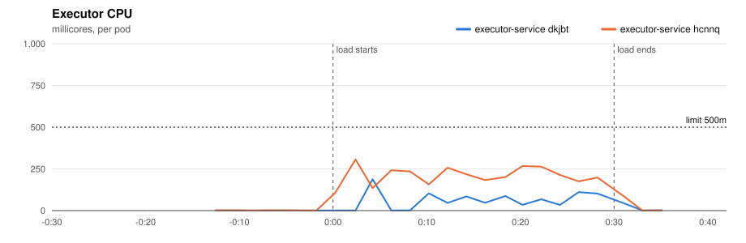
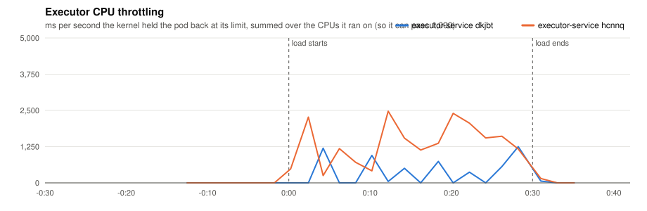
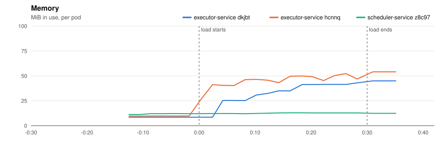
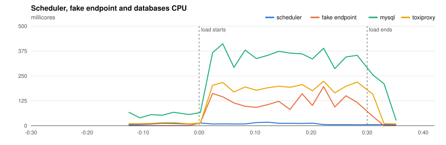
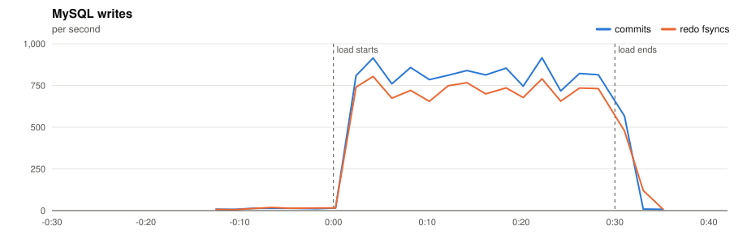
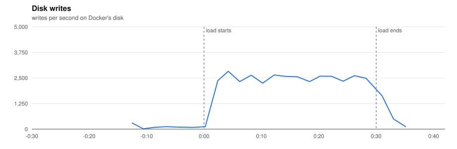

# P10 · 20261119T210532Z-2x-400-w1000 (2x-400-w1000)

- **Load:** 30 s of 400 one-off jobs per second, endpoint `lat=50&dist=lognormal`, timeout 30 s; 12,000 tasks seeded.
- **Deployment:** 2 executors; executor-service: `JOB_TIME_LIMIT_SECONDS=1 WORKER_COUNT=1000 JOB_QUEUE_SIZE=10000 PPROF_ADDR=:6060`; scheduler-service: `SCHEDULE_INTERVAL=200ms SCHEDULE_LOOKAHEAD=10s PPROF_ADDR=:6060`
- **Raw data:** `bench/results/P10-ceiling/runs/20261119T210532Z-2x-400-w1000/` (local, not committed)

## Jobs

| Created | Succeeded | Dead | Still pending or running | Retried | Duplicate successes | Timed out, done anyway | Calls per second (first attempts) |
|---|---|---|---|---|---|---|---|
| 12,000 | 12,000 | 0 | 0 | 0 | 0 | 0 | 415.6 |

*Duplicate successes*: the endpoint answered 200 twice for one job, which only a failure should cause. *Timed out, done anyway*: the executor gave up after the timeout while the endpoint finished the work, so the retry made the customer process the job again.

**Start delay** (when the call reached the endpoint minus when the job was due, first attempts):

| Priority | Jobs | p50 | p90 | p99 | max |
|---|---|---|---|---|---|
| 0 | 3,000 | 0.083 s | 0.195 s | 0.389 s | 0.487 s |
| 1 | 3,000 | 0.084 s | 0.282 s | 0.389 s | 0.487 s |
| 2 | 3,000 | 0.084 s | 0.216 s | 0.387 s | 0.487 s |
| 3 | 3,000 | 0.084 s | 0.281 s | 0.388 s | 0.487 s |
| all | 12,000 | 0.084 s | 0.281 s | 0.388 s | 0.487 s |

## Charts

Time is minutes:seconds from the start of the load.





















## Resources

| Component | CPU avg (millicores) | CPU max | Throttled max (ms/s) | Memory max (MiB) |
|---|---|---|---|---|
| executor-service dkjbt | 40 | 188 | 1250 | 45 |
| executor-service hcnnq | 136 | 307 | 2474 | 54 |
| scheduler-service z8c97 | 9 | 18 | 0 | 13 |
| fake-endpoint cf55t | 75 | 196 | 0 | 379 |
| mysql | 243 | 411 | 0 | 1471 |
| cassandra | 90 | 268 | 0 | 1068 |
| toxiproxy | 124 | 223 | 0 | 22 |

MySQL: up to 916 commits/s, 804 redo fsyncs/s, 0 row lock waits/s, 14 connections.

## CPU profile: executor, 20 s from 0:08

```text
      flat  flat%   sum%        cum   cum%
     240ms 44.44% 44.44%      240ms 44.44%  internal/runtime/syscall.Syscall6
     140ms 25.93% 70.37%      140ms 25.93%  runtime.futex
      20ms  3.70% 74.07%       40ms  7.41%  runtime.stealWork
      10ms  1.85% 75.93%       10ms  1.85%  bytes.Cut
      10ms  1.85% 77.78%       60ms 11.11%  database/sql.withLock
      10ms  1.85% 79.63%       10ms  1.85%  internal/runtime/atomic.(*Int64).Swap
      10ms  1.85% 81.48%       10ms  1.85%  net.wrapSyscallError (inline)
      10ms  1.85% 83.33%       10ms  1.85%  net/http.(*Transport).tryPutIdleConn
      10ms  1.85% 85.19%       10ms  1.85%  runtime.(*mspan).init
      10ms  1.85% 87.04%       10ms  1.85%  runtime.execute
      10ms  1.85% 88.89%       60ms 11.11%  runtime.injectglist.func1
      10ms  1.85% 90.74%       10ms  1.85%  runtime.memclrNoHeapPointers
```

## CPU profile: scheduler, 20 s from 0:08

```text
      flat  flat%   sum%        cum   cum%
      10ms 50.00% 50.00%       10ms 50.00%  internal/runtime/syscall.Syscall6
      10ms 50.00%   100%       10ms 50.00%  runtime.mallocgcSmallScanNoHeader
         0     0%   100%       10ms 50.00%  crypto/internal/sysrand.Read
         0     0%   100%       10ms 50.00%  crypto/internal/sysrand.read
         0     0%   100%       10ms 50.00%  crypto/rand.(*reader).Read
         0     0%   100%       20ms   100%  github.com/JoelTeoGom/distributed-scheduler/scheduler-service/internal/adapters/out/mysql.(*SchedulerRepository).ScheduleJobs
         0     0%   100%       20ms   100%  github.com/JoelTeoGom/distributed-scheduler/scheduler-service/internal/adapters/out/mysql.insertJobs
         0     0%   100%       20ms   100%  github.com/JoelTeoGom/distributed-scheduler/scheduler-service/internal/service.(*SchedulerService).Start
         0     0%   100%       10ms 50.00%  github.com/google/uuid.NewRandom
         0     0%   100%       10ms 50.00%  github.com/google/uuid.NewRandomFromReader
         0     0%   100%       10ms 50.00%  github.com/google/uuid.NewV7
         0     0%   100%       10ms 50.00%  internal/syscall/unix.GetRandom
```
