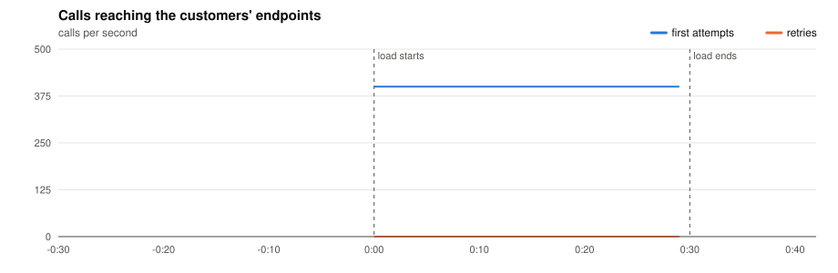
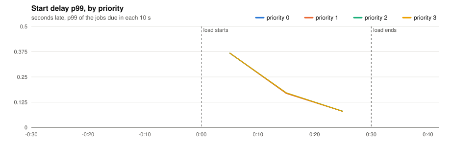
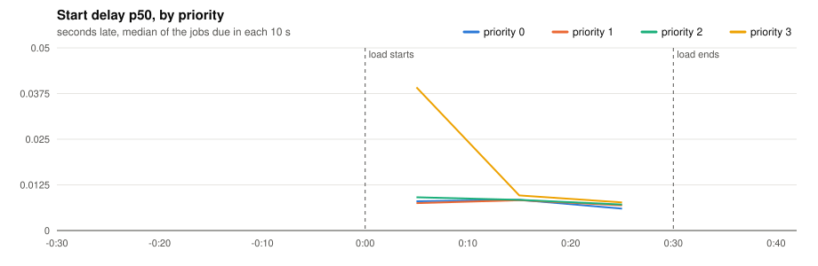
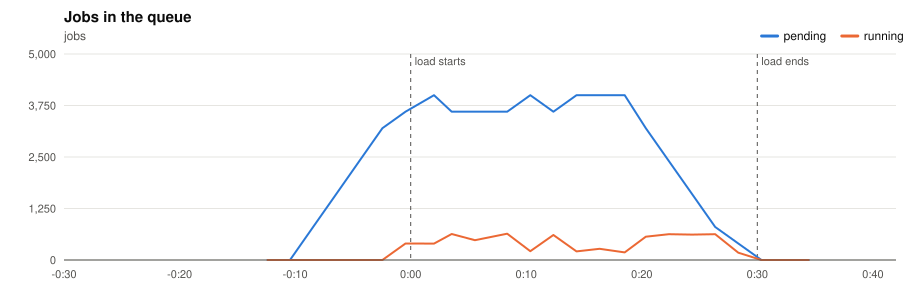
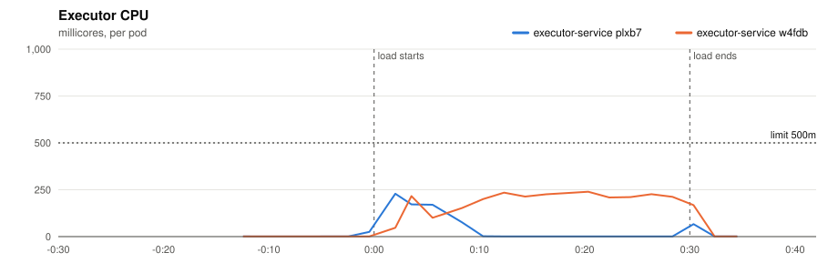
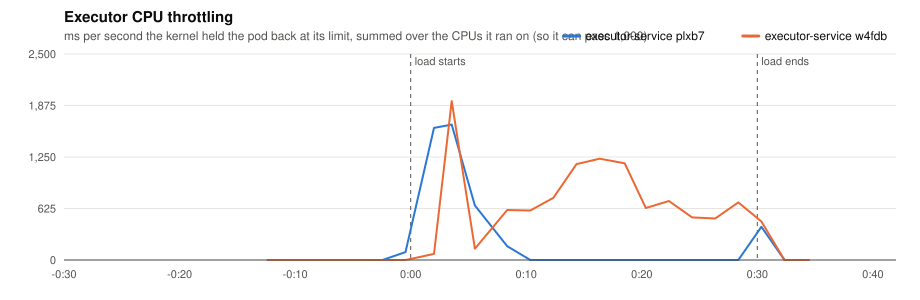
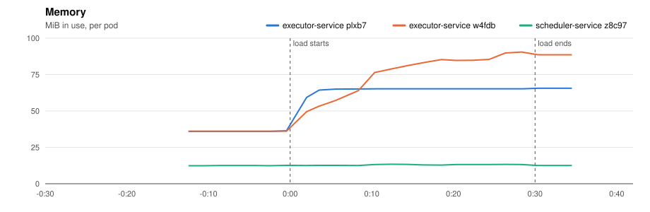
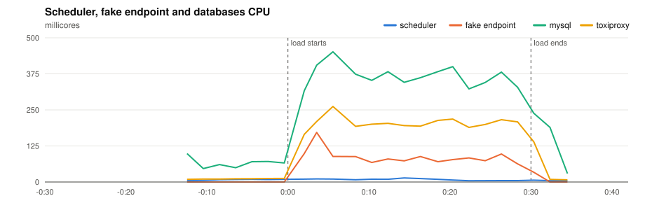
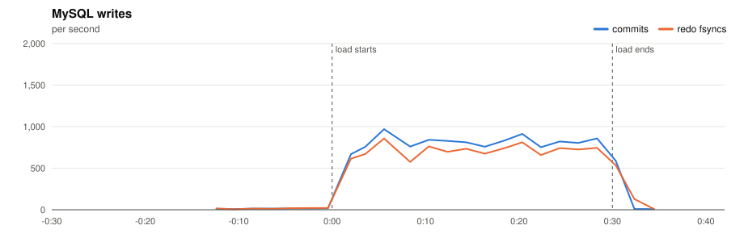
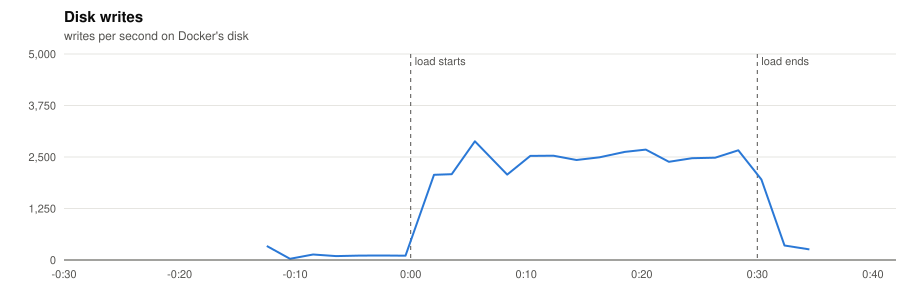

# P10 · 20261119T210628Z-2x-400-w10000 (2x-400-w10000)

- **Load:** 30 s of 400 one-off jobs per second, endpoint `lat=50&dist=lognormal`, timeout 30 s; 12,000 tasks seeded.
- **Deployment:** 2 executors; executor-service: `JOB_TIME_LIMIT_SECONDS=1 WORKER_COUNT=10000 JOB_QUEUE_SIZE=10000 PPROF_ADDR=:6060`; scheduler-service: `SCHEDULE_INTERVAL=200ms SCHEDULE_LOOKAHEAD=10s PPROF_ADDR=:6060`
- **Raw data:** `bench/results/P10-ceiling/runs/20261119T210628Z-2x-400-w10000/` (local, not committed)

## Jobs

| Created | Succeeded | Dead | Still pending or running | Retried | Duplicate successes | Timed out, done anyway | Calls per second (first attempts) |
|---|---|---|---|---|---|---|---|
| 12,000 | 12,000 | 0 | 0 | 0 | 0 | 0 | 413.5 |

*Duplicate successes*: the endpoint answered 200 twice for one job, which only a failure should cause. *Timed out, done anyway*: the executor gave up after the timeout while the endpoint finished the work, so the retry made the customer process the job again.

**Start delay** (when the call reached the endpoint minus when the job was due, first attempts):

| Priority | Jobs | p50 | p90 | p99 | max |
|---|---|---|---|---|---|
| 0 | 3,000 | 0.008 s | 0.080 s | 0.368 s | 0.370 s |
| 1 | 3,000 | 0.007 s | 0.080 s | 0.273 s | 0.369 s |
| 2 | 3,000 | 0.008 s | 0.135 s | 0.273 s | 0.369 s |
| 3 | 3,000 | 0.009 s | 0.117 s | 0.369 s | 0.369 s |
| all | 12,000 | 0.008 s | 0.083 s | 0.368 s | 0.370 s |

## Charts

Time is minutes:seconds from the start of the load.





















## Resources

| Component | CPU avg (millicores) | CPU max | Throttled max (ms/s) | Memory max (MiB) |
|---|---|---|---|---|
| executor-service plxb7 | 31 | 228 | 1643 | 66 |
| executor-service w4fdb | 121 | 239 | 1928 | 90 |
| scheduler-service z8c97 | 8 | 14 | 0 | 13 |
| fake-endpoint cf55t | 52 | 172 | 0 | 300 |
| mysql | 253 | 452 | 0 | 1475 |
| cassandra | 92 | 258 | 0 | 1066 |
| toxiproxy | 129 | 262 | 0 | 22 |

MySQL: up to 970 commits/s, 858 redo fsyncs/s, 0 row lock waits/s, 14 connections.

## CPU profile: executor, 20 s from 0:09

```text
      flat  flat%   sum%        cum   cum%
```

## CPU profile: scheduler, 20 s from 0:09

```text
      flat  flat%   sum%        cum   cum%
      10ms 20.00% 20.00%       10ms 20.00%  internal/runtime/syscall.Syscall6
      10ms 20.00% 40.00%       10ms 20.00%  runtime.(*gList).push
      10ms 20.00% 60.00%       10ms 20.00%  runtime.(*mcache).prepareForSweep
      10ms 20.00% 80.00%       10ms 20.00%  runtime.nanotime
      10ms 20.00%   100%       10ms 20.00%  runtime.scanobject
         0     0%   100%       10ms 20.00%  database/sql.(*DB).execDC
         0     0%   100%       10ms 20.00%  database/sql.(*Tx).ExecContext
         0     0%   100%       10ms 20.00%  database/sql.ctxDriverStmtExec
         0     0%   100%       10ms 20.00%  database/sql.resultFromStatement
         0     0%   100%       10ms 20.00%  github.com/JoelTeoGom/distributed-scheduler/scheduler-service/internal/adapters/out/mysql.(*SchedulerRepository).ScheduleJobs
         0     0%   100%       10ms 20.00%  github.com/JoelTeoGom/distributed-scheduler/scheduler-service/internal/adapters/out/mysql.insertJobs
         0     0%   100%       10ms 20.00%  github.com/JoelTeoGom/distributed-scheduler/scheduler-service/internal/service.(*SchedulerService).Start
```
