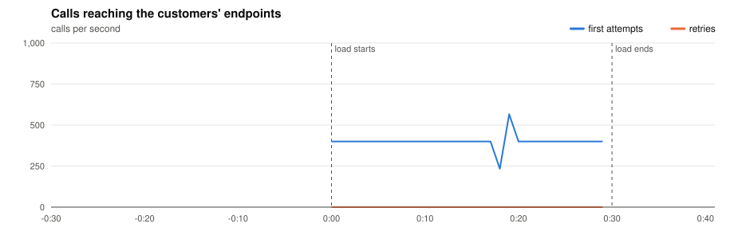
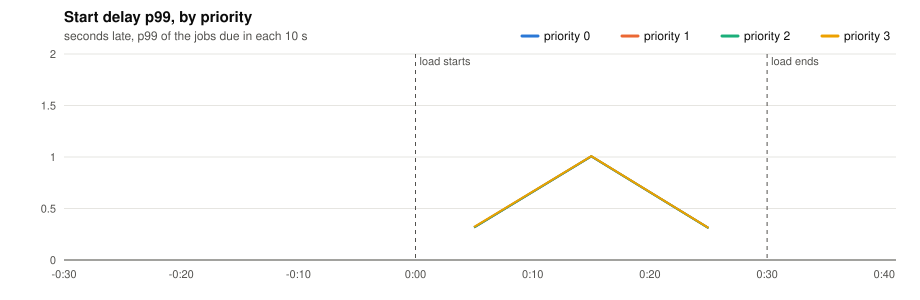
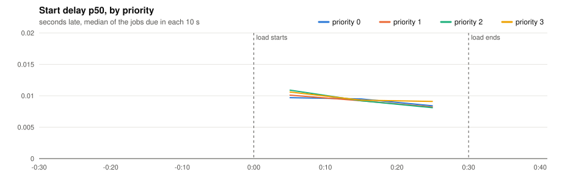
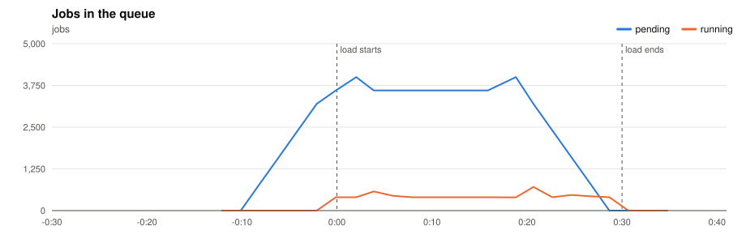
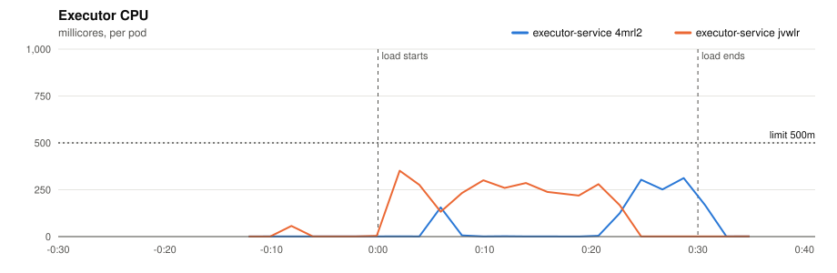
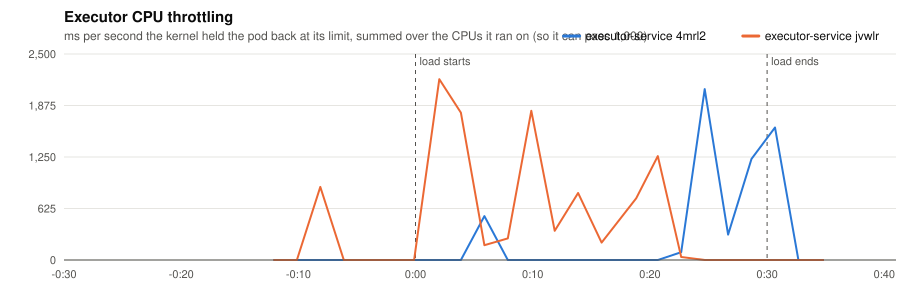
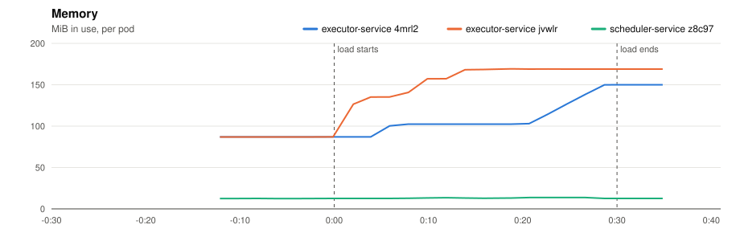
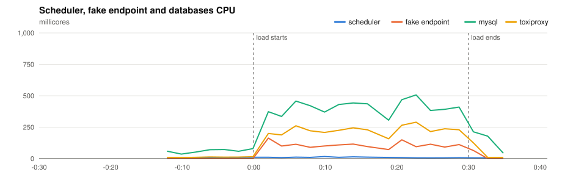
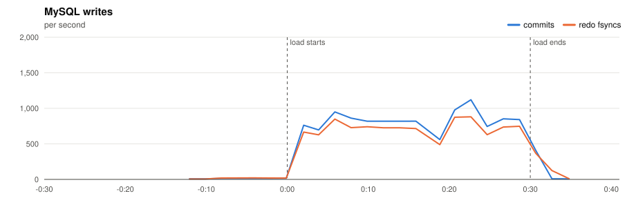
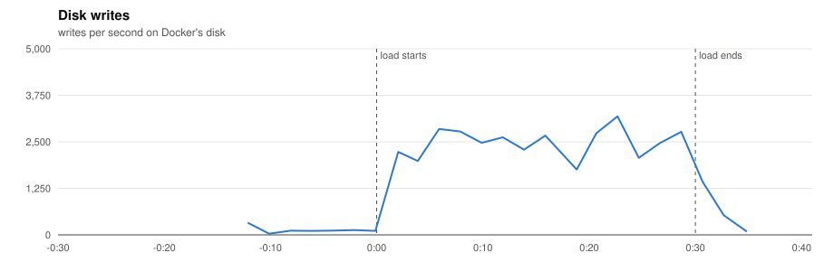

# P10 · 20261119T210723Z-2x-400-w30000 (2x-400-w30000)

- **Load:** 30 s of 400 one-off jobs per second, endpoint `lat=50&dist=lognormal`, timeout 30 s; 12,000 tasks seeded.
- **Deployment:** 2 executors; executor-service: `JOB_TIME_LIMIT_SECONDS=1 WORKER_COUNT=30000 JOB_QUEUE_SIZE=10000 PPROF_ADDR=:6060`; scheduler-service: `SCHEDULE_INTERVAL=200ms SCHEDULE_LOOKAHEAD=10s PPROF_ADDR=:6060`
- **Raw data:** `bench/results/P10-ceiling/runs/20261119T210723Z-2x-400-w30000/` (local, not committed)

## Jobs

| Created | Succeeded | Dead | Still pending or running | Retried | Duplicate successes | Timed out, done anyway | Calls per second (first attempts) |
|---|---|---|---|---|---|---|---|
| 12,000 | 12,000 | 0 | 0 | 0 | 0 | 0 | 410.4 |

*Duplicate successes*: the endpoint answered 200 twice for one job, which only a failure should cause. *Timed out, done anyway*: the executor gave up after the timeout while the endpoint finished the work, so the retry made the customer process the job again.

**Start delay** (when the call reached the endpoint minus when the job was due, first attempts):

| Priority | Jobs | p50 | p90 | p99 | max |
|---|---|---|---|---|---|
| 0 | 3,000 | 0.009 s | 0.243 s | 1.006 s | 1.009 s |
| 1 | 3,000 | 0.009 s | 0.214 s | 1.006 s | 1.009 s |
| 2 | 3,000 | 0.009 s | 0.242 s | 1.006 s | 1.009 s |
| 3 | 3,000 | 0.010 s | 0.256 s | 1.006 s | 1.009 s |
| all | 12,000 | 0.009 s | 0.243 s | 1.006 s | 1.009 s |

## Charts

Time is minutes:seconds from the start of the load.





















## Resources

| Component | CPU avg (millicores) | CPU max | Throttled max (ms/s) | Memory max (MiB) |
|---|---|---|---|---|
| executor-service 4mrl2 | 56 | 312 | 2074 | 150 |
| executor-service jvwlr | 117 | 351 | 2194 | 169 |
| scheduler-service z8c97 | 9 | 17 | 0 | 14 |
| fake-endpoint cf55t | 66 | 163 | 0 | 267 |
| mysql | 275 | 507 | 0 | 1480 |
| cassandra | 94 | 338 | 0 | 1068 |
| toxiproxy | 142 | 290 | 0 | 22 |

MySQL: up to 1120 commits/s, 881 redo fsyncs/s, 0 row lock waits/s, 14 connections.

## CPU profile: executor, 20 s from 0:07

```text
      flat  flat%   sum%        cum   cum%
     0.48s 47.52% 47.52%      0.48s 47.52%  internal/runtime/syscall.Syscall6
     0.11s 10.89% 58.42%      0.11s 10.89%  runtime.futex
     0.04s  3.96% 62.38%      0.04s  3.96%  runtime.memclrNoHeapPointers
     0.02s  1.98% 64.36%      0.02s  1.98%  runtime.(*lfstack).pop (inline)
     0.02s  1.98% 66.34%      0.02s  1.98%  runtime.(*m).clearAllpSnapshot
     0.02s  1.98% 68.32%      0.02s  1.98%  runtime.findfunc
     0.01s  0.99% 69.31%      0.02s  1.98%  context.(*cancelCtx).Done
     0.01s  0.99% 70.30%      0.41s 40.59%  github.com/JoelTeoGom/distributed-scheduler/executor-service/internal/service.(*WorkerService).executeJob
     0.01s  0.99% 71.29%      0.01s  0.99%  internal/runtime/atomic.(*Uint32).Load
     0.01s  0.99% 72.28%      0.01s  0.99%  net/http.(*persistConn).waitForContinue
     0.01s  0.99% 73.27%      0.01s  0.99%  net/http/httptrace.ContextClientTrace
     0.01s  0.99% 74.26%      0.01s  0.99%  net/textproto.isASCIISpace
```

## CPU profile: scheduler, 20 s from 0:07

```text
      flat  flat%   sum%        cum   cum%
      10ms 25.00% 25.00%       10ms 25.00%  runtime.bool2int (inline)
      10ms 25.00% 50.00%       10ms 25.00%  runtime.futex
      10ms 25.00% 75.00%       10ms 25.00%  runtime.memclrNoHeapPointers
      10ms 25.00%   100%       10ms 25.00%  runtime.spanOf
         0     0%   100%       10ms 25.00%  database/sql.(*DB).execDC
         0     0%   100%       10ms 25.00%  database/sql.(*DB).execDC.func2
         0     0%   100%       10ms 25.00%  database/sql.(*Tx).ExecContext
         0     0%   100%       10ms 25.00%  database/sql.driverArgsConnLocked
         0     0%   100%       10ms 25.00%  database/sql.withLock
         0     0%   100%       20ms 50.00%  github.com/JoelTeoGom/distributed-scheduler/scheduler-service/internal/adapters/out/mysql.(*SchedulerRepository).ScheduleJobs
         0     0%   100%       20ms 50.00%  github.com/JoelTeoGom/distributed-scheduler/scheduler-service/internal/adapters/out/mysql.insertJobs
         0     0%   100%       20ms 50.00%  github.com/JoelTeoGom/distributed-scheduler/scheduler-service/internal/service.(*SchedulerService).Start
```
