# P11 · Peak tuning

> How many jobs per second can the platform drain at the 09:00 peak, tuning only settings and replicas?

**Load:** the model until 90 s after the 09:00 peak, ~30,000 jobs on one second (scale 1) and ~90,000 (scale 3), ~6 min per run
**Status:** run on 2026-11-19 and 20. The whole story, with charts, is in [peak-tuning.pdf](../../../docs/benchmarks/peak-tuning.pdf).

## What we test

Round 2, after the scheduler's N+1 was fixed and GOMAXPROCS set from each pod's CPU limit. Each run changes one setting and keeps what won before it. The resources stay as in round 1, 0.5 vCPU and 1 GiB per pod and 2 CPUs for MySQL, except in the runs marked 1 CPU.

| Setting | Values | What it changes |
|---|---|---|
| `SCHEDULE_INTERVAL` | 1 s, 200 ms | how often the scheduler creates jobs; with 1,000 per tick, one tick a second caps it at 1,000 jobs/s |
| `SCHEDULE_BATCH_SIZE` | 1,000, 4,000, 5,000 | how many tasks one tick turns into jobs |
| Executor replicas | 2, 4, 5, 6 | how many executors share the peak |
| `WORKER_COUNT` | 2,000, 5,000, 10,000 | how many jobs an executor claims and calls at once |
| `CLAIM_INTERVAL` / `CLAIM_LEAD` | 1 s / 1 s, 250 ms / 500 ms | how often an executor claims, and how far ahead |
| `MYSQL_MAX_OPEN_CONNS` | 5, 10 | the executor's pool, shared by claims and result saves |
| Executor CPU | 0.5, 1 | the only change of resources |

Each run seeds the model, places the peak on the next 5-minute mark at least a minute after the start and stops the load 90 s after it. A peak job counts as started when it first reached the endpoint, whatever the attempt: a first attempt that timed out before arriving makes the job start with its retry.

Three runs are not valid and are kept only as records:

- `d-5x` and `f-5x-pool10`: the fake endpoint, then a pod of 512 MiB in the cluster, was OOM-killed at ~30,000 open calls, refused the rest and lost the calls it had recorded. It runs in docker compose with 4 GB since `s1-4x`; the runs before `d-5x` did not reach that load.
- `t3-4x-batch5000`: a batch of 5,000 needs 80,000 placeholders in the insert, more than MySQL's 65,535, so every tick failed and the scheduler stopped creating jobs. The service now refuses batches above 4,000.

## Results

| Run | Jobs | Succeeded | Dead | Unfinished | Duplicates | Calls/s | Start delay p50 / p90 / p99 / max |
|---|---|---|---|---|---|---|---|
| [a-base](reports/20261119T214410Z-a-base/report.md) | 38,361 | 37,914 | 447 | 0 | 78 | 82.9 | 3.48 / 26.95 / 36.63 / 36.83 s |
| [b-tick200ms](reports/20261119T215303Z-b-tick200ms/report.md) | 33,067 | 32,628 | 439 | 0 | 133 | 130.6 | 3.08 / 5.13 / 32.60 / 32.76 s |
| [c-4x](reports/20261119T215757Z-c-4x/report.md) | 33,094 | 32,709 | 385 | 0 | 0 | 168.8 | 2.32 / 4.60 / 5.23 / 5.43 s |
| [d-5x](reports/20261119T220633Z-d-5x/report.md) | 35,567 | 35,093 | 474 | 0 | 0 | 19.8 | 0.11 / 5.21 / 6.72 / 6.72 s |
| [e-5x-w2000](reports/20261119T221251Z-e-5x-w2000/report.md) | 33,133 | 32,765 | 368 | 0 | 0 | 163.2 | 5.15 / 10.00 / 12.16 / 12.79 s |
| [f-5x-pool10](reports/20261119T221808Z-f-5x-pool10/report.md) | 33,039 | 32,569 | 470 | 0 | 0 | 19.7 | 0.12 / 0.20 / 8.48 / 9.09 s |
| [s1-4x](reports/20261119T222742Z-s1-4x/report.md) | 34,183 | 33,812 | 371 | 0 | 0 | 161.2 | 2.35 / 3.89 / 4.29 / 5.17 s |
| [s2-5x](reports/20261119T223300Z-s2-5x/report.md) | 33,083 | 32,745 | 338 | 0 | 0 | 170.5 | 3.47 / 5.17 / 6.36 / 7.00 s |
| [s3-6x](reports/20261119T223800Z-s3-6x/report.md) | 33,078 | 32,709 | 369 | 0 | 1 | 172.0 | 2.80 / 5.52 / 6.03 / 6.10 s |
| [t1-4x-w5000](reports/20261119T224312Z-t1-4x-w5000/report.md) | 33,011 | 32,647 | 364 | 0 | 0 | 183.1 | 1.43 / 10.59 / 12.27 / 12.93 s |
| [t2-4x-w2000](reports/20261119T224758Z-t2-4x-w2000/report.md) | 33,094 | 32,746 | 348 | 0 | 0 | 168.8 | 5.19 / 11.83 / 13.29 / 13.75 s |
| [t3-4x-batch5000](reports/20261119T225304Z-t3-4x-batch5000/report.md) | 1,586 | 1,571 | 15 | 0 | 0 | 16.0 | 0.32 / 0.37 / 0.38 / 0.96 s |
| [t4-4x-claim250ms](reports/20261119T225647Z-t4-4x-claim250ms/report.md) | 34,483 | 34,088 | 395 | 0 | 0 | 129.6 | 2.38 / 3.77 / 4.19 / 4.29 s |
| [t3b-batch4000](reports/20261119T230348Z-t3b-batch4000/report.md) | 38,483 | 38,043 | 440 | 0 | 1 | 86.3 | 2.28 / 4.06 / 8.89 / 9.56 s |
| [v1-scale3](reports/20261119T231300Z-v1-scale3/report.md) | 99,250 | 97,718 | 1,532 | 0 | 1210 | 339.3 | 6.38 / 32.29 / 61.37 / 63.50 s |
| [u1-1cpu](reports/20261119T231817Z-u1-1cpu/report.md) | 32,989 | 32,667 | 322 | 0 | 0 | 186.4 | 1.59 / 2.11 / 2.27 / 2.28 s |
| [v2-scale3-1cpu](reports/20261119T232256Z-v2-scale3-1cpu/report.md) | 99,300 | 98,126 | 1,174 | 0 | 882 | 444.3 | 5.37 / 35.51 / 44.86 / 48.99 s |
| [v3-scale3-w5000](reports/20261119T232813Z-v3-scale3-w5000/report.md) | 99,033 | 97,904 | 1,129 | 0 | 122 | 523.4 | 12.60 / 38.59 / 57.64 / 58.47 s |

### a-base

- **Load:** 425 s of the platform model at scale 1.0: 1,000 minute, 4,000 five, 10,000 hour, 15,000 day, 2,361 at tasks; 32,361 tasks seeded.
- **Deployment:** 2 executors; executor-service: `JOB_TIME_LIMIT_SECONDS=1 WORKER_COUNT=10000 JOB_QUEUE_SIZE=10000 PPROF_ADDR=:6060 GOMAXPROCS=`; scheduler-service: `SCHEDULE_INTERVAL=1s SCHEDULE_LOOKAHEAD=10s PPROF_ADDR=:6060 GOMAXPROCS=`
- **Raw data:** `bench/results/P11-peak/runs/20261119T214410Z-a-base/` (local, not committed)

#### Jobs

| Created | Succeeded | Dead | Still pending or running | Retried | Duplicate successes | Timed out, done anyway | Calls per second (first attempts) |
|---|---|---|---|---|---|---|---|
| 38,361 | 37,914 | 447 | 0 | 4,341 | 78 | 667 | 82.9 |

*Duplicate successes*: the endpoint answered 200 twice for one job, which only a failure should cause. *Timed out, done anyway*: the executor gave up after the timeout while the endpoint finished the work, so the retry made the customer process the job again.

**Start delay** (when the call reached the endpoint minus when the job was due, first attempts):

| Priority | Jobs | p50 | p90 | p99 | max |
|---|---|---|---|---|---|
| 0 | 1,763 | 4.410 s | 26.608 s | 26.620 s | 27.141 s |
| 1 | 5,452 | 4.139 s | 26.841 s | 27.020 s | 27.125 s |
| 2 | 21,286 | 3.490 s | 27.126 s | 36.638 s | 36.831 s |
| 3 | 6,649 | 3.185 s | 14.329 s | 36.644 s | 36.649 s |
| all | 35,150 | 3.485 s | 26.946 s | 36.635 s | 36.831 s |

- **09:00 peak:** 26,867 jobs due on the same second. The last one started **36.8 s** late (p50 5.8 s, p99 36.6 s); priority 0 p99 **27.1 s**.
- **Peak throughput:** every job of the peak had started **53.8 s** after it (p99 52.3 s), **558 jobs/s**; 5,791 in its busiest second. First attempts that never reached the endpoint: **3,138**.
- **Peak by priority** (p50 / p99 / max, first attempts): 0: 5.7 / 27.1 / 27.1 s; 1: 6.0 / 27.0 / 27.1 s; 2: 5.8 / 36.6 / 36.8 s; 3: 5.6 / 36.6 / 36.6 s.

<details><summary>Charts</summary>

Time is minutes:seconds from the start of the load.

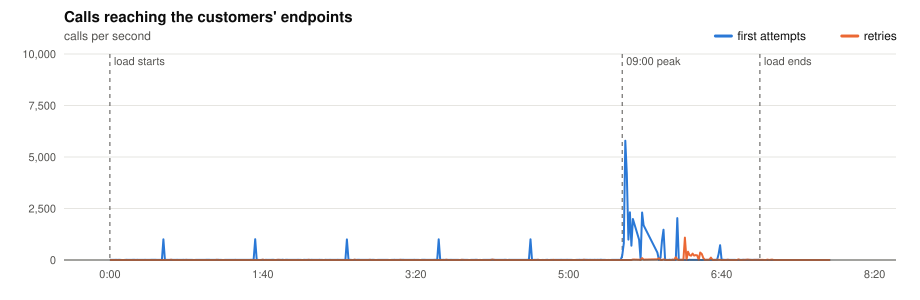

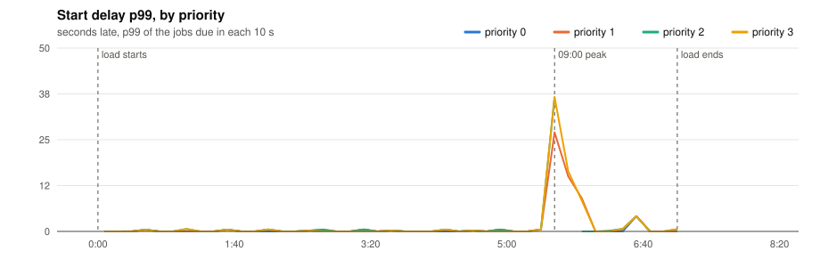

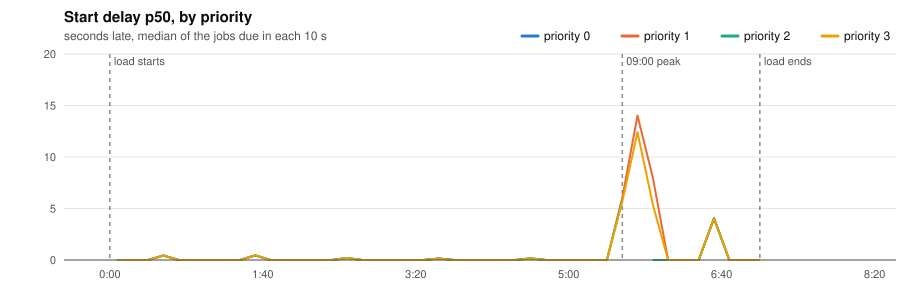

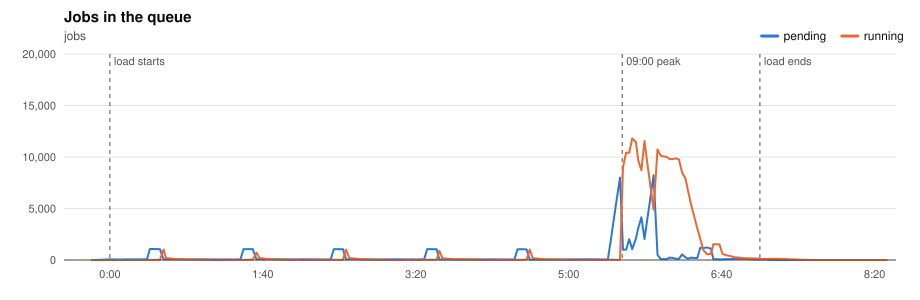

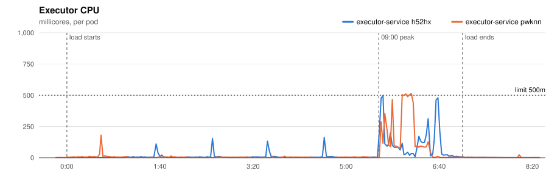

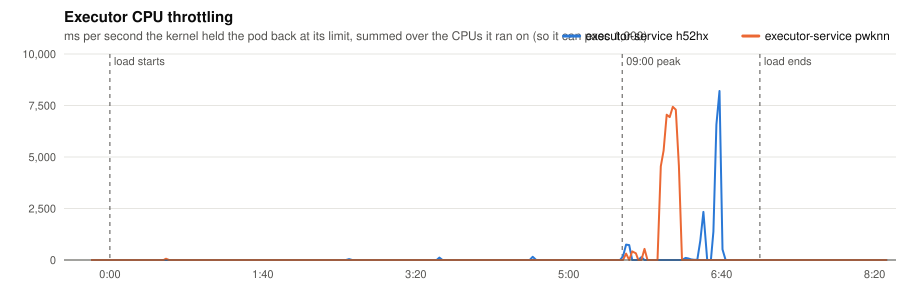

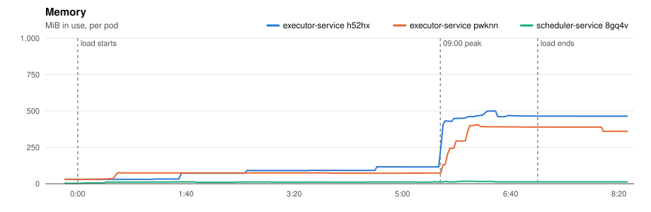

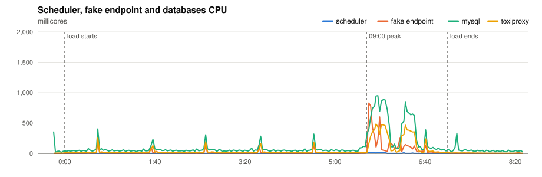

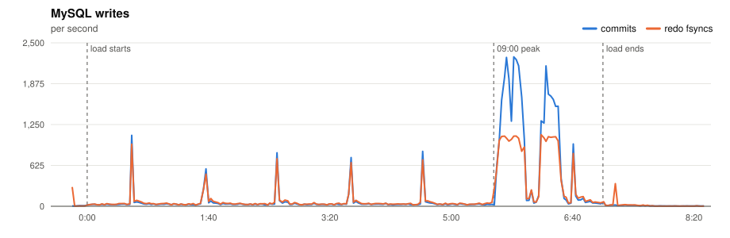

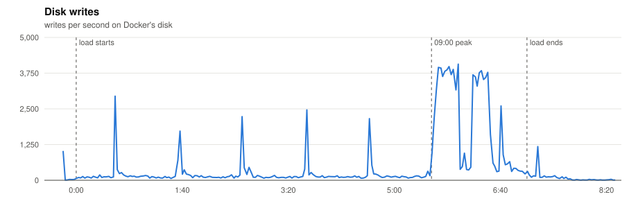

</details>

#### Resources

| Component | CPU avg (millicores) | CPU max | Throttled max (ms/s) | Memory max (MiB) |
|---|---|---|---|---|
| executor-service h52hx | 25 | 498 | 8204 | 500 |
| executor-service pwknn | 28 | 514 | 7434 | 406 |
| scheduler-service 8gq4v | 2 | 14 | 0 | 17 |
| fake-endpoint n294s | 29 | 829 | 0 | 260 |
| mysql | 114 | 951 | 28 | 1286 |
| cassandra | 96 | 355 | 0 | 1020 |
| toxiproxy | 45 | 484 | 0 | 24 |

MySQL: up to 2285 commits/s, 1095 redo fsyncs/s, 8 row lock waits/s, 16 connections.

#### CPU profiles

<details><summary>CPU profile: executor, 20 s from 5:46</summary>

```text
      flat  flat%   sum%        cum   cum%
     0.57s 54.81% 54.81%      0.57s 54.81%  internal/runtime/syscall.Syscall6
     0.06s  5.77% 60.58%      0.06s  5.77%  runtime.futex
     0.03s  2.88% 63.46%      0.03s  2.88%  runtime.gopark
     0.02s  1.92% 65.38%      0.23s 22.12%  database/sql.ctxDriverStmtExec
     0.02s  1.92% 67.31%      0.02s  1.92%  runtime.memmove
     0.02s  1.92% 69.23%      0.02s  1.92%  runtime.netpollblock
     0.02s  1.92% 71.15%      0.03s  2.88%  runtime.newobject
     0.02s  1.92% 73.08%      0.03s  2.88%  runtime.unlock2
     0.01s  0.96% 74.04%      0.02s  1.92%  context.(*cancelCtx).Done
     0.01s  0.96% 75.00%      0.59s 56.73%  github.com/JoelTeoGom/distributed-scheduler/executor-service/internal/service.(*WorkerService).executeJob
     0.01s  0.96% 75.96%      0.13s 12.50%  github.com/go-sql-driver/mysql.(*mysqlConn).readWithTimeout
     0.01s  0.96% 76.92%      0.01s  0.96%  github.com/go-sql-driver/mysql.appendLengthEncodedInteger (inline)
```

</details>

<details><summary>CPU profile: scheduler, 20 s from 5:46</summary>

```text
      flat  flat%   sum%        cum   cum%
      10ms 14.29% 14.29%       20ms 28.57%  database/sql.(*Tx).Commit
      10ms 14.29% 28.57%       10ms 14.29%  database/sql.convertAssignRows
      10ms 14.29% 42.86%       30ms 42.86%  github.com/robfig/cron/v3.getField
      10ms 14.29% 57.14%       10ms 14.29%  runtime.(*mspan).base (inline)
      10ms 14.29% 71.43%       10ms 14.29%  runtime.(*mspan).typePointersOfUnchecked
      10ms 14.29% 85.71%       10ms 14.29%  runtime.(*sweepLocked).sweep
      10ms 14.29%   100%       10ms 14.29%  runtime.futex
         0     0%   100%       10ms 14.29%  database/sql.(*Rows).Scan
         0     0%   100%       10ms 14.29%  database/sql.(*Rows).scanLocked
         0     0%   100%       10ms 14.29%  database/sql.(*Tx).Commit.func1
         0     0%   100%       10ms 14.29%  database/sql.withLock
         0     0%   100%       30ms 42.86%  github.com/JoelTeoGom/distributed-scheduler/scheduler-service/internal/adapters/out/cron.Calculator.Next
```

</details>

Run page: [reports/20261119T214410Z-a-base/report.md](reports/20261119T214410Z-a-base/report.md)

### b-tick200ms

- **Load:** 192 s of the platform model at scale 1.0: 1,000 minute, 4,000 five, 10,000 hour, 15,000 day, 1,067 at tasks; 31,067 tasks seeded.
- **Deployment:** 2 executors; executor-service: `JOB_TIME_LIMIT_SECONDS=1 WORKER_COUNT=10000 JOB_QUEUE_SIZE=10000 PPROF_ADDR=:6060 GOMAXPROCS=`; scheduler-service: `SCHEDULE_INTERVAL=200ms SCHEDULE_LOOKAHEAD=10s PPROF_ADDR=:6060 GOMAXPROCS=`
- **Raw data:** `bench/results/P11-peak/runs/20261119T215303Z-b-tick200ms/` (local, not committed)

#### Jobs

| Created | Succeeded | Dead | Still pending or running | Retried | Duplicate successes | Timed out, done anyway | Calls per second (first attempts) |
|---|---|---|---|---|---|---|---|
| 33,067 | 32,628 | 439 | 0 | 9,031 | 133 | 594 | 130.6 |

*Duplicate successes*: the endpoint answered 200 twice for one job, which only a failure should cause. *Timed out, done anyway*: the executor gave up after the timeout while the endpoint finished the work, so the retry made the customer process the job again.

**Start delay** (when the call reached the endpoint minus when the job was due, first attempts):

| Priority | Jobs | p50 | p90 | p99 | max |
|---|---|---|---|---|---|
| 0 | 1,660 | 2.898 s | 3.376 s | 5.601 s | 10.390 s |
| 1 | 4,906 | 2.975 s | 3.490 s | 5.591 s | 22.717 s |
| 2 | 17,419 | 3.112 s | 5.149 s | 32.008 s | 32.764 s |
| 3 | 952 | 5.591 s | 32.605 s | 32.741 s | 32.761 s |
| all | 24,937 | 3.083 s | 5.132 s | 32.605 s | 32.764 s |

- **09:00 peak:** 22,189 jobs due on the same second. The last one started **32.8 s** late (p50 3.1 s, p99 32.6 s); priority 0 p99 **4.0 s**.
- **Peak throughput:** every job of the peak had started **69.4 s** after it (p99 57.3 s), **432 jobs/s**; 10,657 in its busiest second. First attempts that never reached the endpoint: **7,821**.
- **Peak by priority** (p50 / p99 / max, first attempts): 0: 2.9 / 4.0 / 4.0 s; 1: 3.0 / 4.0 / 4.0 s; 2: 3.2 / 32.3 / 32.8 s; 3: 23.9 / 32.7 / 32.8 s.

<details><summary>Charts</summary>

Time is minutes:seconds from the start of the load.

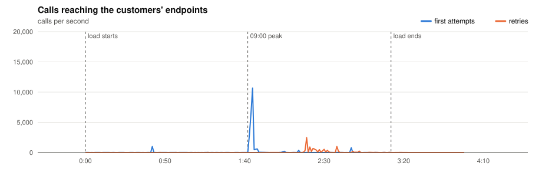

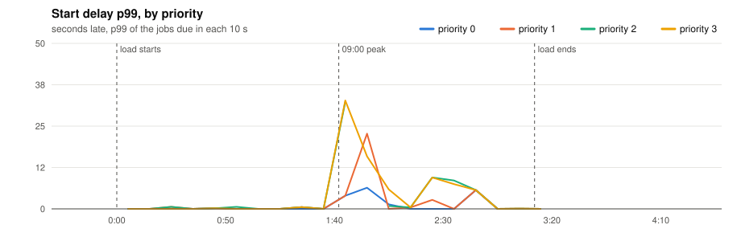

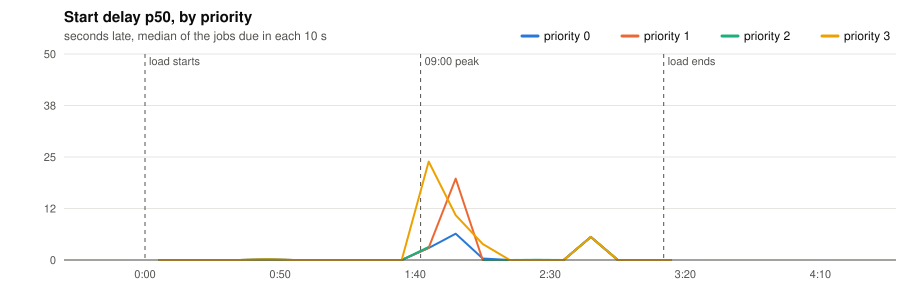

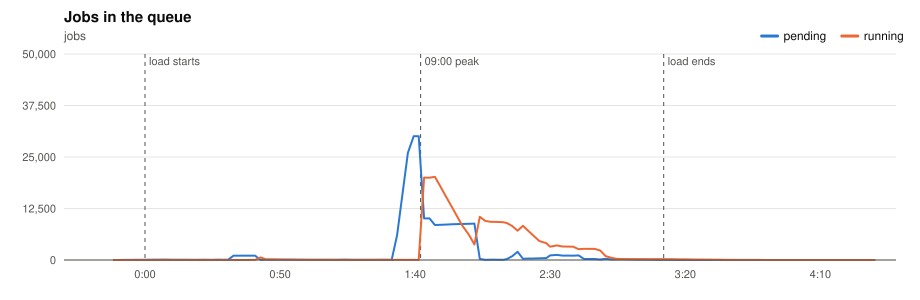

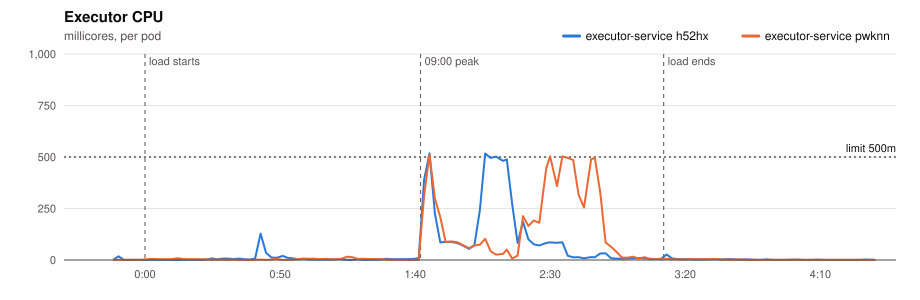

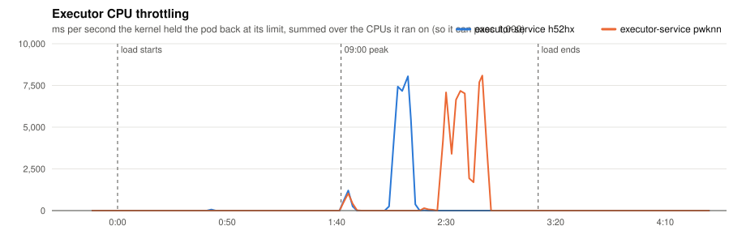

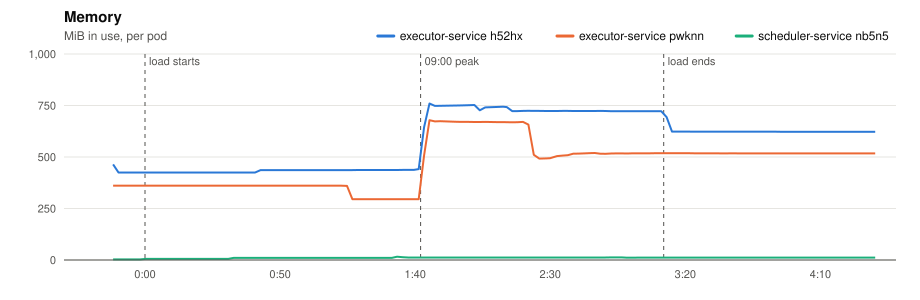

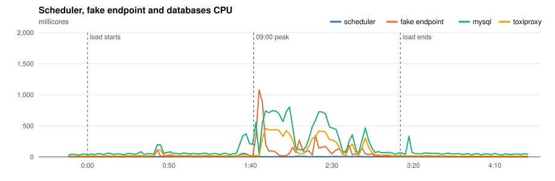

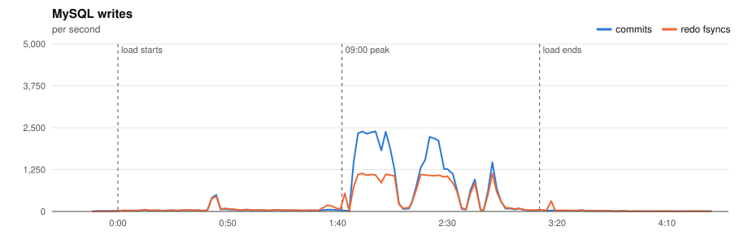

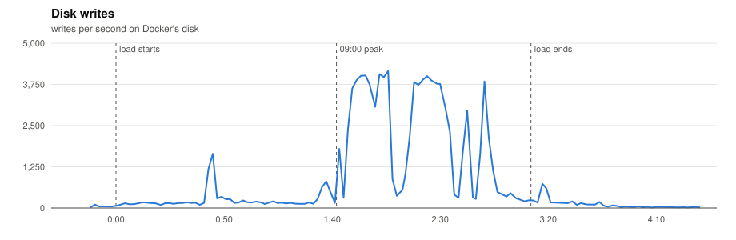

</details>

#### Resources

| Component | CPU avg (millicores) | CPU max | Throttled max (ms/s) | Memory max (MiB) |
|---|---|---|---|---|
| executor-service h52hx | 44 | 518 | 8048 | 760 |
| executor-service pwknn | 58 | 511 | 8092 | 679 |
| scheduler-service nb5n5 | 5 | 56 | 0 | 16 |
| fake-endpoint n294s | 44 | 1080 | 1336 | 454 |
| mysql | 157 | 804 | 0 | 1338 |
| cassandra | 88 | 318 | 0 | 1021 |
| toxiproxy | 73 | 458 | 0 | 24 |

MySQL: up to 2390 commits/s, 1135 redo fsyncs/s, 8 row lock waits/s, 14 connections.

#### CPU profiles

<details><summary>CPU profile: executor, 20 s from 1:49</summary>

```text
      flat  flat%   sum%        cum   cum%
     1.74s 71.60% 71.60%      1.74s 71.60%  internal/runtime/syscall.Syscall6
     0.06s  2.47% 74.07%      0.06s  2.47%  runtime.futex
     0.03s  1.23% 75.31%      0.03s  1.23%  runtime.memclrNoHeapPointers
     0.03s  1.23% 76.54%      0.03s  1.23%  runtime.nextFreeFast
     0.03s  1.23% 77.78%      0.07s  2.88%  runtime.selectgo
     0.02s  0.82% 78.60%      0.02s  0.82%  runtime.(*gcWork).putObjFast (inline)
     0.02s  0.82% 79.42%      0.02s  0.82%  runtime.(*mspan).heapBitsSmallForAddr
     0.02s  0.82% 80.25%      0.02s  0.82%  runtime.adjustpointers
     0.02s  0.82% 81.07%      0.02s  0.82%  runtime.findObject
     0.02s  0.82% 81.89%      0.02s  0.82%  runtime.lock2
     0.02s  0.82% 82.72%      0.02s  0.82%  runtime.pcvalue
     0.02s  0.82% 83.54%      0.08s  3.29%  runtime.scanobject
```

</details>

<details><summary>CPU profile: scheduler, 20 s from 1:49</summary>

```text
      flat  flat%   sum%        cum   cum%
      20ms 50.00% 50.00%       20ms 50.00%  internal/runtime/syscall.Syscall6
      10ms 25.00% 75.00%       30ms 75.00%  internal/poll.(*FD).Read
      10ms 25.00%   100%       10ms 25.00%  runtime.(*limiterEvent).stop
         0     0%   100%       10ms 25.00%  database/sql.(*DB).BeginTx
         0     0%   100%       10ms 25.00%  database/sql.(*DB).BeginTx.func1
         0     0%   100%       10ms 25.00%  database/sql.(*DB).begin
         0     0%   100%       10ms 25.00%  database/sql.(*DB).beginDC
         0     0%   100%       10ms 25.00%  database/sql.(*DB).beginDC.func1
         0     0%   100%       20ms 50.00%  database/sql.(*DB).queryDC
         0     0%   100%       10ms 25.00%  database/sql.(*DB).retry
         0     0%   100%       20ms 50.00%  database/sql.(*Tx).QueryContext
         0     0%   100%       10ms 25.00%  database/sql.ctxDriverBegin
```

</details>

Run page: [reports/20261119T215303Z-b-tick200ms/report.md](reports/20261119T215303Z-b-tick200ms/report.md)

### c-4x

- **Load:** 197 s of the platform model at scale 1.0: 1,000 minute, 4,000 five, 10,000 hour, 15,000 day, 1,094 at tasks; 31,094 tasks seeded.
- **Deployment:** 4 executors; executor-service: `JOB_TIME_LIMIT_SECONDS=1 WORKER_COUNT=10000 JOB_QUEUE_SIZE=10000 PPROF_ADDR=:6060 GOMAXPROCS=`; scheduler-service: `SCHEDULE_INTERVAL=200ms SCHEDULE_LOOKAHEAD=10s PPROF_ADDR=:6060 GOMAXPROCS=`
- **Raw data:** `bench/results/P11-peak/runs/20261119T215757Z-c-4x/` (local, not committed)

#### Jobs

| Created | Succeeded | Dead | Still pending or running | Retried | Duplicate successes | Timed out, done anyway | Calls per second (first attempts) |
|---|---|---|---|---|---|---|---|
| 33,094 | 32,709 | 385 | 0 | 1,002 | 0 | 536 | 168.8 |

*Duplicate successes*: the endpoint answered 200 twice for one job, which only a failure should cause. *Timed out, done anyway*: the executor gave up after the timeout while the endpoint finished the work, so the retry made the customer process the job again.

**Start delay** (when the call reached the endpoint minus when the job was due, first attempts):

| Priority | Jobs | p50 | p90 | p99 | max |
|---|---|---|---|---|---|
| 0 | 1,619 | 2.219 s | 2.701 s | 4.016 s | 4.194 s |
| 1 | 5,036 | 2.939 s | 4.130 s | 4.206 s | 4.210 s |
| 2 | 19,868 | 3.029 s | 4.825 s | 5.236 s | 5.432 s |
| 3 | 6,571 | 1.911 s | 2.300 s | 2.322 s | 2.708 s |
| all | 33,094 | 2.319 s | 4.598 s | 5.226 s | 5.432 s |

- **09:00 peak:** 30,004 jobs due on the same second. The last one started **5.4 s** late (p50 2.6 s, p99 5.2 s); priority 0 p99 **4.0 s**.
- **Peak throughput:** every job of the peak had started **5.4 s** after it (p99 5.2 s), **5,524 jobs/s**; 8,339 in its busiest second. First attempts that never reached the endpoint: **0**.
- **Peak by priority** (p50 / p99 / max, first attempts): 0: 2.2 / 4.0 / 4.2 s; 1: 3.0 / 4.2 / 4.2 s; 2: 3.2 / 5.3 / 5.4 s; 3: 1.9 / 2.3 / 2.3 s.

<details><summary>Charts</summary>

Time is minutes:seconds from the start of the load.

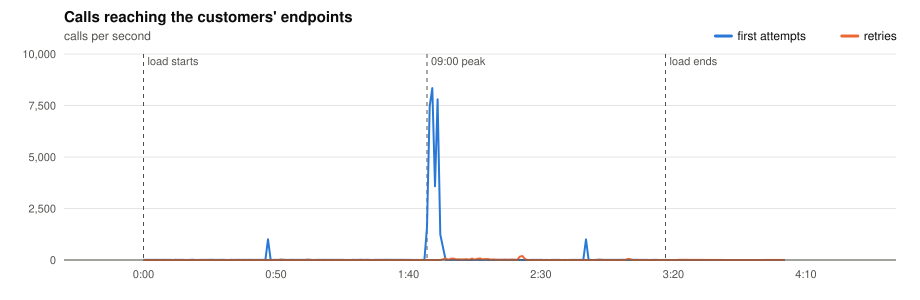

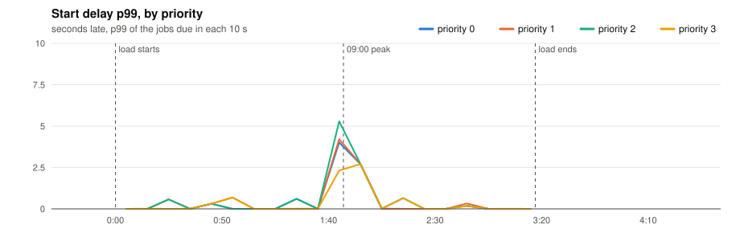

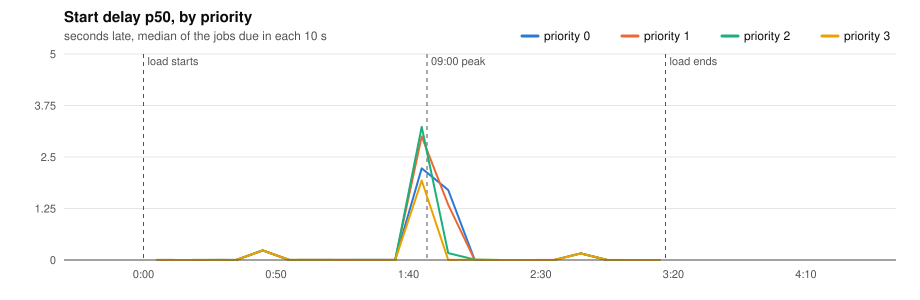

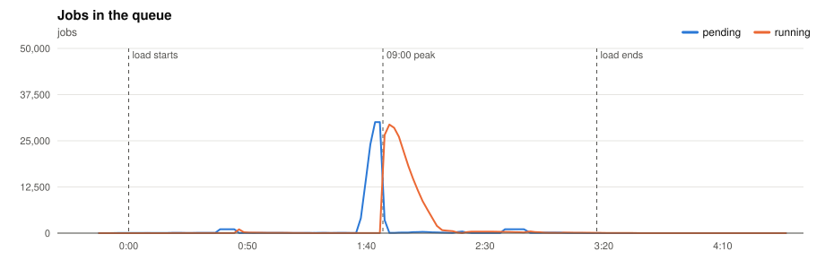

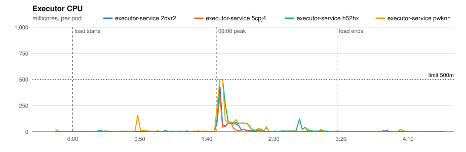

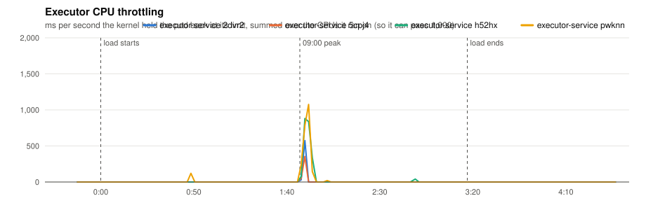

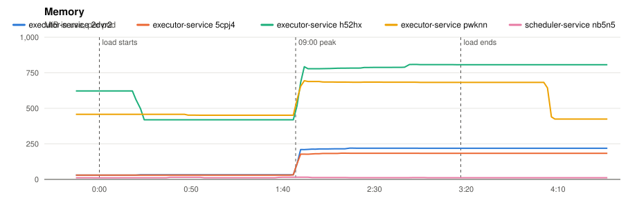

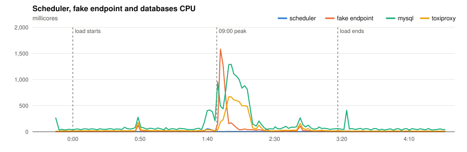

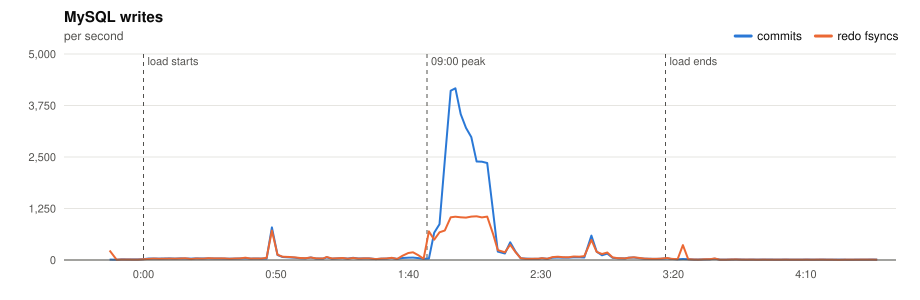

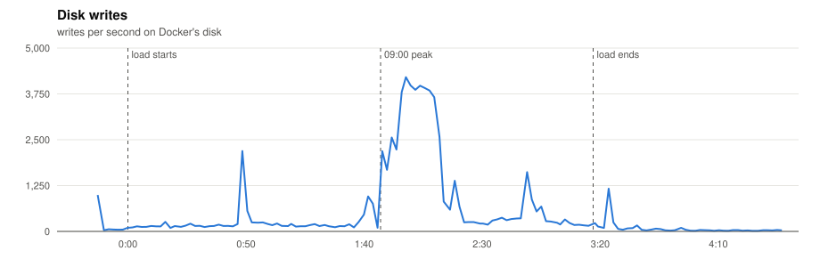

</details>

#### Resources

| Component | CPU avg (millicores) | CPU max | Throttled max (ms/s) | Memory max (MiB) |
|---|---|---|---|---|
| executor-service 2dvr2 | 9 | 438 | 575 | 220 |
| executor-service 5cpj4 | 7 | 342 | 354 | 184 |
| executor-service h52hx | 20 | 502 | 880 | 809 |
| executor-service pwknn | 20 | 502 | 1076 | 694 |
| scheduler-service nb5n5 | 5 | 57 | 0 | 16 |
| fake-endpoint n294s | 37 | 1582 | 364 | 508 |
| mysql | 149 | 1291 | 40 | 1381 |
| cassandra | 95 | 346 | 0 | 1029 |
| toxiproxy | 61 | 670 | 0 | 28 |

MySQL: up to 4168 commits/s, 1061 redo fsyncs/s, 6 row lock waits/s, 25 connections.

#### CPU profiles

<details><summary>CPU profile: executor, 20 s from 1:55</summary>

```text
      flat  flat%   sum%        cum   cum%
     230ms 50.00% 50.00%      230ms 50.00%  internal/runtime/syscall.Syscall6
      40ms  8.70% 58.70%       40ms  8.70%  runtime.futex
      20ms  4.35% 63.04%       20ms  4.35%  runtime.nanotime
      10ms  2.17% 65.22%       20ms  4.35%  database/sql.(*DB).putConn
      10ms  2.17% 67.39%      150ms 32.61%  github.com/go-sql-driver/mysql.(*mysqlConn).writeWithTimeout
      10ms  2.17% 69.57%      140ms 30.43%  internal/poll.(*FD).Write
      10ms  2.17% 71.74%       10ms  2.17%  internal/runtime/atomic.(*Uint32).Store (inline)
      10ms  2.17% 73.91%       10ms  2.17%  runtime.(*timer).stop
      10ms  2.17% 76.09%       10ms  2.17%  runtime.acquireSudog
      10ms  2.17% 78.26%       10ms  2.17%  runtime.acquirem
      10ms  2.17% 80.43%       20ms  4.35%  runtime.chansend
      10ms  2.17% 82.61%       10ms  2.17%  runtime.findfunc
```

</details>

<details><summary>CPU profile: scheduler, 20 s from 1:55</summary>

```text
      flat  flat%   sum%        cum   cum%
      30ms 75.00% 75.00%       30ms 75.00%  internal/runtime/syscall.Syscall6
      10ms 25.00%   100%       10ms 25.00%  runtime.mapassign
         0     0%   100%       10ms 25.00%  context.(*cancelCtx).propagateCancel
         0     0%   100%       10ms 25.00%  context.WithCancel
         0     0%   100%       10ms 25.00%  context.withCancel (inline)
         0     0%   100%       20ms 50.00%  database/sql.(*DB).execDC
         0     0%   100%       20ms 50.00%  database/sql.(*DB).execDC.func3
         0     0%   100%       10ms 25.00%  database/sql.(*DB).queryDC
         0     0%   100%       10ms 25.00%  database/sql.(*Rows).initContextClose
         0     0%   100%       20ms 50.00%  database/sql.(*Tx).ExecContext
         0     0%   100%       10ms 25.00%  database/sql.(*Tx).QueryContext
         0     0%   100%       20ms 50.00%  database/sql.ctxDriverPrepare
```

</details>

Run page: [reports/20261119T215757Z-c-4x/report.md](reports/20261119T215757Z-c-4x/report.md)

### d-5x

- **Load:** 282 s of the platform model at scale 1.0: 1,000 minute, 4,000 five, 10,000 hour, 15,000 day, 1,567 at tasks; 31,567 tasks seeded.
- **Deployment:** 5 executors; executor-service: `JOB_TIME_LIMIT_SECONDS=1 WORKER_COUNT=10000 JOB_QUEUE_SIZE=10000 PPROF_ADDR=:6060 GOMAXPROCS=`; scheduler-service: `SCHEDULE_INTERVAL=200ms SCHEDULE_LOOKAHEAD=10s PPROF_ADDR=:6060 GOMAXPROCS=`
- **Raw data:** `bench/results/P11-peak/runs/20261119T220633Z-d-5x/` (local, not committed)

#### Jobs

| Created | Succeeded | Dead | Still pending or running | Retried | Duplicate successes | Timed out, done anyway | Calls per second (first attempts) |
|---|---|---|---|---|---|---|---|
| 35,567 | 35,093 | 474 | 0 | 17,060 | 0 | 398 | 19.8 |

*Duplicate successes*: the endpoint answered 200 twice for one job, which only a failure should cause. *Timed out, done anyway*: the executor gave up after the timeout while the endpoint finished the work, so the retry made the customer process the job again.

**Start delay** (when the call reached the endpoint minus when the job was due, first attempts):

| Priority | Jobs | p50 | p90 | p99 | max |
|---|---|---|---|---|---|
| 0 | 67 | 0.099 s | 0.188 s | 1.671 s | 1.671 s |
| 1 | 248 | 0.109 s | 0.185 s | 0.670 s | 0.769 s |
| 2 | 1,090 | 0.116 s | 6.153 s | 6.722 s | 6.722 s |
| 3 | 267 | 0.112 s | 0.183 s | 0.530 s | 0.668 s |
| all | 1,672 | 0.114 s | 5.207 s | 6.722 s | 6.722 s |

- **09:00 peak:** 231 jobs due on the same second. The last one started **6.7 s** late (p50 6.0 s, p99 6.7 s); priority 0 p99 **nan s**.
- **Peak throughput:** every job of the peak had started **27.3 s** after it (p99 26.2 s), **627 jobs/s**; 113 in its busiest second. First attempts that never reached the endpoint: **16,902**.
- **Peak by priority** (p50 / p99 / max, first attempts): 2: 6.0 / 6.7 / 6.7 s.

<details><summary>Charts</summary>

Time is minutes:seconds from the start of the load.

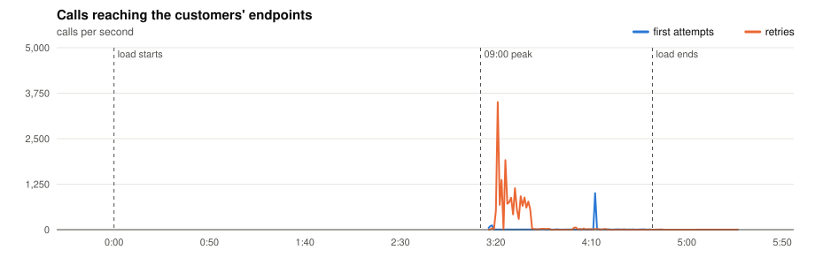

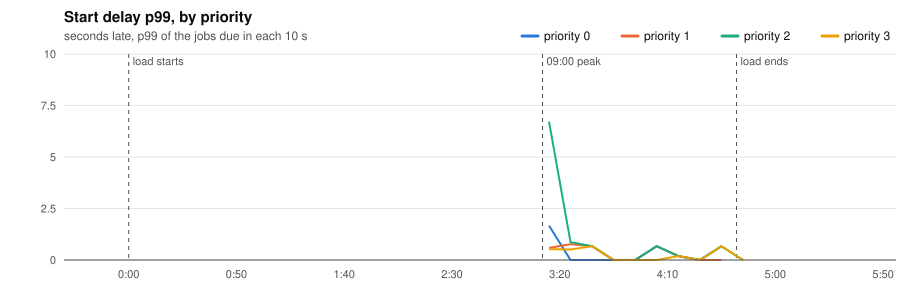

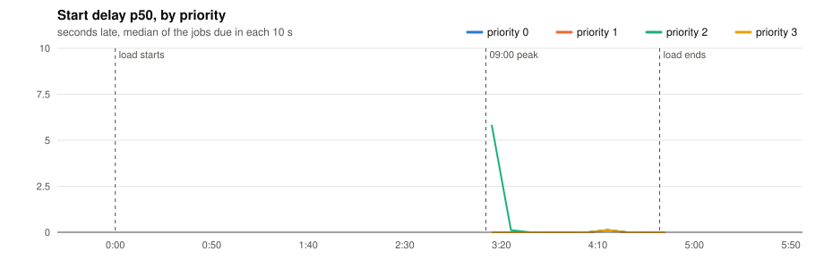

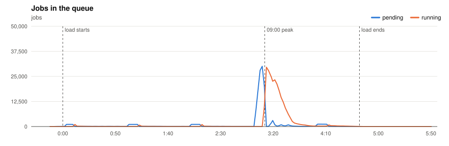

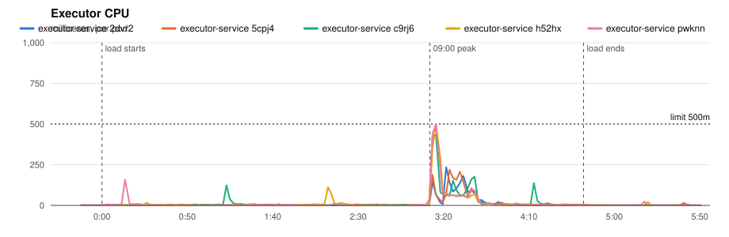

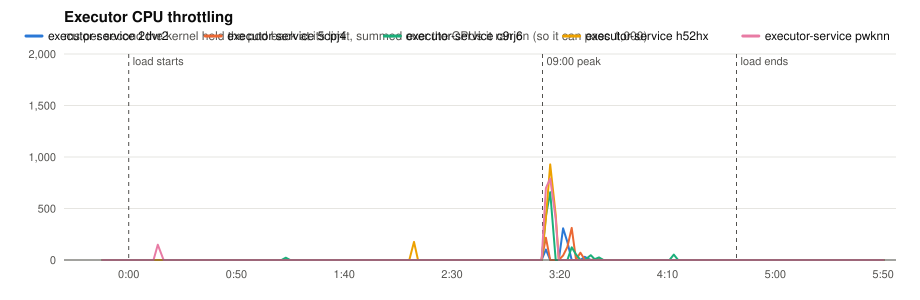

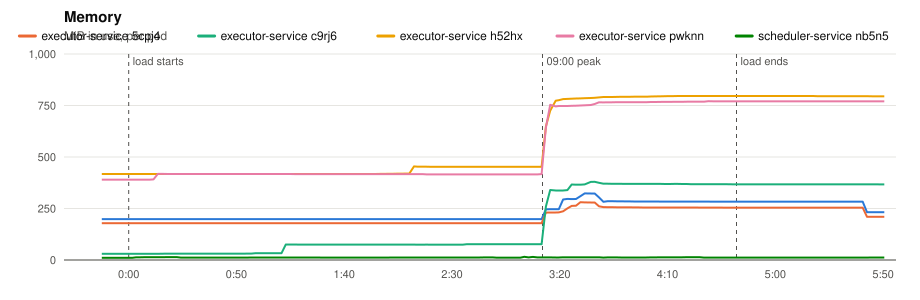

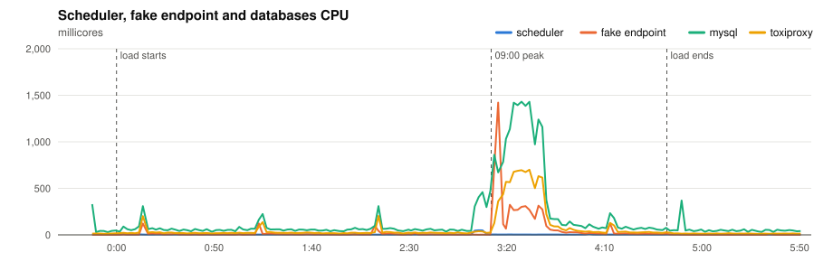

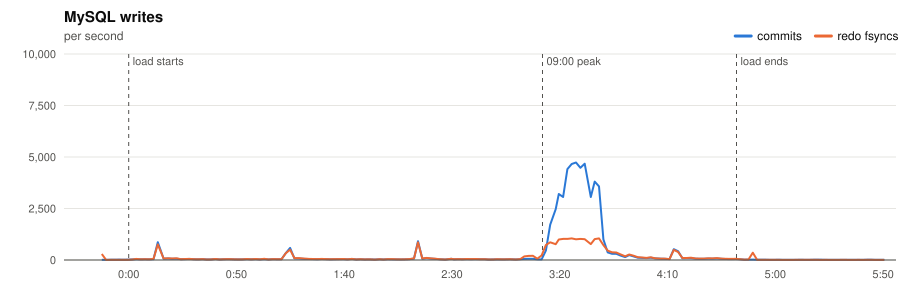

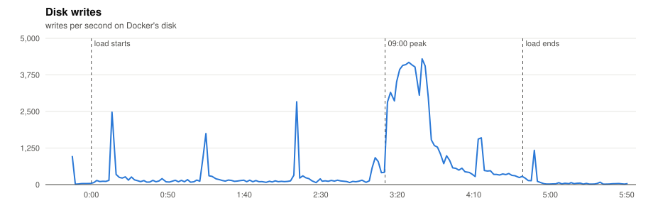

</details>

#### Resources

| Component | CPU avg (millicores) | CPU max | Throttled max (ms/s) | Memory max (MiB) |
|---|---|---|---|---|
| executor-service 2dvr2 | 9 | 235 | 307 | 323 |
| executor-service 5cpj4 | 10 | 219 | 312 | 281 |
| executor-service c9rj6 | 15 | 434 | 658 | 380 |
| executor-service h52hx | 14 | 500 | 928 | 796 |
| executor-service pwknn | 14 | 498 | 791 | 771 |
| scheduler-service nb5n5 | 5 | 50 | 0 | 16 |
| fake-endpoint n294s | 36 | 1421 | 251 | 352 |
| mysql | 159 | 1431 | 11 | 1453 |
| cassandra | 88 | 296 | 0 | 1024 |
| toxiproxy | 67 | 700 | 0 | 29 |

MySQL: up to 4735 commits/s, 1050 redo fsyncs/s, 35 row lock waits/s, 29 connections.

#### CPU profiles

<details><summary>CPU profile: executor, 20 s from 3:20</summary>

```text
      flat  flat%   sum%        cum   cum%
     790ms 49.07% 49.07%      790ms 49.07%  internal/runtime/syscall.Syscall6
      40ms  2.48% 51.55%       40ms  2.48%  runtime.memmove
      30ms  1.86% 53.42%       30ms  1.86%  runtime.nextFreeFast (inline)
      30ms  1.86% 55.28%       60ms  3.73%  runtime.selectgo
      20ms  1.24% 56.52%       40ms  2.48%  runtime.(*unwinder).resolveInternal
      20ms  1.24% 57.76%       20ms  1.24%  runtime.findObject
      20ms  1.24% 59.01%       20ms  1.24%  runtime.ifaceeq
      20ms  1.24% 60.25%      200ms 12.42%  runtime.mallocgc
      20ms  1.24% 61.49%       20ms  1.24%  runtime.memclrNoHeapPointers
      20ms  1.24% 62.73%       20ms  1.24%  runtime.nanotime
      20ms  1.24% 63.98%       80ms  4.97%  runtime.netpoll
      20ms  1.24% 65.22%       20ms  1.24%  runtime.sellock
```

</details>

<details><summary>CPU profile: scheduler, 20 s from 3:20</summary>

```text
      flat  flat%   sum%        cum   cum%
      10ms   100%   100%       10ms   100%  indexbytebody
         0     0%   100%       10ms   100%  database/sql.(*DB).queryDC
         0     0%   100%       10ms   100%  database/sql.(*Rows).initContextClose
         0     0%   100%       10ms   100%  database/sql.(*Tx).QueryContext
         0     0%   100%       10ms   100%  github.com/JoelTeoGom/distributed-scheduler/scheduler-service/internal/adapters/out/mysql.(*SchedulerRepository).ScheduleJobs
         0     0%   100%       10ms   100%  github.com/JoelTeoGom/distributed-scheduler/scheduler-service/internal/adapters/out/mysql.selectScheduledTasks
         0     0%   100%       10ms   100%  github.com/JoelTeoGom/distributed-scheduler/scheduler-service/internal/service.(*SchedulerService).Start
         0     0%   100%       10ms   100%  main.main.func2
         0     0%   100%       10ms   100%  runtime.(*moduledata).funcName
         0     0%   100%       10ms   100%  runtime.findnull
         0     0%   100%       10ms   100%  runtime.funcname (inline)
         0     0%   100%       10ms   100%  runtime.gostringnocopy (inline)
```

</details>

Run page: [reports/20261119T220633Z-d-5x/report.md](reports/20261119T220633Z-d-5x/report.md)

### e-5x-w2000

- **Load:** 204 s of the platform model at scale 1.0: 1,000 minute, 4,000 five, 10,000 hour, 15,000 day, 1,133 at tasks; 31,133 tasks seeded.
- **Deployment:** 5 executors; executor-service: `JOB_TIME_LIMIT_SECONDS=1 WORKER_COUNT=2000 JOB_QUEUE_SIZE=10000 PPROF_ADDR=:6060 GOMAXPROCS=`; scheduler-service: `SCHEDULE_INTERVAL=200ms SCHEDULE_LOOKAHEAD=10s PPROF_ADDR=:6060 GOMAXPROCS=`
- **Raw data:** `bench/results/P11-peak/runs/20261119T221251Z-e-5x-w2000/` (local, not committed)

#### Jobs

| Created | Succeeded | Dead | Still pending or running | Retried | Duplicate successes | Timed out, done anyway | Calls per second (first attempts) |
|---|---|---|---|---|---|---|---|
| 33,133 | 32,765 | 368 | 0 | 894 | 0 | 436 | 163.2 |

*Duplicate successes*: the endpoint answered 200 twice for one job, which only a failure should cause. *Timed out, done anyway*: the executor gave up after the timeout while the endpoint finished the work, so the retry made the customer process the job again.

**Start delay** (when the call reached the endpoint minus when the job was due, first attempts):

| Priority | Jobs | p50 | p90 | p99 | max |
|---|---|---|---|---|---|
| 0 | 1,625 | 0.762 s | 0.895 s | 0.904 s | 0.904 s |
| 1 | 4,999 | 1.066 s | 1.300 s | 1.329 s | 1.335 s |
| 2 | 19,894 | 5.197 s | 7.157 s | 8.465 s | 8.819 s |
| 3 | 6,615 | 10.002 s | 11.515 s | 12.677 s | 12.793 s |
| all | 33,133 | 5.149 s | 10.002 s | 12.156 s | 12.793 s |

- **09:00 peak:** 30,002 jobs due on the same second. The last one started **12.8 s** late (p50 5.4 s, p99 12.2 s); priority 0 p99 **0.9 s**.
- **Peak throughput:** every job of the peak had started **12.8 s** after it (p99 12.2 s), **2,345 jobs/s**; 7,351 in its busiest second. First attempts that never reached the endpoint: **0**.
- **Peak by priority** (p50 / p99 / max, first attempts): 0: 0.8 / 0.9 / 0.9 s; 1: 1.1 / 1.3 / 1.3 s; 2: 5.4 / 8.5 / 8.8 s; 3: 10.0 / 12.7 / 12.8 s.

<details><summary>Charts</summary>

Time is minutes:seconds from the start of the load.

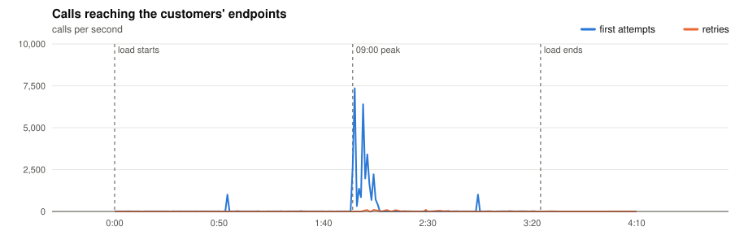

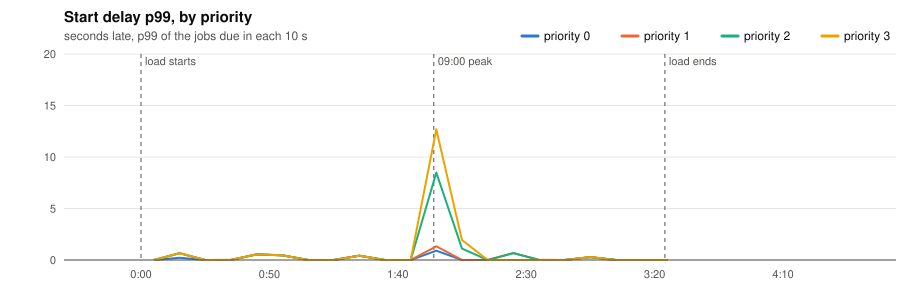

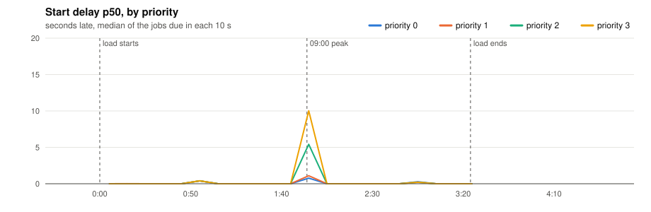

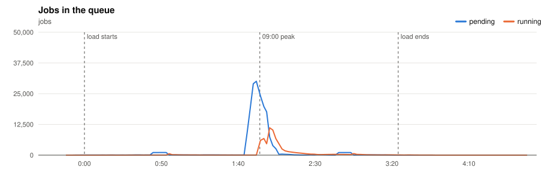

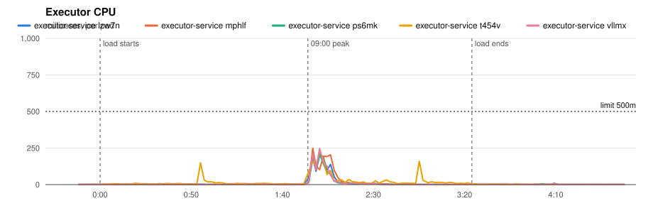

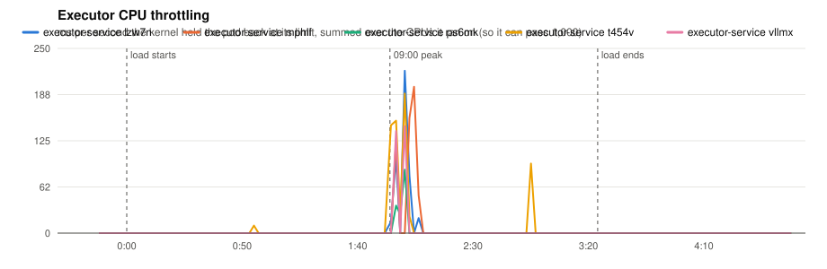

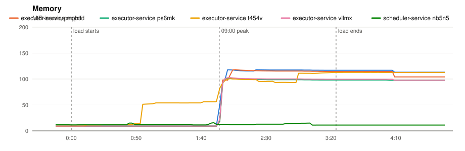

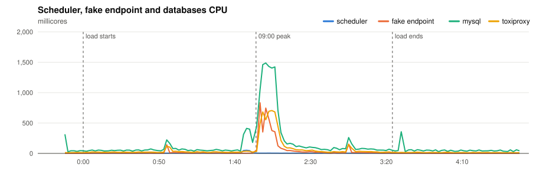

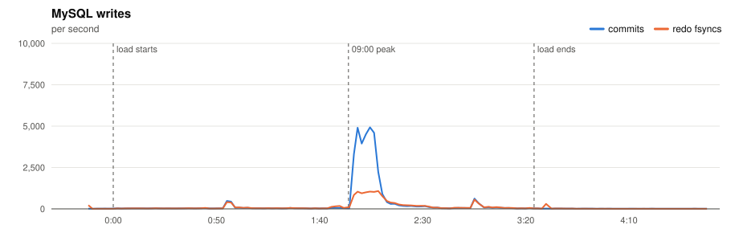

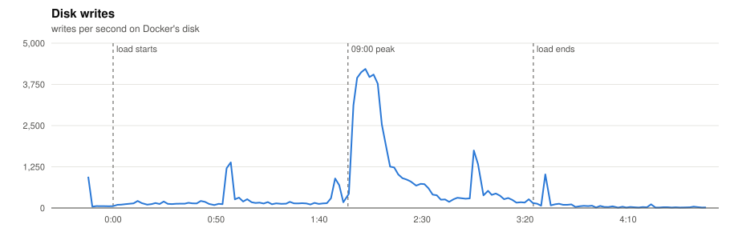

</details>

#### Resources

| Component | CPU avg (millicores) | CPU max | Throttled max (ms/s) | Memory max (MiB) |
|---|---|---|---|---|
| executor-service lzw7n | 8 | 202 | 220 | 118 |
| executor-service mphlf | 10 | 249 | 198 | 118 |
| executor-service ps6mk | 7 | 209 | 86 | 101 |
| executor-service t454v | 15 | 227 | 189 | 113 |
| executor-service vllmx | 8 | 248 | 145 | 103 |
| scheduler-service nb5n5 | 5 | 52 | 0 | 16 |
| fake-endpoint n294s | 32 | 833 | 217 | 305 |
| mysql | 136 | 1487 | 382 | 1501 |
| cassandra | 86 | 285 | 0 | 1022 |
| toxiproxy | 55 | 705 | 0 | 29 |

MySQL: up to 4927 commits/s, 1080 redo fsyncs/s, 6 row lock waits/s, 29 connections.

#### CPU profiles

<details><summary>CPU profile: executor, 20 s from 2:01</summary>

```text
      flat  flat%   sum%        cum   cum%
     300ms 52.63% 52.63%      300ms 52.63%  internal/runtime/syscall.Syscall6
      40ms  7.02% 59.65%       40ms  7.02%  runtime.futex
      10ms  1.75% 61.40%       10ms  1.75%  bufio.(*Reader).ReadSlice
      10ms  1.75% 63.16%       10ms  1.75%  context.(*timerCtx).Done
      10ms  1.75% 64.91%       10ms  1.75%  context.(*timerCtx).cancel
      10ms  1.75% 66.67%       10ms  1.75%  context.WithCancelCause.func1
      10ms  1.75% 68.42%       20ms  3.51%  database/sql.driverArgsConnLocked
      10ms  1.75% 70.18%       10ms  1.75%  github.com/go-sql-driver/mysql.(*mysqlResult).RowsAffected
      10ms  1.75% 71.93%       10ms  1.75%  github.com/go-sql-driver/mysql.converter.ConvertValue
      10ms  1.75% 73.68%       10ms  1.75%  internal/poll.(*fdMutex).rwlock
      10ms  1.75% 75.44%       10ms  1.75%  net/http.(*Request).write
      10ms  1.75% 77.19%       30ms  5.26%  net/http.(*Transport).roundTrip
```

</details>

<details><summary>CPU profile: scheduler, 20 s from 2:01</summary>

```text
      flat  flat%   sum%        cum   cum%
      10ms 50.00% 50.00%       10ms 50.00%  runtime.futex
      10ms 50.00%   100%       10ms 50.00%  runtime.nextFreeFast (inline)
         0     0%   100%       10ms 50.00%  database/sql.(*DB).execDC
         0     0%   100%       10ms 50.00%  database/sql.(*Tx).ExecContext
         0     0%   100%       10ms 50.00%  database/sql.(*Tx).Rollback
         0     0%   100%       10ms 50.00%  database/sql.(*Tx).rollback
         0     0%   100%       10ms 50.00%  database/sql.(*Tx).rollback.func1
         0     0%   100%       10ms 50.00%  database/sql.driverArgsConnLocked
         0     0%   100%       10ms 50.00%  database/sql.resultFromStatement
         0     0%   100%       10ms 50.00%  database/sql.withLock
         0     0%   100%       20ms   100%  github.com/JoelTeoGom/distributed-scheduler/scheduler-service/internal/adapters/out/mysql.(*SchedulerRepository).ScheduleJobs
         0     0%   100%       10ms 50.00%  github.com/JoelTeoGom/distributed-scheduler/scheduler-service/internal/adapters/out/mysql.insertJobs
```

</details>

Run page: [reports/20261119T221251Z-e-5x-w2000/report.md](reports/20261119T221251Z-e-5x-w2000/report.md)

### f-5x-pool10

- **Load:** 187 s of the platform model at scale 1.0: 1,000 minute, 4,000 five, 10,000 hour, 15,000 day, 1,039 at tasks; 31,039 tasks seeded.
- **Deployment:** 5 executors; executor-service: `JOB_TIME_LIMIT_SECONDS=1 WORKER_COUNT=10000 JOB_QUEUE_SIZE=10000 PPROF_ADDR=:6060 GOMAXPROCS= MYSQL_MAX_OPEN_CONNS=10 MYSQL_MAX_IDLE_CONNS=10`; scheduler-service: `SCHEDULE_INTERVAL=200ms SCHEDULE_LOOKAHEAD=10s PPROF_ADDR=:6060 GOMAXPROCS=`
- **Raw data:** `bench/results/P11-peak/runs/20261119T221808Z-f-5x-pool10/` (local, not committed)

#### Jobs

| Created | Succeeded | Dead | Still pending or running | Retried | Duplicate successes | Timed out, done anyway | Calls per second (first attempts) |
|---|---|---|---|---|---|---|---|
| 33,039 | 32,569 | 470 | 0 | 9,200 | 0 | 655 | 19.7 |

*Duplicate successes*: the endpoint answered 200 twice for one job, which only a failure should cause. *Timed out, done anyway*: the executor gave up after the timeout while the endpoint finished the work, so the retry made the customer process the job again.

**Start delay** (when the call reached the endpoint minus when the job was due, first attempts):

| Priority | Jobs | p50 | p90 | p99 | max |
|---|---|---|---|---|---|
| 0 | 62 | 0.120 s | 0.138 s | 9.086 s | 9.086 s |
| 1 | 226 | 0.122 s | 0.138 s | 6.896 s | 8.480 s |
| 2 | 856 | 0.122 s | 0.203 s | 7.147 s | 9.084 s |
| 3 | 293 | 0.120 s | 0.139 s | 8.480 s | 9.090 s |
| all | 1,437 | 0.121 s | 0.203 s | 8.478 s | 9.090 s |

<details><summary>Charts</summary>

Time is minutes:seconds from the start of the load.


</details>

#### Resources

| Component | CPU avg (millicores) | CPU max | Throttled max (ms/s) | Memory max (MiB) |
|---|---|---|---|---|
| executor-service 8rwkv | 17 | 498 | 887 | 446 |
| executor-service 9kdfn | 12 | 283 | 358 | 239 |
| executor-service c74cw | 13 | 490 | 780 | 473 |
| executor-service dljfk | 6 | 177 | 44 | 123 |
| executor-service k54sg | 12 | 316 | 494 | 262 |
| scheduler-service nb5n5 | 5 | 58 | 0 | 15 |
| fake-endpoint n294s | 32 | 1617 | 873 | 502 |
| mysql | 157 | 1974 | 383 | 1599 |
| cassandra | 93 | 505 | 0 | 1038 |
| toxiproxy | 66 | 904 | 0 | 36 |

MySQL: up to 6804 commits/s, 1086 redo fsyncs/s, 88 row lock waits/s, 55 connections.

#### CPU profiles

<details><summary>CPU profile: executor, 20 s from 1:44</summary>

```text
      flat  flat%   sum%        cum   cum%
     420ms 50.00% 50.00%      420ms 50.00%  internal/runtime/syscall.Syscall6
      60ms  7.14% 57.14%       60ms  7.14%  runtime.futex
      30ms  3.57% 60.71%       60ms  7.14%  runtime.selectgo
      20ms  2.38% 63.10%       20ms  2.38%  runtime.memmove
      10ms  1.19% 64.29%       10ms  1.19%  context.(*cancelCtx).Done
      10ms  1.19% 65.48%      490ms 58.33%  database/sql.(*DB).exec
      10ms  1.19% 66.67%      450ms 53.57%  database/sql.(*DB).execDC
      10ms  1.19% 67.86%       20ms  2.38%  database/sql.(*DB).putConn
      10ms  1.19% 69.05%       10ms  1.19%  database/sql.(*connRequestSet).deleteIndex (inline)
      10ms  1.19% 70.24%       20ms  2.38%  database/sql.driverArgsConnLocked
      10ms  1.19% 71.43%      150ms 17.86%  github.com/go-sql-driver/mysql.(*mysqlConn).readWithTimeout
      10ms  1.19% 72.62%      240ms 28.57%  github.com/go-sql-driver/mysql.(*mysqlConn).writePacket
```

</details>

<details><summary>CPU profile: scheduler, 20 s from 1:44</summary>

```text
      flat  flat%   sum%        cum   cum%
      10ms   100%   100%       10ms   100%  internal/runtime/syscall.Syscall6
         0     0%   100%       10ms   100%  internal/runtime/syscall.EpollWait
         0     0%   100%       10ms   100%  runtime.findRunnable
         0     0%   100%       10ms   100%  runtime.mcall
         0     0%   100%       10ms   100%  runtime.netpoll
         0     0%   100%       10ms   100%  runtime.park_m
         0     0%   100%       10ms   100%  runtime.schedule
```

</details>

Run page: [reports/20261119T221808Z-f-5x-pool10/report.md](reports/20261119T221808Z-f-5x-pool10/report.md)

### s1-4x

- **Load:** 213 s of the platform model at scale 1.0: 1,000 minute, 4,000 five, 10,000 hour, 15,000 day, 1,183 at tasks; 31,183 tasks seeded.
- **Deployment:** 4 executors; executor-service: `JOB_TIME_LIMIT_SECONDS=1 WORKER_COUNT=10000 JOB_QUEUE_SIZE=10000 PPROF_ADDR=:6060 GOMAXPROCS= MYSQL_MAX_OPEN_CONNS=5 MYSQL_MAX_IDLE_CONNS=5`; scheduler-service: `SCHEDULE_INTERVAL=200ms SCHEDULE_LOOKAHEAD=10s PPROF_ADDR=:6060 GOMAXPROCS=`
- **Raw data:** `bench/results/P11-peak/runs/20261119T222742Z-s1-4x/` (local, not committed)

#### Jobs

| Created | Succeeded | Dead | Still pending or running | Retried | Duplicate successes | Timed out, done anyway | Calls per second (first attempts) |
|---|---|---|---|---|---|---|---|
| 34,183 | 33,812 | 371 | 0 | 948 | 0 | 489 | 161.2 |

*Duplicate successes*: the endpoint answered 200 twice for one job, which only a failure should cause. *Timed out, done anyway*: the executor gave up after the timeout while the endpoint finished the work, so the retry made the customer process the job again.

**Start delay** (when the call reached the endpoint minus when the job was due, first attempts):

| Priority | Jobs | p50 | p90 | p99 | max |
|---|---|---|---|---|---|
| 0 | 1,775 | 1.879 s | 2.668 s | 2.678 s | 2.678 s |
| 1 | 5,153 | 2.374 s | 2.885 s | 2.910 s | 3.737 s |
| 2 | 20,511 | 2.459 s | 3.873 s | 4.161 s | 4.175 s |
| 3 | 6,744 | 1.746 s | 4.260 s | 4.368 s | 5.165 s |
| all | 34,183 | 2.350 s | 3.892 s | 4.287 s | 5.165 s |

- **09:00 peak:** 30,003 jobs due on the same second. The last one started **5.2 s** late (p50 2.4 s, p99 4.3 s); priority 0 p99 **2.7 s**.
- **Peak throughput:** every job of the peak had started **5.2 s** after it (p99 4.3 s), **5,810 jobs/s**; 11,848 in its busiest second. First attempts that never reached the endpoint: **0**.
- **Peak by priority** (p50 / p99 / max, first attempts): 0: 1.9 / 2.7 / 2.7 s; 1: 2.4 / 2.9 / 3.1 s; 2: 2.6 / 4.2 / 4.2 s; 3: 1.8 / 4.4 / 5.2 s.

<details><summary>Charts</summary>

Time is minutes:seconds from the start of the load.


</details>

#### Resources

| Component | CPU avg (millicores) | CPU max | Throttled max (ms/s) | Memory max (MiB) |
|---|---|---|---|---|
| executor-service 72hwg | 8 | 310 | 221 | 216 |
| executor-service frhks | 13 | 497 | 680 | 419 |
| executor-service gndc4 | 18 | 506 | 856 | 489 |
| executor-service sdkbc | 7 | 323 | 387 | 207 |
| fake-endpoint | 27 | 1184 | 0 | 393 |
| mysql | 143 | 1239 | 43 | 1681 |
| cassandra | 92 | 301 | 0 | 1031 |
| toxiproxy | 59 | 663 | 0 | 33 |

MySQL: up to 4210 commits/s, 1079 redo fsyncs/s, 348 row lock waits/s, 27 connections.

#### CPU profiles

<details><summary>CPU profile: executor, 20 s from 2:10</summary>

```text
      flat  flat%   sum%        cum   cum%
     130ms 44.83% 44.83%      130ms 44.83%  internal/runtime/syscall.Syscall6
      10ms  3.45% 48.28%       20ms  6.90%  database/sql.ctxDriverPrepare
      10ms  3.45% 51.72%       50ms 17.24%  github.com/go-sql-driver/mysql.(*mysqlConn).readPacket
      10ms  3.45% 55.17%      120ms 41.38%  github.com/go-sql-driver/mysql.(*mysqlStmt).ExecContext
      10ms  3.45% 58.62%       40ms 13.79%  internal/poll.(*FD).Read
      10ms  3.45% 62.07%       10ms  3.45%  internal/poll.(*fdMutex).rwlock
      10ms  3.45% 65.52%       10ms  3.45%  internal/runtime/atomic.(*Uint32).CompareAndSwap
      10ms  3.45% 68.97%       10ms  3.45%  net/http.(*Client).Do
      10ms  3.45% 72.41%       10ms  3.45%  runtime.(*mcache).refill
      10ms  3.45% 75.86%       10ms  3.45%  runtime.(*mspan).writeHeapBitsSmall
      10ms  3.45% 79.31%       10ms  3.45%  runtime.acquireSudog
      10ms  3.45% 82.76%       10ms  3.45%  runtime.exitsyscall
```

</details>

<details><summary>CPU profile: scheduler, 20 s from 2:10</summary>

```text
      flat  flat%   sum%        cum   cum%
      20ms 50.00% 50.00%       20ms 50.00%  internal/runtime/syscall.Syscall6
      10ms 25.00% 75.00%       10ms 25.00%  runtime.futex
      10ms 25.00%   100%       10ms 25.00%  runtime.newobject
         0     0%   100%       30ms 75.00%  database/sql.(*DB).BeginTx
         0     0%   100%       30ms 75.00%  database/sql.(*DB).BeginTx.func1
         0     0%   100%       30ms 75.00%  database/sql.(*DB).begin
         0     0%   100%       20ms 50.00%  database/sql.(*DB).beginDC
         0     0%   100%       20ms 50.00%  database/sql.(*DB).beginDC.func1
         0     0%   100%       10ms 25.00%  database/sql.(*DB).conn
         0     0%   100%       30ms 75.00%  database/sql.(*DB).retry
         0     0%   100%       10ms 25.00%  database/sql.(*Tx).Commit
         0     0%   100%       10ms 25.00%  database/sql.(*Tx).Commit.func1
```

</details>

Run page: [reports/20261119T222742Z-s1-4x/report.md](reports/20261119T222742Z-s1-4x/report.md)

### s2-5x

- **Load:** 195 s of the platform model at scale 1.0: 1,000 minute, 4,000 five, 10,000 hour, 15,000 day, 1,083 at tasks; 31,083 tasks seeded.
- **Deployment:** 5 executors; executor-service: `JOB_TIME_LIMIT_SECONDS=1 WORKER_COUNT=10000 JOB_QUEUE_SIZE=10000 PPROF_ADDR=:6060 GOMAXPROCS= MYSQL_MAX_OPEN_CONNS=5 MYSQL_MAX_IDLE_CONNS=5`; scheduler-service: `SCHEDULE_INTERVAL=200ms SCHEDULE_LOOKAHEAD=10s PPROF_ADDR=:6060 GOMAXPROCS=`
- **Raw data:** `bench/results/P11-peak/runs/20261119T223300Z-s2-5x/` (local, not committed)

#### Jobs

| Created | Succeeded | Dead | Still pending or running | Retried | Duplicate successes | Timed out, done anyway | Calls per second (first attempts) |
|---|---|---|---|---|---|---|---|
| 33,083 | 32,745 | 338 | 0 | 1,004 | 0 | 601 | 170.5 |

*Duplicate successes*: the endpoint answered 200 twice for one job, which only a failure should cause. *Timed out, done anyway*: the executor gave up after the timeout while the endpoint finished the work, so the retry made the customer process the job again.

**Start delay** (when the call reached the endpoint minus when the job was due, first attempts):

| Priority | Jobs | p50 | p90 | p99 | max |
|---|---|---|---|---|---|
| 0 | 1,620 | 2.561 s | 4.338 s | 4.377 s | 4.378 s |
| 1 | 4,911 | 3.582 s | 4.567 s | 4.666 s | 4.972 s |
| 2 | 19,945 | 3.959 s | 5.169 s | 5.786 s | 5.837 s |
| 3 | 6,607 | 1.965 s | 5.839 s | 6.867 s | 6.999 s |
| all | 33,083 | 3.473 s | 5.174 s | 6.359 s | 6.999 s |

- **09:00 peak:** 30,007 jobs due on the same second. The last one started **7.0 s** late (p50 3.7 s, p99 6.4 s); priority 0 p99 **4.4 s**.
- **Peak throughput:** every job of the peak had started **7.0 s** after it (p99 6.4 s), **4,288 jobs/s**; 8,209 in its busiest second. First attempts that never reached the endpoint: **0**.
- **Peak by priority** (p50 / p99 / max, first attempts): 0: 2.6 / 4.4 / 4.4 s; 1: 3.7 / 4.7 / 5.0 s; 2: 4.2 / 5.8 / 5.8 s; 3: 2.2 / 6.9 / 7.0 s.

<details><summary>Charts</summary>

Time is minutes:seconds from the start of the load.


</details>

#### Resources

| Component | CPU avg (millicores) | CPU max | Throttled max (ms/s) | Memory max (MiB) |
|---|---|---|---|---|
| executor-service 4s9h9 | 6 | 247 | 185 | 148 |
| executor-service 72hwg | 7 | 374 | 544 | 287 |
| executor-service frhks | 15 | 513 | 783 | 663 |
| executor-service gndc4 | 21 | 504 | 749 | 814 |
| executor-service sdkbc | 7 | 352 | 513 | 296 |
| fake-endpoint | 33 | 1257 | 0 | 692 |
| mysql | 153 | 1448 | 114 | 1759 |
| cassandra | 95 | 361 | 0 | 1036 |
| toxiproxy | 63 | 718 | 0 | 34 |

MySQL: up to 4813 commits/s, 1082 redo fsyncs/s, 10 row lock waits/s, 30 connections.

#### CPU profiles

<details><summary>CPU profile: executor, 20 s from 1:52</summary>

```text
      flat  flat%   sum%        cum   cum%
      40ms 40.00% 40.00%       40ms 40.00%  internal/runtime/syscall.Syscall6
      30ms 30.00% 70.00%       30ms 30.00%  runtime.futex
      10ms 10.00% 80.00%       10ms 10.00%  runtime.netpoll
      10ms 10.00% 90.00%       10ms 10.00%  runtime.selectgo
      10ms 10.00%   100%       10ms 10.00%  runtime.typedmemclr
         0     0%   100%       10ms 10.00%  bufio.(*Writer).Flush
         0     0%   100%       30ms 30.00%  database/sql.(*DB).ExecContext
         0     0%   100%       30ms 30.00%  database/sql.(*DB).ExecContext.func1
         0     0%   100%       30ms 30.00%  database/sql.(*DB).exec
         0     0%   100%       30ms 30.00%  database/sql.(*DB).execDC
         0     0%   100%       10ms 10.00%  database/sql.(*DB).execDC.func3
         0     0%   100%       30ms 30.00%  database/sql.(*DB).retry
```

</details>

<details><summary>CPU profile: scheduler, 20 s from 1:52</summary>

```text
      flat  flat%   sum%        cum   cum%
      20ms 33.33% 33.33%       20ms 33.33%  internal/runtime/syscall.Syscall6
      10ms 16.67% 50.00%       10ms 16.67%  context.(*cancelCtx).Done
      10ms 16.67% 66.67%       10ms 16.67%  runtime.(*timers).run
      10ms 16.67% 83.33%       10ms 16.67%  runtime.ifaceeq
      10ms 16.67%   100%       10ms 16.67%  runtime.roundupsize (inline)
         0     0%   100%       40ms 66.67%  database/sql.(*DB).BeginTx
         0     0%   100%       40ms 66.67%  database/sql.(*DB).BeginTx.func1
         0     0%   100%       40ms 66.67%  database/sql.(*DB).begin
         0     0%   100%       30ms 50.00%  database/sql.(*DB).beginDC
         0     0%   100%       30ms 50.00%  database/sql.(*DB).beginDC.func1
         0     0%   100%       10ms 16.67%  database/sql.(*DB).conn
         0     0%   100%       40ms 66.67%  database/sql.(*DB).retry
```

</details>

Run page: [reports/20261119T223300Z-s2-5x/report.md](reports/20261119T223300Z-s2-5x/report.md)

### s3-6x

- **Load:** 194 s of the platform model at scale 1.0: 1,000 minute, 4,000 five, 10,000 hour, 15,000 day, 1,078 at tasks; 31,078 tasks seeded.
- **Deployment:** 6 executors; executor-service: `JOB_TIME_LIMIT_SECONDS=1 WORKER_COUNT=10000 JOB_QUEUE_SIZE=10000 PPROF_ADDR=:6060 GOMAXPROCS= MYSQL_MAX_OPEN_CONNS=5 MYSQL_MAX_IDLE_CONNS=5`; scheduler-service: `SCHEDULE_INTERVAL=200ms SCHEDULE_LOOKAHEAD=10s PPROF_ADDR=:6060 GOMAXPROCS=`
- **Raw data:** `bench/results/P11-peak/runs/20261119T223800Z-s3-6x/` (local, not committed)

#### Jobs

| Created | Succeeded | Dead | Still pending or running | Retried | Duplicate successes | Timed out, done anyway | Calls per second (first attempts) |
|---|---|---|---|---|---|---|---|
| 33,078 | 32,709 | 369 | 0 | 978 | 1 | 546 | 172.0 |

*Duplicate successes*: the endpoint answered 200 twice for one job, which only a failure should cause. *Timed out, done anyway*: the executor gave up after the timeout while the endpoint finished the work, so the retry made the customer process the job again.

**Start delay** (when the call reached the endpoint minus when the job was due, first attempts):

| Priority | Jobs | p50 | p90 | p99 | max |
|---|---|---|---|---|---|
| 0 | 1,577 | 2.634 s | 4.997 s | 5.034 s | 5.037 s |
| 1 | 4,963 | 2.741 s | 4.998 s | 5.035 s | 5.299 s |
| 2 | 19,883 | 4.017 s | 5.733 s | 6.091 s | 6.103 s |
| 3 | 6,655 | 1.531 s | 2.823 s | 2.917 s | 2.926 s |
| all | 33,078 | 2.804 s | 5.524 s | 6.030 s | 6.103 s |

- **09:00 peak:** 30,004 jobs due on the same second. The last one started **6.1 s** late (p50 2.9 s, p99 6.0 s); priority 0 p99 **5.0 s**.
- **Peak throughput:** every job of the peak had started **6.1 s** after it (p99 6.0 s), **4,917 jobs/s**; 7,301 in its busiest second. First attempts that never reached the endpoint: **0**.
- **Peak by priority** (p50 / p99 / max, first attempts): 0: 2.8 / 5.0 / 5.0 s; 1: 2.9 / 5.0 / 5.3 s; 2: 4.6 / 6.1 / 6.1 s; 3: 1.6 / 2.9 / 2.9 s.

<details><summary>Charts</summary>

Time is minutes:seconds from the start of the load.


</details>

#### Resources

| Component | CPU avg (millicores) | CPU max | Throttled max (ms/s) | Memory max (MiB) |
|---|---|---|---|---|
| executor-service 4s9h9 | 7 | 178 | 156 | 210 |
| executor-service 72hwg | 7 | 270 | 531 | 297 |
| executor-service b77tw | 5 | 295 | 175 | 132 |
| executor-service frhks | 17 | 525 | 822 | 729 |
| executor-service gndc4 | 20 | 523 | 835 | 868 |
| executor-service sdkbc | 7 | 274 | 324 | 297 |
| fake-endpoint | 35 | 1355 | 0 | 785 |
| mysql | 160 | 1369 | 175 | 1805 |
| cassandra | 96 | 395 | 0 | 1030 |
| toxiproxy | 67 | 721 | 0 | 35 |

MySQL: up to 4668 commits/s, 1100 redo fsyncs/s, 11 row lock waits/s, 35 connections.

#### CPU profiles

<details><summary>CPU profile: executor, 20 s from 1:51</summary>

```text
      flat  flat%   sum%        cum   cum%
     100ms 50.00% 50.00%      100ms 50.00%  internal/runtime/syscall.Syscall6
      20ms 10.00% 60.00%       20ms 10.00%  runtime.futex
      10ms  5.00% 65.00%       80ms 40.00%  internal/poll.(*FD).Write
      10ms  5.00% 70.00%       10ms  5.00%  internal/runtime/maps.(*Map).getWithKeySmall
      10ms  5.00% 75.00%       10ms  5.00%  internal/runtime/syscall.EpollWait
      10ms  5.00% 80.00%       10ms  5.00%  runtime.(*mheap).allocNeedsZero
      10ms  5.00% 85.00%       10ms  5.00%  runtime.memmove
      10ms  5.00% 90.00%       10ms  5.00%  runtime.nextFreeFast
      10ms  5.00% 95.00%       10ms  5.00%  runtime.selectgo
      10ms  5.00%   100%       10ms  5.00%  strings.(*byteReplacer).Replace
         0     0%   100%       10ms  5.00%  bufio.(*Reader).Peek
         0     0%   100%       10ms  5.00%  bufio.(*Reader).fill
```

</details>

<details><summary>CPU profile: scheduler, 20 s from 1:51</summary>

```text
      flat  flat%   sum%        cum   cum%
      30ms   100%   100%       30ms   100%  internal/runtime/syscall.Syscall6
         0     0%   100%       30ms   100%  database/sql.(*DB).BeginTx
         0     0%   100%       30ms   100%  database/sql.(*DB).BeginTx.func1
         0     0%   100%       30ms   100%  database/sql.(*DB).begin
         0     0%   100%       30ms   100%  database/sql.(*DB).beginDC
         0     0%   100%       30ms   100%  database/sql.(*DB).beginDC.func1
         0     0%   100%       30ms   100%  database/sql.(*DB).retry
         0     0%   100%       30ms   100%  database/sql.ctxDriverBegin
         0     0%   100%       30ms   100%  database/sql.withLock
         0     0%   100%       30ms   100%  github.com/JoelTeoGom/distributed-scheduler/scheduler-service/internal/adapters/out/mysql.(*SchedulerRepository).ScheduleJobs
         0     0%   100%       30ms   100%  github.com/JoelTeoGom/distributed-scheduler/scheduler-service/internal/service.(*SchedulerService).Start
         0     0%   100%       30ms   100%  github.com/go-sql-driver/mysql.(*mysqlConn).BeginTx
```

</details>

Run page: [reports/20261119T223800Z-s3-6x/report.md](reports/20261119T223800Z-s3-6x/report.md)

### t1-4x-w5000

- **Load:** 182 s of the platform model at scale 1.0: 1,000 minute, 4,000 five, 10,000 hour, 15,000 day, 1,011 at tasks; 31,011 tasks seeded.
- **Deployment:** 4 executors; executor-service: `JOB_TIME_LIMIT_SECONDS=1 WORKER_COUNT=5000 JOB_QUEUE_SIZE=10000 PPROF_ADDR=:6060 GOMAXPROCS= MYSQL_MAX_OPEN_CONNS=5 MYSQL_MAX_IDLE_CONNS=5`; scheduler-service: `SCHEDULE_INTERVAL=200ms SCHEDULE_LOOKAHEAD=10s PPROF_ADDR=:6060 GOMAXPROCS=`
- **Raw data:** `bench/results/P11-peak/runs/20261119T224312Z-t1-4x-w5000/` (local, not committed)

#### Jobs

| Created | Succeeded | Dead | Still pending or running | Retried | Duplicate successes | Timed out, done anyway | Calls per second (first attempts) |
|---|---|---|---|---|---|---|---|
| 33,011 | 32,647 | 364 | 0 | 914 | 0 | 478 | 183.1 |

*Duplicate successes*: the endpoint answered 200 twice for one job, which only a failure should cause. *Timed out, done anyway*: the executor gave up after the timeout while the endpoint finished the work, so the retry made the customer process the job again.

**Start delay** (when the call reached the endpoint minus when the job was due, first attempts):

| Priority | Jobs | p50 | p90 | p99 | max |
|---|---|---|---|---|---|
| 0 | 1,616 | 0.923 s | 1.297 s | 1.420 s | 1.421 s |
| 1 | 4,973 | 1.046 s | 1.305 s | 1.420 s | 2.783 s |
| 2 | 19,858 | 1.454 s | 9.598 s | 11.012 s | 11.398 s |
| 3 | 6,564 | 10.531 s | 11.230 s | 12.816 s | 12.934 s |
| all | 33,011 | 1.425 s | 10.594 s | 12.271 s | 12.934 s |

- **09:00 peak:** 30,011 jobs due on the same second. The last one started **12.9 s** late (p50 1.5 s, p99 12.3 s); priority 0 p99 **1.4 s**.
- **Peak throughput:** every job of the peak had started **12.9 s** after it (p99 12.3 s), **2,320 jobs/s**; 17,062 in its busiest second. First attempts that never reached the endpoint: **0**.
- **Peak by priority** (p50 / p99 / max, first attempts): 0: 0.9 / 1.4 / 1.4 s; 1: 1.1 / 1.4 / 1.7 s; 2: 1.5 / 11.0 / 11.4 s; 3: 10.6 / 12.8 / 12.9 s.

<details><summary>Charts</summary>

Time is minutes:seconds from the start of the load.


</details>

#### Resources

| Component | CPU avg (millicores) | CPU max | Throttled max (ms/s) | Memory max (MiB) |
|---|---|---|---|---|
| executor-service 82sd2 | 15 | 398 | 490 | 292 |
| executor-service hh8jz | 10 | 270 | 181 | 236 |
| executor-service qlk4c | 8 | 258 | 198 | 234 |
| executor-service w26hm | 13 | 348 | 383 | 277 |
| fake-endpoint | 29 | 863 | 0 | 735 |
| mysql | 149 | 1397 | 46 | 1845 |
| cassandra | 93 | 303 | 0 | 993 |
| toxiproxy | 61 | 665 | 0 | 34 |

MySQL: up to 4008 commits/s, 1076 redo fsyncs/s, 7 row lock waits/s, 25 connections.

#### CPU profiles

<details><summary>CPU profile: executor, 20 s from 1:38</summary>

```text
      flat  flat%   sum%        cum   cum%
     0.50s 46.30% 46.30%      0.50s 46.30%  internal/runtime/syscall.Syscall6
     0.04s  3.70% 50.00%      0.04s  3.70%  runtime.futex
     0.02s  1.85% 51.85%      0.02s  1.85%  internal/runtime/maps.(*Iter).Next
     0.02s  1.85% 53.70%      0.02s  1.85%  internal/sync.(*Mutex).Unlock (inline)
     0.02s  1.85% 55.56%      0.02s  1.85%  runtime.acquireSudog
     0.02s  1.85% 57.41%      0.02s  1.85%  runtime.findfunc
     0.02s  1.85% 59.26%      0.02s  1.85%  runtime.nanotime
     0.01s  0.93% 60.19%      0.03s  2.78%  bufio.(*Reader).fill
     0.01s  0.93% 61.11%      0.01s  0.93%  context.(*timerCtx).Done
     0.01s  0.93% 62.04%      0.12s 11.11%  database/sql.(*driverStmt).Close
     0.01s  0.93% 62.96%      0.01s  0.93%  database/sql.driverArgsConnLocked
     0.01s  0.93% 63.89%      0.18s 16.67%  database/sql.resultFromStatement
```

</details>

<details><summary>CPU profile: scheduler, 20 s from 1:38</summary>

```text
      flat  flat%   sum%        cum   cum%
      10ms   100%   100%       10ms   100%  internal/runtime/syscall.Syscall6
         0     0%   100%       10ms   100%  database/sql.(*DB).BeginTx
         0     0%   100%       10ms   100%  database/sql.(*DB).BeginTx.func1
         0     0%   100%       10ms   100%  database/sql.(*DB).begin
         0     0%   100%       10ms   100%  database/sql.(*DB).beginDC
         0     0%   100%       10ms   100%  database/sql.(*DB).beginDC.func1
         0     0%   100%       10ms   100%  database/sql.(*DB).retry
         0     0%   100%       10ms   100%  database/sql.ctxDriverBegin
         0     0%   100%       10ms   100%  database/sql.withLock
         0     0%   100%       10ms   100%  github.com/JoelTeoGom/distributed-scheduler/scheduler-service/internal/adapters/out/mysql.(*SchedulerRepository).ScheduleJobs
         0     0%   100%       10ms   100%  github.com/JoelTeoGom/distributed-scheduler/scheduler-service/internal/service.(*SchedulerService).Start
         0     0%   100%       10ms   100%  github.com/go-sql-driver/mysql.(*mysqlConn).BeginTx
```

</details>

Run page: [reports/20261119T224312Z-t1-4x-w5000/report.md](reports/20261119T224312Z-t1-4x-w5000/report.md)

### t2-4x-w2000

- **Load:** 197 s of the platform model at scale 1.0: 1,000 minute, 4,000 five, 10,000 hour, 15,000 day, 1,094 at tasks; 31,094 tasks seeded.
- **Deployment:** 4 executors; executor-service: `JOB_TIME_LIMIT_SECONDS=1 WORKER_COUNT=2000 JOB_QUEUE_SIZE=10000 PPROF_ADDR=:6060 GOMAXPROCS=limits.cpu MYSQL_MAX_OPEN_CONNS=5 MYSQL_MAX_IDLE_CONNS=5`; scheduler-service: `SCHEDULE_INTERVAL=200ms SCHEDULE_LOOKAHEAD=10s PPROF_ADDR=:6060 GOMAXPROCS=limits.cpu`
- **Raw data:** `bench/results/P11-peak/runs/20261119T224758Z-t2-4x-w2000/` (local, not committed)

#### Jobs

| Created | Succeeded | Dead | Still pending or running | Retried | Duplicate successes | Timed out, done anyway | Calls per second (first attempts) |
|---|---|---|---|---|---|---|---|
| 33,094 | 32,746 | 348 | 0 | 877 | 0 | 437 | 168.8 |

*Duplicate successes*: the endpoint answered 200 twice for one job, which only a failure should cause. *Timed out, done anyway*: the executor gave up after the timeout while the endpoint finished the work, so the retry made the customer process the job again.

**Start delay** (when the call reached the endpoint minus when the job was due, first attempts):

| Priority | Jobs | p50 | p90 | p99 | max |
|---|---|---|---|---|---|
| 0 | 1,656 | 0.564 s | 0.742 s | 0.766 s | 0.767 s |
| 1 | 4,897 | 0.575 s | 0.737 s | 0.747 s | 1.063 s |
| 2 | 19,958 | 5.281 s | 9.595 s | 10.995 s | 11.069 s |
| 3 | 6,583 | 11.829 s | 13.277 s | 13.611 s | 13.747 s |
| all | 33,094 | 5.187 s | 11.827 s | 13.294 s | 13.747 s |

- **09:00 peak:** 30,004 jobs due on the same second. The last one started **13.7 s** late (p50 5.8 s, p99 13.3 s); priority 0 p99 **0.8 s**.
- **Peak throughput:** every job of the peak had started **13.7 s** after it (p99 13.3 s), **2,183 jobs/s**; 7,991 in its busiest second. First attempts that never reached the endpoint: **0**.
- **Peak by priority** (p50 / p99 / max, first attempts): 0: 0.6 / 0.8 / 0.8 s; 1: 0.6 / 0.7 / 0.8 s; 2: 5.8 / 11.0 / 11.1 s; 3: 11.9 / 13.6 / 13.7 s.

<details><summary>Charts</summary>

Time is minutes:seconds from the start of the load.


</details>

#### Resources

| Component | CPU avg (millicores) | CPU max | Throttled max (ms/s) | Memory max (MiB) |
|---|---|---|---|---|
| executor-service 44xtj | 10 | 168 | 159 | 135 |
| executor-service 546n5 | 11 | 177 | 89 | 120 |
| executor-service k8gcf | 9 | 216 | 74 | 105 |
| executor-service zgp5n | 11 | 203 | 52 | 115 |
| fake-endpoint | 26 | 448 | 0 | 540 |
| mysql | 137 | 1313 | 1 | 1866 |
| cassandra | 85 | 263 | 0 | 997 |
| toxiproxy | 56 | 639 | 0 | 32 |

MySQL: up to 4115 commits/s, 1074 redo fsyncs/s, 4 row lock waits/s, 25 connections.

#### CPU profiles

<details><summary>CPU profile: executor, 20 s from 1:54</summary>

```text
      flat  flat%   sum%        cum   cum%
     310ms 44.93% 44.93%      310ms 44.93%  internal/runtime/syscall.Syscall6
      60ms  8.70% 53.62%       60ms  8.70%  runtime.futex
      20ms  2.90% 56.52%      170ms 24.64%  database/sql.resultFromStatement
      20ms  2.90% 59.42%       20ms  2.90%  runtime.exitsyscallfast
      20ms  2.90% 62.32%       40ms  5.80%  runtime.scanobject
      10ms  1.45% 63.77%      130ms 18.84%  database/sql.ctxDriverStmtExec
      10ms  1.45% 65.22%       10ms  1.45%  fmt.(*pp).printArg
      10ms  1.45% 66.67%       10ms  1.45%  indexbytebody
      10ms  1.45% 68.12%       10ms  1.45%  internal/poll.(*FD).readUnlock
      10ms  1.45% 69.57%       10ms  1.45%  internal/poll.(*fdMutex).rwlock
      10ms  1.45% 71.01%       10ms  1.45%  internal/runtime/maps.h2
      10ms  1.45% 72.46%       10ms  1.45%  net.(*TCPAddr).sockaddr
```

</details>

<details><summary>CPU profile: scheduler, 20 s from 1:54</summary>

```text
      flat  flat%   sum%        cum   cum%
      20ms 66.67% 66.67%       20ms 66.67%  internal/runtime/syscall.Syscall6
      10ms 33.33%   100%       10ms 33.33%  time.runtimeNow
         0     0%   100%       20ms 66.67%  database/sql.(*DB).BeginTx
         0     0%   100%       20ms 66.67%  database/sql.(*DB).BeginTx.func1
         0     0%   100%       20ms 66.67%  database/sql.(*DB).begin
         0     0%   100%       10ms 33.33%  database/sql.(*DB).beginDC
         0     0%   100%       10ms 33.33%  database/sql.(*DB).beginDC.func1
         0     0%   100%       10ms 33.33%  database/sql.(*DB).conn
         0     0%   100%       20ms 66.67%  database/sql.(*DB).retry
         0     0%   100%       10ms 33.33%  database/sql.(*driverConn).expired
         0     0%   100%       10ms 33.33%  database/sql.ctxDriverBegin
         0     0%   100%       10ms 33.33%  database/sql.withLock
```

</details>

Run page: [reports/20261119T224758Z-t2-4x-w2000/report.md](reports/20261119T224758Z-t2-4x-w2000/report.md)

### t3-4x-batch5000

- **Load:** 190 s of the platform model at scale 1.0: 1,000 minute, 4,000 five, 10,000 hour, 15,000 day, 1,056 at tasks; 31,056 tasks seeded.
- **Deployment:** 4 executors; executor-service: `JOB_TIME_LIMIT_SECONDS=1 WORKER_COUNT=10000 JOB_QUEUE_SIZE=10000 PPROF_ADDR=:6060 GOMAXPROCS=limits.cpu MYSQL_MAX_OPEN_CONNS=5 MYSQL_MAX_IDLE_CONNS=5`; scheduler-service: `SCHEDULE_INTERVAL=1s SCHEDULE_LOOKAHEAD=10s PPROF_ADDR=:6060 GOMAXPROCS=limits.cpu SCHEDULE_BATCH_SIZE=5000`
- **Raw data:** `bench/results/P11-peak/runs/20261119T225304Z-t3-4x-batch5000/` (local, not committed)

#### Jobs

| Created | Succeeded | Dead | Still pending or running | Retried | Duplicate successes | Timed out, done anyway | Calls per second (first attempts) |
|---|---|---|---|---|---|---|---|
| 1,586 | 1,571 | 15 | 0 | 31 | 0 | 14 | 16.0 |

*Duplicate successes*: the endpoint answered 200 twice for one job, which only a failure should cause. *Timed out, done anyway*: the executor gave up after the timeout while the endpoint finished the work, so the retry made the customer process the job again.

**Start delay** (when the call reached the endpoint minus when the job was due, first attempts):

| Priority | Jobs | p50 | p90 | p99 | max |
|---|---|---|---|---|---|
| 0 | 84 | 0.312 s | 0.375 s | 0.384 s | 0.384 s |
| 1 | 220 | 0.320 s | 0.376 s | 0.384 s | 0.959 s |
| 2 | 972 | 0.316 s | 0.371 s | 0.384 s | 0.959 s |
| 3 | 310 | 0.319 s | 0.377 s | 0.384 s | 0.803 s |
| all | 1,586 | 0.318 s | 0.374 s | 0.384 s | 0.959 s |

<details><summary>Charts</summary>

Time is minutes:seconds from the start of the load.


</details>

#### Resources

| Component | CPU avg (millicores) | CPU max | Throttled max (ms/s) | Memory max (MiB) |
|---|---|---|---|---|
| executor-service 6rd75 | 1 | 7 | 0 | 36 |
| executor-service g472p | 5 | 121 | 5 | 73 |
| executor-service v8vb8 | 1 | 8 | 0 | 30 |
| executor-service wqckl | 1 | 8 | 0 | 30 |
| scheduler-service 4d7xw | 20 | 59 | 0 | 52 |
| fake-endpoint | 3 | 103 | 0 | 498 |
| mysql | 65 | 341 | 0 | 1871 |
| cassandra | 85 | 251 | 0 | 999 |
| toxiproxy | 15 | 122 | 0 | 31 |

MySQL: up to 520 commits/s, 462 redo fsyncs/s, 1 row lock waits/s, 15 connections.

#### CPU profiles

<details><summary>CPU profile: executor, 20 s from 1:46</summary>

```text
      flat  flat%   sum%        cum   cum%
```

</details>

<details><summary>CPU profile: scheduler, 20 s from 1:46</summary>

```text
      flat  flat%   sum%        cum   cum%
      90ms 12.86% 12.86%      200ms 28.57%  runtime.scanobject
      60ms  8.57% 21.43%       60ms  8.57%  runtime.findObject
      60ms  8.57% 30.00%       60ms  8.57%  runtime.memclrNoHeapPointers
      30ms  4.29% 34.29%       30ms  4.29%  internal/runtime/syscall.Syscall6
      30ms  4.29% 38.57%      120ms 17.14%  runtime.mallocgcSmallScanNoHeader
      20ms  2.86% 41.43%       30ms  4.29%  database/sql.convertAssignRows
      20ms  2.86% 44.29%       20ms  2.86%  runtime.(*mspan).typePointersOfUnchecked
      20ms  2.86% 47.14%       20ms  2.86%  runtime.(*mspan).writeHeapBitsSmall
      20ms  2.86% 50.00%       20ms  2.86%  runtime.nextFreeFast (inline)
      20ms  2.86% 52.86%       20ms  2.86%  strings.Count
      20ms  2.86% 55.71%       20ms  2.86%  time.(*Location).get
      20ms  2.86% 58.57%       20ms  2.86%  time.(*Time).addSec
```

</details>

Run page: [reports/20261119T225304Z-t3-4x-batch5000/report.md](reports/20261119T225304Z-t3-4x-batch5000/report.md)

### t4-4x-claim250ms

- **Load:** 267 s of the platform model at scale 1.0: 1,000 minute, 4,000 five, 10,000 hour, 15,000 day, 1,483 at tasks; 31,483 tasks seeded.
- **Deployment:** 4 executors; executor-service: `JOB_TIME_LIMIT_SECONDS=1 WORKER_COUNT=10000 JOB_QUEUE_SIZE=10000 PPROF_ADDR=:6060 GOMAXPROCS=limits.cpu MYSQL_MAX_OPEN_CONNS=5 MYSQL_MAX_IDLE_CONNS=5 CLAIM_INTERVAL=250ms CLAIM_LEAD=500ms`; scheduler-service: `SCHEDULE_INTERVAL=200ms SCHEDULE_LOOKAHEAD=10s PPROF_ADDR=:6060 GOMAXPROCS=limits.cpu SCHEDULE_BATCH_SIZE=1000`
- **Raw data:** `bench/results/P11-peak/runs/20261119T225647Z-t4-4x-claim250ms/` (local, not committed)

#### Jobs

| Created | Succeeded | Dead | Still pending or running | Retried | Duplicate successes | Timed out, done anyway | Calls per second (first attempts) |
|---|---|---|---|---|---|---|---|
| 34,483 | 34,088 | 395 | 0 | 1,035 | 0 | 555 | 129.6 |

*Duplicate successes*: the endpoint answered 200 twice for one job, which only a failure should cause. *Timed out, done anyway*: the executor gave up after the timeout while the endpoint finished the work, so the retry made the customer process the job again.

**Start delay** (when the call reached the endpoint minus when the job was due, first attempts):

| Priority | Jobs | p50 | p90 | p99 | max |
|---|---|---|---|---|---|
| 0 | 1,665 | 3.067 s | 3.772 s | 3.786 s | 3.979 s |
| 1 | 5,311 | 3.481 s | 4.074 s | 4.097 s | 4.101 s |
| 2 | 20,725 | 2.373 s | 3.692 s | 4.196 s | 4.289 s |
| 3 | 6,782 | 1.798 s | 2.483 s | 2.594 s | 2.600 s |
| all | 34,483 | 2.385 s | 3.769 s | 4.190 s | 4.289 s |

- **09:00 peak:** 30,009 jobs due on the same second. The last one started **4.3 s** late (p50 2.5 s, p99 4.2 s); priority 0 p99 **3.8 s**.
- **Peak throughput:** every job of the peak had started **4.3 s** after it (p99 4.2 s), **6,998 jobs/s**; 12,736 in its busiest second. First attempts that never reached the endpoint: **0**.
- **Peak by priority** (p50 / p99 / max, first attempts): 0: 3.1 / 3.8 / 4.0 s; 1: 3.5 / 4.1 / 4.1 s; 2: 2.4 / 4.2 / 4.3 s; 3: 1.9 / 2.6 / 2.6 s.

<details><summary>Charts</summary>

Time is minutes:seconds from the start of the load.


</details>

#### Resources

| Component | CPU avg (millicores) | CPU max | Throttled max (ms/s) | Memory max (MiB) |
|---|---|---|---|---|
| executor-service bzfc8 | 11 | 434 | 659 | 452 |
| executor-service flhfs | 10 | 432 | 427 | 342 |
| executor-service hd2lg | 14 | 288 | 421 | 385 |
| executor-service m44rh | 9 | 195 | 260 | 245 |
| scheduler-service wl5x8 | 5 | 50 | 0 | 15 |
| fake-endpoint | 20 | 1218 | 0 | 749 |
| mysql | 144 | 1274 | 25 | 1916 |
| cassandra | 89 | 305 | 0 | 1001 |
| toxiproxy | 66 | 686 | 0 | 32 |

MySQL: up to 4297 commits/s, 1099 redo fsyncs/s, 8 row lock waits/s, 25 connections.

#### CPU profiles

<details><summary>CPU profile: executor, 20 s from 3:04</summary>

```text
      flat  flat%   sum%        cum   cum%
     290ms 50.00% 50.00%      290ms 50.00%  internal/runtime/syscall.Syscall6
      40ms  6.90% 56.90%       40ms  6.90%  runtime.futex
      20ms  3.45% 60.34%       30ms  5.17%  database/sql.(*DB).execDC.func1
      20ms  3.45% 63.79%       80ms 13.79%  github.com/go-sql-driver/mysql.(*mysqlStmt).writeExecutePacket
      20ms  3.45% 67.24%       20ms  3.45%  runtime.pidleget
      10ms  1.72% 68.97%       10ms  1.72%  bufio.(*Reader).ReadSlice
      10ms  1.72% 70.69%      420ms 72.41%  database/sql.(*DB).ExecContext
      10ms  1.72% 72.41%      390ms 67.24%  database/sql.(*DB).execDC
      10ms  1.72% 74.14%       10ms  1.72%  github.com/go-sql-driver/mysql.(*mysqlConn).finish
      10ms  1.72% 75.86%      240ms 41.38%  github.com/go-sql-driver/mysql.(*mysqlConn).writePacket
      10ms  1.72% 77.59%       10ms  1.72%  internal/runtime/atomic.(*Uint32).CompareAndSwap
      10ms  1.72% 79.31%       10ms  1.72%  runtime.(*m).clearAllpSnapshot
```

</details>

<details><summary>CPU profile: scheduler, 20 s from 3:04</summary>

```text
      flat  flat%   sum%        cum   cum%
      10ms 50.00% 50.00%       10ms 50.00%  internal/runtime/syscall.Syscall6
      10ms 50.00%   100%       10ms 50.00%  runtime.futex
         0     0%   100%       20ms   100%  database/sql.(*DB).queryDC
         0     0%   100%       10ms 50.00%  database/sql.(*DB).queryDC.func2
         0     0%   100%       20ms   100%  database/sql.(*Tx).QueryContext
         0     0%   100%       10ms 50.00%  database/sql.ctxDriverPrepare
         0     0%   100%       10ms 50.00%  database/sql.ctxDriverStmtQuery
         0     0%   100%       10ms 50.00%  database/sql.rowsiFromStatement
         0     0%   100%       10ms 50.00%  database/sql.withLock
         0     0%   100%       20ms   100%  github.com/JoelTeoGom/distributed-scheduler/scheduler-service/internal/adapters/out/mysql.(*SchedulerRepository).ScheduleJobs
         0     0%   100%       20ms   100%  github.com/JoelTeoGom/distributed-scheduler/scheduler-service/internal/adapters/out/mysql.selectScheduledTasks
         0     0%   100%       20ms   100%  github.com/JoelTeoGom/distributed-scheduler/scheduler-service/internal/service.(*SchedulerService).Start
```

</details>

Run page: [reports/20261119T225647Z-t4-4x-claim250ms/report.md](reports/20261119T225647Z-t4-4x-claim250ms/report.md)

### t3b-batch4000

- **Load:** 447 s of the platform model at scale 1.0: 1,000 minute, 4,000 five, 10,000 hour, 15,000 day, 2,483 at tasks; 32,483 tasks seeded.
- **Deployment:** 4 executors; executor-service: `JOB_TIME_LIMIT_SECONDS=1 WORKER_COUNT=10000 JOB_QUEUE_SIZE=10000 PPROF_ADDR=:6060 GOMAXPROCS=limits.cpu MYSQL_MAX_OPEN_CONNS=5 MYSQL_MAX_IDLE_CONNS=5 CLAIM_INTERVAL=250ms CLAIM_LEAD=500ms`; scheduler-service: `SCHEDULE_INTERVAL=1s SCHEDULE_LOOKAHEAD=10s PPROF_ADDR=:6060 GOMAXPROCS=limits.cpu SCHEDULE_BATCH_SIZE=4000`
- **Raw data:** `bench/results/P11-peak/runs/20261119T230348Z-t3b-batch4000/` (local, not committed)

#### Jobs

| Created | Succeeded | Dead | Still pending or running | Retried | Duplicate successes | Timed out, done anyway | Calls per second (first attempts) |
|---|---|---|---|---|---|---|---|
| 38,483 | 38,043 | 440 | 0 | 1,066 | 1 | 535 | 86.3 |

*Duplicate successes*: the endpoint answered 200 twice for one job, which only a failure should cause. *Timed out, done anyway*: the executor gave up after the timeout while the endpoint finished the work, so the retry made the customer process the job again.

**Start delay** (when the call reached the endpoint minus when the job was due, first attempts):

| Priority | Jobs | p50 | p90 | p99 | max |
|---|---|---|---|---|---|
| 0 | 1,868 | 1.982 s | 2.975 s | 2.992 s | 5.567 s |
| 1 | 5,834 | 2.173 s | 3.164 s | 3.265 s | 4.575 s |
| 2 | 23,191 | 2.865 s | 3.889 s | 4.153 s | 5.585 s |
| 3 | 7,590 | 1.273 s | 8.215 s | 9.424 s | 9.565 s |
| all | 38,483 | 2.280 s | 4.056 s | 8.890 s | 9.565 s |

- **09:00 peak:** 30,005 jobs due on the same second. The last one started **9.6 s** late (p50 3.1 s, p99 9.0 s); priority 0 p99 **3.0 s**.
- **Peak throughput:** every job of the peak had started **9.6 s** after it (p99 9.0 s), **3,137 jobs/s**; 11,588 in its busiest second. First attempts that never reached the endpoint: **0**.
- **Peak by priority** (p50 / p99 / max, first attempts): 0: 2.0 / 3.0 / 3.0 s; 1: 2.3 / 3.3 / 3.3 s; 2: 3.3 / 4.2 / 4.3 s; 3: 4.0 / 9.5 / 9.6 s.

<details><summary>Charts</summary>

Time is minutes:seconds from the start of the load.


</details>

#### Resources

| Component | CPU avg (millicores) | CPU max | Throttled max (ms/s) | Memory max (MiB) |
|---|---|---|---|---|
| executor-service 56tl6 | 7 | 258 | 285 | 210 |
| executor-service 8kfx2 | 14 | 492 | 686 | 466 |
| executor-service 9splq | 10 | 454 | 637 | 457 |
| executor-service hk2f7 | 6 | 156 | 84 | 150 |
| scheduler-service sdg5h | 2 | 45 | 0 | 25 |
| fake-endpoint | 18 | 1124 | 0 | 675 |
| mysql | 116 | 1162 | 15 | 2015 |
| cassandra | 87 | 322 | 0 | 1005 |
| toxiproxy | 53 | 653 | 0 | 32 |

MySQL: up to 3857 commits/s, 1154 redo fsyncs/s, 204 row lock waits/s, 24 connections.

#### CPU profiles

<details><summary>CPU profile: executor, 20 s from 6:05</summary>

```text
      flat  flat%   sum%        cum   cum%
     100ms 55.56% 55.56%      100ms 55.56%  internal/runtime/syscall.Syscall6
      20ms 11.11% 66.67%       20ms 11.11%  runtime.futex
      10ms  5.56% 72.22%       10ms  5.56%  net.(*TCPConn).Read
      10ms  5.56% 77.78%       10ms  5.56%  runtime.(*_panic).start
      10ms  5.56% 83.33%       10ms  5.56%  runtime.chanrecv
      10ms  5.56% 88.89%       10ms  5.56%  runtime.mapassign
      10ms  5.56% 94.44%       10ms  5.56%  runtime.readvarint
      10ms  5.56%   100%       10ms  5.56%  runtime.unpackScavChunkData
         0     0%   100%       10ms  5.56%  bufio.(*Reader).Peek
         0     0%   100%       10ms  5.56%  bufio.(*Reader).fill
         0     0%   100%       10ms  5.56%  context.(*cancelCtx).propagateCancel
         0     0%   100%       10ms  5.56%  context.WithCancel
```

</details>

<details><summary>CPU profile: scheduler, 20 s from 6:05</summary>

```text
      flat  flat%   sum%        cum   cum%
```

</details>

Run page: [reports/20261119T230348Z-t3b-batch4000/report.md](reports/20261119T230348Z-t3b-batch4000/report.md)

### v1-scale3

- **Load:** 195 s of the platform model at scale 3.0: 3,000 minute, 12,000 five, 30,000 hour, 45,000 day, 3,250 at tasks; 93,250 tasks seeded.
- **Deployment:** 4 executors; executor-service: `JOB_TIME_LIMIT_SECONDS=1 WORKER_COUNT=10000 JOB_QUEUE_SIZE=10000 PPROF_ADDR=:6060 GOMAXPROCS=limits.cpu MYSQL_MAX_OPEN_CONNS=5 MYSQL_MAX_IDLE_CONNS=5 CLAIM_INTERVAL=250ms CLAIM_LEAD=500ms`; scheduler-service: `SCHEDULE_INTERVAL=200ms SCHEDULE_LOOKAHEAD=10s PPROF_ADDR=:6060 GOMAXPROCS=limits.cpu SCHEDULE_BATCH_SIZE=1000`
- **Raw data:** `bench/results/P11-peak/runs/20261119T231300Z-v1-scale3/` (local, not committed)

#### Jobs

| Created | Succeeded | Dead | Still pending or running | Retried | Duplicate successes | Timed out, done anyway | Calls per second (first attempts) |
|---|---|---|---|---|---|---|---|
| 99,250 | 97,718 | 1,532 | 0 | 34,308 | 1210 | 2,006 | 339.3 |

*Duplicate successes*: the endpoint answered 200 twice for one job, which only a failure should cause. *Timed out, done anyway*: the executor gave up after the timeout while the endpoint finished the work, so the retry made the customer process the job again.

**Start delay** (when the call reached the endpoint minus when the job was due, first attempts):

| Priority | Jobs | p50 | p90 | p99 | max |
|---|---|---|---|---|---|
| 0 | 4,862 | 3.851 s | 17.676 s | 17.883 s | 19.402 s |
| 1 | 10,356 | 4.155 s | 32.284 s | 32.969 s | 32.975 s |
| 2 | 40,278 | 6.485 s | 32.663 s | 41.864 s | 57.868 s |
| 3 | 12,800 | 10.703 s | 59.585 s | 63.439 s | 63.503 s |
| all | 68,296 | 6.380 s | 32.286 s | 61.371 s | 63.503 s |

- **09:00 peak:** 59,837 jobs due on the same second. The last one started **63.5 s** late (p50 6.6 s, p99 61.5 s); priority 0 p99 **17.9 s**.
- **Peak throughput:** every job of the peak had started **112.2 s** after it (p99 95.3 s), **802 jobs/s**; 10,108 in its busiest second. First attempts that never reached the endpoint: **30,182**.
- **Peak by priority** (p50 / p99 / max, first attempts): 0: 3.9 / 17.9 / 18.0 s; 1: 4.2 / 33.0 / 33.0 s; 2: 6.6 / 44.0 / 57.9 s; 3: 11.8 / 63.4 / 63.5 s.

<details><summary>Charts</summary>

Time is minutes:seconds from the start of the load.


</details>

#### Resources

| Component | CPU avg (millicores) | CPU max | Throttled max (ms/s) | Memory max (MiB) |
|---|---|---|---|---|
| executor-service 56tl6 | 71 | 524 | 5828 | 623 |
| executor-service 8kfx2 | 81 | 518 | 6762 | 740 |
| executor-service 9splq | 81 | 512 | 6567 | 841 |
| executor-service hk2f7 | 67 | 510 | 6631 | 510 |
| scheduler-service wr75f | 7 | 63 | 0 | 20 |
| fake-endpoint | 93 | 1639 | 0 | 909 |
| mysql | 435 | 1774 | 943 | 2096 |
| cassandra | 92 | 313 | 0 | 1003 |
| toxiproxy | 198 | 707 | 0 | 34 |

MySQL: up to 4388 commits/s, 1155 redo fsyncs/s, 1143 row lock waits/s, 24 connections.

#### CPU profiles

<details><summary>CPU profile: executor, 20 s from 1:52</summary>

```text
      flat  flat%   sum%        cum   cum%
     1.19s 67.23% 67.23%      1.19s 67.23%  internal/runtime/syscall.Syscall6
     0.07s  3.95% 71.19%      0.07s  3.95%  runtime.futex
     0.03s  1.69% 72.88%      0.15s  8.47%  net.(*conn).Read
     0.03s  1.69% 74.58%      0.03s  1.69%  runtime.memmove
     0.02s  1.13% 75.71%      0.02s  1.13%  runtime.(*waitq).dequeueSudoG
     0.02s  1.13% 76.84%      0.02s  1.13%  runtime.(*waitq).enqueue
     0.02s  1.13% 77.97%      0.02s  1.13%  runtime.exitsyscall
     0.02s  1.13% 79.10%      0.02s  1.13%  runtime.gopark
     0.02s  1.13% 80.23%      0.02s  1.13%  runtime.nextFreeFast
     0.01s  0.56% 80.79%      0.01s  0.56%  aeshashbody
     0.01s  0.56% 81.36%      0.02s  1.13%  database/sql.driverArgsConnLocked
     0.01s  0.56% 81.92%      0.01s  0.56%  database/sql/driver.IsValue (inline)
```

</details>

<details><summary>CPU profile: scheduler, 20 s from 1:52</summary>

```text
      flat  flat%   sum%        cum   cum%
      80ms 19.51% 19.51%       80ms 19.51%  internal/runtime/syscall.Syscall6
      40ms  9.76% 29.27%       40ms  9.76%  runtime.(*mspan).base (inline)
      40ms  9.76% 39.02%       40ms  9.76%  runtime.memclrNoHeapPointers
      30ms  7.32% 46.34%       50ms 12.20%  runtime.scanobject
      20ms  4.88% 51.22%      310ms 75.61%  github.com/JoelTeoGom/distributed-scheduler/scheduler-service/internal/adapters/out/mysql.insertJobs
      20ms  4.88% 56.10%       90ms 21.95%  runtime.mallocgcSmallScanNoHeader
      20ms  4.88% 60.98%       20ms  4.88%  runtime.typePointers.next
      10ms  2.44% 63.41%       10ms  2.44%  database/sql.NullString.Value
      10ms  2.44% 65.85%       70ms 17.07%  database/sql.driverArgsConnLocked
      10ms  2.44% 68.29%       10ms  2.44%  database/sql/driver.IsValue (inline)
      10ms  2.44% 70.73%       20ms  4.88%  github.com/JoelTeoGom/distributed-scheduler/scheduler-service/internal/adapters/out/mysql.updateNextRuns
      10ms  2.44% 73.17%       70ms 17.07%  github.com/go-sql-driver/mysql.(*mysqlStmt).writeExecutePacket
```

</details>

Run page: [reports/20261119T231300Z-v1-scale3/report.md](reports/20261119T231300Z-v1-scale3/report.md)

### u1-1cpu

- **Load:** 178 s of the platform model at scale 1.0: 1,000 minute, 4,000 five, 10,000 hour, 15,000 day, 989 at tasks; 30,989 tasks seeded.
- **Deployment:** 4 executors; executor-service: `JOB_TIME_LIMIT_SECONDS=1 WORKER_COUNT=10000 JOB_QUEUE_SIZE=10000 PPROF_ADDR=:6060 GOMAXPROCS=limits.cpu MYSQL_MAX_OPEN_CONNS=5 MYSQL_MAX_IDLE_CONNS=5 CLAIM_INTERVAL=250ms CLAIM_LEAD=500ms`; scheduler-service: `SCHEDULE_INTERVAL=200ms SCHEDULE_LOOKAHEAD=10s PPROF_ADDR=:6060 GOMAXPROCS=limits.cpu SCHEDULE_BATCH_SIZE=1000`
- **Raw data:** `bench/results/P11-peak/runs/20261119T231817Z-u1-1cpu/` (local, not committed)

#### Jobs

| Created | Succeeded | Dead | Still pending or running | Retried | Duplicate successes | Timed out, done anyway | Calls per second (first attempts) |
|---|---|---|---|---|---|---|---|
| 32,989 | 32,667 | 322 | 0 | 891 | 0 | 441 | 186.4 |

*Duplicate successes*: the endpoint answered 200 twice for one job, which only a failure should cause. *Timed out, done anyway*: the executor gave up after the timeout while the endpoint finished the work, so the retry made the customer process the job again.

**Start delay** (when the call reached the endpoint minus when the job was due, first attempts):

| Priority | Jobs | p50 | p90 | p99 | max |
|---|---|---|---|---|---|
| 0 | 1,642 | 1.685 s | 2.069 s | 2.078 s | 2.078 s |
| 1 | 4,936 | 1.787 s | 2.160 s | 2.232 s | 2.233 s |
| 2 | 19,908 | 1.377 s | 2.088 s | 2.272 s | 2.280 s |
| 3 | 6,503 | 1.550 s | 1.752 s | 1.867 s | 2.066 s |
| all | 32,989 | 1.587 s | 2.107 s | 2.268 s | 2.280 s |

- **09:00 peak:** 30,006 jobs due on the same second. The last one started **2.3 s** late (p50 1.6 s, p99 2.3 s); priority 0 p99 **2.1 s**.
- **Peak throughput:** every job of the peak had started **2.3 s** after it (p99 2.3 s), **13,166 jobs/s**; 23,648 in its busiest second. First attempts that never reached the endpoint: **0**.
- **Peak by priority** (p50 / p99 / max, first attempts): 0: 1.7 / 2.1 / 2.1 s; 1: 1.8 / 2.2 / 2.2 s; 2: 1.4 / 2.3 / 2.3 s; 3: 1.6 / 1.9 / 1.9 s.

<details><summary>Charts</summary>

Time is minutes:seconds from the start of the load.


</details>

#### Resources

| Component | CPU avg (millicores) | CPU max | Throttled max (ms/s) | Memory max (MiB) |
|---|---|---|---|---|
| executor-service cnxjw | 16 | 472 | 5 | 413 |
| executor-service gjsxk | 17 | 488 | 5 | 446 |
| executor-service l5pnq | 9 | 319 | 0 | 203 |
| executor-service qr6f4 | 12 | 345 | 4 | 239 |
| scheduler-service wr75f | 5 | 52 | 0 | 18 |
| fake-endpoint | 26 | 1174 | 0 | 922 |
| mysql | 165 | 1256 | 202 | 2022 |
| cassandra | 91 | 314 | 0 | 951 |
| toxiproxy | 75 | 689 | 0 | 32 |

MySQL: up to 4264 commits/s, 1114 redo fsyncs/s, 31 row lock waits/s, 25 connections.

#### CPU profiles

<details><summary>CPU profile: executor, 20 s from 1:34</summary>

```text
      flat  flat%   sum%        cum   cum%
     270ms 48.21% 48.21%      270ms 48.21%  internal/runtime/syscall.Syscall6
     100ms 17.86% 66.07%      100ms 17.86%  runtime.futex
      20ms  3.57% 69.64%       20ms  3.57%  runtime.nextFreeFast (inline)
      10ms  1.79% 71.43%       40ms  7.14%  database/sql.(*DB).conn
      10ms  1.79% 73.21%       50ms  8.93%  database/sql.driverArgsConnLocked
      10ms  1.79% 75.00%      110ms 19.64%  github.com/go-sql-driver/mysql.(*buffer).fill
      10ms  1.79% 76.79%      120ms 21.43%  github.com/go-sql-driver/mysql.(*mysqlConn).readPacket
      10ms  1.79% 78.57%       60ms 10.71%  github.com/go-sql-driver/mysql.(*okHandler).readResultSetHeaderPacket
      10ms  1.79% 80.36%       10ms  1.79%  github.com/go-sql-driver/mysql.converter.ConvertValue
      10ms  1.79% 82.14%       10ms  1.79%  github.com/go-sql-driver/mysql.readLengthEncodedInteger (inline)
      10ms  1.79% 83.93%       10ms  1.79%  internal/poll.runtime_pollReset
      10ms  1.79% 85.71%       10ms  1.79%  runtime.gopark
```

</details>

<details><summary>CPU profile: scheduler, 20 s from 1:34</summary>

```text
      flat  flat%   sum%        cum   cum%
      10ms 50.00% 50.00%       10ms 50.00%  internal/poll.(*FD).writeUnlock
      10ms 50.00%   100%       10ms 50.00%  internal/runtime/syscall.Syscall6
         0     0%   100%       20ms   100%  database/sql.(*DB).queryDC
         0     0%   100%       10ms 50.00%  database/sql.(*DB).queryDC.func2
         0     0%   100%       20ms   100%  database/sql.(*Tx).QueryContext
         0     0%   100%       10ms 50.00%  database/sql.ctxDriverPrepare
         0     0%   100%       10ms 50.00%  database/sql.ctxDriverStmtQuery
         0     0%   100%       10ms 50.00%  database/sql.rowsiFromStatement
         0     0%   100%       10ms 50.00%  database/sql.withLock
         0     0%   100%       20ms   100%  github.com/JoelTeoGom/distributed-scheduler/scheduler-service/internal/adapters/out/mysql.(*SchedulerRepository).ScheduleJobs
         0     0%   100%       20ms   100%  github.com/JoelTeoGom/distributed-scheduler/scheduler-service/internal/adapters/out/mysql.selectScheduledTasks
         0     0%   100%       20ms   100%  github.com/JoelTeoGom/distributed-scheduler/scheduler-service/internal/service.(*SchedulerService).Start
```

</details>

Run page: [reports/20261119T231817Z-u1-1cpu/report.md](reports/20261119T231817Z-u1-1cpu/report.md)

### v2-scale3-1cpu

- **Load:** 198 s of the platform model at scale 3.0: 3,000 minute, 12,000 five, 30,000 hour, 45,000 day, 3,300 at tasks; 93,300 tasks seeded.
- **Deployment:** 4 executors; executor-service: `JOB_TIME_LIMIT_SECONDS=1 WORKER_COUNT=10000 JOB_QUEUE_SIZE=10000 PPROF_ADDR=:6060 GOMAXPROCS=limits.cpu MYSQL_MAX_OPEN_CONNS=5 MYSQL_MAX_IDLE_CONNS=5 CLAIM_INTERVAL=250ms CLAIM_LEAD=500ms`; scheduler-service: `SCHEDULE_INTERVAL=200ms SCHEDULE_LOOKAHEAD=10s PPROF_ADDR=:6060 GOMAXPROCS=limits.cpu SCHEDULE_BATCH_SIZE=1000`
- **Raw data:** `bench/results/P11-peak/runs/20261119T232256Z-v2-scale3-1cpu/` (local, not committed)

#### Jobs

| Created | Succeeded | Dead | Still pending or running | Retried | Duplicate successes | Timed out, done anyway | Calls per second (first attempts) |
|---|---|---|---|---|---|---|---|
| 99,300 | 98,126 | 1,174 | 0 | 15,112 | 882 | 1,812 | 444.3 |

*Duplicate successes*: the endpoint answered 200 twice for one job, which only a failure should cause. *Timed out, done anyway*: the executor gave up after the timeout while the endpoint finished the work, so the retry made the customer process the job again.

**Start delay** (when the call reached the endpoint minus when the job was due, first attempts):

| Priority | Jobs | p50 | p90 | p99 | max |
|---|---|---|---|---|---|
| 0 | 5,046 | 1.827 s | 13.495 s | 22.162 s | 22.163 s |
| 1 | 14,874 | 1.982 s | 22.165 s | 22.241 s | 22.242 s |
| 2 | 53,955 | 5.286 s | 38.266 s | 44.761 s | 45.868 s |
| 3 | 13,650 | 13.517 s | 27.861 s | 48.831 s | 48.987 s |
| all | 87,525 | 5.374 s | 35.514 s | 44.856 s | 48.987 s |

- **09:00 peak:** 78,329 jobs due on the same second. The last one started **49.0 s** late (p50 5.9 s, p99 45.0 s); priority 0 p99 **22.2 s**.
- **Peak throughput:** every job of the peak had started **80.2 s** after it (p99 75.4 s), **1,123 jobs/s**; 17,255 in its busiest second. First attempts that never reached the endpoint: **11,688**.
- **Peak by priority** (p50 / p99 / max, first attempts): 0: 1.8 / 22.2 / 22.2 s; 1: 2.0 / 22.2 / 22.2 s; 2: 5.4 / 44.9 / 45.9 s; 3: 14.3 / 48.8 / 49.0 s.

<details><summary>Charts</summary>

Time is minutes:seconds from the start of the load.


</details>

#### Resources

| Component | CPU avg (millicores) | CPU max | Throttled max (ms/s) | Memory max (MiB) |
|---|---|---|---|---|
| executor-service cnxjw | 82 | 1024 | 3648 | 773 |
| executor-service gjsxk | 86 | 1032 | 5029 | 726 |
| executor-service l5pnq | 91 | 1014 | 6365 | 657 |
| executor-service qr6f4 | 101 | 1025 | 5016 | 612 |
| scheduler-service wr75f | 7 | 62 | 0 | 20 |
| fake-endpoint | 87 | 1408 | 0 | 798 |
| mysql | 385 | 1640 | 147 | 2071 |
| cassandra | 98 | 406 | 0 | 954 |
| toxiproxy | 169 | 704 | 0 | 32 |

MySQL: up to 4145 commits/s, 1114 redo fsyncs/s, 632 row lock waits/s, 25 connections.

#### CPU profiles

<details><summary>CPU profile: executor, 20 s from 1:55</summary>

```text
      flat  flat%   sum%        cum   cum%
     1.01s 49.75% 49.75%      1.01s 49.75%  internal/runtime/syscall.Syscall6
     0.12s  5.91% 55.67%      0.12s  5.91%  runtime.futex
     0.07s  3.45% 59.11%      0.07s  3.45%  runtime.findObject
     0.05s  2.46% 61.58%      0.05s  2.46%  runtime.(*mspan).heapBitsSmallForAddr
     0.04s  1.97% 63.55%      0.04s  1.97%  runtime.(*gcWork).putObjFast (inline)
     0.04s  1.97% 65.52%      0.04s  1.97%  runtime.memmove
     0.03s  1.48% 67.00%      0.03s  1.48%  internal/runtime/atomic.(*Uint32).CompareAndSwap
     0.03s  1.48% 68.47%      0.03s  1.48%  internal/runtime/atomic.(*Uint8).Load
     0.03s  1.48% 69.95%      0.03s  1.48%  runtime.(*mspan).writeHeapBitsSmall
     0.03s  1.48% 71.43%      0.04s  1.97%  runtime.adjustframe
     0.03s  1.48% 72.91%      0.15s  7.39%  runtime.scanobject
     0.02s  0.99% 73.89%      0.02s  0.99%  runtime.gopark
```

</details>

<details><summary>CPU profile: scheduler, 20 s from 1:55</summary>

```text
      flat  flat%   sum%        cum   cum%
      70ms 25.00% 25.00%       70ms 25.00%  internal/runtime/syscall.Syscall6
      20ms  7.14% 32.14%       20ms  7.14%  runtime.duffcopy
      20ms  7.14% 39.29%       30ms 10.71%  runtime.findObject
      20ms  7.14% 46.43%       20ms  7.14%  runtime.memmove
      10ms  3.57% 50.00%       20ms  7.14%  database/sql.driverArgsConnLocked
      10ms  3.57% 53.57%       10ms  3.57%  database/sql/driver.IsValue (inline)
      10ms  3.57% 57.14%       10ms  3.57%  gcWriteBarrier
      10ms  3.57% 60.71%      280ms   100%  github.com/JoelTeoGom/distributed-scheduler/scheduler-service/internal/adapters/out/mysql.(*SchedulerRepository).ScheduleJobs
      10ms  3.57% 64.29%      170ms 60.71%  github.com/JoelTeoGom/distributed-scheduler/scheduler-service/internal/adapters/out/mysql.insertJobs
      10ms  3.57% 67.86%       40ms 14.29%  github.com/go-sql-driver/mysql.(*mysqlConn).PrepareContext
      10ms  3.57% 71.43%       10ms  3.57%  runtime.(*mspan).base (inline)
      10ms  3.57% 75.00%       10ms  3.57%  runtime.(*mspan).divideByElemSize (inline)
```

</details>

Run page: [reports/20261119T232256Z-v2-scale3-1cpu/report.md](reports/20261119T232256Z-v2-scale3-1cpu/report.md)

### v3-scale3-w5000

- **Load:** 182 s of the platform model at scale 3.0: 3,000 minute, 12,000 five, 30,000 hour, 45,000 day, 3,033 at tasks; 93,033 tasks seeded.
- **Deployment:** 4 executors; executor-service: `JOB_TIME_LIMIT_SECONDS=1 WORKER_COUNT=5000 JOB_QUEUE_SIZE=10000 PPROF_ADDR=:6060 GOMAXPROCS=limits.cpu MYSQL_MAX_OPEN_CONNS=5 MYSQL_MAX_IDLE_CONNS=5 CLAIM_INTERVAL=250ms CLAIM_LEAD=500ms`; scheduler-service: `SCHEDULE_INTERVAL=200ms SCHEDULE_LOOKAHEAD=10s PPROF_ADDR=:6060 GOMAXPROCS=limits.cpu SCHEDULE_BATCH_SIZE=1000`
- **Raw data:** `bench/results/P11-peak/runs/20261119T232813Z-v3-scale3-w5000/` (local, not committed)

#### Jobs

| Created | Succeeded | Dead | Still pending or running | Retried | Duplicate successes | Timed out, done anyway | Calls per second (first attempts) |
|---|---|---|---|---|---|---|---|
| 99,033 | 97,904 | 1,129 | 0 | 7,040 | 122 | 1,567 | 523.4 |

*Duplicate successes*: the endpoint answered 200 twice for one job, which only a failure should cause. *Timed out, done anyway*: the executor gave up after the timeout while the endpoint finished the work, so the retry made the customer process the job again.

**Start delay** (when the call reached the endpoint minus when the job was due, first attempts):

| Priority | Jobs | p50 | p90 | p99 | max |
|---|---|---|---|---|---|
| 0 | 4,866 | 1.691 s | 20.537 s | 20.554 s | 20.555 s |
| 1 | 15,005 | 2.402 s | 23.169 s | 23.356 s | 23.361 s |
| 2 | 59,277 | 10.270 s | 30.024 s | 34.160 s | 34.431 s |
| 3 | 15,582 | 40.352 s | 51.415 s | 58.193 s | 58.468 s |
| all | 94,730 | 12.596 s | 38.587 s | 57.643 s | 58.468 s |

- **09:00 peak:** 86,025 jobs due on the same second. The last one started **58.5 s** late (p50 21.3 s, p99 57.6 s); priority 0 p99 **20.6 s**.
- **Peak throughput:** every job of the peak had started **70.5 s** after it (p99 64.7 s), **1,277 jobs/s**; 10,791 in its busiest second. First attempts that never reached the endpoint: **3,989**.
- **Peak by priority** (p50 / p99 / max, first attempts): 0: 1.8 / 20.6 / 20.6 s; 1: 2.4 / 23.4 / 23.4 s; 2: 11.8 / 34.2 / 34.4 s; 3: 40.5 / 58.2 / 58.5 s.

<details><summary>Charts</summary>

Time is minutes:seconds from the start of the load.


</details>

#### Resources

| Component | CPU avg (millicores) | CPU max | Throttled max (ms/s) | Memory max (MiB) |
|---|---|---|---|---|
| executor-service 8kr7x | 49 | 502 | 6369 | 282 |
| executor-service b22q8 | 54 | 505 | 7690 | 288 |
| executor-service n4nlt | 56 | 498 | 4935 | 354 |
| executor-service zd98j | 55 | 511 | 6110 | 281 |
| scheduler-service wr75f | 7 | 61 | 0 | 19 |
| fake-endpoint | 80 | 910 | 0 | 774 |
| mysql | 382 | 1770 | 1170 | 2114 |
| cassandra | 90 | 307 | 0 | 921 |
| toxiproxy | 166 | 715 | 0 | 33 |

MySQL: up to 4229 commits/s, 1148 redo fsyncs/s, 2248 row lock waits/s, 24 connections.

#### CPU profiles

<details><summary>CPU profile: executor, 20 s from 1:38</summary>

```text
      flat  flat%   sum%        cum   cum%
     810ms 45.51% 45.51%      810ms 45.51%  internal/runtime/syscall.Syscall6
      60ms  3.37% 48.88%       60ms  3.37%  runtime.futex
      50ms  2.81% 51.69%       50ms  2.81%  runtime.findObject
      40ms  2.25% 53.93%      130ms  7.30%  runtime.selectgo
      30ms  1.69% 55.62%       30ms  1.69%  runtime.gopark
      30ms  1.69% 57.30%       30ms  1.69%  runtime.step
      20ms  1.12% 58.43%       20ms  1.12%  runtime.(*mspan).heapBitsSmallForAddr
      20ms  1.12% 59.55%       20ms  1.12%  runtime.(*mspan).writeHeapBitsSmall
      20ms  1.12% 60.67%       60ms  3.37%  runtime.(*unwinder).resolveInternal
      20ms  1.12% 61.80%       20ms  1.12%  runtime.(*waitq).dequeue (inline)
      20ms  1.12% 62.92%       20ms  1.12%  runtime.ifaceeq
      20ms  1.12% 64.04%      100ms  5.62%  runtime.netpoll
```

</details>

<details><summary>CPU profile: scheduler, 20 s from 1:38</summary>

```text
      flat  flat%   sum%        cum   cum%
      20ms 10.53% 10.53%       20ms 10.53%  internal/runtime/syscall.Syscall6
      20ms 10.53% 21.05%       20ms 10.53%  runtime.memclrNoHeapPointers
      20ms 10.53% 31.58%       20ms 10.53%  runtime.memmove
      10ms  5.26% 36.84%       50ms 26.32%  database/sql.driverArgsConnLocked
      10ms  5.26% 42.11%       50ms 26.32%  github.com/go-sql-driver/mysql.(*mysqlStmt).writeExecutePacket
      10ms  5.26% 47.37%       10ms  5.26%  github.com/go-sql-driver/mysql.namedValueToValue
      10ms  5.26% 52.63%       10ms  5.26%  internal/runtime/atomic.(*Uint32).Add
      10ms  5.26% 57.89%       10ms  5.26%  internal/runtime/atomic.(*UnsafePointer).Load (inline)
      10ms  5.26% 63.16%       10ms  5.26%  runtime.(*mspan).base (inline)
      10ms  5.26% 68.42%       10ms  5.26%  runtime.bulkBarrierPreWrite
      10ms  5.26% 73.68%       10ms  5.26%  runtime.casgstatus
      10ms  5.26% 78.95%       20ms 10.53%  runtime.greyobject
```

</details>

Run page: [reports/20261119T232813Z-v3-scale3-w5000/report.md](reports/20261119T232813Z-v3-scale3-w5000/report.md)

## Conclusions

**From 558 to 6,998 jobs per second draining the peak with the same resources, 13,166 with the executors at 1 CPU; the whole peak started in 4.3 s, 2.3 s at 1 CPU.**

| Run | Change, keeping the ones before | Jobs/s | Every job of the peak started | First tries lost |
|---|---|---|---|---|
| `a-base` | 2 executors, tick 1 s, 10,000 workers, claim every 1 s | 558 | 53.8 s | 3,138 |
| `b-tick200ms` | scheduler tick 200 ms | 432 | 69.4 s | 7,821 |
| `s1-4x` | 4 executors | 5,810 | 5.2 s | 0 |
| `t4-4x-claim250ms` | claim every 250 ms, 500 ms ahead | **6,998** | **4.3 s** | 0 |
| `u1-1cpu` | executors at 1 CPU | **13,166** | **2.3 s** | 0 |

- **A short scheduler tick and enough executors only work together.** With a 1 s tick the scheduler creates at most 1,000 jobs a second, so 30,000 cannot start in less than ~20 s. With 200 ms the whole peak exists at once, and two executors had to fire ~15,000 calls each in a second: thousands of first attempts timed out before reaching the endpoint. Four executors spread that burst and lost none.
- **Four executors is the sweet spot.** Five and six drained the peak in 7.0 and 6.1 s against 5.2 s: each extra executor adds claim transactions to the shared MySQL, whose CPU and commits rose (up to 1,448 millicores and 4,813 commits/s) while the executors waited.
- **Workers trade throughput for priority.** 10,000 per executor claim their share of the peak at once: 5,810 jobs/s. With 5,000 and 2,000 the peak took 12.9 and 13.7 s, but the claim took priority 0 and 1 first and they all started within 1.7 and 0.8 s.
- **Claiming every 250 ms, 500 ms ahead,** freed workers sooner: +20%, for 40% more commits.
- **Small batches, often.** 4,000 tasks a second in one tick drained the peak in 9.6 s against 4.3 s with 1,000 every 200 ms: jobs appear in lumps and the last ones of the peak are created later.
- **The executors were short of CPU.** At 1 CPU, throttling went from 659 to 5 ms/s at its worst and throughput nearly doubled, while MySQL used the same CPU with fewer commits.

**Three times the peak does not scale.** ~90,000 jobs due on one second:

| Run | Jobs/s | Every job started | First tries lost | MySQL CPU, max |
|---|---|---|---|---|
| `v1-scale3`, 0.5 vCPU, 10,000 workers | 802 | 112.2 s | 30,182 | 1,774 millicores |
| `v2-scale3-1cpu`, 1 CPU, 10,000 workers | 1,123 | 80.2 s | 11,688 | 1,640 millicores |
| `v3-scale3-w5000`, 0.5 vCPU, 5,000 workers | 1,277 | 70.5 s | 3,989 | 1,660 millicores |

Each executor claims as many jobs as it has free workers and calls them all at once: past some 7,500 calls at a time on half a CPU, many time out before reaching the endpoint, and their retries stretch the peak, while MySQL runs at 80 to 90% of its CPU. Fewer workers helped more than twice the CPU. The fixes are in the executor, not in the settings: claim what it can fire rather than what it has workers for, and save results in batches.
