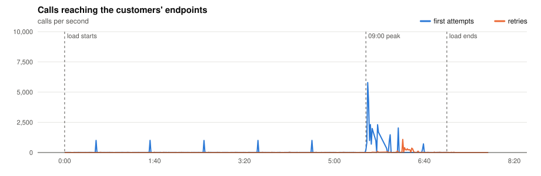
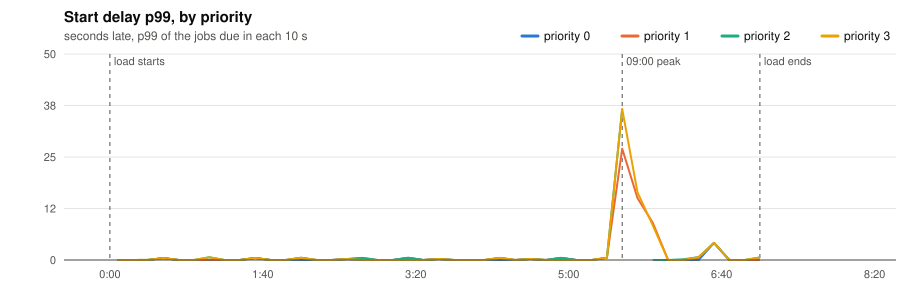
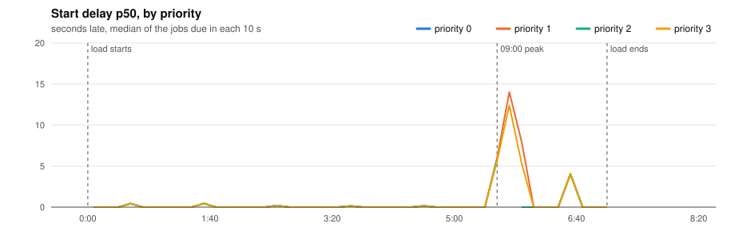
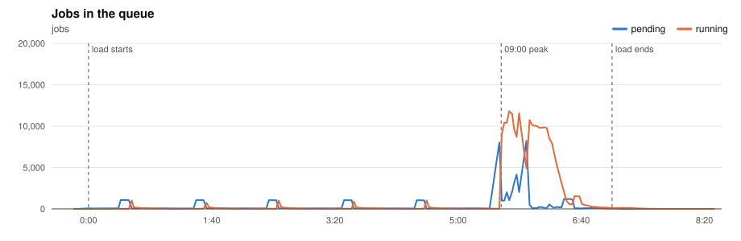
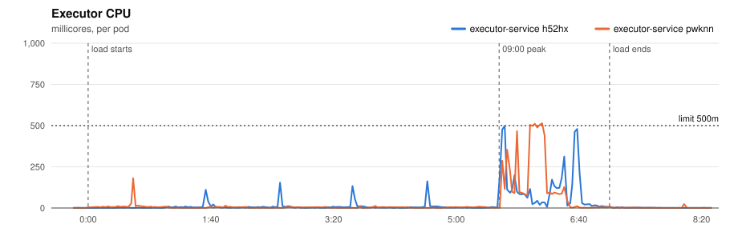
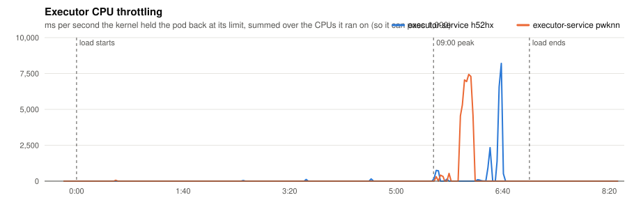
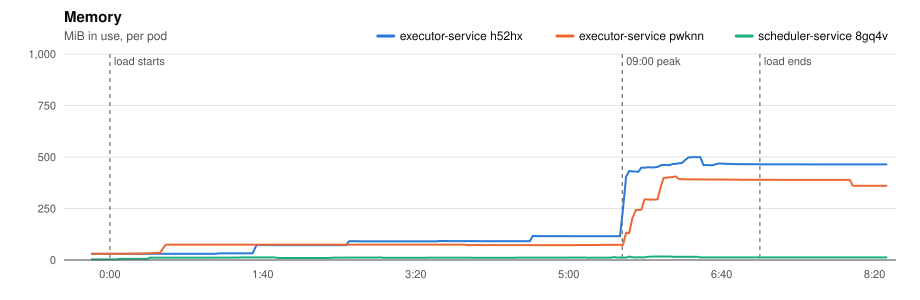
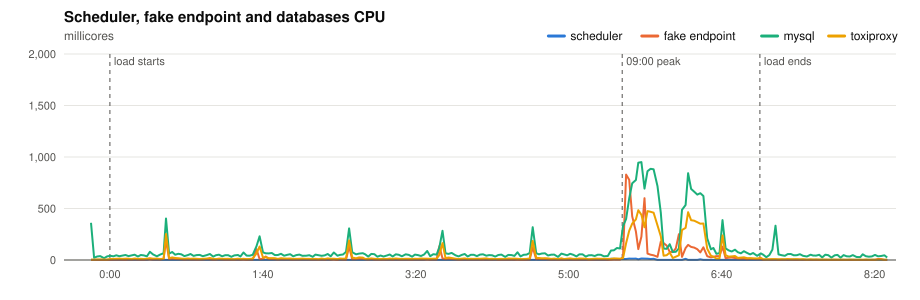
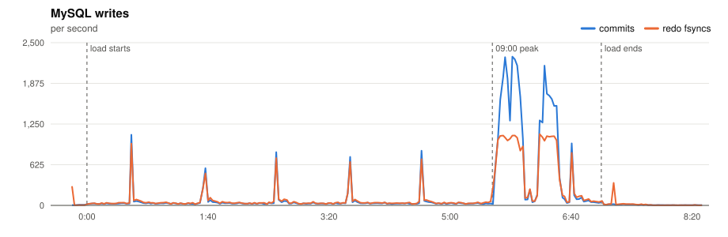
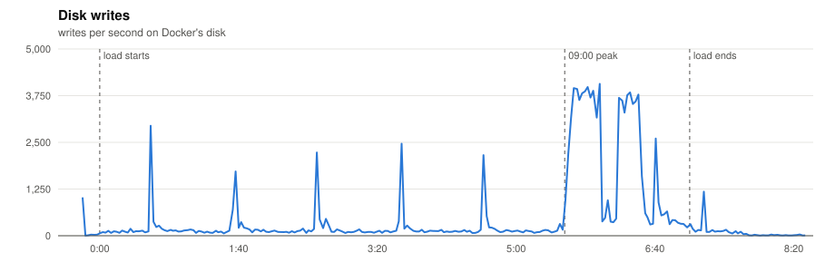

# P11 · 20261119T214410Z-a-base (a-base)

- **Load:** 425 s of the platform model at scale 1.0: 1,000 minute, 4,000 five, 10,000 hour, 15,000 day, 2,361 at tasks; 32,361 tasks seeded.
- **Deployment:** 2 executors; executor-service: `JOB_TIME_LIMIT_SECONDS=1 WORKER_COUNT=10000 JOB_QUEUE_SIZE=10000 PPROF_ADDR=:6060 GOMAXPROCS=`; scheduler-service: `SCHEDULE_INTERVAL=1s SCHEDULE_LOOKAHEAD=10s PPROF_ADDR=:6060 GOMAXPROCS=`
- **Raw data:** `bench/results/P11-peak/runs/20261119T214410Z-a-base/` (local, not committed)

## Jobs

| Created | Succeeded | Dead | Still pending or running | Retried | Duplicate successes | Timed out, done anyway | Calls per second (first attempts) |
|---|---|---|---|---|---|---|---|
| 38,361 | 37,914 | 447 | 0 | 4,341 | 78 | 667 | 82.9 |

*Duplicate successes*: the endpoint answered 200 twice for one job, which only a failure should cause. *Timed out, done anyway*: the executor gave up after the timeout while the endpoint finished the work, so the retry made the customer process the job again.

**Start delay** (when the call reached the endpoint minus when the job was due, first attempts):

| Priority | Jobs | p50 | p90 | p99 | max |
|---|---|---|---|---|---|
| 0 | 1,763 | 4.410 s | 26.608 s | 26.620 s | 27.141 s |
| 1 | 5,452 | 4.139 s | 26.841 s | 27.020 s | 27.125 s |
| 2 | 21,286 | 3.490 s | 27.126 s | 36.638 s | 36.831 s |
| 3 | 6,649 | 3.185 s | 14.329 s | 36.644 s | 36.649 s |
| all | 35,150 | 3.485 s | 26.946 s | 36.635 s | 36.831 s |

- **09:00 peak:** 26,867 jobs due on the same second. The last one started **36.8 s** late (p50 5.8 s, p99 36.6 s); priority 0 p99 **27.1 s**.
- **Peak throughput:** every job of the peak had started **53.8 s** after it (p99 52.3 s), **558 jobs/s**; 5,791 in its busiest second. First attempts that never reached the endpoint: **3,138**.
- **Peak by priority** (p50 / p99 / max, first attempts): 0: 5.7 / 27.1 / 27.1 s; 1: 6.0 / 27.0 / 27.1 s; 2: 5.8 / 36.6 / 36.8 s; 3: 5.6 / 36.6 / 36.6 s.

## Charts

Time is minutes:seconds from the start of the load.





















## Resources

| Component | CPU avg (millicores) | CPU max | Throttled max (ms/s) | Memory max (MiB) |
|---|---|---|---|---|
| executor-service h52hx | 25 | 498 | 8204 | 500 |
| executor-service pwknn | 28 | 514 | 7434 | 406 |
| scheduler-service 8gq4v | 2 | 14 | 0 | 17 |
| fake-endpoint n294s | 29 | 829 | 0 | 260 |
| mysql | 114 | 951 | 28 | 1286 |
| cassandra | 96 | 355 | 0 | 1020 |
| toxiproxy | 45 | 484 | 0 | 24 |

MySQL: up to 2285 commits/s, 1095 redo fsyncs/s, 8 row lock waits/s, 16 connections.

## CPU profile: executor, 20 s from 5:46

```text
      flat  flat%   sum%        cum   cum%
     0.57s 54.81% 54.81%      0.57s 54.81%  internal/runtime/syscall.Syscall6
     0.06s  5.77% 60.58%      0.06s  5.77%  runtime.futex
     0.03s  2.88% 63.46%      0.03s  2.88%  runtime.gopark
     0.02s  1.92% 65.38%      0.23s 22.12%  database/sql.ctxDriverStmtExec
     0.02s  1.92% 67.31%      0.02s  1.92%  runtime.memmove
     0.02s  1.92% 69.23%      0.02s  1.92%  runtime.netpollblock
     0.02s  1.92% 71.15%      0.03s  2.88%  runtime.newobject
     0.02s  1.92% 73.08%      0.03s  2.88%  runtime.unlock2
     0.01s  0.96% 74.04%      0.02s  1.92%  context.(*cancelCtx).Done
     0.01s  0.96% 75.00%      0.59s 56.73%  github.com/JoelTeoGom/distributed-scheduler/executor-service/internal/service.(*WorkerService).executeJob
     0.01s  0.96% 75.96%      0.13s 12.50%  github.com/go-sql-driver/mysql.(*mysqlConn).readWithTimeout
     0.01s  0.96% 76.92%      0.01s  0.96%  github.com/go-sql-driver/mysql.appendLengthEncodedInteger (inline)
```

## CPU profile: scheduler, 20 s from 5:46

```text
      flat  flat%   sum%        cum   cum%
      10ms 14.29% 14.29%       20ms 28.57%  database/sql.(*Tx).Commit
      10ms 14.29% 28.57%       10ms 14.29%  database/sql.convertAssignRows
      10ms 14.29% 42.86%       30ms 42.86%  github.com/robfig/cron/v3.getField
      10ms 14.29% 57.14%       10ms 14.29%  runtime.(*mspan).base (inline)
      10ms 14.29% 71.43%       10ms 14.29%  runtime.(*mspan).typePointersOfUnchecked
      10ms 14.29% 85.71%       10ms 14.29%  runtime.(*sweepLocked).sweep
      10ms 14.29%   100%       10ms 14.29%  runtime.futex
         0     0%   100%       10ms 14.29%  database/sql.(*Rows).Scan
         0     0%   100%       10ms 14.29%  database/sql.(*Rows).scanLocked
         0     0%   100%       10ms 14.29%  database/sql.(*Tx).Commit.func1
         0     0%   100%       10ms 14.29%  database/sql.withLock
         0     0%   100%       30ms 42.86%  github.com/JoelTeoGom/distributed-scheduler/scheduler-service/internal/adapters/out/cron.Calculator.Next
```
