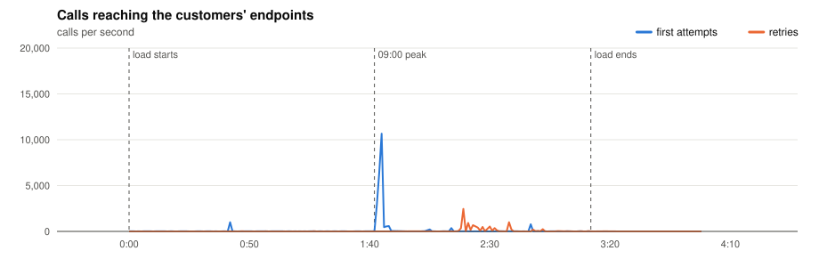
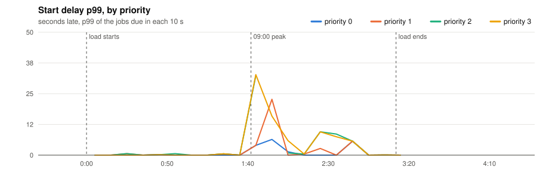
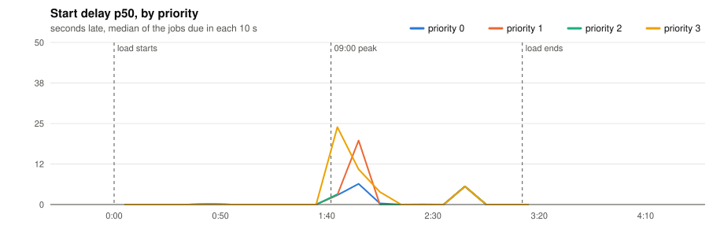
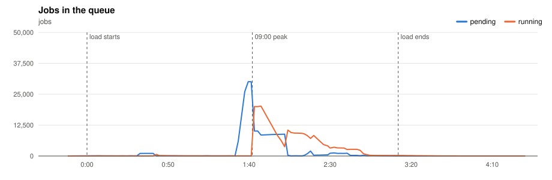
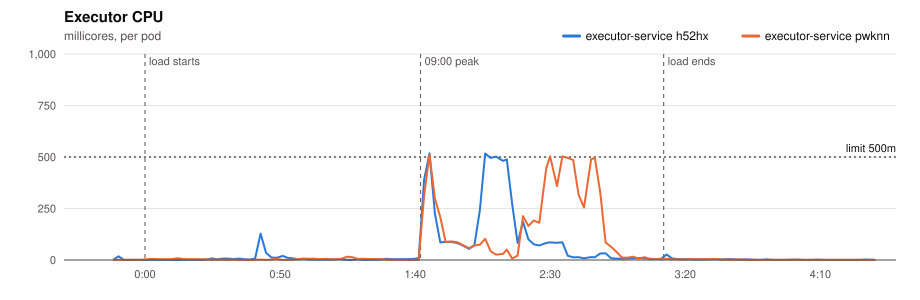
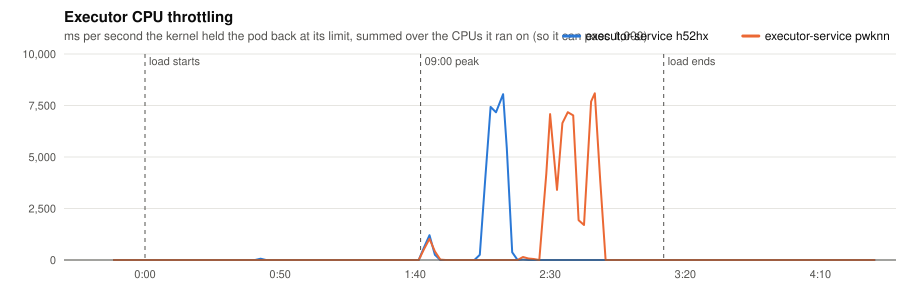
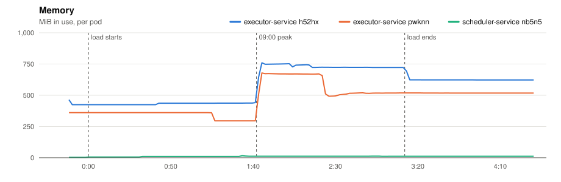
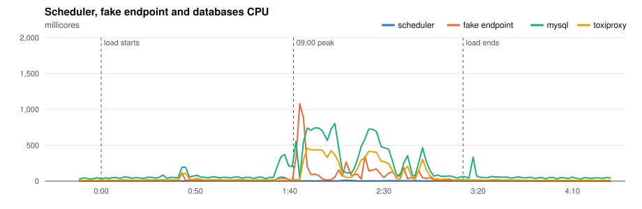
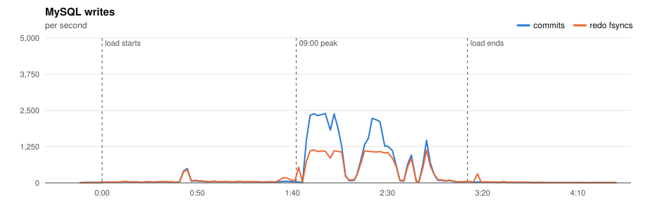
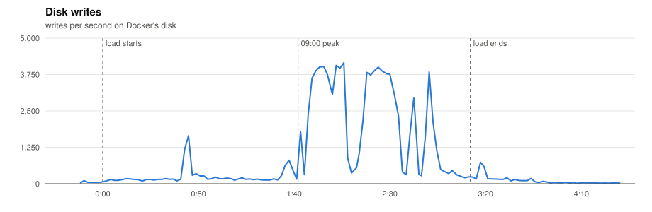

# P11 · 20261119T215303Z-b-tick200ms (b-tick200ms)

- **Load:** 192 s of the platform model at scale 1.0: 1,000 minute, 4,000 five, 10,000 hour, 15,000 day, 1,067 at tasks; 31,067 tasks seeded.
- **Deployment:** 2 executors; executor-service: `JOB_TIME_LIMIT_SECONDS=1 WORKER_COUNT=10000 JOB_QUEUE_SIZE=10000 PPROF_ADDR=:6060 GOMAXPROCS=`; scheduler-service: `SCHEDULE_INTERVAL=200ms SCHEDULE_LOOKAHEAD=10s PPROF_ADDR=:6060 GOMAXPROCS=`
- **Raw data:** `bench/results/P11-peak/runs/20261119T215303Z-b-tick200ms/` (local, not committed)

## Jobs

| Created | Succeeded | Dead | Still pending or running | Retried | Duplicate successes | Timed out, done anyway | Calls per second (first attempts) |
|---|---|---|---|---|---|---|---|
| 33,067 | 32,628 | 439 | 0 | 9,031 | 133 | 594 | 130.6 |

*Duplicate successes*: the endpoint answered 200 twice for one job, which only a failure should cause. *Timed out, done anyway*: the executor gave up after the timeout while the endpoint finished the work, so the retry made the customer process the job again.

**Start delay** (when the call reached the endpoint minus when the job was due, first attempts):

| Priority | Jobs | p50 | p90 | p99 | max |
|---|---|---|---|---|---|
| 0 | 1,660 | 2.898 s | 3.376 s | 5.601 s | 10.390 s |
| 1 | 4,906 | 2.975 s | 3.490 s | 5.591 s | 22.717 s |
| 2 | 17,419 | 3.112 s | 5.149 s | 32.008 s | 32.764 s |
| 3 | 952 | 5.591 s | 32.605 s | 32.741 s | 32.761 s |
| all | 24,937 | 3.083 s | 5.132 s | 32.605 s | 32.764 s |

- **09:00 peak:** 22,189 jobs due on the same second. The last one started **32.8 s** late (p50 3.1 s, p99 32.6 s); priority 0 p99 **4.0 s**.
- **Peak throughput:** every job of the peak had started **69.4 s** after it (p99 57.3 s), **432 jobs/s**; 10,657 in its busiest second. First attempts that never reached the endpoint: **7,821**.
- **Peak by priority** (p50 / p99 / max, first attempts): 0: 2.9 / 4.0 / 4.0 s; 1: 3.0 / 4.0 / 4.0 s; 2: 3.2 / 32.3 / 32.8 s; 3: 23.9 / 32.7 / 32.8 s.

## Charts

Time is minutes:seconds from the start of the load.





















## Resources

| Component | CPU avg (millicores) | CPU max | Throttled max (ms/s) | Memory max (MiB) |
|---|---|---|---|---|
| executor-service h52hx | 44 | 518 | 8048 | 760 |
| executor-service pwknn | 58 | 511 | 8092 | 679 |
| scheduler-service nb5n5 | 5 | 56 | 0 | 16 |
| fake-endpoint n294s | 44 | 1080 | 1336 | 454 |
| mysql | 157 | 804 | 0 | 1338 |
| cassandra | 88 | 318 | 0 | 1021 |
| toxiproxy | 73 | 458 | 0 | 24 |

MySQL: up to 2390 commits/s, 1135 redo fsyncs/s, 8 row lock waits/s, 14 connections.

## CPU profile: executor, 20 s from 1:49

```text
      flat  flat%   sum%        cum   cum%
     1.74s 71.60% 71.60%      1.74s 71.60%  internal/runtime/syscall.Syscall6
     0.06s  2.47% 74.07%      0.06s  2.47%  runtime.futex
     0.03s  1.23% 75.31%      0.03s  1.23%  runtime.memclrNoHeapPointers
     0.03s  1.23% 76.54%      0.03s  1.23%  runtime.nextFreeFast
     0.03s  1.23% 77.78%      0.07s  2.88%  runtime.selectgo
     0.02s  0.82% 78.60%      0.02s  0.82%  runtime.(*gcWork).putObjFast (inline)
     0.02s  0.82% 79.42%      0.02s  0.82%  runtime.(*mspan).heapBitsSmallForAddr
     0.02s  0.82% 80.25%      0.02s  0.82%  runtime.adjustpointers
     0.02s  0.82% 81.07%      0.02s  0.82%  runtime.findObject
     0.02s  0.82% 81.89%      0.02s  0.82%  runtime.lock2
     0.02s  0.82% 82.72%      0.02s  0.82%  runtime.pcvalue
     0.02s  0.82% 83.54%      0.08s  3.29%  runtime.scanobject
```

## CPU profile: scheduler, 20 s from 1:49

```text
      flat  flat%   sum%        cum   cum%
      20ms 50.00% 50.00%       20ms 50.00%  internal/runtime/syscall.Syscall6
      10ms 25.00% 75.00%       30ms 75.00%  internal/poll.(*FD).Read
      10ms 25.00%   100%       10ms 25.00%  runtime.(*limiterEvent).stop
         0     0%   100%       10ms 25.00%  database/sql.(*DB).BeginTx
         0     0%   100%       10ms 25.00%  database/sql.(*DB).BeginTx.func1
         0     0%   100%       10ms 25.00%  database/sql.(*DB).begin
         0     0%   100%       10ms 25.00%  database/sql.(*DB).beginDC
         0     0%   100%       10ms 25.00%  database/sql.(*DB).beginDC.func1
         0     0%   100%       20ms 50.00%  database/sql.(*DB).queryDC
         0     0%   100%       10ms 25.00%  database/sql.(*DB).retry
         0     0%   100%       20ms 50.00%  database/sql.(*Tx).QueryContext
         0     0%   100%       10ms 25.00%  database/sql.ctxDriverBegin
```
