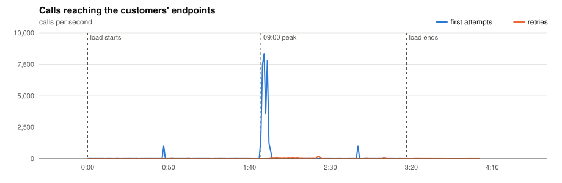
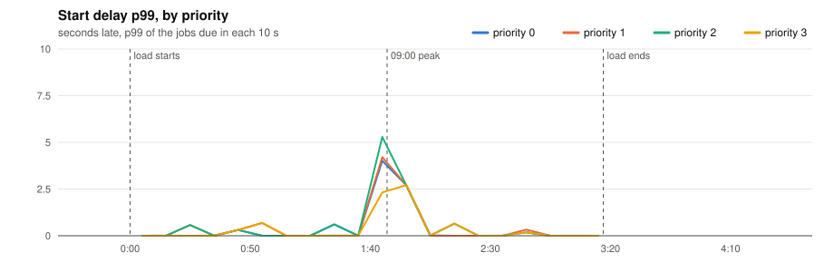
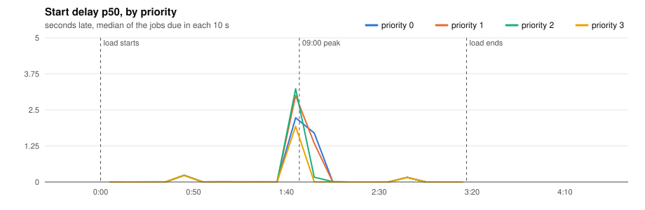
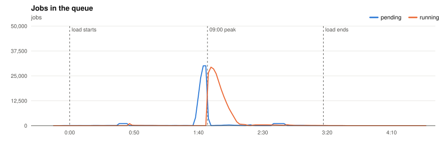
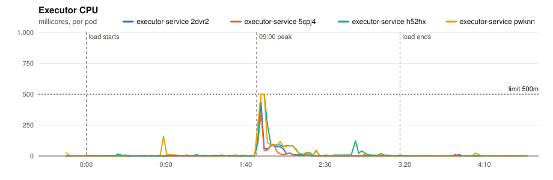
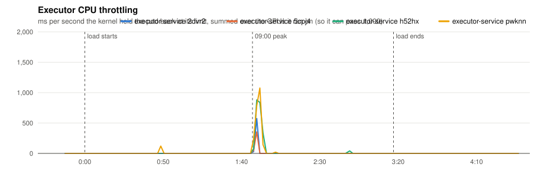
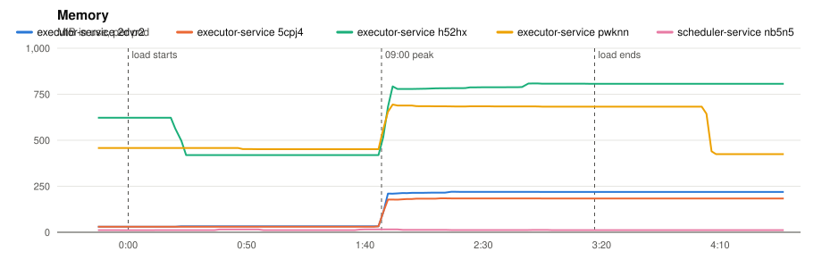
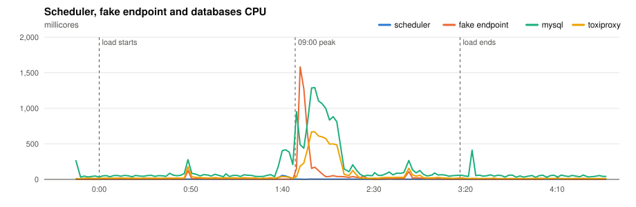
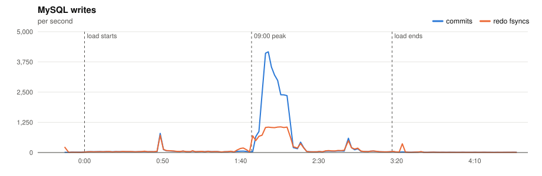
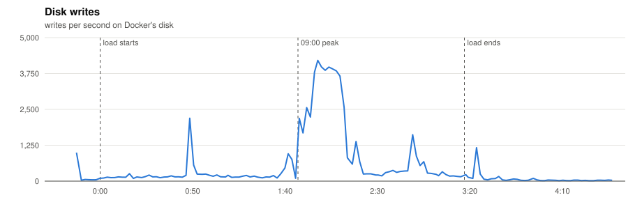

# P11 · 20261119T215757Z-c-4x (c-4x)

- **Load:** 197 s of the platform model at scale 1.0: 1,000 minute, 4,000 five, 10,000 hour, 15,000 day, 1,094 at tasks; 31,094 tasks seeded.
- **Deployment:** 4 executors; executor-service: `JOB_TIME_LIMIT_SECONDS=1 WORKER_COUNT=10000 JOB_QUEUE_SIZE=10000 PPROF_ADDR=:6060 GOMAXPROCS=`; scheduler-service: `SCHEDULE_INTERVAL=200ms SCHEDULE_LOOKAHEAD=10s PPROF_ADDR=:6060 GOMAXPROCS=`
- **Raw data:** `bench/results/P11-peak/runs/20261119T215757Z-c-4x/` (local, not committed)

## Jobs

| Created | Succeeded | Dead | Still pending or running | Retried | Duplicate successes | Timed out, done anyway | Calls per second (first attempts) |
|---|---|---|---|---|---|---|---|
| 33,094 | 32,709 | 385 | 0 | 1,002 | 0 | 536 | 168.8 |

*Duplicate successes*: the endpoint answered 200 twice for one job, which only a failure should cause. *Timed out, done anyway*: the executor gave up after the timeout while the endpoint finished the work, so the retry made the customer process the job again.

**Start delay** (when the call reached the endpoint minus when the job was due, first attempts):

| Priority | Jobs | p50 | p90 | p99 | max |
|---|---|---|---|---|---|
| 0 | 1,619 | 2.219 s | 2.701 s | 4.016 s | 4.194 s |
| 1 | 5,036 | 2.939 s | 4.130 s | 4.206 s | 4.210 s |
| 2 | 19,868 | 3.029 s | 4.825 s | 5.236 s | 5.432 s |
| 3 | 6,571 | 1.911 s | 2.300 s | 2.322 s | 2.708 s |
| all | 33,094 | 2.319 s | 4.598 s | 5.226 s | 5.432 s |

- **09:00 peak:** 30,004 jobs due on the same second. The last one started **5.4 s** late (p50 2.6 s, p99 5.2 s); priority 0 p99 **4.0 s**.
- **Peak throughput:** every job of the peak had started **5.4 s** after it (p99 5.2 s), **5,524 jobs/s**; 8,339 in its busiest second. First attempts that never reached the endpoint: **0**.
- **Peak by priority** (p50 / p99 / max, first attempts): 0: 2.2 / 4.0 / 4.2 s; 1: 3.0 / 4.2 / 4.2 s; 2: 3.2 / 5.3 / 5.4 s; 3: 1.9 / 2.3 / 2.3 s.

## Charts

Time is minutes:seconds from the start of the load.





















## Resources

| Component | CPU avg (millicores) | CPU max | Throttled max (ms/s) | Memory max (MiB) |
|---|---|---|---|---|
| executor-service 2dvr2 | 9 | 438 | 575 | 220 |
| executor-service 5cpj4 | 7 | 342 | 354 | 184 |
| executor-service h52hx | 20 | 502 | 880 | 809 |
| executor-service pwknn | 20 | 502 | 1076 | 694 |
| scheduler-service nb5n5 | 5 | 57 | 0 | 16 |
| fake-endpoint n294s | 37 | 1582 | 364 | 508 |
| mysql | 149 | 1291 | 40 | 1381 |
| cassandra | 95 | 346 | 0 | 1029 |
| toxiproxy | 61 | 670 | 0 | 28 |

MySQL: up to 4168 commits/s, 1061 redo fsyncs/s, 6 row lock waits/s, 25 connections.

## CPU profile: executor, 20 s from 1:55

```text
      flat  flat%   sum%        cum   cum%
     230ms 50.00% 50.00%      230ms 50.00%  internal/runtime/syscall.Syscall6
      40ms  8.70% 58.70%       40ms  8.70%  runtime.futex
      20ms  4.35% 63.04%       20ms  4.35%  runtime.nanotime
      10ms  2.17% 65.22%       20ms  4.35%  database/sql.(*DB).putConn
      10ms  2.17% 67.39%      150ms 32.61%  github.com/go-sql-driver/mysql.(*mysqlConn).writeWithTimeout
      10ms  2.17% 69.57%      140ms 30.43%  internal/poll.(*FD).Write
      10ms  2.17% 71.74%       10ms  2.17%  internal/runtime/atomic.(*Uint32).Store (inline)
      10ms  2.17% 73.91%       10ms  2.17%  runtime.(*timer).stop
      10ms  2.17% 76.09%       10ms  2.17%  runtime.acquireSudog
      10ms  2.17% 78.26%       10ms  2.17%  runtime.acquirem
      10ms  2.17% 80.43%       20ms  4.35%  runtime.chansend
      10ms  2.17% 82.61%       10ms  2.17%  runtime.findfunc
```

## CPU profile: scheduler, 20 s from 1:55

```text
      flat  flat%   sum%        cum   cum%
      30ms 75.00% 75.00%       30ms 75.00%  internal/runtime/syscall.Syscall6
      10ms 25.00%   100%       10ms 25.00%  runtime.mapassign
         0     0%   100%       10ms 25.00%  context.(*cancelCtx).propagateCancel
         0     0%   100%       10ms 25.00%  context.WithCancel
         0     0%   100%       10ms 25.00%  context.withCancel (inline)
         0     0%   100%       20ms 50.00%  database/sql.(*DB).execDC
         0     0%   100%       20ms 50.00%  database/sql.(*DB).execDC.func3
         0     0%   100%       10ms 25.00%  database/sql.(*DB).queryDC
         0     0%   100%       10ms 25.00%  database/sql.(*Rows).initContextClose
         0     0%   100%       20ms 50.00%  database/sql.(*Tx).ExecContext
         0     0%   100%       10ms 25.00%  database/sql.(*Tx).QueryContext
         0     0%   100%       20ms 50.00%  database/sql.ctxDriverPrepare
```
