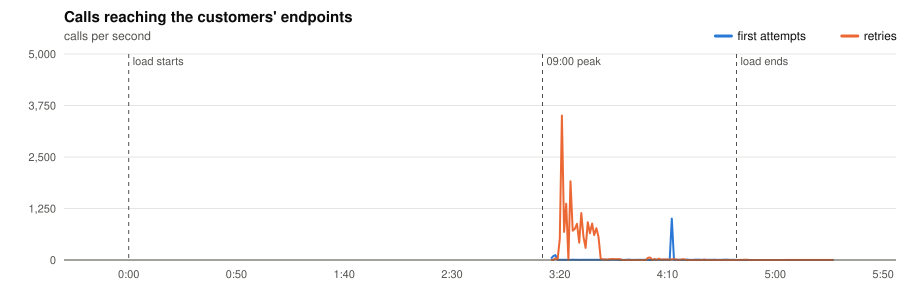
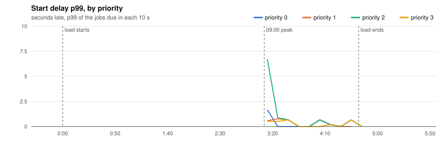
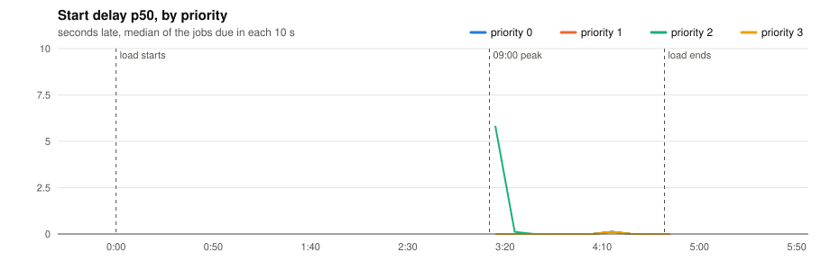
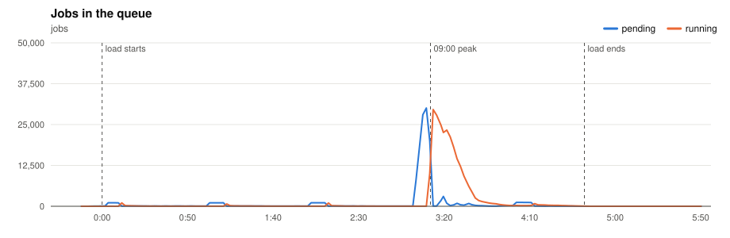
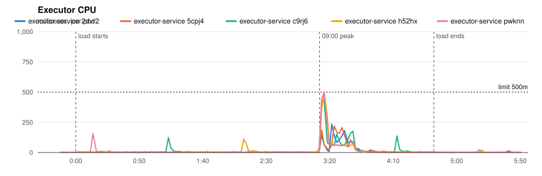
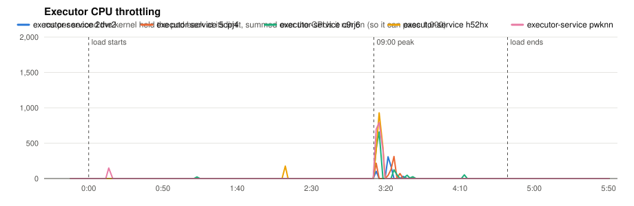
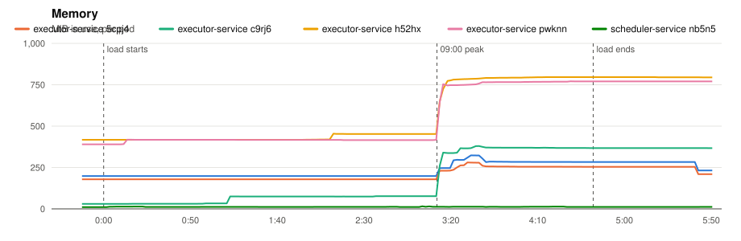
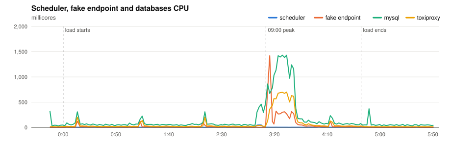
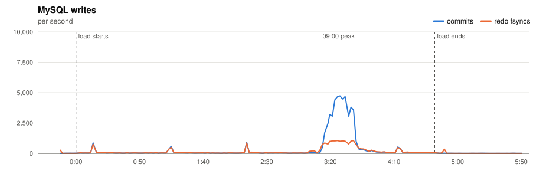
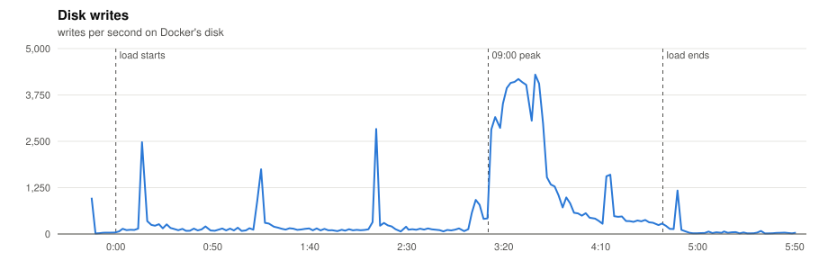

# P11 · 20261119T220633Z-d-5x (d-5x)

- **Load:** 282 s of the platform model at scale 1.0: 1,000 minute, 4,000 five, 10,000 hour, 15,000 day, 1,567 at tasks; 31,567 tasks seeded.
- **Deployment:** 5 executors; executor-service: `JOB_TIME_LIMIT_SECONDS=1 WORKER_COUNT=10000 JOB_QUEUE_SIZE=10000 PPROF_ADDR=:6060 GOMAXPROCS=`; scheduler-service: `SCHEDULE_INTERVAL=200ms SCHEDULE_LOOKAHEAD=10s PPROF_ADDR=:6060 GOMAXPROCS=`
- **Raw data:** `bench/results/P11-peak/runs/20261119T220633Z-d-5x/` (local, not committed)

## Jobs

| Created | Succeeded | Dead | Still pending or running | Retried | Duplicate successes | Timed out, done anyway | Calls per second (first attempts) |
|---|---|---|---|---|---|---|---|
| 35,567 | 35,093 | 474 | 0 | 17,060 | 0 | 398 | 19.8 |

*Duplicate successes*: the endpoint answered 200 twice for one job, which only a failure should cause. *Timed out, done anyway*: the executor gave up after the timeout while the endpoint finished the work, so the retry made the customer process the job again.

**Start delay** (when the call reached the endpoint minus when the job was due, first attempts):

| Priority | Jobs | p50 | p90 | p99 | max |
|---|---|---|---|---|---|
| 0 | 67 | 0.099 s | 0.188 s | 1.671 s | 1.671 s |
| 1 | 248 | 0.109 s | 0.185 s | 0.670 s | 0.769 s |
| 2 | 1,090 | 0.116 s | 6.153 s | 6.722 s | 6.722 s |
| 3 | 267 | 0.112 s | 0.183 s | 0.530 s | 0.668 s |
| all | 1,672 | 0.114 s | 5.207 s | 6.722 s | 6.722 s |

- **09:00 peak:** 231 jobs due on the same second. The last one started **6.7 s** late (p50 6.0 s, p99 6.7 s); priority 0 p99 **nan s**.
- **Peak throughput:** every job of the peak had started **27.3 s** after it (p99 26.2 s), **627 jobs/s**; 113 in its busiest second. First attempts that never reached the endpoint: **16,902**.
- **Peak by priority** (p50 / p99 / max, first attempts): 2: 6.0 / 6.7 / 6.7 s.

## Charts

Time is minutes:seconds from the start of the load.





















## Resources

| Component | CPU avg (millicores) | CPU max | Throttled max (ms/s) | Memory max (MiB) |
|---|---|---|---|---|
| executor-service 2dvr2 | 9 | 235 | 307 | 323 |
| executor-service 5cpj4 | 10 | 219 | 312 | 281 |
| executor-service c9rj6 | 15 | 434 | 658 | 380 |
| executor-service h52hx | 14 | 500 | 928 | 796 |
| executor-service pwknn | 14 | 498 | 791 | 771 |
| scheduler-service nb5n5 | 5 | 50 | 0 | 16 |
| fake-endpoint n294s | 36 | 1421 | 251 | 352 |
| mysql | 159 | 1431 | 11 | 1453 |
| cassandra | 88 | 296 | 0 | 1024 |
| toxiproxy | 67 | 700 | 0 | 29 |

MySQL: up to 4735 commits/s, 1050 redo fsyncs/s, 35 row lock waits/s, 29 connections.

## CPU profile: executor, 20 s from 3:20

```text
      flat  flat%   sum%        cum   cum%
     790ms 49.07% 49.07%      790ms 49.07%  internal/runtime/syscall.Syscall6
      40ms  2.48% 51.55%       40ms  2.48%  runtime.memmove
      30ms  1.86% 53.42%       30ms  1.86%  runtime.nextFreeFast (inline)
      30ms  1.86% 55.28%       60ms  3.73%  runtime.selectgo
      20ms  1.24% 56.52%       40ms  2.48%  runtime.(*unwinder).resolveInternal
      20ms  1.24% 57.76%       20ms  1.24%  runtime.findObject
      20ms  1.24% 59.01%       20ms  1.24%  runtime.ifaceeq
      20ms  1.24% 60.25%      200ms 12.42%  runtime.mallocgc
      20ms  1.24% 61.49%       20ms  1.24%  runtime.memclrNoHeapPointers
      20ms  1.24% 62.73%       20ms  1.24%  runtime.nanotime
      20ms  1.24% 63.98%       80ms  4.97%  runtime.netpoll
      20ms  1.24% 65.22%       20ms  1.24%  runtime.sellock
```

## CPU profile: scheduler, 20 s from 3:20

```text
      flat  flat%   sum%        cum   cum%
      10ms   100%   100%       10ms   100%  indexbytebody
         0     0%   100%       10ms   100%  database/sql.(*DB).queryDC
         0     0%   100%       10ms   100%  database/sql.(*Rows).initContextClose
         0     0%   100%       10ms   100%  database/sql.(*Tx).QueryContext
         0     0%   100%       10ms   100%  github.com/JoelTeoGom/distributed-scheduler/scheduler-service/internal/adapters/out/mysql.(*SchedulerRepository).ScheduleJobs
         0     0%   100%       10ms   100%  github.com/JoelTeoGom/distributed-scheduler/scheduler-service/internal/adapters/out/mysql.selectScheduledTasks
         0     0%   100%       10ms   100%  github.com/JoelTeoGom/distributed-scheduler/scheduler-service/internal/service.(*SchedulerService).Start
         0     0%   100%       10ms   100%  main.main.func2
         0     0%   100%       10ms   100%  runtime.(*moduledata).funcName
         0     0%   100%       10ms   100%  runtime.findnull
         0     0%   100%       10ms   100%  runtime.funcname (inline)
         0     0%   100%       10ms   100%  runtime.gostringnocopy (inline)
```
