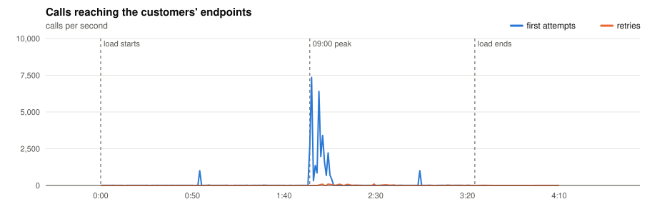
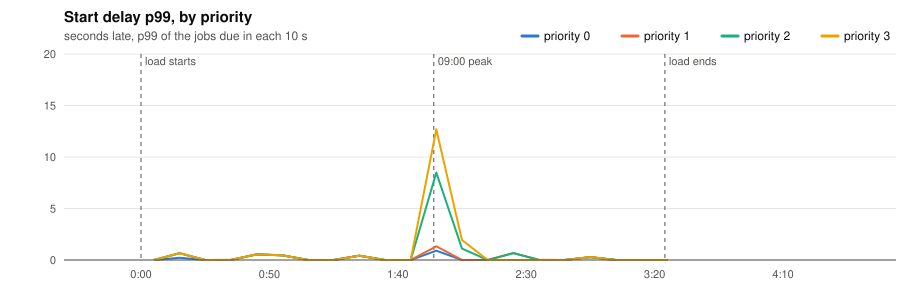
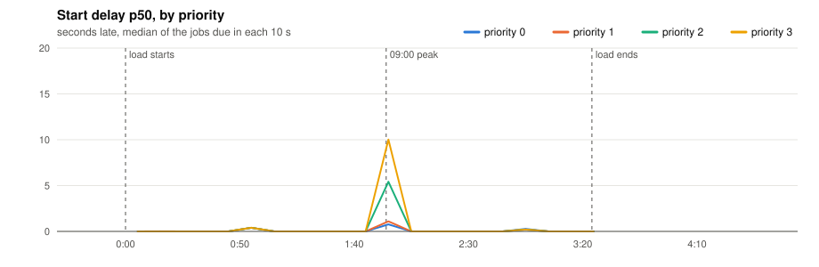
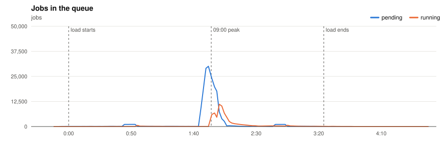
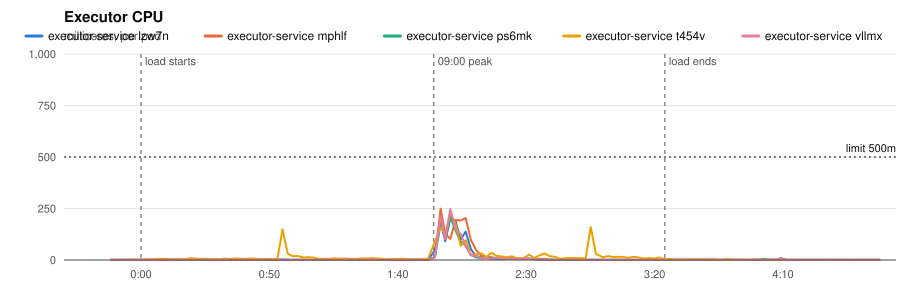
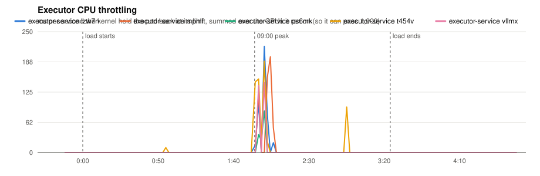
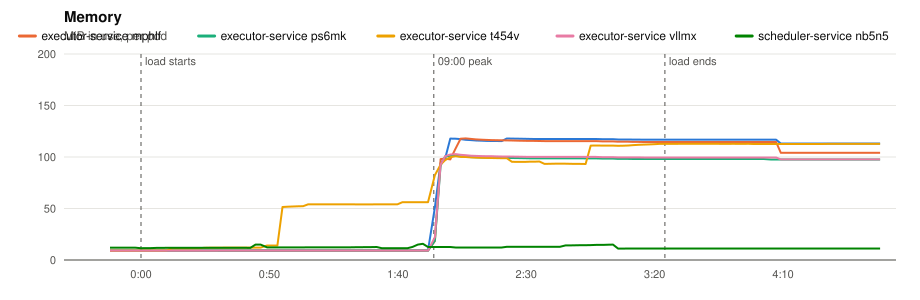
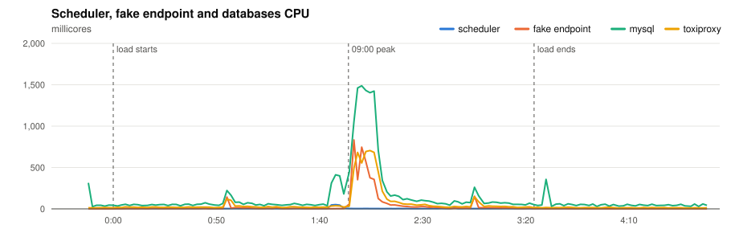
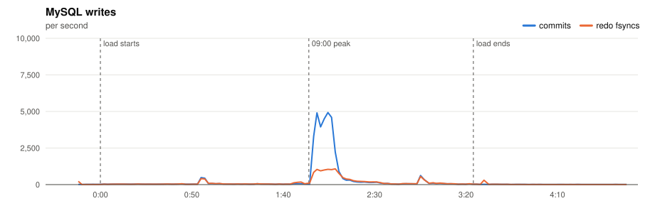
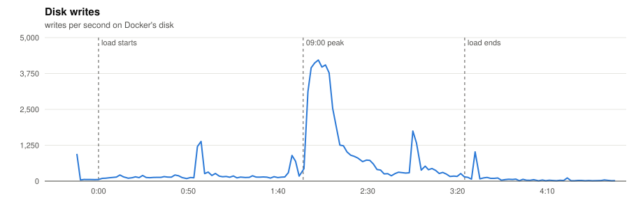

# P11 · 20261119T221251Z-e-5x-w2000 (e-5x-w2000)

- **Load:** 204 s of the platform model at scale 1.0: 1,000 minute, 4,000 five, 10,000 hour, 15,000 day, 1,133 at tasks; 31,133 tasks seeded.
- **Deployment:** 5 executors; executor-service: `JOB_TIME_LIMIT_SECONDS=1 WORKER_COUNT=2000 JOB_QUEUE_SIZE=10000 PPROF_ADDR=:6060 GOMAXPROCS=`; scheduler-service: `SCHEDULE_INTERVAL=200ms SCHEDULE_LOOKAHEAD=10s PPROF_ADDR=:6060 GOMAXPROCS=`
- **Raw data:** `bench/results/P11-peak/runs/20261119T221251Z-e-5x-w2000/` (local, not committed)

## Jobs

| Created | Succeeded | Dead | Still pending or running | Retried | Duplicate successes | Timed out, done anyway | Calls per second (first attempts) |
|---|---|---|---|---|---|---|---|
| 33,133 | 32,765 | 368 | 0 | 894 | 0 | 436 | 163.2 |

*Duplicate successes*: the endpoint answered 200 twice for one job, which only a failure should cause. *Timed out, done anyway*: the executor gave up after the timeout while the endpoint finished the work, so the retry made the customer process the job again.

**Start delay** (when the call reached the endpoint minus when the job was due, first attempts):

| Priority | Jobs | p50 | p90 | p99 | max |
|---|---|---|---|---|---|
| 0 | 1,625 | 0.762 s | 0.895 s | 0.904 s | 0.904 s |
| 1 | 4,999 | 1.066 s | 1.300 s | 1.329 s | 1.335 s |
| 2 | 19,894 | 5.197 s | 7.157 s | 8.465 s | 8.819 s |
| 3 | 6,615 | 10.002 s | 11.515 s | 12.677 s | 12.793 s |
| all | 33,133 | 5.149 s | 10.002 s | 12.156 s | 12.793 s |

- **09:00 peak:** 30,002 jobs due on the same second. The last one started **12.8 s** late (p50 5.4 s, p99 12.2 s); priority 0 p99 **0.9 s**.
- **Peak throughput:** every job of the peak had started **12.8 s** after it (p99 12.2 s), **2,345 jobs/s**; 7,351 in its busiest second. First attempts that never reached the endpoint: **0**.
- **Peak by priority** (p50 / p99 / max, first attempts): 0: 0.8 / 0.9 / 0.9 s; 1: 1.1 / 1.3 / 1.3 s; 2: 5.4 / 8.5 / 8.8 s; 3: 10.0 / 12.7 / 12.8 s.

## Charts

Time is minutes:seconds from the start of the load.





















## Resources

| Component | CPU avg (millicores) | CPU max | Throttled max (ms/s) | Memory max (MiB) |
|---|---|---|---|---|
| executor-service lzw7n | 8 | 202 | 220 | 118 |
| executor-service mphlf | 10 | 249 | 198 | 118 |
| executor-service ps6mk | 7 | 209 | 86 | 101 |
| executor-service t454v | 15 | 227 | 189 | 113 |
| executor-service vllmx | 8 | 248 | 145 | 103 |
| scheduler-service nb5n5 | 5 | 52 | 0 | 16 |
| fake-endpoint n294s | 32 | 833 | 217 | 305 |
| mysql | 136 | 1487 | 382 | 1501 |
| cassandra | 86 | 285 | 0 | 1022 |
| toxiproxy | 55 | 705 | 0 | 29 |

MySQL: up to 4927 commits/s, 1080 redo fsyncs/s, 6 row lock waits/s, 29 connections.

## CPU profile: executor, 20 s from 2:01

```text
      flat  flat%   sum%        cum   cum%
     300ms 52.63% 52.63%      300ms 52.63%  internal/runtime/syscall.Syscall6
      40ms  7.02% 59.65%       40ms  7.02%  runtime.futex
      10ms  1.75% 61.40%       10ms  1.75%  bufio.(*Reader).ReadSlice
      10ms  1.75% 63.16%       10ms  1.75%  context.(*timerCtx).Done
      10ms  1.75% 64.91%       10ms  1.75%  context.(*timerCtx).cancel
      10ms  1.75% 66.67%       10ms  1.75%  context.WithCancelCause.func1
      10ms  1.75% 68.42%       20ms  3.51%  database/sql.driverArgsConnLocked
      10ms  1.75% 70.18%       10ms  1.75%  github.com/go-sql-driver/mysql.(*mysqlResult).RowsAffected
      10ms  1.75% 71.93%       10ms  1.75%  github.com/go-sql-driver/mysql.converter.ConvertValue
      10ms  1.75% 73.68%       10ms  1.75%  internal/poll.(*fdMutex).rwlock
      10ms  1.75% 75.44%       10ms  1.75%  net/http.(*Request).write
      10ms  1.75% 77.19%       30ms  5.26%  net/http.(*Transport).roundTrip
```

## CPU profile: scheduler, 20 s from 2:01

```text
      flat  flat%   sum%        cum   cum%
      10ms 50.00% 50.00%       10ms 50.00%  runtime.futex
      10ms 50.00%   100%       10ms 50.00%  runtime.nextFreeFast (inline)
         0     0%   100%       10ms 50.00%  database/sql.(*DB).execDC
         0     0%   100%       10ms 50.00%  database/sql.(*Tx).ExecContext
         0     0%   100%       10ms 50.00%  database/sql.(*Tx).Rollback
         0     0%   100%       10ms 50.00%  database/sql.(*Tx).rollback
         0     0%   100%       10ms 50.00%  database/sql.(*Tx).rollback.func1
         0     0%   100%       10ms 50.00%  database/sql.driverArgsConnLocked
         0     0%   100%       10ms 50.00%  database/sql.resultFromStatement
         0     0%   100%       10ms 50.00%  database/sql.withLock
         0     0%   100%       20ms   100%  github.com/JoelTeoGom/distributed-scheduler/scheduler-service/internal/adapters/out/mysql.(*SchedulerRepository).ScheduleJobs
         0     0%   100%       10ms 50.00%  github.com/JoelTeoGom/distributed-scheduler/scheduler-service/internal/adapters/out/mysql.insertJobs
```
