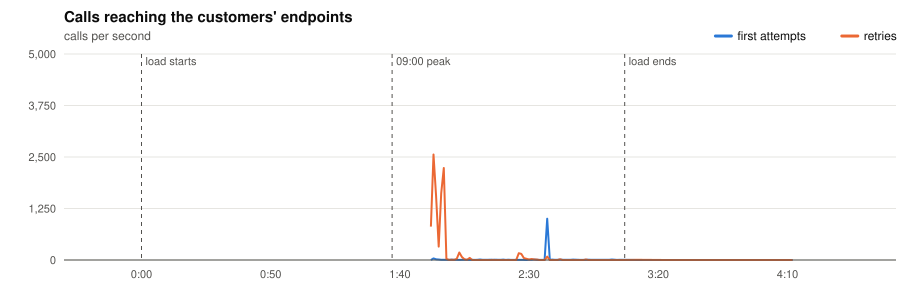
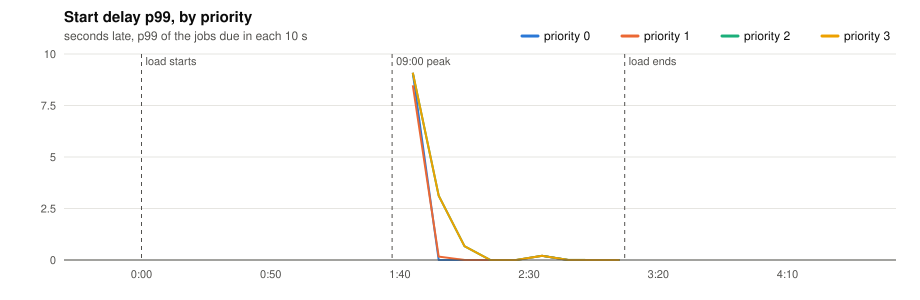
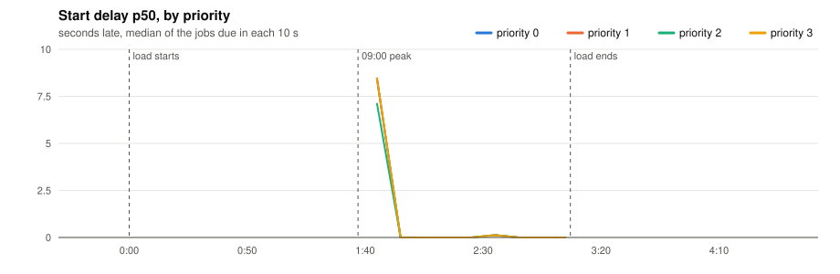
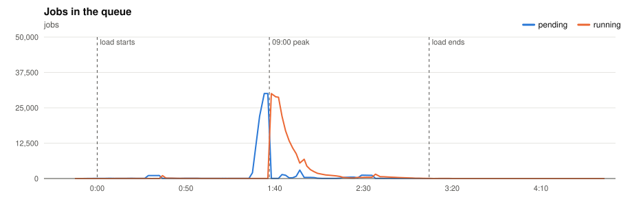
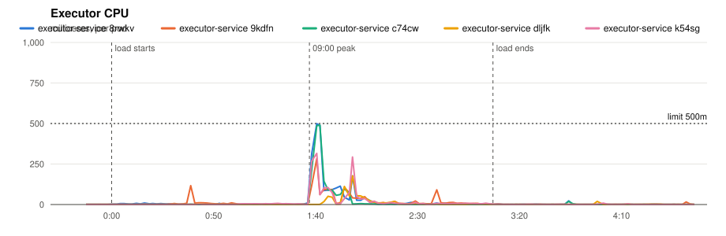
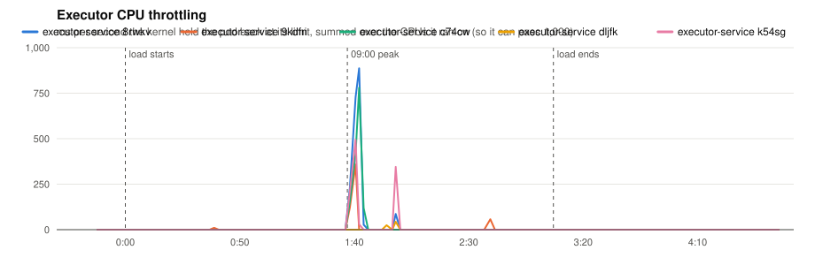
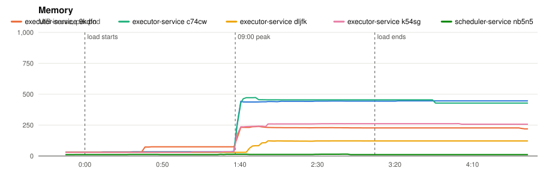
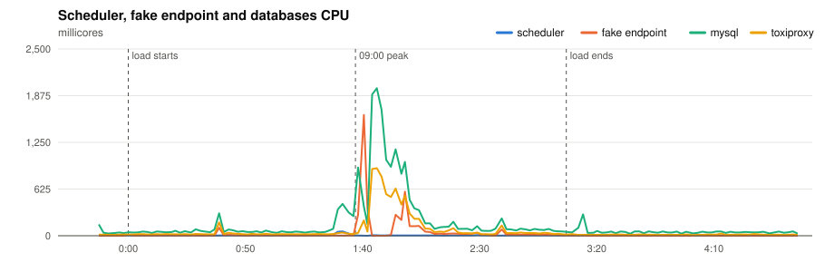
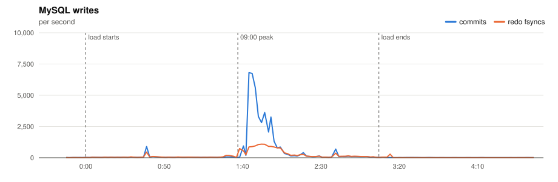
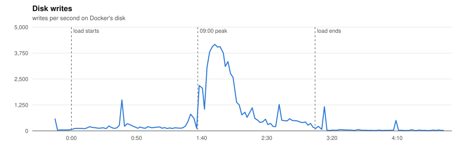

# P11 · 20261119T221808Z-f-5x-pool10 (f-5x-pool10)

- **Load:** 187 s of the platform model at scale 1.0: 1,000 minute, 4,000 five, 10,000 hour, 15,000 day, 1,039 at tasks; 31,039 tasks seeded.
- **Deployment:** 5 executors; executor-service: `JOB_TIME_LIMIT_SECONDS=1 WORKER_COUNT=10000 JOB_QUEUE_SIZE=10000 PPROF_ADDR=:6060 GOMAXPROCS= MYSQL_MAX_OPEN_CONNS=10 MYSQL_MAX_IDLE_CONNS=10`; scheduler-service: `SCHEDULE_INTERVAL=200ms SCHEDULE_LOOKAHEAD=10s PPROF_ADDR=:6060 GOMAXPROCS=`
- **Raw data:** `bench/results/P11-peak/runs/20261119T221808Z-f-5x-pool10/` (local, not committed)

## Jobs

| Created | Succeeded | Dead | Still pending or running | Retried | Duplicate successes | Timed out, done anyway | Calls per second (first attempts) |
|---|---|---|---|---|---|---|---|
| 33,039 | 32,569 | 470 | 0 | 9,200 | 0 | 655 | 19.7 |

*Duplicate successes*: the endpoint answered 200 twice for one job, which only a failure should cause. *Timed out, done anyway*: the executor gave up after the timeout while the endpoint finished the work, so the retry made the customer process the job again.

**Start delay** (when the call reached the endpoint minus when the job was due, first attempts):

| Priority | Jobs | p50 | p90 | p99 | max |
|---|---|---|---|---|---|
| 0 | 62 | 0.120 s | 0.138 s | 9.086 s | 9.086 s |
| 1 | 226 | 0.122 s | 0.138 s | 6.896 s | 8.480 s |
| 2 | 856 | 0.122 s | 0.203 s | 7.147 s | 9.084 s |
| 3 | 293 | 0.120 s | 0.139 s | 8.480 s | 9.090 s |
| all | 1,437 | 0.121 s | 0.203 s | 8.478 s | 9.090 s |

## Charts

Time is minutes:seconds from the start of the load.





















## Resources

| Component | CPU avg (millicores) | CPU max | Throttled max (ms/s) | Memory max (MiB) |
|---|---|---|---|---|
| executor-service 8rwkv | 17 | 498 | 887 | 446 |
| executor-service 9kdfn | 12 | 283 | 358 | 239 |
| executor-service c74cw | 13 | 490 | 780 | 473 |
| executor-service dljfk | 6 | 177 | 44 | 123 |
| executor-service k54sg | 12 | 316 | 494 | 262 |
| scheduler-service nb5n5 | 5 | 58 | 0 | 15 |
| fake-endpoint n294s | 32 | 1617 | 873 | 502 |
| mysql | 157 | 1974 | 383 | 1599 |
| cassandra | 93 | 505 | 0 | 1038 |
| toxiproxy | 66 | 904 | 0 | 36 |

MySQL: up to 6804 commits/s, 1086 redo fsyncs/s, 88 row lock waits/s, 55 connections.

## CPU profile: executor, 20 s from 1:44

```text
      flat  flat%   sum%        cum   cum%
     420ms 50.00% 50.00%      420ms 50.00%  internal/runtime/syscall.Syscall6
      60ms  7.14% 57.14%       60ms  7.14%  runtime.futex
      30ms  3.57% 60.71%       60ms  7.14%  runtime.selectgo
      20ms  2.38% 63.10%       20ms  2.38%  runtime.memmove
      10ms  1.19% 64.29%       10ms  1.19%  context.(*cancelCtx).Done
      10ms  1.19% 65.48%      490ms 58.33%  database/sql.(*DB).exec
      10ms  1.19% 66.67%      450ms 53.57%  database/sql.(*DB).execDC
      10ms  1.19% 67.86%       20ms  2.38%  database/sql.(*DB).putConn
      10ms  1.19% 69.05%       10ms  1.19%  database/sql.(*connRequestSet).deleteIndex (inline)
      10ms  1.19% 70.24%       20ms  2.38%  database/sql.driverArgsConnLocked
      10ms  1.19% 71.43%      150ms 17.86%  github.com/go-sql-driver/mysql.(*mysqlConn).readWithTimeout
      10ms  1.19% 72.62%      240ms 28.57%  github.com/go-sql-driver/mysql.(*mysqlConn).writePacket
```

## CPU profile: scheduler, 20 s from 1:44

```text
      flat  flat%   sum%        cum   cum%
      10ms   100%   100%       10ms   100%  internal/runtime/syscall.Syscall6
         0     0%   100%       10ms   100%  internal/runtime/syscall.EpollWait
         0     0%   100%       10ms   100%  runtime.findRunnable
         0     0%   100%       10ms   100%  runtime.mcall
         0     0%   100%       10ms   100%  runtime.netpoll
         0     0%   100%       10ms   100%  runtime.park_m
         0     0%   100%       10ms   100%  runtime.schedule
```
