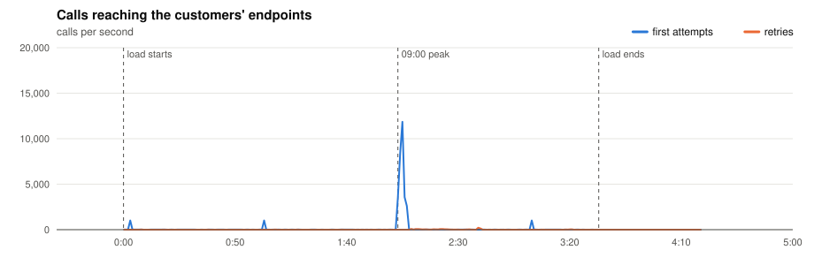
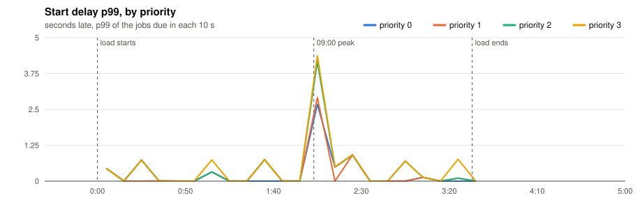
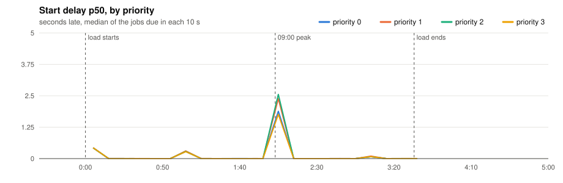
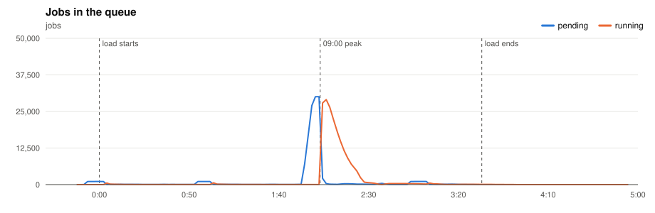
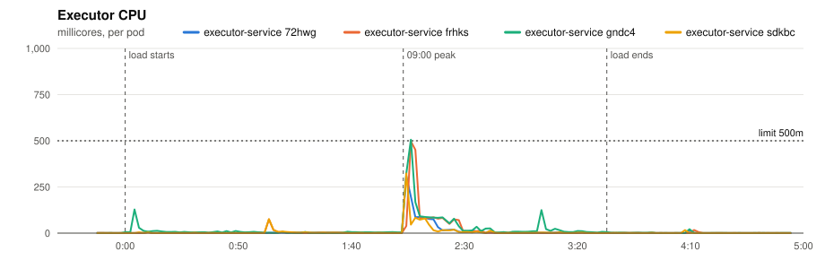
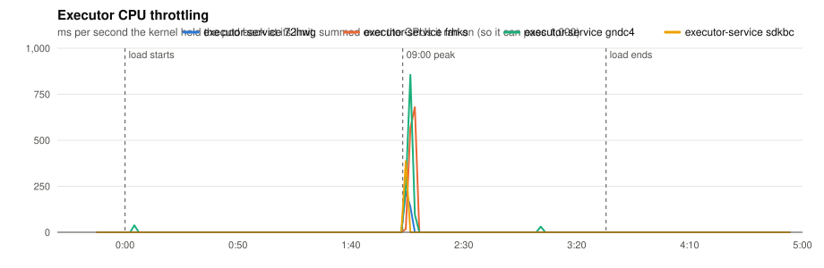
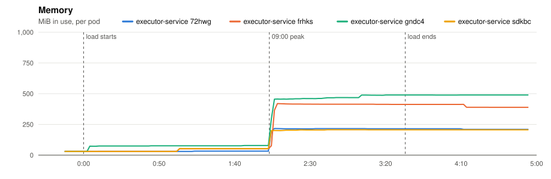
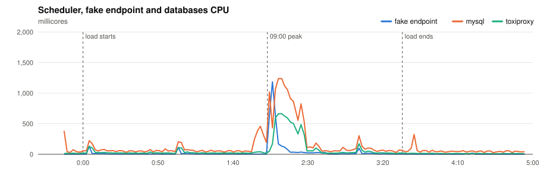
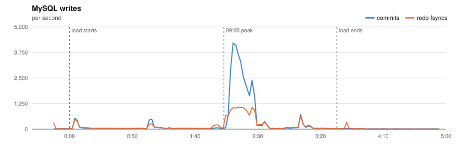
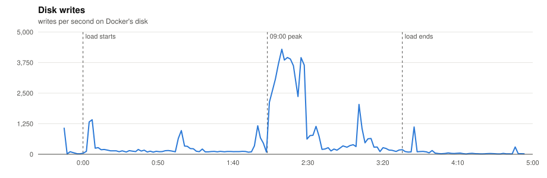

# P11 · 20261119T222742Z-s1-4x (s1-4x)

- **Load:** 213 s of the platform model at scale 1.0: 1,000 minute, 4,000 five, 10,000 hour, 15,000 day, 1,183 at tasks; 31,183 tasks seeded.
- **Deployment:** 4 executors; executor-service: `JOB_TIME_LIMIT_SECONDS=1 WORKER_COUNT=10000 JOB_QUEUE_SIZE=10000 PPROF_ADDR=:6060 GOMAXPROCS= MYSQL_MAX_OPEN_CONNS=5 MYSQL_MAX_IDLE_CONNS=5`; scheduler-service: `SCHEDULE_INTERVAL=200ms SCHEDULE_LOOKAHEAD=10s PPROF_ADDR=:6060 GOMAXPROCS=`
- **Raw data:** `bench/results/P11-peak/runs/20261119T222742Z-s1-4x/` (local, not committed)

## Jobs

| Created | Succeeded | Dead | Still pending or running | Retried | Duplicate successes | Timed out, done anyway | Calls per second (first attempts) |
|---|---|---|---|---|---|---|---|
| 34,183 | 33,812 | 371 | 0 | 948 | 0 | 489 | 161.2 |

*Duplicate successes*: the endpoint answered 200 twice for one job, which only a failure should cause. *Timed out, done anyway*: the executor gave up after the timeout while the endpoint finished the work, so the retry made the customer process the job again.

**Start delay** (when the call reached the endpoint minus when the job was due, first attempts):

| Priority | Jobs | p50 | p90 | p99 | max |
|---|---|---|---|---|---|
| 0 | 1,775 | 1.879 s | 2.668 s | 2.678 s | 2.678 s |
| 1 | 5,153 | 2.374 s | 2.885 s | 2.910 s | 3.737 s |
| 2 | 20,511 | 2.459 s | 3.873 s | 4.161 s | 4.175 s |
| 3 | 6,744 | 1.746 s | 4.260 s | 4.368 s | 5.165 s |
| all | 34,183 | 2.350 s | 3.892 s | 4.287 s | 5.165 s |

- **09:00 peak:** 30,003 jobs due on the same second. The last one started **5.2 s** late (p50 2.4 s, p99 4.3 s); priority 0 p99 **2.7 s**.
- **Peak throughput:** every job of the peak had started **5.2 s** after it (p99 4.3 s), **5,810 jobs/s**; 11,848 in its busiest second. First attempts that never reached the endpoint: **0**.
- **Peak by priority** (p50 / p99 / max, first attempts): 0: 1.9 / 2.7 / 2.7 s; 1: 2.4 / 2.9 / 3.1 s; 2: 2.6 / 4.2 / 4.2 s; 3: 1.8 / 4.4 / 5.2 s.

## Charts

Time is minutes:seconds from the start of the load.





















## Resources

| Component | CPU avg (millicores) | CPU max | Throttled max (ms/s) | Memory max (MiB) |
|---|---|---|---|---|
| executor-service 72hwg | 8 | 310 | 221 | 216 |
| executor-service frhks | 13 | 497 | 680 | 419 |
| executor-service gndc4 | 18 | 506 | 856 | 489 |
| executor-service sdkbc | 7 | 323 | 387 | 207 |
| fake-endpoint | 27 | 1184 | 0 | 393 |
| mysql | 143 | 1239 | 43 | 1681 |
| cassandra | 92 | 301 | 0 | 1031 |
| toxiproxy | 59 | 663 | 0 | 33 |

MySQL: up to 4210 commits/s, 1079 redo fsyncs/s, 348 row lock waits/s, 27 connections.

## CPU profile: executor, 20 s from 2:10

```text
      flat  flat%   sum%        cum   cum%
     130ms 44.83% 44.83%      130ms 44.83%  internal/runtime/syscall.Syscall6
      10ms  3.45% 48.28%       20ms  6.90%  database/sql.ctxDriverPrepare
      10ms  3.45% 51.72%       50ms 17.24%  github.com/go-sql-driver/mysql.(*mysqlConn).readPacket
      10ms  3.45% 55.17%      120ms 41.38%  github.com/go-sql-driver/mysql.(*mysqlStmt).ExecContext
      10ms  3.45% 58.62%       40ms 13.79%  internal/poll.(*FD).Read
      10ms  3.45% 62.07%       10ms  3.45%  internal/poll.(*fdMutex).rwlock
      10ms  3.45% 65.52%       10ms  3.45%  internal/runtime/atomic.(*Uint32).CompareAndSwap
      10ms  3.45% 68.97%       10ms  3.45%  net/http.(*Client).Do
      10ms  3.45% 72.41%       10ms  3.45%  runtime.(*mcache).refill
      10ms  3.45% 75.86%       10ms  3.45%  runtime.(*mspan).writeHeapBitsSmall
      10ms  3.45% 79.31%       10ms  3.45%  runtime.acquireSudog
      10ms  3.45% 82.76%       10ms  3.45%  runtime.exitsyscall
```

## CPU profile: scheduler, 20 s from 2:10

```text
      flat  flat%   sum%        cum   cum%
      20ms 50.00% 50.00%       20ms 50.00%  internal/runtime/syscall.Syscall6
      10ms 25.00% 75.00%       10ms 25.00%  runtime.futex
      10ms 25.00%   100%       10ms 25.00%  runtime.newobject
         0     0%   100%       30ms 75.00%  database/sql.(*DB).BeginTx
         0     0%   100%       30ms 75.00%  database/sql.(*DB).BeginTx.func1
         0     0%   100%       30ms 75.00%  database/sql.(*DB).begin
         0     0%   100%       20ms 50.00%  database/sql.(*DB).beginDC
         0     0%   100%       20ms 50.00%  database/sql.(*DB).beginDC.func1
         0     0%   100%       10ms 25.00%  database/sql.(*DB).conn
         0     0%   100%       30ms 75.00%  database/sql.(*DB).retry
         0     0%   100%       10ms 25.00%  database/sql.(*Tx).Commit
         0     0%   100%       10ms 25.00%  database/sql.(*Tx).Commit.func1
```
