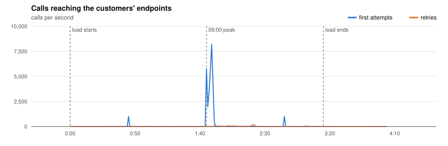
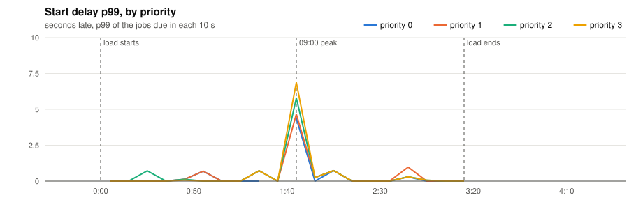
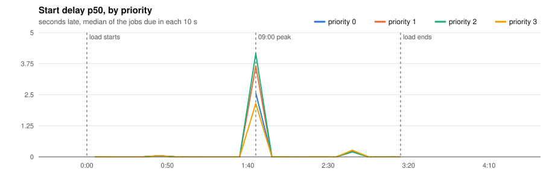
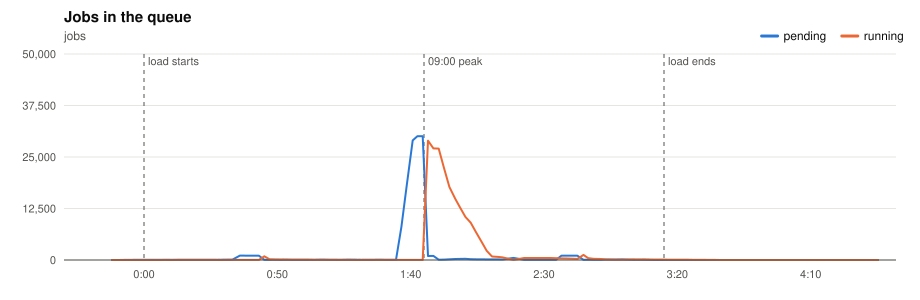
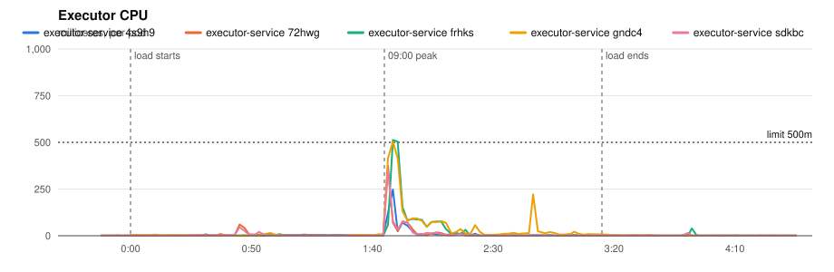
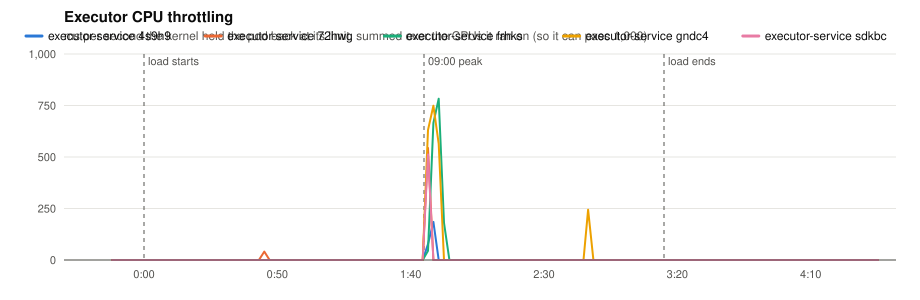
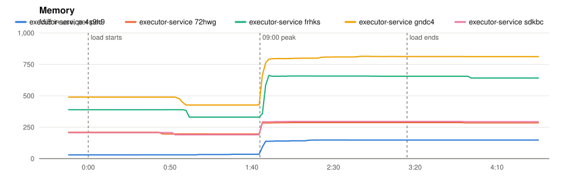
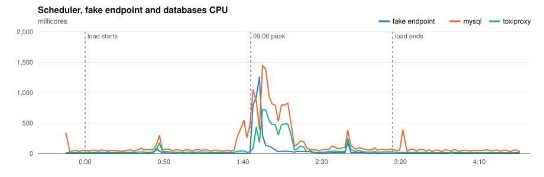
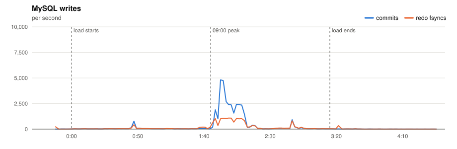
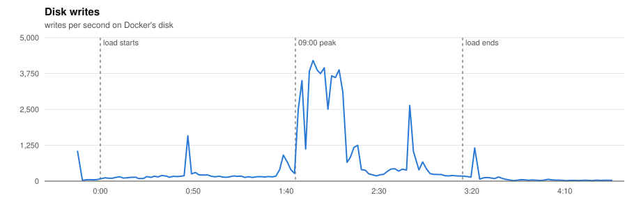

# P11 · 20261119T223300Z-s2-5x (s2-5x)

- **Load:** 195 s of the platform model at scale 1.0: 1,000 minute, 4,000 five, 10,000 hour, 15,000 day, 1,083 at tasks; 31,083 tasks seeded.
- **Deployment:** 5 executors; executor-service: `JOB_TIME_LIMIT_SECONDS=1 WORKER_COUNT=10000 JOB_QUEUE_SIZE=10000 PPROF_ADDR=:6060 GOMAXPROCS= MYSQL_MAX_OPEN_CONNS=5 MYSQL_MAX_IDLE_CONNS=5`; scheduler-service: `SCHEDULE_INTERVAL=200ms SCHEDULE_LOOKAHEAD=10s PPROF_ADDR=:6060 GOMAXPROCS=`
- **Raw data:** `bench/results/P11-peak/runs/20261119T223300Z-s2-5x/` (local, not committed)

## Jobs

| Created | Succeeded | Dead | Still pending or running | Retried | Duplicate successes | Timed out, done anyway | Calls per second (first attempts) |
|---|---|---|---|---|---|---|---|
| 33,083 | 32,745 | 338 | 0 | 1,004 | 0 | 601 | 170.5 |

*Duplicate successes*: the endpoint answered 200 twice for one job, which only a failure should cause. *Timed out, done anyway*: the executor gave up after the timeout while the endpoint finished the work, so the retry made the customer process the job again.

**Start delay** (when the call reached the endpoint minus when the job was due, first attempts):

| Priority | Jobs | p50 | p90 | p99 | max |
|---|---|---|---|---|---|
| 0 | 1,620 | 2.561 s | 4.338 s | 4.377 s | 4.378 s |
| 1 | 4,911 | 3.582 s | 4.567 s | 4.666 s | 4.972 s |
| 2 | 19,945 | 3.959 s | 5.169 s | 5.786 s | 5.837 s |
| 3 | 6,607 | 1.965 s | 5.839 s | 6.867 s | 6.999 s |
| all | 33,083 | 3.473 s | 5.174 s | 6.359 s | 6.999 s |

- **09:00 peak:** 30,007 jobs due on the same second. The last one started **7.0 s** late (p50 3.7 s, p99 6.4 s); priority 0 p99 **4.4 s**.
- **Peak throughput:** every job of the peak had started **7.0 s** after it (p99 6.4 s), **4,288 jobs/s**; 8,209 in its busiest second. First attempts that never reached the endpoint: **0**.
- **Peak by priority** (p50 / p99 / max, first attempts): 0: 2.6 / 4.4 / 4.4 s; 1: 3.7 / 4.7 / 5.0 s; 2: 4.2 / 5.8 / 5.8 s; 3: 2.2 / 6.9 / 7.0 s.

## Charts

Time is minutes:seconds from the start of the load.





















## Resources

| Component | CPU avg (millicores) | CPU max | Throttled max (ms/s) | Memory max (MiB) |
|---|---|---|---|---|
| executor-service 4s9h9 | 6 | 247 | 185 | 148 |
| executor-service 72hwg | 7 | 374 | 544 | 287 |
| executor-service frhks | 15 | 513 | 783 | 663 |
| executor-service gndc4 | 21 | 504 | 749 | 814 |
| executor-service sdkbc | 7 | 352 | 513 | 296 |
| fake-endpoint | 33 | 1257 | 0 | 692 |
| mysql | 153 | 1448 | 114 | 1759 |
| cassandra | 95 | 361 | 0 | 1036 |
| toxiproxy | 63 | 718 | 0 | 34 |

MySQL: up to 4813 commits/s, 1082 redo fsyncs/s, 10 row lock waits/s, 30 connections.

## CPU profile: executor, 20 s from 1:52

```text
      flat  flat%   sum%        cum   cum%
      40ms 40.00% 40.00%       40ms 40.00%  internal/runtime/syscall.Syscall6
      30ms 30.00% 70.00%       30ms 30.00%  runtime.futex
      10ms 10.00% 80.00%       10ms 10.00%  runtime.netpoll
      10ms 10.00% 90.00%       10ms 10.00%  runtime.selectgo
      10ms 10.00%   100%       10ms 10.00%  runtime.typedmemclr
         0     0%   100%       10ms 10.00%  bufio.(*Writer).Flush
         0     0%   100%       30ms 30.00%  database/sql.(*DB).ExecContext
         0     0%   100%       30ms 30.00%  database/sql.(*DB).ExecContext.func1
         0     0%   100%       30ms 30.00%  database/sql.(*DB).exec
         0     0%   100%       30ms 30.00%  database/sql.(*DB).execDC
         0     0%   100%       10ms 10.00%  database/sql.(*DB).execDC.func3
         0     0%   100%       30ms 30.00%  database/sql.(*DB).retry
```

## CPU profile: scheduler, 20 s from 1:52

```text
      flat  flat%   sum%        cum   cum%
      20ms 33.33% 33.33%       20ms 33.33%  internal/runtime/syscall.Syscall6
      10ms 16.67% 50.00%       10ms 16.67%  context.(*cancelCtx).Done
      10ms 16.67% 66.67%       10ms 16.67%  runtime.(*timers).run
      10ms 16.67% 83.33%       10ms 16.67%  runtime.ifaceeq
      10ms 16.67%   100%       10ms 16.67%  runtime.roundupsize (inline)
         0     0%   100%       40ms 66.67%  database/sql.(*DB).BeginTx
         0     0%   100%       40ms 66.67%  database/sql.(*DB).BeginTx.func1
         0     0%   100%       40ms 66.67%  database/sql.(*DB).begin
         0     0%   100%       30ms 50.00%  database/sql.(*DB).beginDC
         0     0%   100%       30ms 50.00%  database/sql.(*DB).beginDC.func1
         0     0%   100%       10ms 16.67%  database/sql.(*DB).conn
         0     0%   100%       40ms 66.67%  database/sql.(*DB).retry
```
