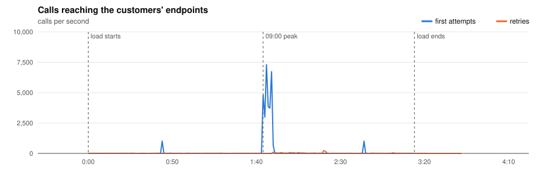
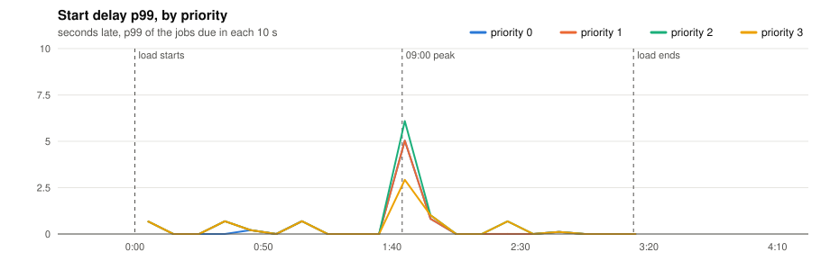
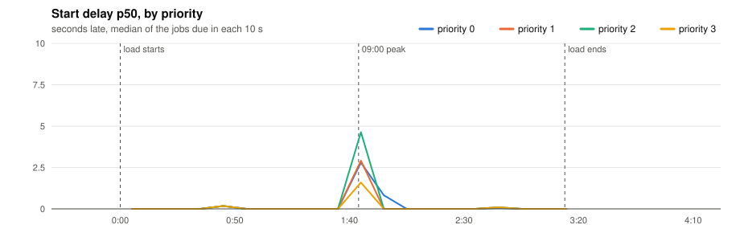
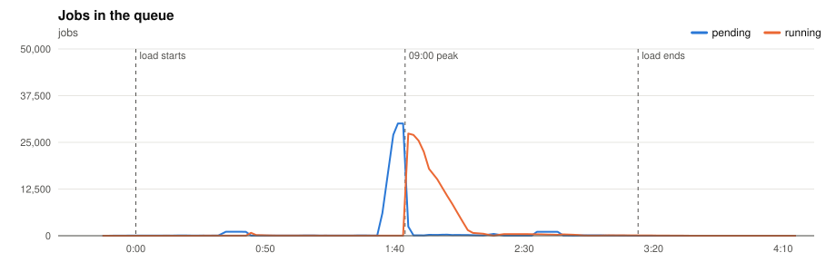
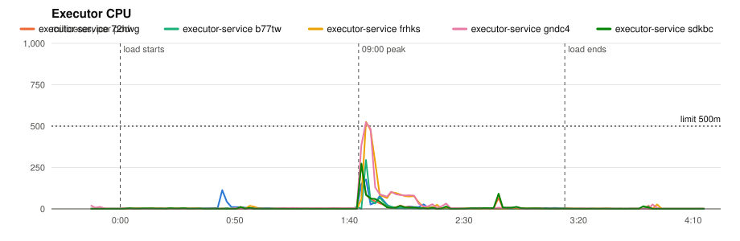
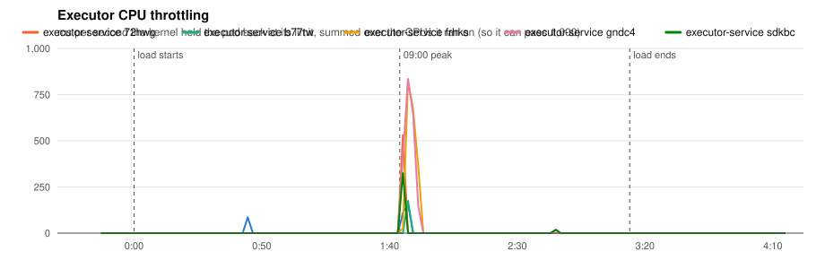
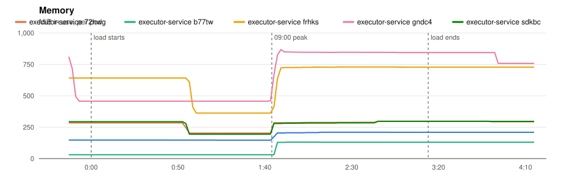
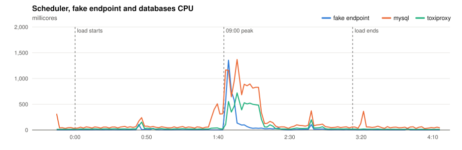
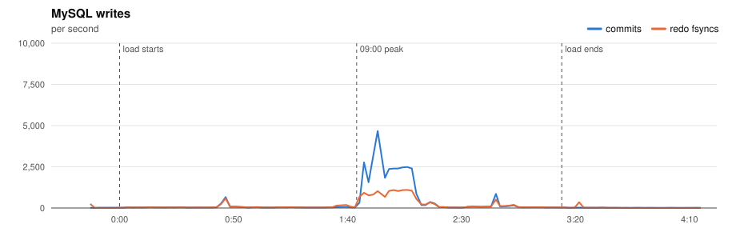
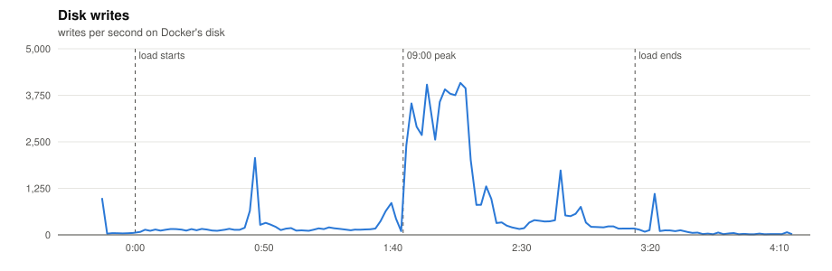

# P11 · 20261119T223800Z-s3-6x (s3-6x)

- **Load:** 194 s of the platform model at scale 1.0: 1,000 minute, 4,000 five, 10,000 hour, 15,000 day, 1,078 at tasks; 31,078 tasks seeded.
- **Deployment:** 6 executors; executor-service: `JOB_TIME_LIMIT_SECONDS=1 WORKER_COUNT=10000 JOB_QUEUE_SIZE=10000 PPROF_ADDR=:6060 GOMAXPROCS= MYSQL_MAX_OPEN_CONNS=5 MYSQL_MAX_IDLE_CONNS=5`; scheduler-service: `SCHEDULE_INTERVAL=200ms SCHEDULE_LOOKAHEAD=10s PPROF_ADDR=:6060 GOMAXPROCS=`
- **Raw data:** `bench/results/P11-peak/runs/20261119T223800Z-s3-6x/` (local, not committed)

## Jobs

| Created | Succeeded | Dead | Still pending or running | Retried | Duplicate successes | Timed out, done anyway | Calls per second (first attempts) |
|---|---|---|---|---|---|---|---|
| 33,078 | 32,709 | 369 | 0 | 978 | 1 | 546 | 172.0 |

*Duplicate successes*: the endpoint answered 200 twice for one job, which only a failure should cause. *Timed out, done anyway*: the executor gave up after the timeout while the endpoint finished the work, so the retry made the customer process the job again.

**Start delay** (when the call reached the endpoint minus when the job was due, first attempts):

| Priority | Jobs | p50 | p90 | p99 | max |
|---|---|---|---|---|---|
| 0 | 1,577 | 2.634 s | 4.997 s | 5.034 s | 5.037 s |
| 1 | 4,963 | 2.741 s | 4.998 s | 5.035 s | 5.299 s |
| 2 | 19,883 | 4.017 s | 5.733 s | 6.091 s | 6.103 s |
| 3 | 6,655 | 1.531 s | 2.823 s | 2.917 s | 2.926 s |
| all | 33,078 | 2.804 s | 5.524 s | 6.030 s | 6.103 s |

- **09:00 peak:** 30,004 jobs due on the same second. The last one started **6.1 s** late (p50 2.9 s, p99 6.0 s); priority 0 p99 **5.0 s**.
- **Peak throughput:** every job of the peak had started **6.1 s** after it (p99 6.0 s), **4,917 jobs/s**; 7,301 in its busiest second. First attempts that never reached the endpoint: **0**.
- **Peak by priority** (p50 / p99 / max, first attempts): 0: 2.8 / 5.0 / 5.0 s; 1: 2.9 / 5.0 / 5.3 s; 2: 4.6 / 6.1 / 6.1 s; 3: 1.6 / 2.9 / 2.9 s.

## Charts

Time is minutes:seconds from the start of the load.





















## Resources

| Component | CPU avg (millicores) | CPU max | Throttled max (ms/s) | Memory max (MiB) |
|---|---|---|---|---|
| executor-service 4s9h9 | 7 | 178 | 156 | 210 |
| executor-service 72hwg | 7 | 270 | 531 | 297 |
| executor-service b77tw | 5 | 295 | 175 | 132 |
| executor-service frhks | 17 | 525 | 822 | 729 |
| executor-service gndc4 | 20 | 523 | 835 | 868 |
| executor-service sdkbc | 7 | 274 | 324 | 297 |
| fake-endpoint | 35 | 1355 | 0 | 785 |
| mysql | 160 | 1369 | 175 | 1805 |
| cassandra | 96 | 395 | 0 | 1030 |
| toxiproxy | 67 | 721 | 0 | 35 |

MySQL: up to 4668 commits/s, 1100 redo fsyncs/s, 11 row lock waits/s, 35 connections.

## CPU profile: executor, 20 s from 1:51

```text
      flat  flat%   sum%        cum   cum%
     100ms 50.00% 50.00%      100ms 50.00%  internal/runtime/syscall.Syscall6
      20ms 10.00% 60.00%       20ms 10.00%  runtime.futex
      10ms  5.00% 65.00%       80ms 40.00%  internal/poll.(*FD).Write
      10ms  5.00% 70.00%       10ms  5.00%  internal/runtime/maps.(*Map).getWithKeySmall
      10ms  5.00% 75.00%       10ms  5.00%  internal/runtime/syscall.EpollWait
      10ms  5.00% 80.00%       10ms  5.00%  runtime.(*mheap).allocNeedsZero
      10ms  5.00% 85.00%       10ms  5.00%  runtime.memmove
      10ms  5.00% 90.00%       10ms  5.00%  runtime.nextFreeFast
      10ms  5.00% 95.00%       10ms  5.00%  runtime.selectgo
      10ms  5.00%   100%       10ms  5.00%  strings.(*byteReplacer).Replace
         0     0%   100%       10ms  5.00%  bufio.(*Reader).Peek
         0     0%   100%       10ms  5.00%  bufio.(*Reader).fill
```

## CPU profile: scheduler, 20 s from 1:51

```text
      flat  flat%   sum%        cum   cum%
      30ms   100%   100%       30ms   100%  internal/runtime/syscall.Syscall6
         0     0%   100%       30ms   100%  database/sql.(*DB).BeginTx
         0     0%   100%       30ms   100%  database/sql.(*DB).BeginTx.func1
         0     0%   100%       30ms   100%  database/sql.(*DB).begin
         0     0%   100%       30ms   100%  database/sql.(*DB).beginDC
         0     0%   100%       30ms   100%  database/sql.(*DB).beginDC.func1
         0     0%   100%       30ms   100%  database/sql.(*DB).retry
         0     0%   100%       30ms   100%  database/sql.ctxDriverBegin
         0     0%   100%       30ms   100%  database/sql.withLock
         0     0%   100%       30ms   100%  github.com/JoelTeoGom/distributed-scheduler/scheduler-service/internal/adapters/out/mysql.(*SchedulerRepository).ScheduleJobs
         0     0%   100%       30ms   100%  github.com/JoelTeoGom/distributed-scheduler/scheduler-service/internal/service.(*SchedulerService).Start
         0     0%   100%       30ms   100%  github.com/go-sql-driver/mysql.(*mysqlConn).BeginTx
```
