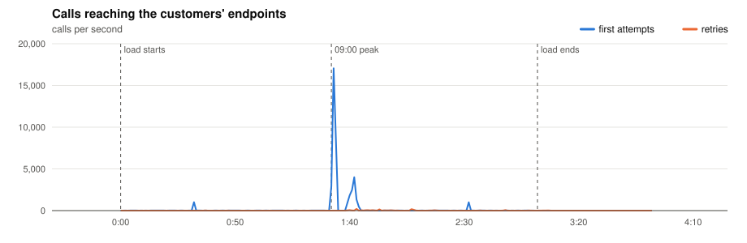
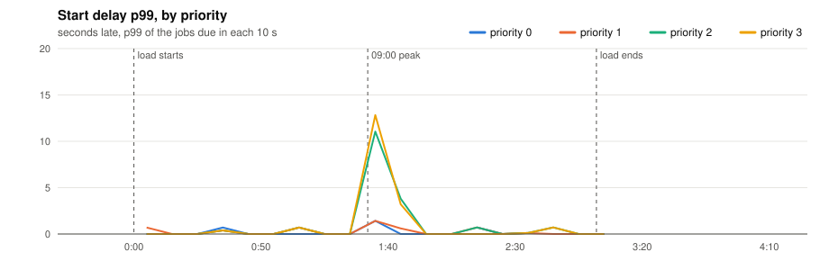
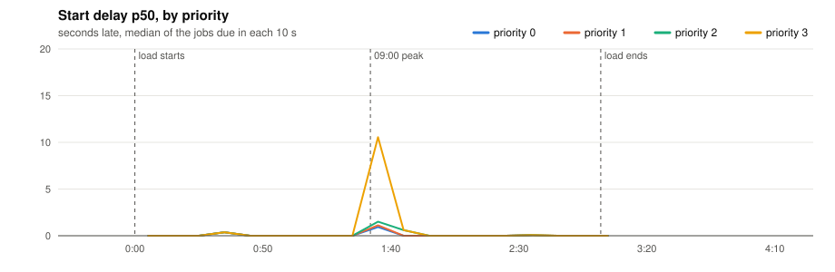
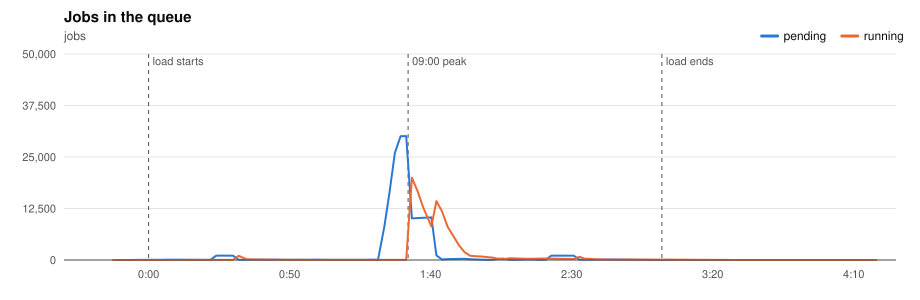
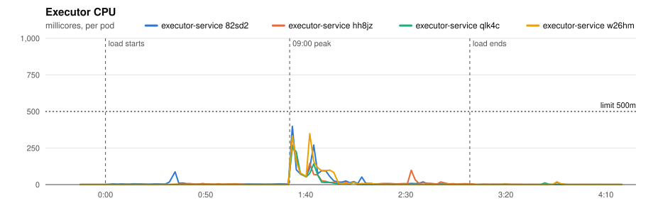
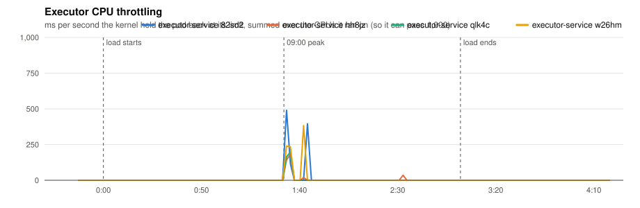
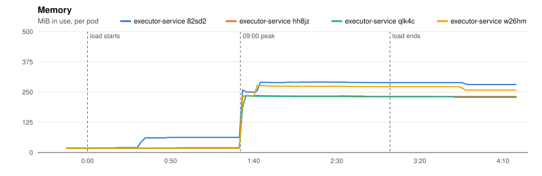
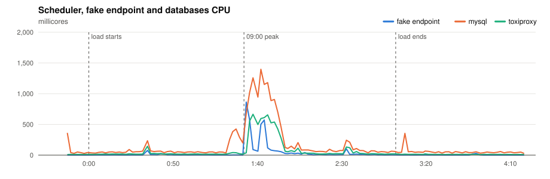
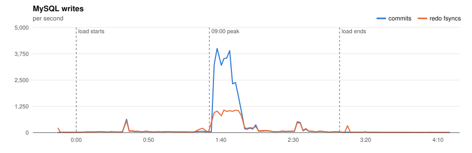
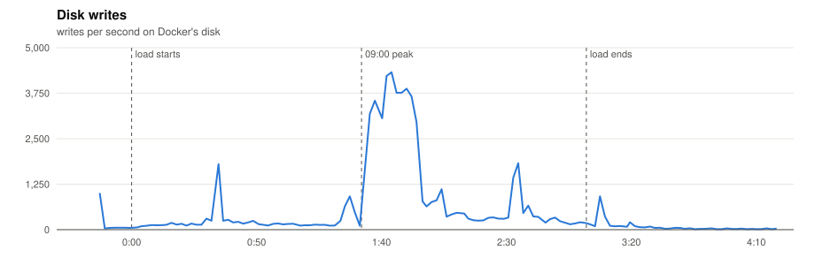

# P11 · 20261119T224312Z-t1-4x-w5000 (t1-4x-w5000)

- **Load:** 182 s of the platform model at scale 1.0: 1,000 minute, 4,000 five, 10,000 hour, 15,000 day, 1,011 at tasks; 31,011 tasks seeded.
- **Deployment:** 4 executors; executor-service: `JOB_TIME_LIMIT_SECONDS=1 WORKER_COUNT=5000 JOB_QUEUE_SIZE=10000 PPROF_ADDR=:6060 GOMAXPROCS= MYSQL_MAX_OPEN_CONNS=5 MYSQL_MAX_IDLE_CONNS=5`; scheduler-service: `SCHEDULE_INTERVAL=200ms SCHEDULE_LOOKAHEAD=10s PPROF_ADDR=:6060 GOMAXPROCS=`
- **Raw data:** `bench/results/P11-peak/runs/20261119T224312Z-t1-4x-w5000/` (local, not committed)

## Jobs

| Created | Succeeded | Dead | Still pending or running | Retried | Duplicate successes | Timed out, done anyway | Calls per second (first attempts) |
|---|---|---|---|---|---|---|---|
| 33,011 | 32,647 | 364 | 0 | 914 | 0 | 478 | 183.1 |

*Duplicate successes*: the endpoint answered 200 twice for one job, which only a failure should cause. *Timed out, done anyway*: the executor gave up after the timeout while the endpoint finished the work, so the retry made the customer process the job again.

**Start delay** (when the call reached the endpoint minus when the job was due, first attempts):

| Priority | Jobs | p50 | p90 | p99 | max |
|---|---|---|---|---|---|
| 0 | 1,616 | 0.923 s | 1.297 s | 1.420 s | 1.421 s |
| 1 | 4,973 | 1.046 s | 1.305 s | 1.420 s | 2.783 s |
| 2 | 19,858 | 1.454 s | 9.598 s | 11.012 s | 11.398 s |
| 3 | 6,564 | 10.531 s | 11.230 s | 12.816 s | 12.934 s |
| all | 33,011 | 1.425 s | 10.594 s | 12.271 s | 12.934 s |

- **09:00 peak:** 30,011 jobs due on the same second. The last one started **12.9 s** late (p50 1.5 s, p99 12.3 s); priority 0 p99 **1.4 s**.
- **Peak throughput:** every job of the peak had started **12.9 s** after it (p99 12.3 s), **2,320 jobs/s**; 17,062 in its busiest second. First attempts that never reached the endpoint: **0**.
- **Peak by priority** (p50 / p99 / max, first attempts): 0: 0.9 / 1.4 / 1.4 s; 1: 1.1 / 1.4 / 1.7 s; 2: 1.5 / 11.0 / 11.4 s; 3: 10.6 / 12.8 / 12.9 s.

## Charts

Time is minutes:seconds from the start of the load.





















## Resources

| Component | CPU avg (millicores) | CPU max | Throttled max (ms/s) | Memory max (MiB) |
|---|---|---|---|---|
| executor-service 82sd2 | 15 | 398 | 490 | 292 |
| executor-service hh8jz | 10 | 270 | 181 | 236 |
| executor-service qlk4c | 8 | 258 | 198 | 234 |
| executor-service w26hm | 13 | 348 | 383 | 277 |
| fake-endpoint | 29 | 863 | 0 | 735 |
| mysql | 149 | 1397 | 46 | 1845 |
| cassandra | 93 | 303 | 0 | 993 |
| toxiproxy | 61 | 665 | 0 | 34 |

MySQL: up to 4008 commits/s, 1076 redo fsyncs/s, 7 row lock waits/s, 25 connections.

## CPU profile: executor, 20 s from 1:38

```text
      flat  flat%   sum%        cum   cum%
     0.50s 46.30% 46.30%      0.50s 46.30%  internal/runtime/syscall.Syscall6
     0.04s  3.70% 50.00%      0.04s  3.70%  runtime.futex
     0.02s  1.85% 51.85%      0.02s  1.85%  internal/runtime/maps.(*Iter).Next
     0.02s  1.85% 53.70%      0.02s  1.85%  internal/sync.(*Mutex).Unlock (inline)
     0.02s  1.85% 55.56%      0.02s  1.85%  runtime.acquireSudog
     0.02s  1.85% 57.41%      0.02s  1.85%  runtime.findfunc
     0.02s  1.85% 59.26%      0.02s  1.85%  runtime.nanotime
     0.01s  0.93% 60.19%      0.03s  2.78%  bufio.(*Reader).fill
     0.01s  0.93% 61.11%      0.01s  0.93%  context.(*timerCtx).Done
     0.01s  0.93% 62.04%      0.12s 11.11%  database/sql.(*driverStmt).Close
     0.01s  0.93% 62.96%      0.01s  0.93%  database/sql.driverArgsConnLocked
     0.01s  0.93% 63.89%      0.18s 16.67%  database/sql.resultFromStatement
```

## CPU profile: scheduler, 20 s from 1:38

```text
      flat  flat%   sum%        cum   cum%
      10ms   100%   100%       10ms   100%  internal/runtime/syscall.Syscall6
         0     0%   100%       10ms   100%  database/sql.(*DB).BeginTx
         0     0%   100%       10ms   100%  database/sql.(*DB).BeginTx.func1
         0     0%   100%       10ms   100%  database/sql.(*DB).begin
         0     0%   100%       10ms   100%  database/sql.(*DB).beginDC
         0     0%   100%       10ms   100%  database/sql.(*DB).beginDC.func1
         0     0%   100%       10ms   100%  database/sql.(*DB).retry
         0     0%   100%       10ms   100%  database/sql.ctxDriverBegin
         0     0%   100%       10ms   100%  database/sql.withLock
         0     0%   100%       10ms   100%  github.com/JoelTeoGom/distributed-scheduler/scheduler-service/internal/adapters/out/mysql.(*SchedulerRepository).ScheduleJobs
         0     0%   100%       10ms   100%  github.com/JoelTeoGom/distributed-scheduler/scheduler-service/internal/service.(*SchedulerService).Start
         0     0%   100%       10ms   100%  github.com/go-sql-driver/mysql.(*mysqlConn).BeginTx
```
