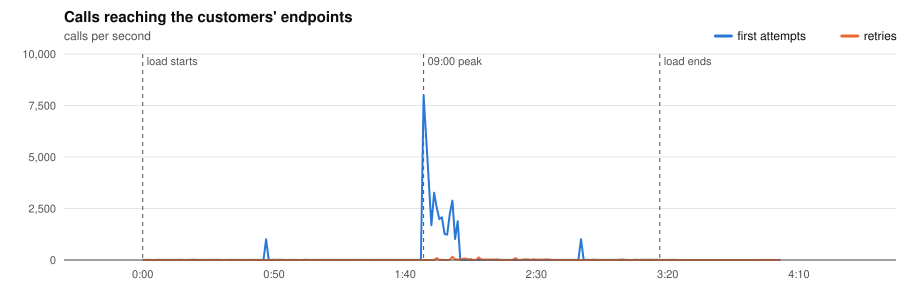
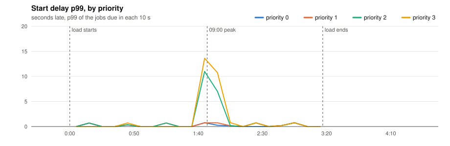
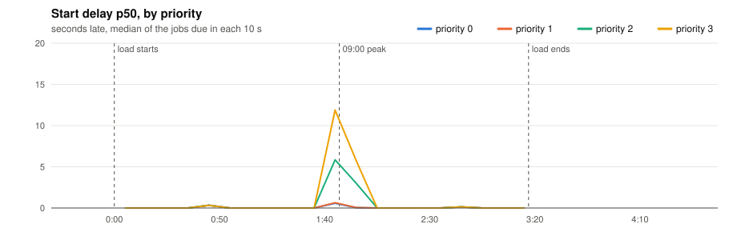
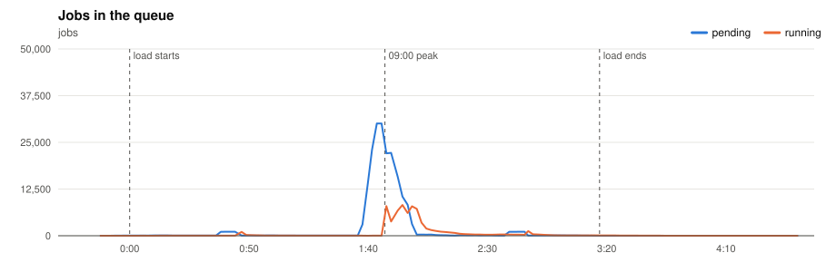
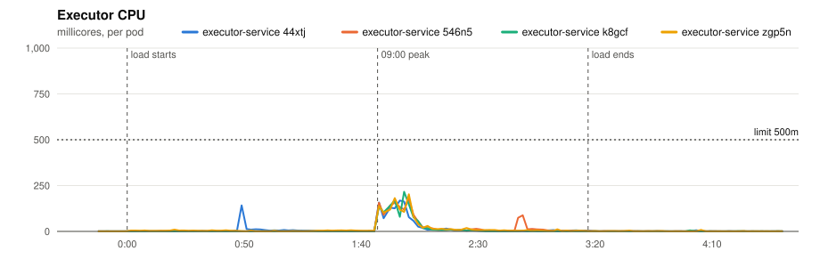
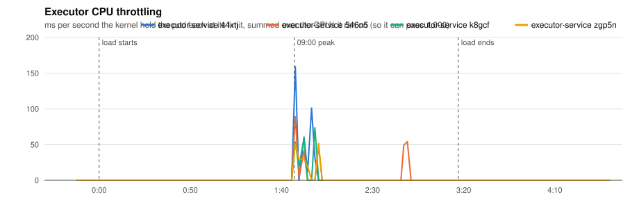
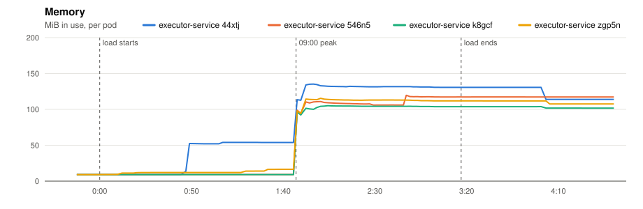
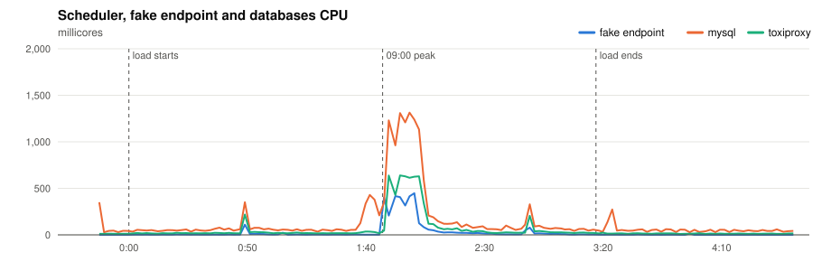
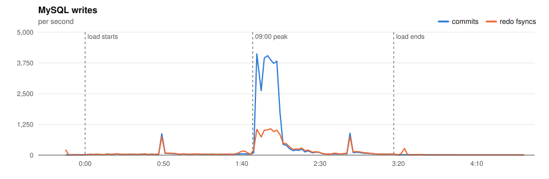
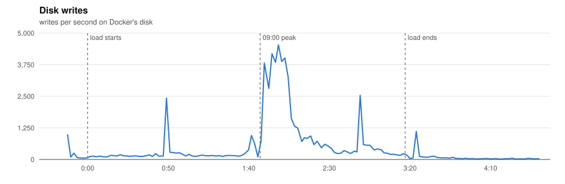

# P11 · 20261119T224758Z-t2-4x-w2000 (t2-4x-w2000)

- **Load:** 197 s of the platform model at scale 1.0: 1,000 minute, 4,000 five, 10,000 hour, 15,000 day, 1,094 at tasks; 31,094 tasks seeded.
- **Deployment:** 4 executors; executor-service: `JOB_TIME_LIMIT_SECONDS=1 WORKER_COUNT=2000 JOB_QUEUE_SIZE=10000 PPROF_ADDR=:6060 GOMAXPROCS=limits.cpu MYSQL_MAX_OPEN_CONNS=5 MYSQL_MAX_IDLE_CONNS=5`; scheduler-service: `SCHEDULE_INTERVAL=200ms SCHEDULE_LOOKAHEAD=10s PPROF_ADDR=:6060 GOMAXPROCS=limits.cpu`
- **Raw data:** `bench/results/P11-peak/runs/20261119T224758Z-t2-4x-w2000/` (local, not committed)

## Jobs

| Created | Succeeded | Dead | Still pending or running | Retried | Duplicate successes | Timed out, done anyway | Calls per second (first attempts) |
|---|---|---|---|---|---|---|---|
| 33,094 | 32,746 | 348 | 0 | 877 | 0 | 437 | 168.8 |

*Duplicate successes*: the endpoint answered 200 twice for one job, which only a failure should cause. *Timed out, done anyway*: the executor gave up after the timeout while the endpoint finished the work, so the retry made the customer process the job again.

**Start delay** (when the call reached the endpoint minus when the job was due, first attempts):

| Priority | Jobs | p50 | p90 | p99 | max |
|---|---|---|---|---|---|
| 0 | 1,656 | 0.564 s | 0.742 s | 0.766 s | 0.767 s |
| 1 | 4,897 | 0.575 s | 0.737 s | 0.747 s | 1.063 s |
| 2 | 19,958 | 5.281 s | 9.595 s | 10.995 s | 11.069 s |
| 3 | 6,583 | 11.829 s | 13.277 s | 13.611 s | 13.747 s |
| all | 33,094 | 5.187 s | 11.827 s | 13.294 s | 13.747 s |

- **09:00 peak:** 30,004 jobs due on the same second. The last one started **13.7 s** late (p50 5.8 s, p99 13.3 s); priority 0 p99 **0.8 s**.
- **Peak throughput:** every job of the peak had started **13.7 s** after it (p99 13.3 s), **2,183 jobs/s**; 7,991 in its busiest second. First attempts that never reached the endpoint: **0**.
- **Peak by priority** (p50 / p99 / max, first attempts): 0: 0.6 / 0.8 / 0.8 s; 1: 0.6 / 0.7 / 0.8 s; 2: 5.8 / 11.0 / 11.1 s; 3: 11.9 / 13.6 / 13.7 s.

## Charts

Time is minutes:seconds from the start of the load.





















## Resources

| Component | CPU avg (millicores) | CPU max | Throttled max (ms/s) | Memory max (MiB) |
|---|---|---|---|---|
| executor-service 44xtj | 10 | 168 | 159 | 135 |
| executor-service 546n5 | 11 | 177 | 89 | 120 |
| executor-service k8gcf | 9 | 216 | 74 | 105 |
| executor-service zgp5n | 11 | 203 | 52 | 115 |
| fake-endpoint | 26 | 448 | 0 | 540 |
| mysql | 137 | 1313 | 1 | 1866 |
| cassandra | 85 | 263 | 0 | 997 |
| toxiproxy | 56 | 639 | 0 | 32 |

MySQL: up to 4115 commits/s, 1074 redo fsyncs/s, 4 row lock waits/s, 25 connections.

## CPU profile: executor, 20 s from 1:54

```text
      flat  flat%   sum%        cum   cum%
     310ms 44.93% 44.93%      310ms 44.93%  internal/runtime/syscall.Syscall6
      60ms  8.70% 53.62%       60ms  8.70%  runtime.futex
      20ms  2.90% 56.52%      170ms 24.64%  database/sql.resultFromStatement
      20ms  2.90% 59.42%       20ms  2.90%  runtime.exitsyscallfast
      20ms  2.90% 62.32%       40ms  5.80%  runtime.scanobject
      10ms  1.45% 63.77%      130ms 18.84%  database/sql.ctxDriverStmtExec
      10ms  1.45% 65.22%       10ms  1.45%  fmt.(*pp).printArg
      10ms  1.45% 66.67%       10ms  1.45%  indexbytebody
      10ms  1.45% 68.12%       10ms  1.45%  internal/poll.(*FD).readUnlock
      10ms  1.45% 69.57%       10ms  1.45%  internal/poll.(*fdMutex).rwlock
      10ms  1.45% 71.01%       10ms  1.45%  internal/runtime/maps.h2
      10ms  1.45% 72.46%       10ms  1.45%  net.(*TCPAddr).sockaddr
```

## CPU profile: scheduler, 20 s from 1:54

```text
      flat  flat%   sum%        cum   cum%
      20ms 66.67% 66.67%       20ms 66.67%  internal/runtime/syscall.Syscall6
      10ms 33.33%   100%       10ms 33.33%  time.runtimeNow
         0     0%   100%       20ms 66.67%  database/sql.(*DB).BeginTx
         0     0%   100%       20ms 66.67%  database/sql.(*DB).BeginTx.func1
         0     0%   100%       20ms 66.67%  database/sql.(*DB).begin
         0     0%   100%       10ms 33.33%  database/sql.(*DB).beginDC
         0     0%   100%       10ms 33.33%  database/sql.(*DB).beginDC.func1
         0     0%   100%       10ms 33.33%  database/sql.(*DB).conn
         0     0%   100%       20ms 66.67%  database/sql.(*DB).retry
         0     0%   100%       10ms 33.33%  database/sql.(*driverConn).expired
         0     0%   100%       10ms 33.33%  database/sql.ctxDriverBegin
         0     0%   100%       10ms 33.33%  database/sql.withLock
```
