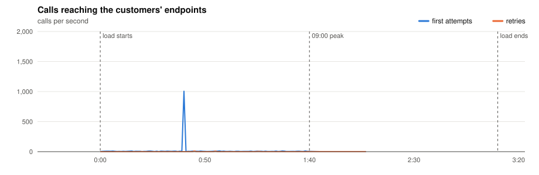
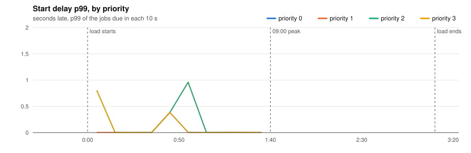
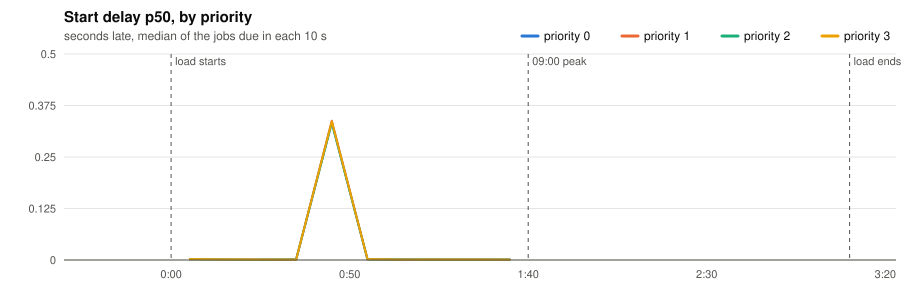
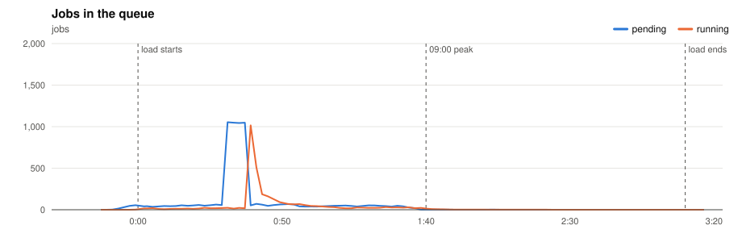
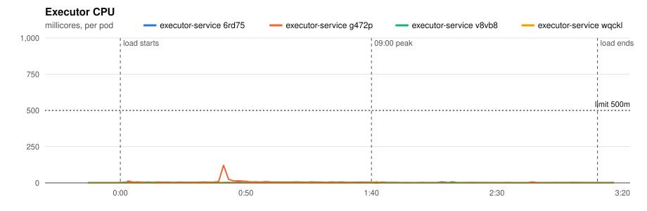
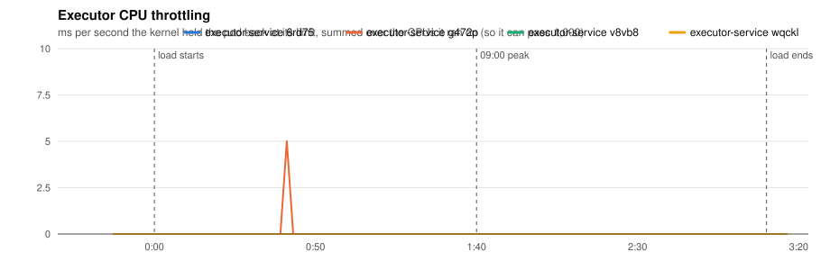
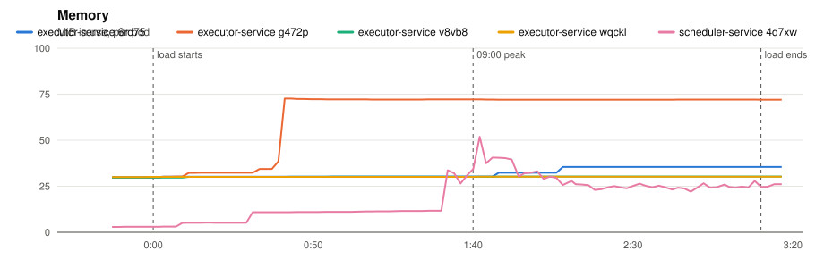
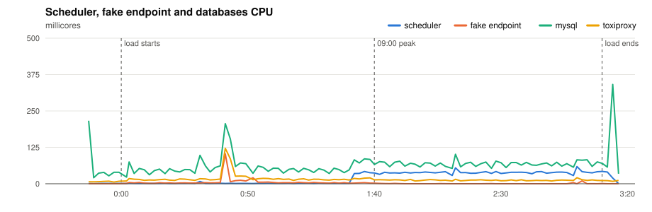
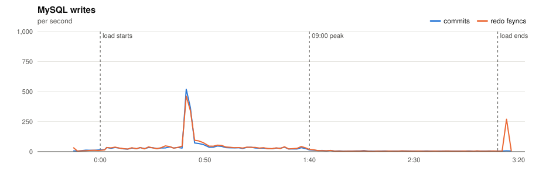
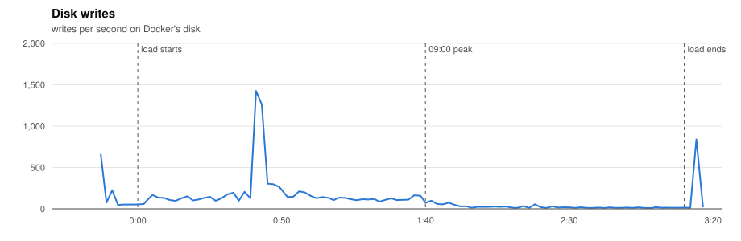

# P11 · 20261119T225304Z-t3-4x-batch5000 (t3-4x-batch5000)

- **Load:** 190 s of the platform model at scale 1.0: 1,000 minute, 4,000 five, 10,000 hour, 15,000 day, 1,056 at tasks; 31,056 tasks seeded.
- **Deployment:** 4 executors; executor-service: `JOB_TIME_LIMIT_SECONDS=1 WORKER_COUNT=10000 JOB_QUEUE_SIZE=10000 PPROF_ADDR=:6060 GOMAXPROCS=limits.cpu MYSQL_MAX_OPEN_CONNS=5 MYSQL_MAX_IDLE_CONNS=5`; scheduler-service: `SCHEDULE_INTERVAL=1s SCHEDULE_LOOKAHEAD=10s PPROF_ADDR=:6060 GOMAXPROCS=limits.cpu SCHEDULE_BATCH_SIZE=5000`
- **Raw data:** `bench/results/P11-peak/runs/20261119T225304Z-t3-4x-batch5000/` (local, not committed)

## Jobs

| Created | Succeeded | Dead | Still pending or running | Retried | Duplicate successes | Timed out, done anyway | Calls per second (first attempts) |
|---|---|---|---|---|---|---|---|
| 1,586 | 1,571 | 15 | 0 | 31 | 0 | 14 | 16.0 |

*Duplicate successes*: the endpoint answered 200 twice for one job, which only a failure should cause. *Timed out, done anyway*: the executor gave up after the timeout while the endpoint finished the work, so the retry made the customer process the job again.

**Start delay** (when the call reached the endpoint minus when the job was due, first attempts):

| Priority | Jobs | p50 | p90 | p99 | max |
|---|---|---|---|---|---|
| 0 | 84 | 0.312 s | 0.375 s | 0.384 s | 0.384 s |
| 1 | 220 | 0.320 s | 0.376 s | 0.384 s | 0.959 s |
| 2 | 972 | 0.316 s | 0.371 s | 0.384 s | 0.959 s |
| 3 | 310 | 0.319 s | 0.377 s | 0.384 s | 0.803 s |
| all | 1,586 | 0.318 s | 0.374 s | 0.384 s | 0.959 s |

## Charts

Time is minutes:seconds from the start of the load.





















## Resources

| Component | CPU avg (millicores) | CPU max | Throttled max (ms/s) | Memory max (MiB) |
|---|---|---|---|---|
| executor-service 6rd75 | 1 | 7 | 0 | 36 |
| executor-service g472p | 5 | 121 | 5 | 73 |
| executor-service v8vb8 | 1 | 8 | 0 | 30 |
| executor-service wqckl | 1 | 8 | 0 | 30 |
| scheduler-service 4d7xw | 20 | 59 | 0 | 52 |
| fake-endpoint | 3 | 103 | 0 | 498 |
| mysql | 65 | 341 | 0 | 1871 |
| cassandra | 85 | 251 | 0 | 999 |
| toxiproxy | 15 | 122 | 0 | 31 |

MySQL: up to 520 commits/s, 462 redo fsyncs/s, 1 row lock waits/s, 15 connections.

## CPU profile: executor, 20 s from 1:46

```text
      flat  flat%   sum%        cum   cum%
```

## CPU profile: scheduler, 20 s from 1:46

```text
      flat  flat%   sum%        cum   cum%
      90ms 12.86% 12.86%      200ms 28.57%  runtime.scanobject
      60ms  8.57% 21.43%       60ms  8.57%  runtime.findObject
      60ms  8.57% 30.00%       60ms  8.57%  runtime.memclrNoHeapPointers
      30ms  4.29% 34.29%       30ms  4.29%  internal/runtime/syscall.Syscall6
      30ms  4.29% 38.57%      120ms 17.14%  runtime.mallocgcSmallScanNoHeader
      20ms  2.86% 41.43%       30ms  4.29%  database/sql.convertAssignRows
      20ms  2.86% 44.29%       20ms  2.86%  runtime.(*mspan).typePointersOfUnchecked
      20ms  2.86% 47.14%       20ms  2.86%  runtime.(*mspan).writeHeapBitsSmall
      20ms  2.86% 50.00%       20ms  2.86%  runtime.nextFreeFast (inline)
      20ms  2.86% 52.86%       20ms  2.86%  strings.Count
      20ms  2.86% 55.71%       20ms  2.86%  time.(*Location).get
      20ms  2.86% 58.57%       20ms  2.86%  time.(*Time).addSec
```
