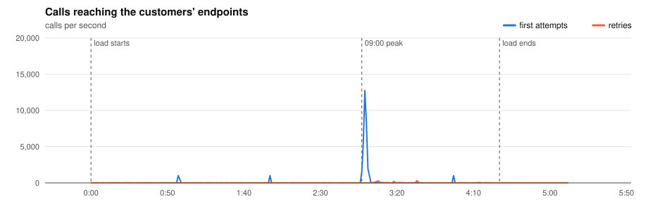
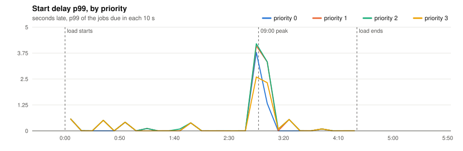
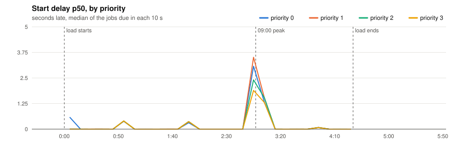
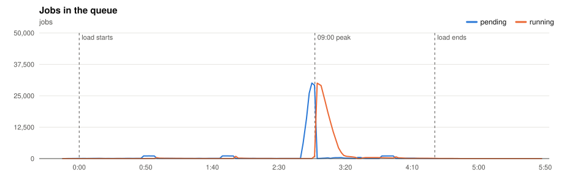
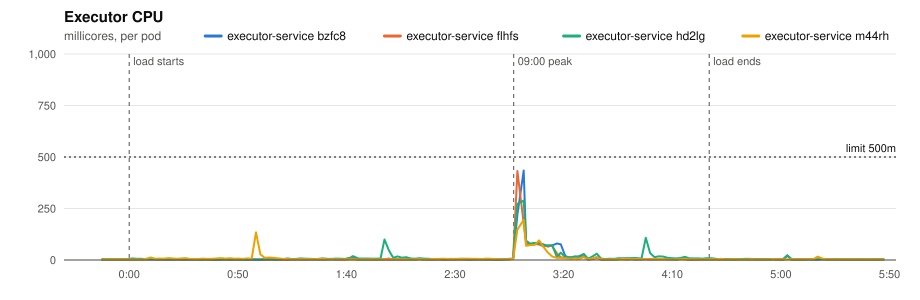
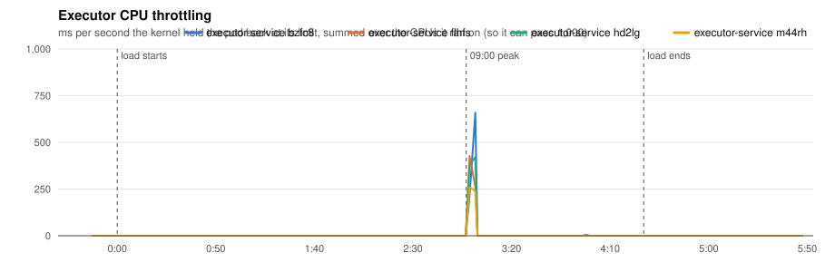
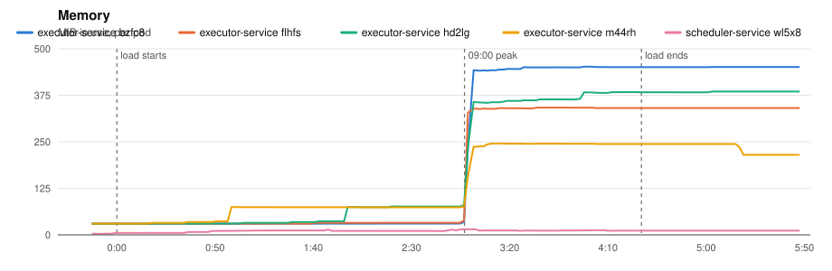
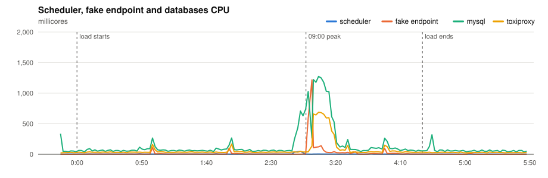
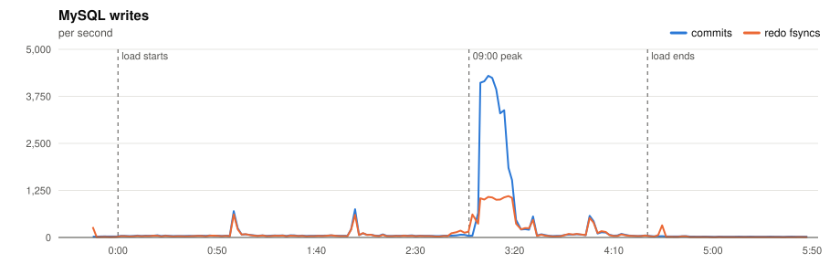
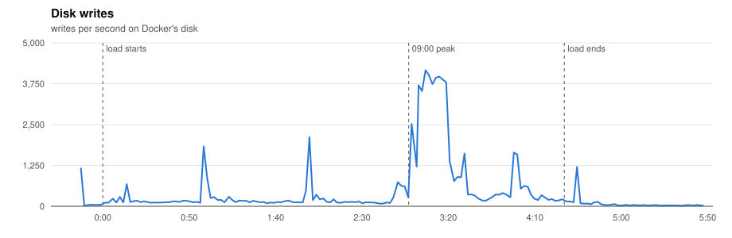

# P11 · 20261119T225647Z-t4-4x-claim250ms (t4-4x-claim250ms)

- **Load:** 267 s of the platform model at scale 1.0: 1,000 minute, 4,000 five, 10,000 hour, 15,000 day, 1,483 at tasks; 31,483 tasks seeded.
- **Deployment:** 4 executors; executor-service: `JOB_TIME_LIMIT_SECONDS=1 WORKER_COUNT=10000 JOB_QUEUE_SIZE=10000 PPROF_ADDR=:6060 GOMAXPROCS=limits.cpu MYSQL_MAX_OPEN_CONNS=5 MYSQL_MAX_IDLE_CONNS=5 CLAIM_INTERVAL=250ms CLAIM_LEAD=500ms`; scheduler-service: `SCHEDULE_INTERVAL=200ms SCHEDULE_LOOKAHEAD=10s PPROF_ADDR=:6060 GOMAXPROCS=limits.cpu SCHEDULE_BATCH_SIZE=1000`
- **Raw data:** `bench/results/P11-peak/runs/20261119T225647Z-t4-4x-claim250ms/` (local, not committed)

## Jobs

| Created | Succeeded | Dead | Still pending or running | Retried | Duplicate successes | Timed out, done anyway | Calls per second (first attempts) |
|---|---|---|---|---|---|---|---|
| 34,483 | 34,088 | 395 | 0 | 1,035 | 0 | 555 | 129.6 |

*Duplicate successes*: the endpoint answered 200 twice for one job, which only a failure should cause. *Timed out, done anyway*: the executor gave up after the timeout while the endpoint finished the work, so the retry made the customer process the job again.

**Start delay** (when the call reached the endpoint minus when the job was due, first attempts):

| Priority | Jobs | p50 | p90 | p99 | max |
|---|---|---|---|---|---|
| 0 | 1,665 | 3.067 s | 3.772 s | 3.786 s | 3.979 s |
| 1 | 5,311 | 3.481 s | 4.074 s | 4.097 s | 4.101 s |
| 2 | 20,725 | 2.373 s | 3.692 s | 4.196 s | 4.289 s |
| 3 | 6,782 | 1.798 s | 2.483 s | 2.594 s | 2.600 s |
| all | 34,483 | 2.385 s | 3.769 s | 4.190 s | 4.289 s |

- **09:00 peak:** 30,009 jobs due on the same second. The last one started **4.3 s** late (p50 2.5 s, p99 4.2 s); priority 0 p99 **3.8 s**.
- **Peak throughput:** every job of the peak had started **4.3 s** after it (p99 4.2 s), **6,998 jobs/s**; 12,736 in its busiest second. First attempts that never reached the endpoint: **0**.
- **Peak by priority** (p50 / p99 / max, first attempts): 0: 3.1 / 3.8 / 4.0 s; 1: 3.5 / 4.1 / 4.1 s; 2: 2.4 / 4.2 / 4.3 s; 3: 1.9 / 2.6 / 2.6 s.

## Charts

Time is minutes:seconds from the start of the load.





















## Resources

| Component | CPU avg (millicores) | CPU max | Throttled max (ms/s) | Memory max (MiB) |
|---|---|---|---|---|
| executor-service bzfc8 | 11 | 434 | 659 | 452 |
| executor-service flhfs | 10 | 432 | 427 | 342 |
| executor-service hd2lg | 14 | 288 | 421 | 385 |
| executor-service m44rh | 9 | 195 | 260 | 245 |
| scheduler-service wl5x8 | 5 | 50 | 0 | 15 |
| fake-endpoint | 20 | 1218 | 0 | 749 |
| mysql | 144 | 1274 | 25 | 1916 |
| cassandra | 89 | 305 | 0 | 1001 |
| toxiproxy | 66 | 686 | 0 | 32 |

MySQL: up to 4297 commits/s, 1099 redo fsyncs/s, 8 row lock waits/s, 25 connections.

## CPU profile: executor, 20 s from 3:04

```text
      flat  flat%   sum%        cum   cum%
     290ms 50.00% 50.00%      290ms 50.00%  internal/runtime/syscall.Syscall6
      40ms  6.90% 56.90%       40ms  6.90%  runtime.futex
      20ms  3.45% 60.34%       30ms  5.17%  database/sql.(*DB).execDC.func1
      20ms  3.45% 63.79%       80ms 13.79%  github.com/go-sql-driver/mysql.(*mysqlStmt).writeExecutePacket
      20ms  3.45% 67.24%       20ms  3.45%  runtime.pidleget
      10ms  1.72% 68.97%       10ms  1.72%  bufio.(*Reader).ReadSlice
      10ms  1.72% 70.69%      420ms 72.41%  database/sql.(*DB).ExecContext
      10ms  1.72% 72.41%      390ms 67.24%  database/sql.(*DB).execDC
      10ms  1.72% 74.14%       10ms  1.72%  github.com/go-sql-driver/mysql.(*mysqlConn).finish
      10ms  1.72% 75.86%      240ms 41.38%  github.com/go-sql-driver/mysql.(*mysqlConn).writePacket
      10ms  1.72% 77.59%       10ms  1.72%  internal/runtime/atomic.(*Uint32).CompareAndSwap
      10ms  1.72% 79.31%       10ms  1.72%  runtime.(*m).clearAllpSnapshot
```

## CPU profile: scheduler, 20 s from 3:04

```text
      flat  flat%   sum%        cum   cum%
      10ms 50.00% 50.00%       10ms 50.00%  internal/runtime/syscall.Syscall6
      10ms 50.00%   100%       10ms 50.00%  runtime.futex
         0     0%   100%       20ms   100%  database/sql.(*DB).queryDC
         0     0%   100%       10ms 50.00%  database/sql.(*DB).queryDC.func2
         0     0%   100%       20ms   100%  database/sql.(*Tx).QueryContext
         0     0%   100%       10ms 50.00%  database/sql.ctxDriverPrepare
         0     0%   100%       10ms 50.00%  database/sql.ctxDriverStmtQuery
         0     0%   100%       10ms 50.00%  database/sql.rowsiFromStatement
         0     0%   100%       10ms 50.00%  database/sql.withLock
         0     0%   100%       20ms   100%  github.com/JoelTeoGom/distributed-scheduler/scheduler-service/internal/adapters/out/mysql.(*SchedulerRepository).ScheduleJobs
         0     0%   100%       20ms   100%  github.com/JoelTeoGom/distributed-scheduler/scheduler-service/internal/adapters/out/mysql.selectScheduledTasks
         0     0%   100%       20ms   100%  github.com/JoelTeoGom/distributed-scheduler/scheduler-service/internal/service.(*SchedulerService).Start
```
