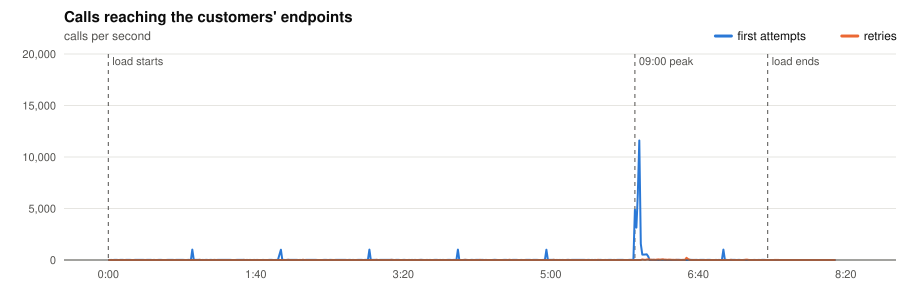
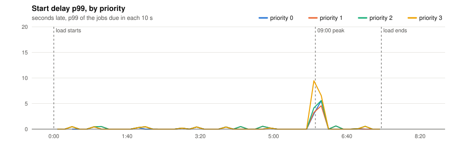
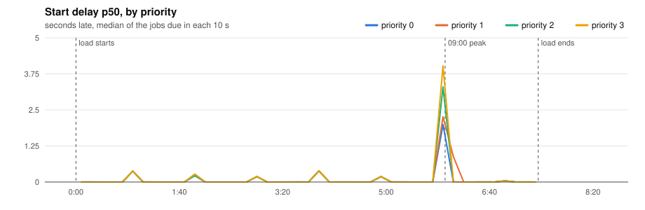
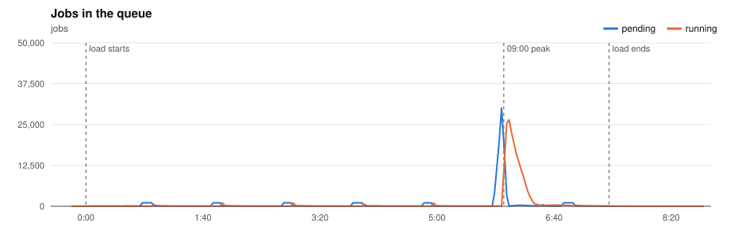
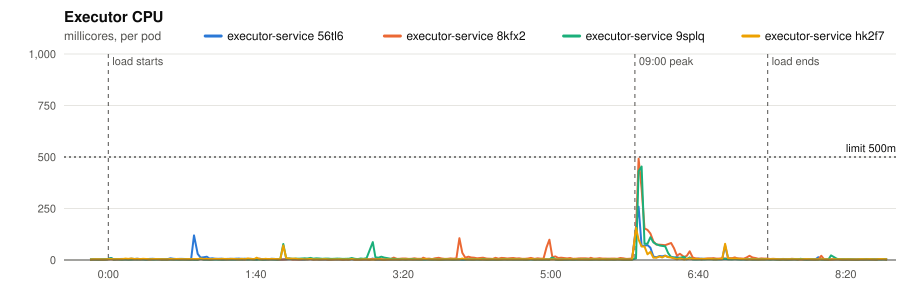
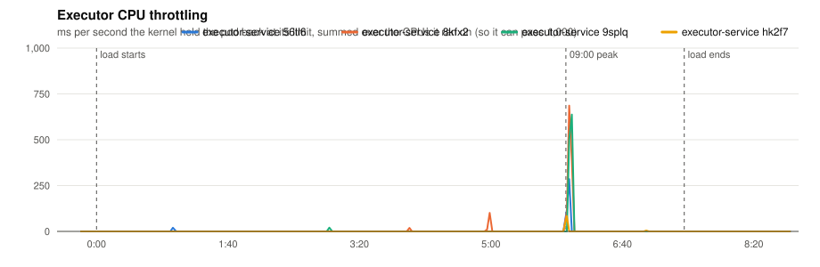
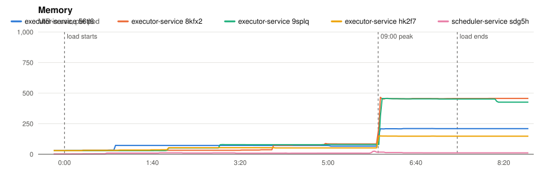
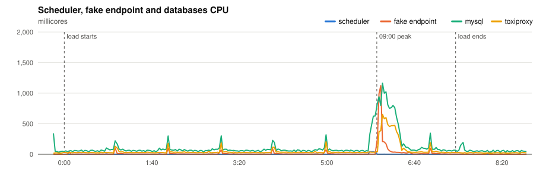
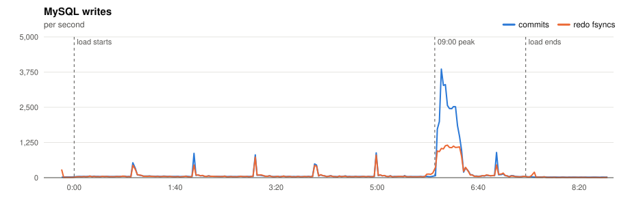
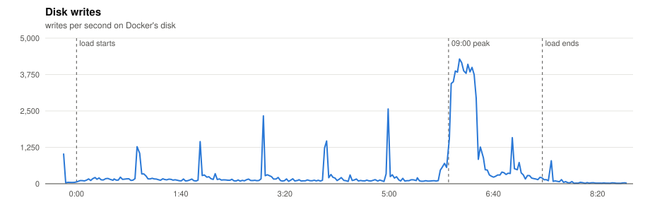

# P11 · 20261119T230348Z-t3b-batch4000 (t3b-batch4000)

- **Load:** 447 s of the platform model at scale 1.0: 1,000 minute, 4,000 five, 10,000 hour, 15,000 day, 2,483 at tasks; 32,483 tasks seeded.
- **Deployment:** 4 executors; executor-service: `JOB_TIME_LIMIT_SECONDS=1 WORKER_COUNT=10000 JOB_QUEUE_SIZE=10000 PPROF_ADDR=:6060 GOMAXPROCS=limits.cpu MYSQL_MAX_OPEN_CONNS=5 MYSQL_MAX_IDLE_CONNS=5 CLAIM_INTERVAL=250ms CLAIM_LEAD=500ms`; scheduler-service: `SCHEDULE_INTERVAL=1s SCHEDULE_LOOKAHEAD=10s PPROF_ADDR=:6060 GOMAXPROCS=limits.cpu SCHEDULE_BATCH_SIZE=4000`
- **Raw data:** `bench/results/P11-peak/runs/20261119T230348Z-t3b-batch4000/` (local, not committed)

## Jobs

| Created | Succeeded | Dead | Still pending or running | Retried | Duplicate successes | Timed out, done anyway | Calls per second (first attempts) |
|---|---|---|---|---|---|---|---|
| 38,483 | 38,043 | 440 | 0 | 1,066 | 1 | 535 | 86.3 |

*Duplicate successes*: the endpoint answered 200 twice for one job, which only a failure should cause. *Timed out, done anyway*: the executor gave up after the timeout while the endpoint finished the work, so the retry made the customer process the job again.

**Start delay** (when the call reached the endpoint minus when the job was due, first attempts):

| Priority | Jobs | p50 | p90 | p99 | max |
|---|---|---|---|---|---|
| 0 | 1,868 | 1.982 s | 2.975 s | 2.992 s | 5.567 s |
| 1 | 5,834 | 2.173 s | 3.164 s | 3.265 s | 4.575 s |
| 2 | 23,191 | 2.865 s | 3.889 s | 4.153 s | 5.585 s |
| 3 | 7,590 | 1.273 s | 8.215 s | 9.424 s | 9.565 s |
| all | 38,483 | 2.280 s | 4.056 s | 8.890 s | 9.565 s |

- **09:00 peak:** 30,005 jobs due on the same second. The last one started **9.6 s** late (p50 3.1 s, p99 9.0 s); priority 0 p99 **3.0 s**.
- **Peak throughput:** every job of the peak had started **9.6 s** after it (p99 9.0 s), **3,137 jobs/s**; 11,588 in its busiest second. First attempts that never reached the endpoint: **0**.
- **Peak by priority** (p50 / p99 / max, first attempts): 0: 2.0 / 3.0 / 3.0 s; 1: 2.3 / 3.3 / 3.3 s; 2: 3.3 / 4.2 / 4.3 s; 3: 4.0 / 9.5 / 9.6 s.

## Charts

Time is minutes:seconds from the start of the load.





















## Resources

| Component | CPU avg (millicores) | CPU max | Throttled max (ms/s) | Memory max (MiB) |
|---|---|---|---|---|
| executor-service 56tl6 | 7 | 258 | 285 | 210 |
| executor-service 8kfx2 | 14 | 492 | 686 | 466 |
| executor-service 9splq | 10 | 454 | 637 | 457 |
| executor-service hk2f7 | 6 | 156 | 84 | 150 |
| scheduler-service sdg5h | 2 | 45 | 0 | 25 |
| fake-endpoint | 18 | 1124 | 0 | 675 |
| mysql | 116 | 1162 | 15 | 2015 |
| cassandra | 87 | 322 | 0 | 1005 |
| toxiproxy | 53 | 653 | 0 | 32 |

MySQL: up to 3857 commits/s, 1154 redo fsyncs/s, 204 row lock waits/s, 24 connections.

## CPU profile: executor, 20 s from 6:05

```text
      flat  flat%   sum%        cum   cum%
     100ms 55.56% 55.56%      100ms 55.56%  internal/runtime/syscall.Syscall6
      20ms 11.11% 66.67%       20ms 11.11%  runtime.futex
      10ms  5.56% 72.22%       10ms  5.56%  net.(*TCPConn).Read
      10ms  5.56% 77.78%       10ms  5.56%  runtime.(*_panic).start
      10ms  5.56% 83.33%       10ms  5.56%  runtime.chanrecv
      10ms  5.56% 88.89%       10ms  5.56%  runtime.mapassign
      10ms  5.56% 94.44%       10ms  5.56%  runtime.readvarint
      10ms  5.56%   100%       10ms  5.56%  runtime.unpackScavChunkData
         0     0%   100%       10ms  5.56%  bufio.(*Reader).Peek
         0     0%   100%       10ms  5.56%  bufio.(*Reader).fill
         0     0%   100%       10ms  5.56%  context.(*cancelCtx).propagateCancel
         0     0%   100%       10ms  5.56%  context.WithCancel
```

## CPU profile: scheduler, 20 s from 6:05

```text
      flat  flat%   sum%        cum   cum%
```
