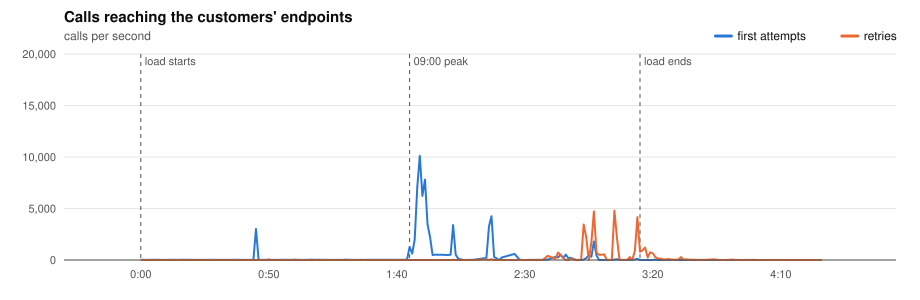
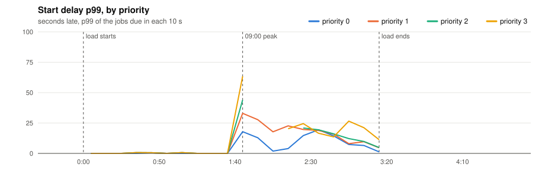
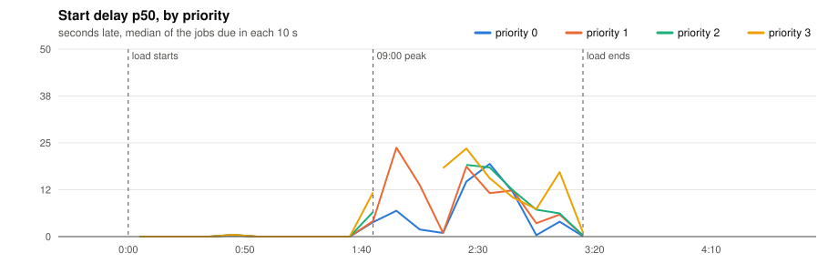
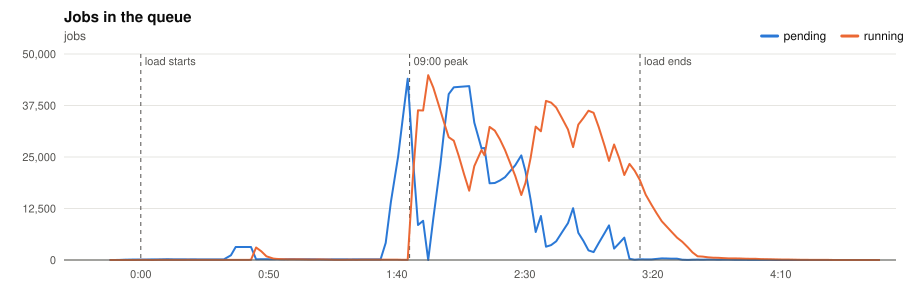
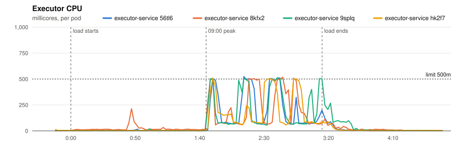
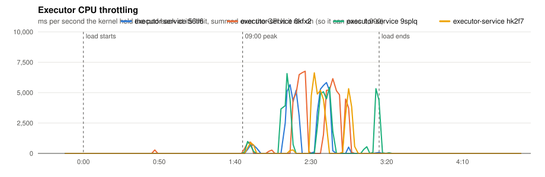
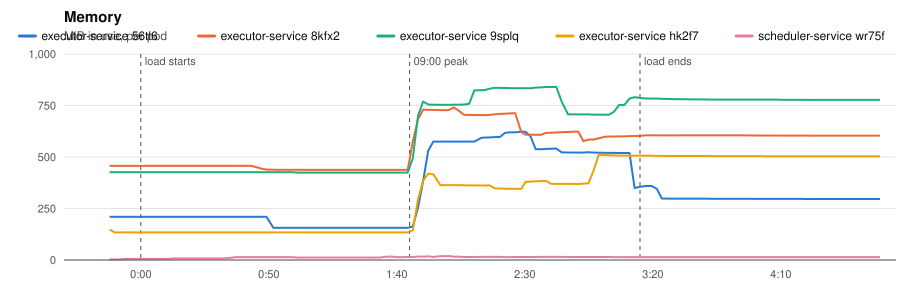
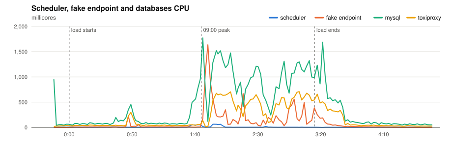
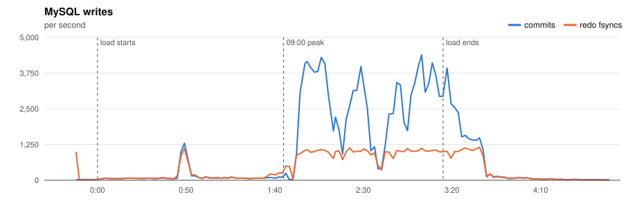
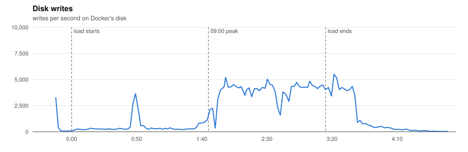

# P11 · 20261119T231300Z-v1-scale3 (v1-scale3)

- **Load:** 195 s of the platform model at scale 3.0: 3,000 minute, 12,000 five, 30,000 hour, 45,000 day, 3,250 at tasks; 93,250 tasks seeded.
- **Deployment:** 4 executors; executor-service: `JOB_TIME_LIMIT_SECONDS=1 WORKER_COUNT=10000 JOB_QUEUE_SIZE=10000 PPROF_ADDR=:6060 GOMAXPROCS=limits.cpu MYSQL_MAX_OPEN_CONNS=5 MYSQL_MAX_IDLE_CONNS=5 CLAIM_INTERVAL=250ms CLAIM_LEAD=500ms`; scheduler-service: `SCHEDULE_INTERVAL=200ms SCHEDULE_LOOKAHEAD=10s PPROF_ADDR=:6060 GOMAXPROCS=limits.cpu SCHEDULE_BATCH_SIZE=1000`
- **Raw data:** `bench/results/P11-peak/runs/20261119T231300Z-v1-scale3/` (local, not committed)

## Jobs

| Created | Succeeded | Dead | Still pending or running | Retried | Duplicate successes | Timed out, done anyway | Calls per second (first attempts) |
|---|---|---|---|---|---|---|---|
| 99,250 | 97,718 | 1,532 | 0 | 34,308 | 1210 | 2,006 | 339.3 |

*Duplicate successes*: the endpoint answered 200 twice for one job, which only a failure should cause. *Timed out, done anyway*: the executor gave up after the timeout while the endpoint finished the work, so the retry made the customer process the job again.

**Start delay** (when the call reached the endpoint minus when the job was due, first attempts):

| Priority | Jobs | p50 | p90 | p99 | max |
|---|---|---|---|---|---|
| 0 | 4,862 | 3.851 s | 17.676 s | 17.883 s | 19.402 s |
| 1 | 10,356 | 4.155 s | 32.284 s | 32.969 s | 32.975 s |
| 2 | 40,278 | 6.485 s | 32.663 s | 41.864 s | 57.868 s |
| 3 | 12,800 | 10.703 s | 59.585 s | 63.439 s | 63.503 s |
| all | 68,296 | 6.380 s | 32.286 s | 61.371 s | 63.503 s |

- **09:00 peak:** 59,837 jobs due on the same second. The last one started **63.5 s** late (p50 6.6 s, p99 61.5 s); priority 0 p99 **17.9 s**.
- **Peak throughput:** every job of the peak had started **112.2 s** after it (p99 95.3 s), **802 jobs/s**; 10,108 in its busiest second. First attempts that never reached the endpoint: **30,182**.
- **Peak by priority** (p50 / p99 / max, first attempts): 0: 3.9 / 17.9 / 18.0 s; 1: 4.2 / 33.0 / 33.0 s; 2: 6.6 / 44.0 / 57.9 s; 3: 11.8 / 63.4 / 63.5 s.

## Charts

Time is minutes:seconds from the start of the load.





















## Resources

| Component | CPU avg (millicores) | CPU max | Throttled max (ms/s) | Memory max (MiB) |
|---|---|---|---|---|
| executor-service 56tl6 | 71 | 524 | 5828 | 623 |
| executor-service 8kfx2 | 81 | 518 | 6762 | 740 |
| executor-service 9splq | 81 | 512 | 6567 | 841 |
| executor-service hk2f7 | 67 | 510 | 6631 | 510 |
| scheduler-service wr75f | 7 | 63 | 0 | 20 |
| fake-endpoint | 93 | 1639 | 0 | 909 |
| mysql | 435 | 1774 | 943 | 2096 |
| cassandra | 92 | 313 | 0 | 1003 |
| toxiproxy | 198 | 707 | 0 | 34 |

MySQL: up to 4388 commits/s, 1155 redo fsyncs/s, 1143 row lock waits/s, 24 connections.

## CPU profile: executor, 20 s from 1:52

```text
      flat  flat%   sum%        cum   cum%
     1.19s 67.23% 67.23%      1.19s 67.23%  internal/runtime/syscall.Syscall6
     0.07s  3.95% 71.19%      0.07s  3.95%  runtime.futex
     0.03s  1.69% 72.88%      0.15s  8.47%  net.(*conn).Read
     0.03s  1.69% 74.58%      0.03s  1.69%  runtime.memmove
     0.02s  1.13% 75.71%      0.02s  1.13%  runtime.(*waitq).dequeueSudoG
     0.02s  1.13% 76.84%      0.02s  1.13%  runtime.(*waitq).enqueue
     0.02s  1.13% 77.97%      0.02s  1.13%  runtime.exitsyscall
     0.02s  1.13% 79.10%      0.02s  1.13%  runtime.gopark
     0.02s  1.13% 80.23%      0.02s  1.13%  runtime.nextFreeFast
     0.01s  0.56% 80.79%      0.01s  0.56%  aeshashbody
     0.01s  0.56% 81.36%      0.02s  1.13%  database/sql.driverArgsConnLocked
     0.01s  0.56% 81.92%      0.01s  0.56%  database/sql/driver.IsValue (inline)
```

## CPU profile: scheduler, 20 s from 1:52

```text
      flat  flat%   sum%        cum   cum%
      80ms 19.51% 19.51%       80ms 19.51%  internal/runtime/syscall.Syscall6
      40ms  9.76% 29.27%       40ms  9.76%  runtime.(*mspan).base (inline)
      40ms  9.76% 39.02%       40ms  9.76%  runtime.memclrNoHeapPointers
      30ms  7.32% 46.34%       50ms 12.20%  runtime.scanobject
      20ms  4.88% 51.22%      310ms 75.61%  github.com/JoelTeoGom/distributed-scheduler/scheduler-service/internal/adapters/out/mysql.insertJobs
      20ms  4.88% 56.10%       90ms 21.95%  runtime.mallocgcSmallScanNoHeader
      20ms  4.88% 60.98%       20ms  4.88%  runtime.typePointers.next
      10ms  2.44% 63.41%       10ms  2.44%  database/sql.NullString.Value
      10ms  2.44% 65.85%       70ms 17.07%  database/sql.driverArgsConnLocked
      10ms  2.44% 68.29%       10ms  2.44%  database/sql/driver.IsValue (inline)
      10ms  2.44% 70.73%       20ms  4.88%  github.com/JoelTeoGom/distributed-scheduler/scheduler-service/internal/adapters/out/mysql.updateNextRuns
      10ms  2.44% 73.17%       70ms 17.07%  github.com/go-sql-driver/mysql.(*mysqlStmt).writeExecutePacket
```
