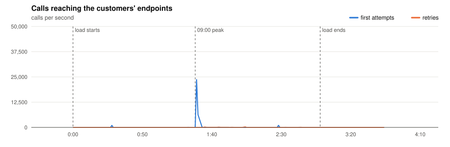
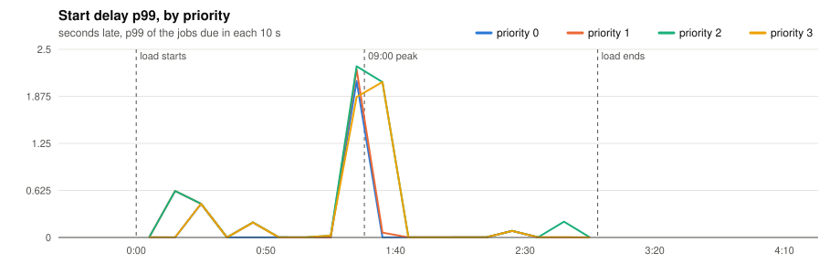
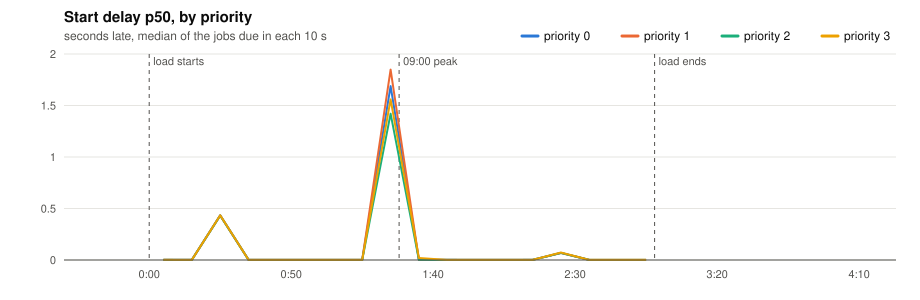
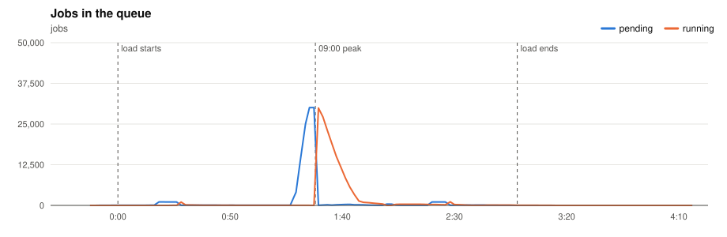
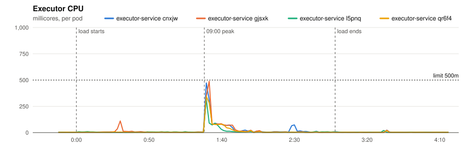
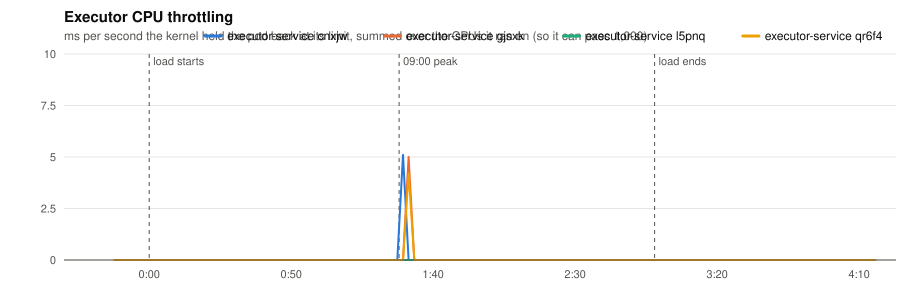
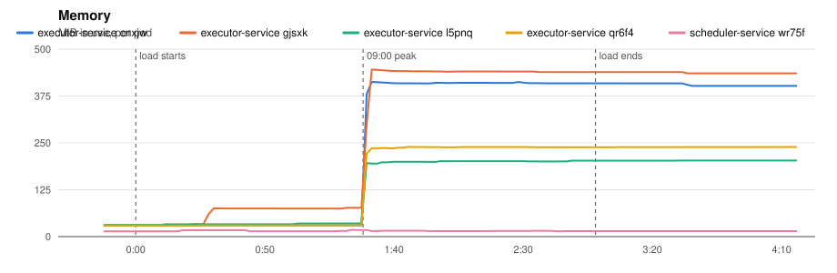
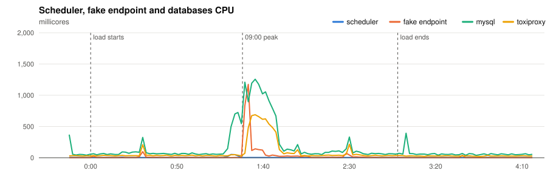
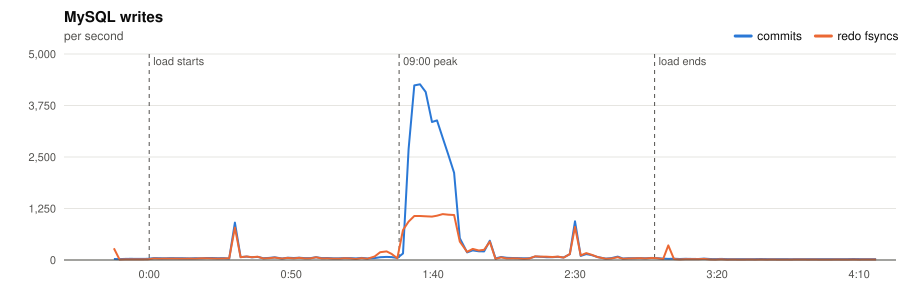
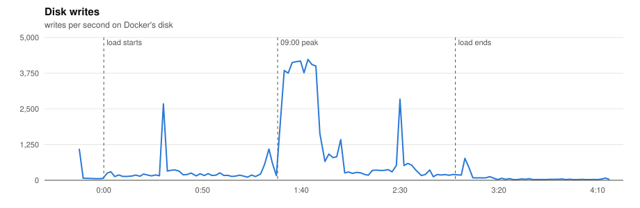

# P11 · 20261119T231817Z-u1-1cpu (u1-1cpu)

- **Load:** 178 s of the platform model at scale 1.0: 1,000 minute, 4,000 five, 10,000 hour, 15,000 day, 989 at tasks; 30,989 tasks seeded.
- **Deployment:** 4 executors; executor-service: `JOB_TIME_LIMIT_SECONDS=1 WORKER_COUNT=10000 JOB_QUEUE_SIZE=10000 PPROF_ADDR=:6060 GOMAXPROCS=limits.cpu MYSQL_MAX_OPEN_CONNS=5 MYSQL_MAX_IDLE_CONNS=5 CLAIM_INTERVAL=250ms CLAIM_LEAD=500ms`; scheduler-service: `SCHEDULE_INTERVAL=200ms SCHEDULE_LOOKAHEAD=10s PPROF_ADDR=:6060 GOMAXPROCS=limits.cpu SCHEDULE_BATCH_SIZE=1000`
- **Raw data:** `bench/results/P11-peak/runs/20261119T231817Z-u1-1cpu/` (local, not committed)

## Jobs

| Created | Succeeded | Dead | Still pending or running | Retried | Duplicate successes | Timed out, done anyway | Calls per second (first attempts) |
|---|---|---|---|---|---|---|---|
| 32,989 | 32,667 | 322 | 0 | 891 | 0 | 441 | 186.4 |

*Duplicate successes*: the endpoint answered 200 twice for one job, which only a failure should cause. *Timed out, done anyway*: the executor gave up after the timeout while the endpoint finished the work, so the retry made the customer process the job again.

**Start delay** (when the call reached the endpoint minus when the job was due, first attempts):

| Priority | Jobs | p50 | p90 | p99 | max |
|---|---|---|---|---|---|
| 0 | 1,642 | 1.685 s | 2.069 s | 2.078 s | 2.078 s |
| 1 | 4,936 | 1.787 s | 2.160 s | 2.232 s | 2.233 s |
| 2 | 19,908 | 1.377 s | 2.088 s | 2.272 s | 2.280 s |
| 3 | 6,503 | 1.550 s | 1.752 s | 1.867 s | 2.066 s |
| all | 32,989 | 1.587 s | 2.107 s | 2.268 s | 2.280 s |

- **09:00 peak:** 30,006 jobs due on the same second. The last one started **2.3 s** late (p50 1.6 s, p99 2.3 s); priority 0 p99 **2.1 s**.
- **Peak throughput:** every job of the peak had started **2.3 s** after it (p99 2.3 s), **13,166 jobs/s**; 23,648 in its busiest second. First attempts that never reached the endpoint: **0**.
- **Peak by priority** (p50 / p99 / max, first attempts): 0: 1.7 / 2.1 / 2.1 s; 1: 1.8 / 2.2 / 2.2 s; 2: 1.4 / 2.3 / 2.3 s; 3: 1.6 / 1.9 / 1.9 s.

## Charts

Time is minutes:seconds from the start of the load.





















## Resources

| Component | CPU avg (millicores) | CPU max | Throttled max (ms/s) | Memory max (MiB) |
|---|---|---|---|---|
| executor-service cnxjw | 16 | 472 | 5 | 413 |
| executor-service gjsxk | 17 | 488 | 5 | 446 |
| executor-service l5pnq | 9 | 319 | 0 | 203 |
| executor-service qr6f4 | 12 | 345 | 4 | 239 |
| scheduler-service wr75f | 5 | 52 | 0 | 18 |
| fake-endpoint | 26 | 1174 | 0 | 922 |
| mysql | 165 | 1256 | 202 | 2022 |
| cassandra | 91 | 314 | 0 | 951 |
| toxiproxy | 75 | 689 | 0 | 32 |

MySQL: up to 4264 commits/s, 1114 redo fsyncs/s, 31 row lock waits/s, 25 connections.

## CPU profile: executor, 20 s from 1:34

```text
      flat  flat%   sum%        cum   cum%
     270ms 48.21% 48.21%      270ms 48.21%  internal/runtime/syscall.Syscall6
     100ms 17.86% 66.07%      100ms 17.86%  runtime.futex
      20ms  3.57% 69.64%       20ms  3.57%  runtime.nextFreeFast (inline)
      10ms  1.79% 71.43%       40ms  7.14%  database/sql.(*DB).conn
      10ms  1.79% 73.21%       50ms  8.93%  database/sql.driverArgsConnLocked
      10ms  1.79% 75.00%      110ms 19.64%  github.com/go-sql-driver/mysql.(*buffer).fill
      10ms  1.79% 76.79%      120ms 21.43%  github.com/go-sql-driver/mysql.(*mysqlConn).readPacket
      10ms  1.79% 78.57%       60ms 10.71%  github.com/go-sql-driver/mysql.(*okHandler).readResultSetHeaderPacket
      10ms  1.79% 80.36%       10ms  1.79%  github.com/go-sql-driver/mysql.converter.ConvertValue
      10ms  1.79% 82.14%       10ms  1.79%  github.com/go-sql-driver/mysql.readLengthEncodedInteger (inline)
      10ms  1.79% 83.93%       10ms  1.79%  internal/poll.runtime_pollReset
      10ms  1.79% 85.71%       10ms  1.79%  runtime.gopark
```

## CPU profile: scheduler, 20 s from 1:34

```text
      flat  flat%   sum%        cum   cum%
      10ms 50.00% 50.00%       10ms 50.00%  internal/poll.(*FD).writeUnlock
      10ms 50.00%   100%       10ms 50.00%  internal/runtime/syscall.Syscall6
         0     0%   100%       20ms   100%  database/sql.(*DB).queryDC
         0     0%   100%       10ms 50.00%  database/sql.(*DB).queryDC.func2
         0     0%   100%       20ms   100%  database/sql.(*Tx).QueryContext
         0     0%   100%       10ms 50.00%  database/sql.ctxDriverPrepare
         0     0%   100%       10ms 50.00%  database/sql.ctxDriverStmtQuery
         0     0%   100%       10ms 50.00%  database/sql.rowsiFromStatement
         0     0%   100%       10ms 50.00%  database/sql.withLock
         0     0%   100%       20ms   100%  github.com/JoelTeoGom/distributed-scheduler/scheduler-service/internal/adapters/out/mysql.(*SchedulerRepository).ScheduleJobs
         0     0%   100%       20ms   100%  github.com/JoelTeoGom/distributed-scheduler/scheduler-service/internal/adapters/out/mysql.selectScheduledTasks
         0     0%   100%       20ms   100%  github.com/JoelTeoGom/distributed-scheduler/scheduler-service/internal/service.(*SchedulerService).Start
```
