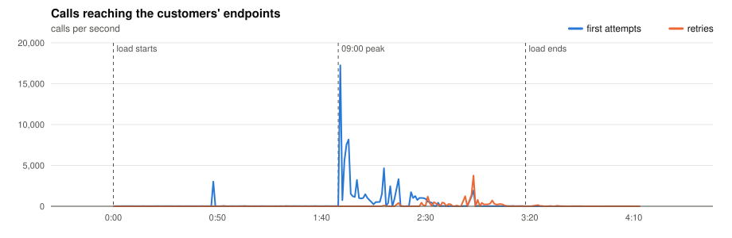
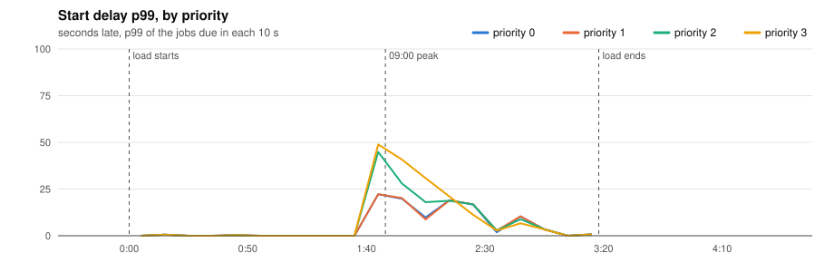
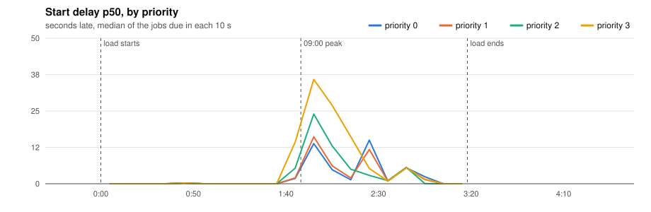
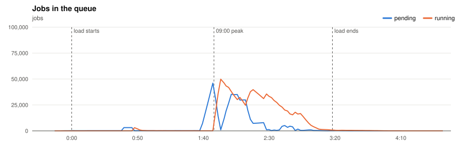
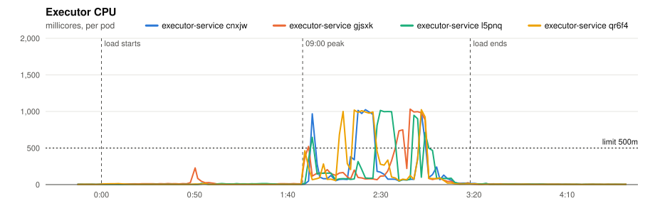
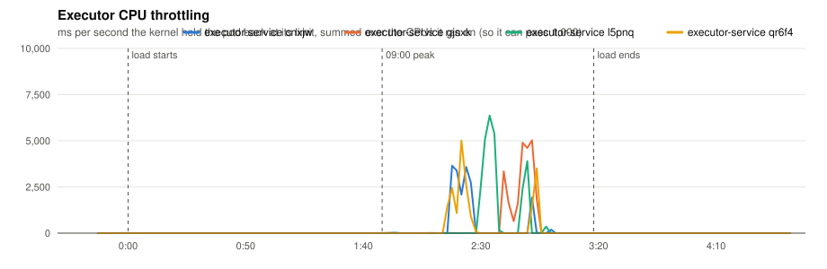
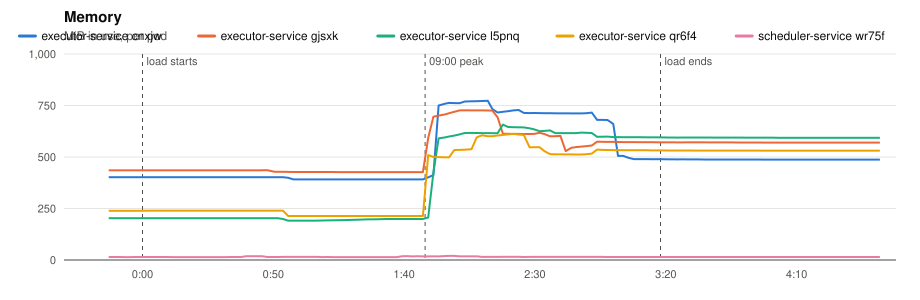
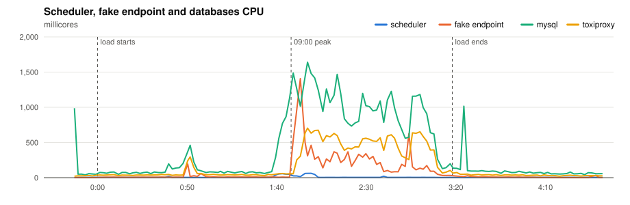
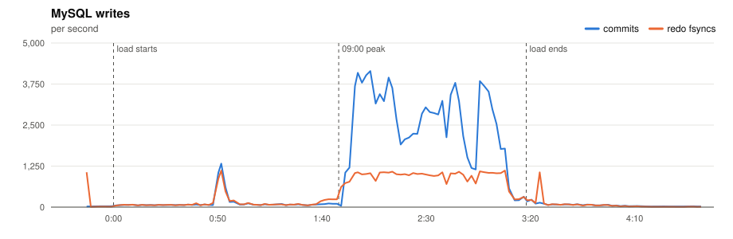
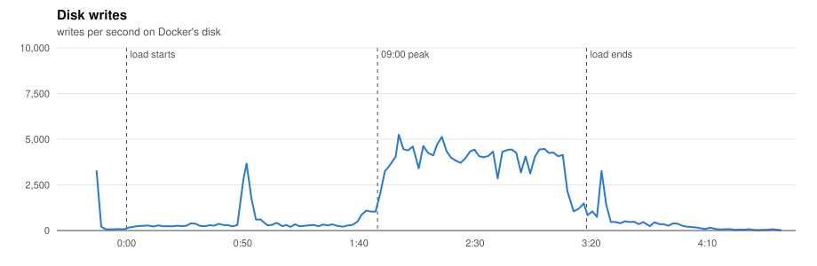

# P11 · 20261119T232256Z-v2-scale3-1cpu (v2-scale3-1cpu)

- **Load:** 198 s of the platform model at scale 3.0: 3,000 minute, 12,000 five, 30,000 hour, 45,000 day, 3,300 at tasks; 93,300 tasks seeded.
- **Deployment:** 4 executors; executor-service: `JOB_TIME_LIMIT_SECONDS=1 WORKER_COUNT=10000 JOB_QUEUE_SIZE=10000 PPROF_ADDR=:6060 GOMAXPROCS=limits.cpu MYSQL_MAX_OPEN_CONNS=5 MYSQL_MAX_IDLE_CONNS=5 CLAIM_INTERVAL=250ms CLAIM_LEAD=500ms`; scheduler-service: `SCHEDULE_INTERVAL=200ms SCHEDULE_LOOKAHEAD=10s PPROF_ADDR=:6060 GOMAXPROCS=limits.cpu SCHEDULE_BATCH_SIZE=1000`
- **Raw data:** `bench/results/P11-peak/runs/20261119T232256Z-v2-scale3-1cpu/` (local, not committed)

## Jobs

| Created | Succeeded | Dead | Still pending or running | Retried | Duplicate successes | Timed out, done anyway | Calls per second (first attempts) |
|---|---|---|---|---|---|---|---|
| 99,300 | 98,126 | 1,174 | 0 | 15,112 | 882 | 1,812 | 444.3 |

*Duplicate successes*: the endpoint answered 200 twice for one job, which only a failure should cause. *Timed out, done anyway*: the executor gave up after the timeout while the endpoint finished the work, so the retry made the customer process the job again.

**Start delay** (when the call reached the endpoint minus when the job was due, first attempts):

| Priority | Jobs | p50 | p90 | p99 | max |
|---|---|---|---|---|---|
| 0 | 5,046 | 1.827 s | 13.495 s | 22.162 s | 22.163 s |
| 1 | 14,874 | 1.982 s | 22.165 s | 22.241 s | 22.242 s |
| 2 | 53,955 | 5.286 s | 38.266 s | 44.761 s | 45.868 s |
| 3 | 13,650 | 13.517 s | 27.861 s | 48.831 s | 48.987 s |
| all | 87,525 | 5.374 s | 35.514 s | 44.856 s | 48.987 s |

- **09:00 peak:** 78,329 jobs due on the same second. The last one started **49.0 s** late (p50 5.9 s, p99 45.0 s); priority 0 p99 **22.2 s**.
- **Peak throughput:** every job of the peak had started **80.2 s** after it (p99 75.4 s), **1,123 jobs/s**; 17,255 in its busiest second. First attempts that never reached the endpoint: **11,688**.
- **Peak by priority** (p50 / p99 / max, first attempts): 0: 1.8 / 22.2 / 22.2 s; 1: 2.0 / 22.2 / 22.2 s; 2: 5.4 / 44.9 / 45.9 s; 3: 14.3 / 48.8 / 49.0 s.

## Charts

Time is minutes:seconds from the start of the load.





















## Resources

| Component | CPU avg (millicores) | CPU max | Throttled max (ms/s) | Memory max (MiB) |
|---|---|---|---|---|
| executor-service cnxjw | 82 | 1024 | 3648 | 773 |
| executor-service gjsxk | 86 | 1032 | 5029 | 726 |
| executor-service l5pnq | 91 | 1014 | 6365 | 657 |
| executor-service qr6f4 | 101 | 1025 | 5016 | 612 |
| scheduler-service wr75f | 7 | 62 | 0 | 20 |
| fake-endpoint | 87 | 1408 | 0 | 798 |
| mysql | 385 | 1640 | 147 | 2071 |
| cassandra | 98 | 406 | 0 | 954 |
| toxiproxy | 169 | 704 | 0 | 32 |

MySQL: up to 4145 commits/s, 1114 redo fsyncs/s, 632 row lock waits/s, 25 connections.

## CPU profile: executor, 20 s from 1:55

```text
      flat  flat%   sum%        cum   cum%
     1.01s 49.75% 49.75%      1.01s 49.75%  internal/runtime/syscall.Syscall6
     0.12s  5.91% 55.67%      0.12s  5.91%  runtime.futex
     0.07s  3.45% 59.11%      0.07s  3.45%  runtime.findObject
     0.05s  2.46% 61.58%      0.05s  2.46%  runtime.(*mspan).heapBitsSmallForAddr
     0.04s  1.97% 63.55%      0.04s  1.97%  runtime.(*gcWork).putObjFast (inline)
     0.04s  1.97% 65.52%      0.04s  1.97%  runtime.memmove
     0.03s  1.48% 67.00%      0.03s  1.48%  internal/runtime/atomic.(*Uint32).CompareAndSwap
     0.03s  1.48% 68.47%      0.03s  1.48%  internal/runtime/atomic.(*Uint8).Load
     0.03s  1.48% 69.95%      0.03s  1.48%  runtime.(*mspan).writeHeapBitsSmall
     0.03s  1.48% 71.43%      0.04s  1.97%  runtime.adjustframe
     0.03s  1.48% 72.91%      0.15s  7.39%  runtime.scanobject
     0.02s  0.99% 73.89%      0.02s  0.99%  runtime.gopark
```

## CPU profile: scheduler, 20 s from 1:55

```text
      flat  flat%   sum%        cum   cum%
      70ms 25.00% 25.00%       70ms 25.00%  internal/runtime/syscall.Syscall6
      20ms  7.14% 32.14%       20ms  7.14%  runtime.duffcopy
      20ms  7.14% 39.29%       30ms 10.71%  runtime.findObject
      20ms  7.14% 46.43%       20ms  7.14%  runtime.memmove
      10ms  3.57% 50.00%       20ms  7.14%  database/sql.driverArgsConnLocked
      10ms  3.57% 53.57%       10ms  3.57%  database/sql/driver.IsValue (inline)
      10ms  3.57% 57.14%       10ms  3.57%  gcWriteBarrier
      10ms  3.57% 60.71%      280ms   100%  github.com/JoelTeoGom/distributed-scheduler/scheduler-service/internal/adapters/out/mysql.(*SchedulerRepository).ScheduleJobs
      10ms  3.57% 64.29%      170ms 60.71%  github.com/JoelTeoGom/distributed-scheduler/scheduler-service/internal/adapters/out/mysql.insertJobs
      10ms  3.57% 67.86%       40ms 14.29%  github.com/go-sql-driver/mysql.(*mysqlConn).PrepareContext
      10ms  3.57% 71.43%       10ms  3.57%  runtime.(*mspan).base (inline)
      10ms  3.57% 75.00%       10ms  3.57%  runtime.(*mspan).divideByElemSize (inline)
```
