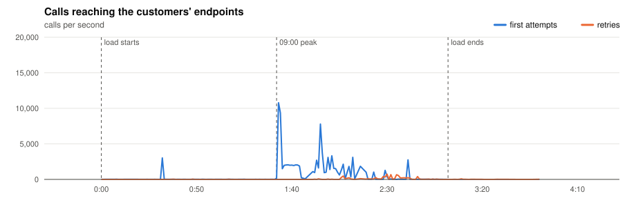
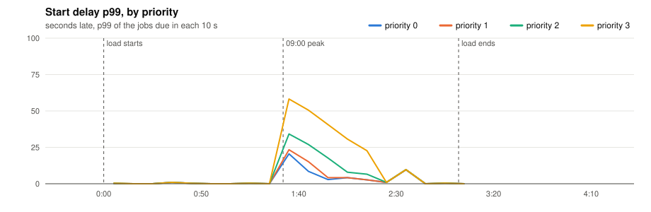
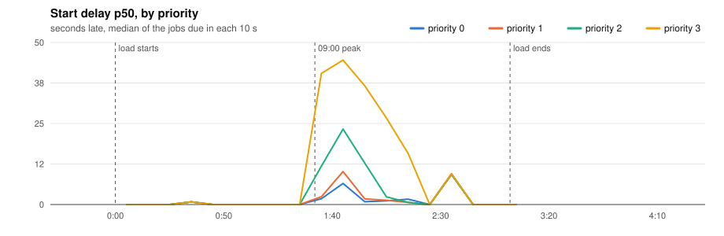
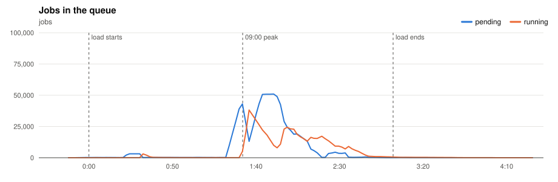
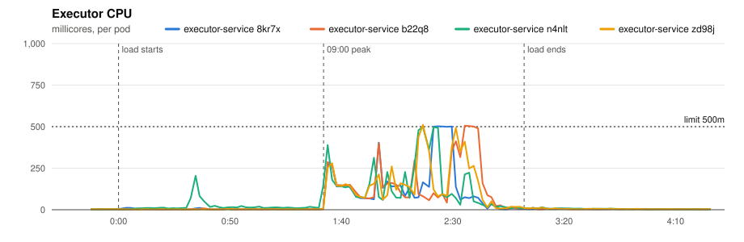
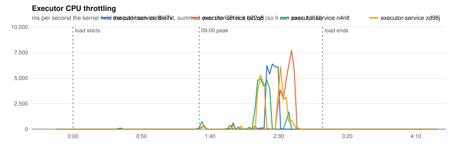
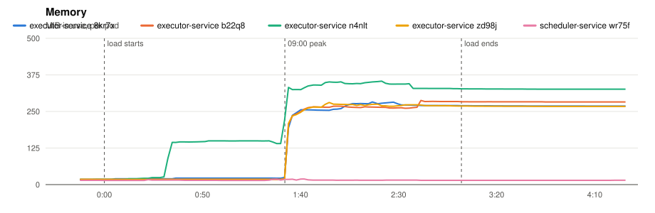
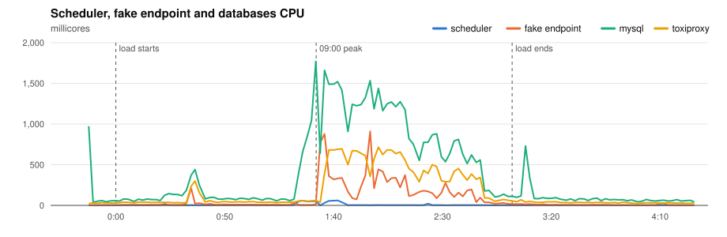
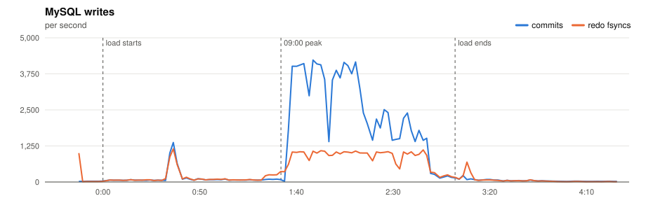
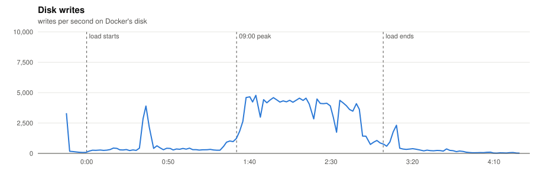

# P11 · 20261119T232813Z-v3-scale3-w5000 (v3-scale3-w5000)

- **Load:** 182 s of the platform model at scale 3.0: 3,000 minute, 12,000 five, 30,000 hour, 45,000 day, 3,033 at tasks; 93,033 tasks seeded.
- **Deployment:** 4 executors; executor-service: `JOB_TIME_LIMIT_SECONDS=1 WORKER_COUNT=5000 JOB_QUEUE_SIZE=10000 PPROF_ADDR=:6060 GOMAXPROCS=limits.cpu MYSQL_MAX_OPEN_CONNS=5 MYSQL_MAX_IDLE_CONNS=5 CLAIM_INTERVAL=250ms CLAIM_LEAD=500ms`; scheduler-service: `SCHEDULE_INTERVAL=200ms SCHEDULE_LOOKAHEAD=10s PPROF_ADDR=:6060 GOMAXPROCS=limits.cpu SCHEDULE_BATCH_SIZE=1000`
- **Raw data:** `bench/results/P11-peak/runs/20261119T232813Z-v3-scale3-w5000/` (local, not committed)

## Jobs

| Created | Succeeded | Dead | Still pending or running | Retried | Duplicate successes | Timed out, done anyway | Calls per second (first attempts) |
|---|---|---|---|---|---|---|---|
| 99,033 | 97,904 | 1,129 | 0 | 7,040 | 122 | 1,567 | 523.4 |

*Duplicate successes*: the endpoint answered 200 twice for one job, which only a failure should cause. *Timed out, done anyway*: the executor gave up after the timeout while the endpoint finished the work, so the retry made the customer process the job again.

**Start delay** (when the call reached the endpoint minus when the job was due, first attempts):

| Priority | Jobs | p50 | p90 | p99 | max |
|---|---|---|---|---|---|
| 0 | 4,866 | 1.691 s | 20.537 s | 20.554 s | 20.555 s |
| 1 | 15,005 | 2.402 s | 23.169 s | 23.356 s | 23.361 s |
| 2 | 59,277 | 10.270 s | 30.024 s | 34.160 s | 34.431 s |
| 3 | 15,582 | 40.352 s | 51.415 s | 58.193 s | 58.468 s |
| all | 94,730 | 12.596 s | 38.587 s | 57.643 s | 58.468 s |

- **09:00 peak:** 86,025 jobs due on the same second. The last one started **58.5 s** late (p50 21.3 s, p99 57.6 s); priority 0 p99 **20.6 s**.
- **Peak throughput:** every job of the peak had started **70.5 s** after it (p99 64.7 s), **1,277 jobs/s**; 10,791 in its busiest second. First attempts that never reached the endpoint: **3,989**.
- **Peak by priority** (p50 / p99 / max, first attempts): 0: 1.8 / 20.6 / 20.6 s; 1: 2.4 / 23.4 / 23.4 s; 2: 11.8 / 34.2 / 34.4 s; 3: 40.5 / 58.2 / 58.5 s.

## Charts

Time is minutes:seconds from the start of the load.





















## Resources

| Component | CPU avg (millicores) | CPU max | Throttled max (ms/s) | Memory max (MiB) |
|---|---|---|---|---|
| executor-service 8kr7x | 49 | 502 | 6369 | 282 |
| executor-service b22q8 | 54 | 505 | 7690 | 288 |
| executor-service n4nlt | 56 | 498 | 4935 | 354 |
| executor-service zd98j | 55 | 511 | 6110 | 281 |
| scheduler-service wr75f | 7 | 61 | 0 | 19 |
| fake-endpoint | 80 | 910 | 0 | 774 |
| mysql | 382 | 1770 | 1170 | 2114 |
| cassandra | 90 | 307 | 0 | 921 |
| toxiproxy | 166 | 715 | 0 | 33 |

MySQL: up to 4229 commits/s, 1148 redo fsyncs/s, 2248 row lock waits/s, 24 connections.

## CPU profile: executor, 20 s from 1:38

```text
      flat  flat%   sum%        cum   cum%
     810ms 45.51% 45.51%      810ms 45.51%  internal/runtime/syscall.Syscall6
      60ms  3.37% 48.88%       60ms  3.37%  runtime.futex
      50ms  2.81% 51.69%       50ms  2.81%  runtime.findObject
      40ms  2.25% 53.93%      130ms  7.30%  runtime.selectgo
      30ms  1.69% 55.62%       30ms  1.69%  runtime.gopark
      30ms  1.69% 57.30%       30ms  1.69%  runtime.step
      20ms  1.12% 58.43%       20ms  1.12%  runtime.(*mspan).heapBitsSmallForAddr
      20ms  1.12% 59.55%       20ms  1.12%  runtime.(*mspan).writeHeapBitsSmall
      20ms  1.12% 60.67%       60ms  3.37%  runtime.(*unwinder).resolveInternal
      20ms  1.12% 61.80%       20ms  1.12%  runtime.(*waitq).dequeue (inline)
      20ms  1.12% 62.92%       20ms  1.12%  runtime.ifaceeq
      20ms  1.12% 64.04%      100ms  5.62%  runtime.netpoll
```

## CPU profile: scheduler, 20 s from 1:38

```text
      flat  flat%   sum%        cum   cum%
      20ms 10.53% 10.53%       20ms 10.53%  internal/runtime/syscall.Syscall6
      20ms 10.53% 21.05%       20ms 10.53%  runtime.memclrNoHeapPointers
      20ms 10.53% 31.58%       20ms 10.53%  runtime.memmove
      10ms  5.26% 36.84%       50ms 26.32%  database/sql.driverArgsConnLocked
      10ms  5.26% 42.11%       50ms 26.32%  github.com/go-sql-driver/mysql.(*mysqlStmt).writeExecutePacket
      10ms  5.26% 47.37%       10ms  5.26%  github.com/go-sql-driver/mysql.namedValueToValue
      10ms  5.26% 52.63%       10ms  5.26%  internal/runtime/atomic.(*Uint32).Add
      10ms  5.26% 57.89%       10ms  5.26%  internal/runtime/atomic.(*UnsafePointer).Load (inline)
      10ms  5.26% 63.16%       10ms  5.26%  runtime.(*mspan).base (inline)
      10ms  5.26% 68.42%       10ms  5.26%  runtime.bulkBarrierPreWrite
      10ms  5.26% 73.68%       10ms  5.26%  runtime.casgstatus
      10ms  5.26% 78.95%       20ms 10.53%  runtime.greyobject
```
