# P2 · Capacity

> How many jobs per second can we run, and does adding servers help?

**Load:** fast endpoints, 50 → 800 jobs/s in steps, then 2 and 3 executors, ~20 min
**Status:** run on 2026-11-10.

## What we test

One executor gets a steady stream of one-off jobs with fast endpoints (~50 ms, lognormal), 60 s per step: 50, 100, 200, 400 and 800 jobs per second. The ladder stops at the first step that cannot keep up, the *knee*: it sustains less than 90% of what was offered, or its p99 start delay passes 2 s. The knee rate then runs again on 2 and 3 executors.

Nothing else runs: no crons, no slow endpoints. It measures the throughput of the pipeline, from the claim to the call.

**What to look at:**

- Sustained against offered jobs per second, per step (the capacity chart).
- The p99 start delay at each step: it should stay flat below the knee and climb above it.
- What saturates first at the knee: the executor's CPU and throttling, or MySQL (commits and redo `fsync`s per second).
- Whether 2 and 3 executors move the knee.

## Results

| Run | Jobs | Succeeded | Dead | Unfinished | Duplicates | Calls/s | Start delay p50 / p90 / p99 / max |
|---|---|---|---|---|---|---|---|
| [1x-50](reports/20261110T192413Z-1x-50/report.md) | 3,000 | 3,000 | 0 | 0 | 0 | 50.8 | 0.00 / 0.01 / 0.80 / 0.80 s |
| [1x-100](reports/20261110T192623Z-1x-100/report.md) | 6,000 | 6,000 | 0 | 0 | 0 | 101.7 | 0.00 / 0.01 / 0.80 / 0.80 s |
| [1x-200](reports/20261110T192832Z-1x-200/report.md) | 12,000 | 12,000 | 0 | 0 | 0 | 203.4 | 0.01 / 0.10 / 0.81 / 1.01 s |
| [1x-400](reports/20261110T193042Z-1x-400/report.md) | 24,000 | 24,000 | 0 | 0 | 0 | 300.9 | 3.36 / 21.85 / 26.65 / 27.95 s |
| [2x-400](reports/20261110T193326Z-2x-400/report.md) | 24,000 | 24,000 | 0 | 0 | 0 | 336.5 | 3.52 / 11.73 / 13.92 / 14.22 s |
| [3x-400](reports/20261110T193552Z-3x-400/report.md) | 24,000 | 24,000 | 0 | 0 | 0 | 330.3 | 4.28 / 12.47 / 14.67 / 16.07 s |
| [r2-1x-50](reports/20261119T202410Z-r2-1x-50/report.md) | 3,000 | 3,000 | 0 | 0 | 0 | 50.8 | 0.00 / 0.01 / 0.62 / 0.62 s |
| [r2-1x-100](reports/20261119T202620Z-r2-1x-100/report.md) | 6,000 | 6,000 | 0 | 0 | 0 | 101.7 | 0.00 / 0.01 / 0.64 / 0.65 s |
| [r2-1x-200](reports/20261119T202828Z-r2-1x-200/report.md) | 12,000 | 12,000 | 0 | 0 | 0 | 203.3 | 0.01 / 0.10 / 0.53 / 0.53 s |
| [r2-1x-400](reports/20261119T203217Z-r2-1x-400/report.md) | 24,000 | 24,000 | 0 | 0 | 0 | 327.3 | 3.46 / 13.85 / 19.34 / 20.55 s |
| [r2-2x-400](reports/20261119T203410Z-r2-2x-400/report.md) | 24,000 | 24,000 | 0 | 0 | 0 | 397.5 | 0.01 / 0.39 / 1.09 / 1.95 s |
| [r2-3x-400](reports/20261119T203538Z-r2-3x-400/report.md) | 24,000 | 24,000 | 0 | 0 | 0 | 406.7 | 0.01 / 0.12 / 0.62 / 0.84 s |
| [r3-1x-400](reports/20261119T210827Z-r3-1x-400/report.md) | 24,000 | 24,000 | 0 | 0 | 0 | 260.5 | 0.06 / 11.75 / 20.25 / 21.35 s |

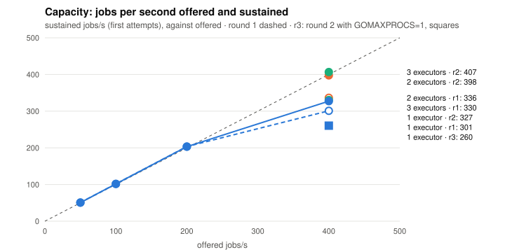

### 1x-50

- **Load:** 60 s of 50 one-off jobs per second, endpoint `lat=50&dist=lognormal`, timeout 30 s; 3,000 tasks seeded.
- **Deployment:** 1 executors; executor-service: `JOB_TIME_LIMIT_SECONDS=1 WORKER_COUNT=10000 JOB_QUEUE_SIZE=10000 PPROF_ADDR=:6060`; scheduler-service: `SCHEDULE_INTERVAL=1s SCHEDULE_LOOKAHEAD=10s PPROF_ADDR=:6060`
- **Raw data:** `bench/results/P2-capacity/runs/20261110T192413Z-1x-50/` (local, not committed)

#### Jobs

| Created | Succeeded | Dead | Still pending or running | Retried | Duplicate successes | Timed out, done anyway | Calls per second (first attempts) |
|---|---|---|---|---|---|---|---|
| 3,000 | 3,000 | 0 | 0 | 0 | 0 | 0 | 50.8 |

*Duplicate successes*: the endpoint answered 200 twice for one job, which only a failure should cause. *Timed out, done anyway*: the executor gave up after the timeout while the endpoint finished the work, so the retry made the customer process the job again.

**Start delay** (when the call reached the endpoint minus when the job was due, first attempts):

| Priority | Jobs | p50 | p90 | p99 | max |
|---|---|---|---|---|---|
| 0 | 750 | 0.003 s | 0.006 s | 0.802 s | 0.803 s |
| 1 | 750 | 0.003 s | 0.005 s | 0.802 s | 0.803 s |
| 2 | 750 | 0.003 s | 0.005 s | 0.802 s | 0.803 s |
| 3 | 750 | 0.003 s | 0.005 s | 0.802 s | 0.803 s |
| all | 3,000 | 0.003 s | 0.005 s | 0.802 s | 0.803 s |

<details><summary>Charts</summary>

Time is minutes:seconds from the start of the load.

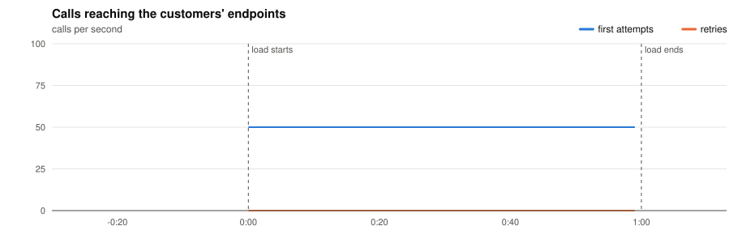

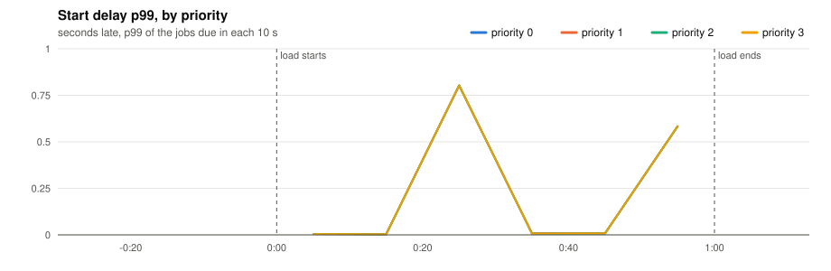

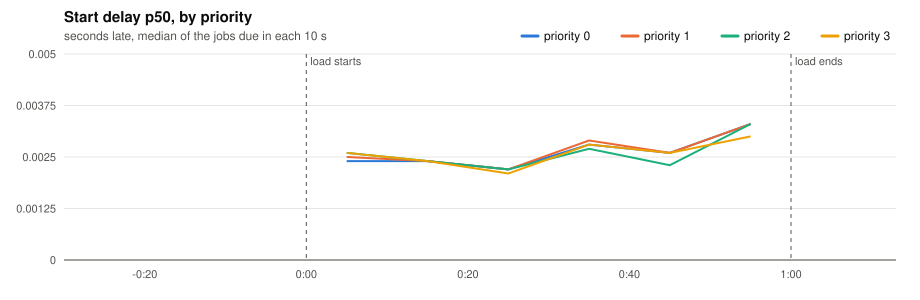

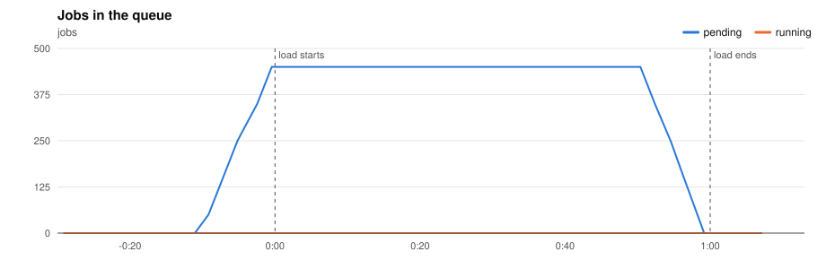

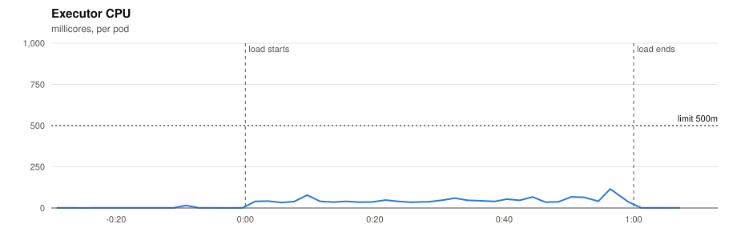

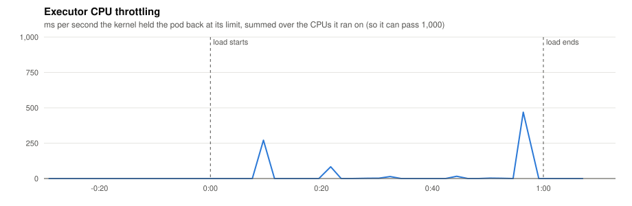

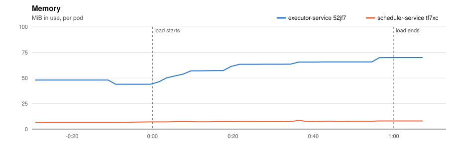

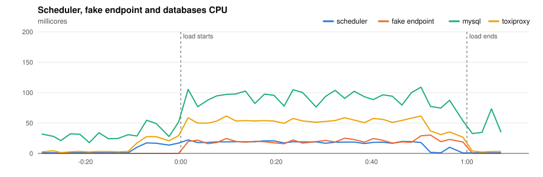

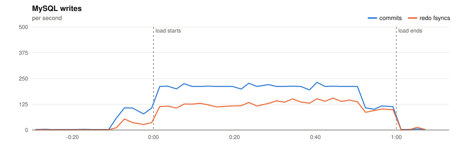

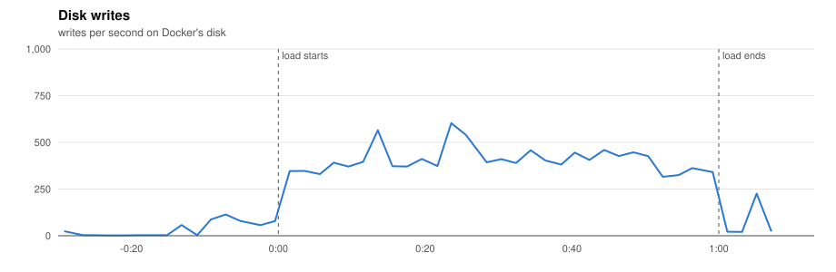

</details>

#### Resources

| Component | CPU avg (millicores) | CPU max | Throttled max (ms/s) | Memory max (MiB) |
|---|---|---|---|---|
| executor-service 52jf7 | 23 | 115 | 469 | 70 |
| scheduler-service tf7xc | 9 | 22 | 0 | 8 |
| fake-endpoint bcdlv | 10 | 30 | 0 | 14 |
| mysql | 60 | 109 | 0 | 695 |
| cassandra | 92 | 287 | 0 | 816 |
| toxiproxy | 27 | 62 | 0 | 19 |

MySQL: up to 232 commits/s, 155 redo fsyncs/s, 0 row lock waits/s, 10 connections.

#### CPU profiles

<details><summary>CPU profile: executor, 20 s from 0:34</summary>

```text
      flat  flat%   sum%        cum   cum%
     360ms 52.17% 52.17%      360ms 52.17%  internal/runtime/syscall.Syscall6
     120ms 17.39% 69.57%      120ms 17.39%  runtime.futex
      20ms  2.90% 72.46%       20ms  2.90%  runtime.usleep
      10ms  1.45% 73.91%       20ms  2.90%  context.WithDeadlineCause.func3
      10ms  1.45% 75.36%       10ms  1.45%  internal/runtime/atomic.(*Uint8).Load
      10ms  1.45% 76.81%       10ms  1.45%  net.(*TCPConn).SyscallConn
      10ms  1.45% 78.26%       10ms  1.45%  net.sockaddrToTCP
      10ms  1.45% 79.71%       10ms  1.45%  net/http.(*transferWriter).writeHeader
      10ms  1.45% 81.16%       10ms  1.45%  runtime.(*fixalloc).alloc
      10ms  1.45% 82.61%       10ms  1.45%  runtime.(*mcentral).uncacheSpan
      10ms  1.45% 84.06%       10ms  1.45%  runtime.ifaceeq
      10ms  1.45% 85.51%       10ms  1.45%  runtime.lock2
```

</details>

<details><summary>CPU profile: scheduler, 20 s from 0:34</summary>

```text
      flat  flat%   sum%        cum   cum%
      60ms 46.15% 46.15%       60ms 46.15%  internal/runtime/syscall.Syscall6
      30ms 23.08% 69.23%       30ms 23.08%  runtime.futex
      10ms  7.69% 76.92%       10ms  7.69%  runtime.(*limiterEvent).stop
      10ms  7.69% 84.62%       10ms  7.69%  runtime.acquirep
      10ms  7.69% 92.31%       10ms  7.69%  runtime.mPark
      10ms  7.69%   100%       10ms  7.69%  runtime.runqgrab
         0     0%   100%       80ms 61.54%  database/sql.(*DB).execDC
         0     0%   100%       30ms 23.08%  database/sql.(*DB).execDC.func3
         0     0%   100%       80ms 61.54%  database/sql.(*Tx).ExecContext
         0     0%   100%       10ms  7.69%  database/sql.(*driverStmt).Close
         0     0%   100%       30ms 23.08%  database/sql.ctxDriverPrepare
         0     0%   100%       40ms 30.77%  database/sql.ctxDriverStmtExec
```

</details>

Run page: [reports/20261110T192413Z-1x-50/report.md](reports/20261110T192413Z-1x-50/report.md)

### 1x-100

- **Load:** 60 s of 100 one-off jobs per second, endpoint `lat=50&dist=lognormal`, timeout 30 s; 6,000 tasks seeded.
- **Deployment:** 1 executors; executor-service: `JOB_TIME_LIMIT_SECONDS=1 WORKER_COUNT=10000 JOB_QUEUE_SIZE=10000 PPROF_ADDR=:6060`; scheduler-service: `SCHEDULE_INTERVAL=1s SCHEDULE_LOOKAHEAD=10s PPROF_ADDR=:6060`
- **Raw data:** `bench/results/P2-capacity/runs/20261110T192623Z-1x-100/` (local, not committed)

#### Jobs

| Created | Succeeded | Dead | Still pending or running | Retried | Duplicate successes | Timed out, done anyway | Calls per second (first attempts) |
|---|---|---|---|---|---|---|---|
| 6,000 | 6,000 | 0 | 0 | 0 | 0 | 0 | 101.7 |

*Duplicate successes*: the endpoint answered 200 twice for one job, which only a failure should cause. *Timed out, done anyway*: the executor gave up after the timeout while the endpoint finished the work, so the retry made the customer process the job again.

**Start delay** (when the call reached the endpoint minus when the job was due, first attempts):

| Priority | Jobs | p50 | p90 | p99 | max |
|---|---|---|---|---|---|
| 0 | 1,500 | 0.004 s | 0.008 s | 0.800 s | 0.801 s |
| 1 | 1,500 | 0.004 s | 0.008 s | 0.800 s | 0.801 s |
| 2 | 1,500 | 0.004 s | 0.008 s | 0.800 s | 0.801 s |
| 3 | 1,500 | 0.004 s | 0.008 s | 0.800 s | 0.800 s |
| all | 6,000 | 0.004 s | 0.008 s | 0.800 s | 0.801 s |

<details><summary>Charts</summary>

Time is minutes:seconds from the start of the load.

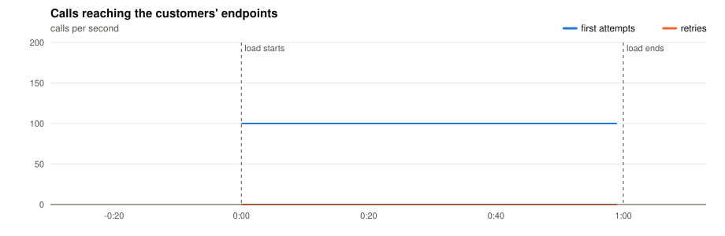

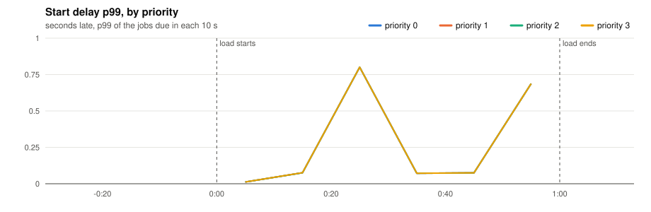

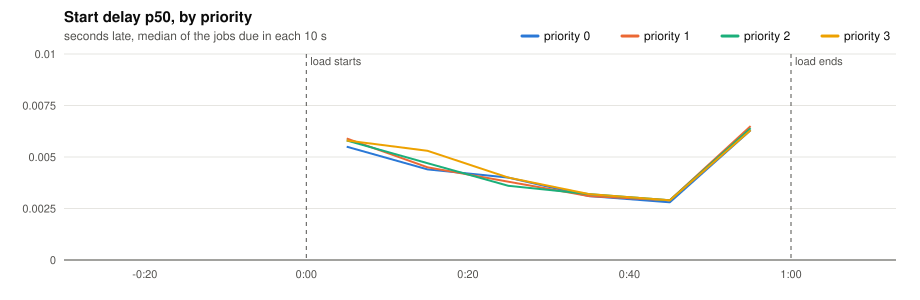

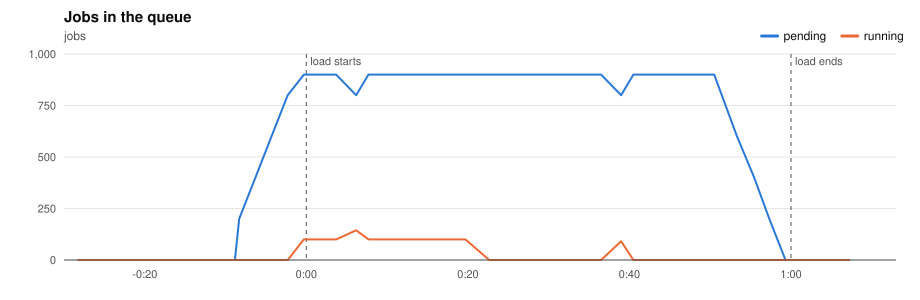

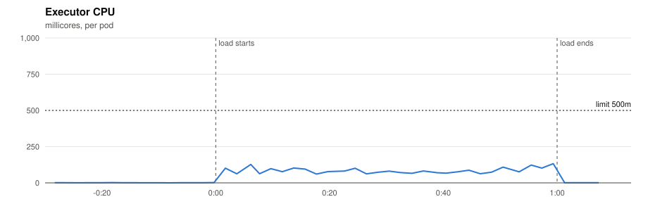

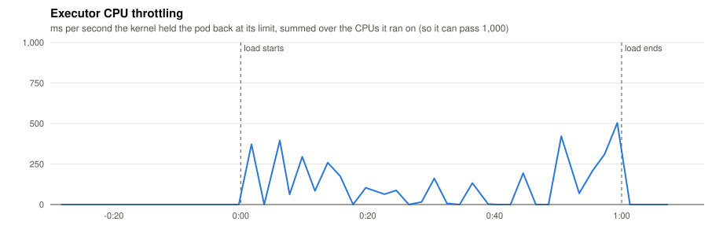

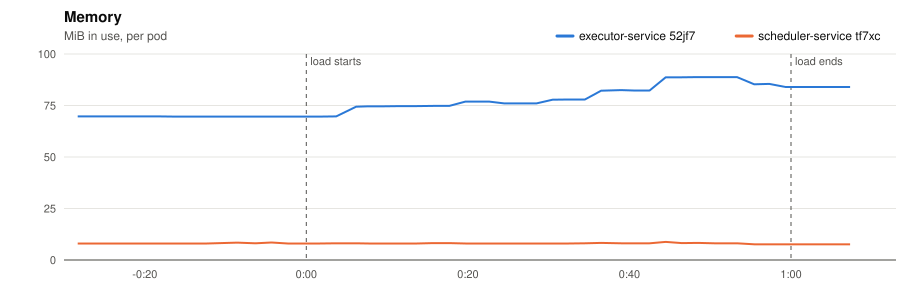

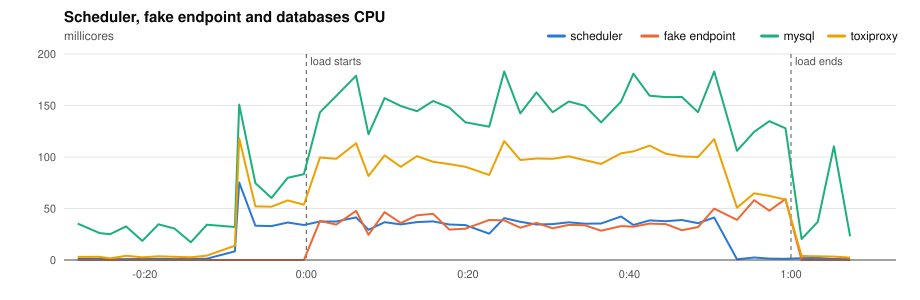

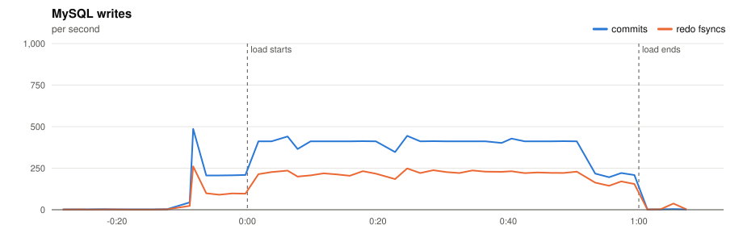

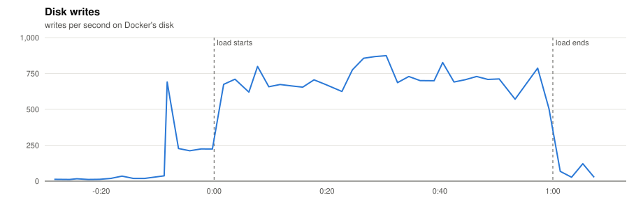

</details>

#### Resources

| Component | CPU avg (millicores) | CPU max | Throttled max (ms/s) | Memory max (MiB) |
|---|---|---|---|---|
| executor-service 52jf7 | 40 | 132 | 503 | 89 |
| scheduler-service tf7xc | 19 | 75 | 0 | 9 |
| fake-endpoint bcdlv | 18 | 59 | 0 | 19 |
| mysql | 91 | 183 | 0 | 709 |
| cassandra | 90 | 400 | 0 | 818 |
| toxiproxy | 51 | 118 | 0 | 18 |

MySQL: up to 486 commits/s, 261 redo fsyncs/s, 0 row lock waits/s, 9 connections.

#### CPU profiles

<details><summary>CPU profile: executor, 20 s from 0:34</summary>

```text
      flat  flat%   sum%        cum   cum%
     0.28s 24.78% 24.78%      0.28s 24.78%  internal/runtime/syscall.Syscall6
     0.14s 12.39% 37.17%      0.14s 12.39%  runtime.futex
     0.03s  2.65% 39.82%      0.03s  2.65%  runtime.nextFreeFast
     0.03s  2.65% 42.48%      0.03s  2.65%  runtime.step
     0.02s  1.77% 44.25%      0.03s  2.65%  runtime.(*gList).pop (inline)
     0.02s  1.77% 46.02%      0.19s 16.81%  runtime.findRunnable
     0.02s  1.77% 47.79%      0.02s  1.77%  runtime.memclrNoHeapPointers
     0.02s  1.77% 49.56%      0.02s  1.77%  runtime.memmove
     0.02s  1.77% 51.33%      0.02s  1.77%  runtime.usleep
     0.02s  1.77% 53.10%      0.02s  1.77%  runtime.write1
     0.01s  0.88% 53.98%      0.01s  0.88%  database/sql.NullInt64.Value
     0.01s  0.88% 54.87%      0.01s  0.88%  database/sql.driverResult.RowsAffected
```

</details>

<details><summary>CPU profile: scheduler, 20 s from 0:34</summary>

```text
      flat  flat%   sum%        cum   cum%
     100ms 30.30% 30.30%      100ms 30.30%  internal/runtime/syscall.Syscall6
      80ms 24.24% 54.55%       80ms 24.24%  runtime.futex
      10ms  3.03% 57.58%       30ms  9.09%  github.com/go-sql-driver/mysql.(*mysqlConn).Prepare
      10ms  3.03% 60.61%      110ms 33.33%  github.com/go-sql-driver/mysql.(*mysqlStmt).ExecContext
      10ms  3.03% 63.64%       50ms 15.15%  github.com/go-sql-driver/mysql.(*mysqlStmt).writeExecutePacket
      10ms  3.03% 66.67%       10ms  3.03%  internal/runtime/atomic.(*Bool).Load (inline)
      10ms  3.03% 69.70%       10ms  3.03%  runtime.(*mspan).writeHeapBitsSmall
      10ms  3.03% 72.73%       10ms  3.03%  runtime.(*timers).wakeTime
      10ms  3.03% 75.76%       10ms  3.03%  runtime.dropg
      10ms  3.03% 78.79%       10ms  3.03%  runtime.getcallerfp
      10ms  3.03% 81.82%       30ms  9.09%  runtime.mPark
      10ms  3.03% 84.85%       20ms  6.06%  runtime.mallocgc
```

</details>

Run page: [reports/20261110T192623Z-1x-100/report.md](reports/20261110T192623Z-1x-100/report.md)

### 1x-200

- **Load:** 60 s of 200 one-off jobs per second, endpoint `lat=50&dist=lognormal`, timeout 30 s; 12,000 tasks seeded.
- **Deployment:** 1 executors; executor-service: `JOB_TIME_LIMIT_SECONDS=1 WORKER_COUNT=10000 JOB_QUEUE_SIZE=10000 PPROF_ADDR=:6060`; scheduler-service: `SCHEDULE_INTERVAL=1s SCHEDULE_LOOKAHEAD=10s PPROF_ADDR=:6060`
- **Raw data:** `bench/results/P2-capacity/runs/20261110T192832Z-1x-200/` (local, not committed)

#### Jobs

| Created | Succeeded | Dead | Still pending or running | Retried | Duplicate successes | Timed out, done anyway | Calls per second (first attempts) |
|---|---|---|---|---|---|---|---|
| 12,000 | 12,000 | 0 | 0 | 0 | 0 | 0 | 203.4 |

*Duplicate successes*: the endpoint answered 200 twice for one job, which only a failure should cause. *Timed out, done anyway*: the executor gave up after the timeout while the endpoint finished the work, so the retry made the customer process the job again.

**Start delay** (when the call reached the endpoint minus when the job was due, first attempts):

| Priority | Jobs | p50 | p90 | p99 | max |
|---|---|---|---|---|---|
| 0 | 3,000 | 0.006 s | 0.103 s | 0.810 s | 1.012 s |
| 1 | 3,000 | 0.006 s | 0.104 s | 0.811 s | 1.012 s |
| 2 | 3,000 | 0.006 s | 0.103 s | 0.916 s | 1.012 s |
| 3 | 3,000 | 0.006 s | 0.104 s | 0.815 s | 1.012 s |
| all | 12,000 | 0.006 s | 0.104 s | 0.815 s | 1.012 s |

<details><summary>Charts</summary>

Time is minutes:seconds from the start of the load.

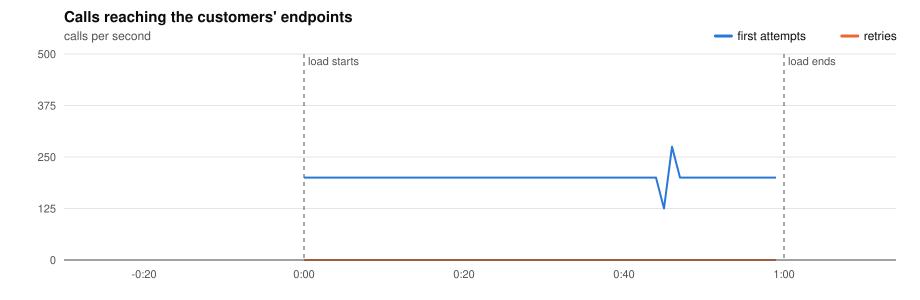

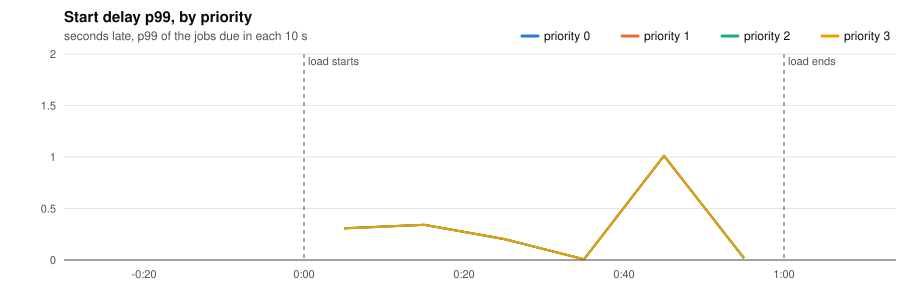

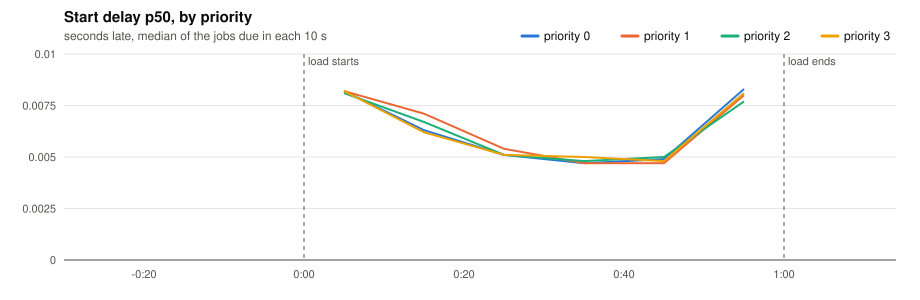

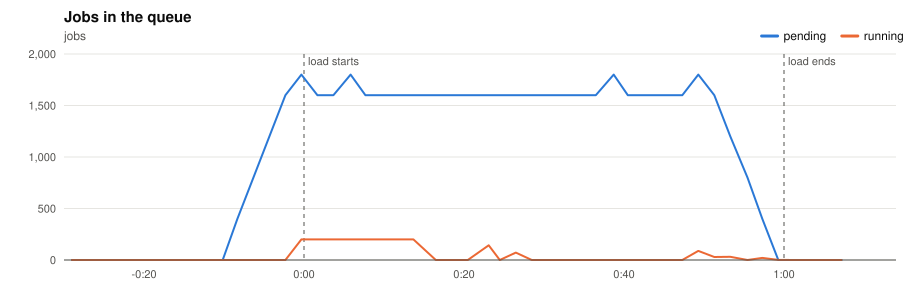

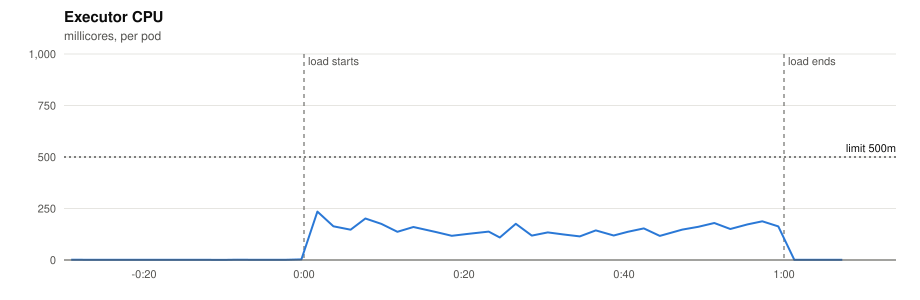

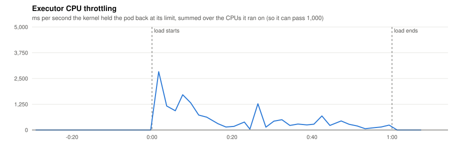

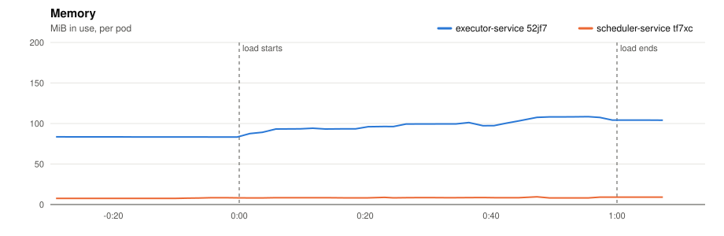

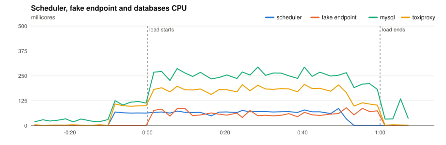

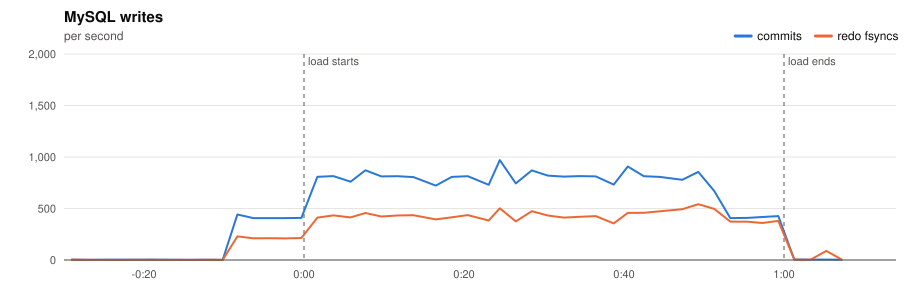

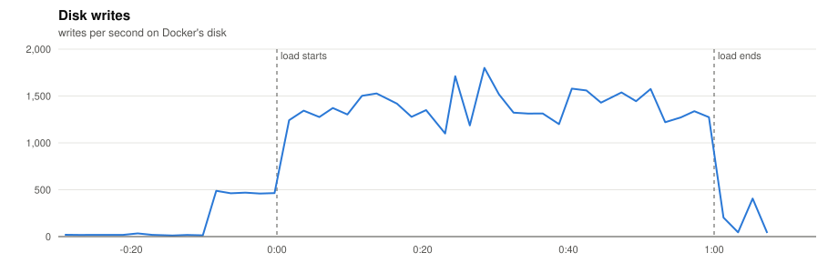

</details>

#### Resources

| Component | CPU avg (millicores) | CPU max | Throttled max (ms/s) | Memory max (MiB) |
|---|---|---|---|---|
| executor-service 52jf7 | 71 | 235 | 2831 | 108 |
| scheduler-service tf7xc | 33 | 86 | 0 | 10 |
| fake-endpoint bcdlv | 29 | 90 | 0 | 35 |
| mysql | 142 | 294 | 0 | 738 |
| cassandra | 87 | 241 | 0 | 821 |
| toxiproxy | 90 | 207 | 0 | 19 |

MySQL: up to 970 commits/s, 542 redo fsyncs/s, 0 row lock waits/s, 9 connections.

#### CPU profiles

<details><summary>CPU profile: executor, 20 s from 0:35</summary>

```text
      flat  flat%   sum%        cum   cum%
     300ms 24.79% 24.79%      300ms 24.79%  internal/runtime/syscall.Syscall6
     210ms 17.36% 42.15%      210ms 17.36%  runtime.futex
      60ms  4.96% 47.11%       60ms  4.96%  runtime.(*lfstack).pop
      30ms  2.48% 49.59%       30ms  2.48%  internal/runtime/atomic.(*Uint32).CompareAndSwap (inline)
      30ms  2.48% 52.07%       40ms  3.31%  runtime.(*unwinder).resolveInternal
      20ms  1.65% 53.72%       20ms  1.65%  runtime.(*lfstack).push
      20ms  1.65% 55.37%       30ms  2.48%  runtime.execute
      20ms  1.65% 57.02%       30ms  2.48%  runtime.findObject
      20ms  1.65% 58.68%      200ms 16.53%  runtime.findRunnable
      20ms  1.65% 60.33%       20ms  1.65%  runtime.gopark
      20ms  1.65% 61.98%       20ms  1.65%  runtime.nanotime (inline)
      20ms  1.65% 63.64%       60ms  4.96%  runtime.selectgo
```

</details>

<details><summary>CPU profile: scheduler, 20 s from 0:35</summary>

```text
      flat  flat%   sum%        cum   cum%
     240ms 41.38% 41.38%      240ms 41.38%  internal/runtime/syscall.Syscall6
     130ms 22.41% 63.79%      130ms 22.41%  runtime.futex
      20ms  3.45% 67.24%      100ms 17.24%  github.com/go-sql-driver/mysql.(*mysqlStmt).writeExecutePacket
      20ms  3.45% 70.69%      100ms 17.24%  runtime.startm
      20ms  3.45% 74.14%       20ms  3.45%  runtime.typedmemclr
      10ms  1.72% 75.86%       90ms 15.52%  database/sql.ctxDriverPrepare
      10ms  1.72% 77.59%       70ms 12.07%  github.com/go-sql-driver/mysql.(*mysqlConn).Prepare
      10ms  1.72% 79.31%       90ms 15.52%  github.com/go-sql-driver/mysql.(*mysqlConn).readPacket
      10ms  1.72% 81.03%       30ms  5.17%  github.com/go-sql-driver/mysql.(*mysqlStmt).readPrepareResultPacket
      10ms  1.72% 82.76%       10ms  1.72%  runtime.(*m).snapshotAllp
      10ms  1.72% 84.48%       10ms  1.72%  runtime.(*sweepLocked).sweep
      10ms  1.72% 86.21%       10ms  1.72%  runtime.acquireSudog
```

</details>

Run page: [reports/20261110T192832Z-1x-200/report.md](reports/20261110T192832Z-1x-200/report.md)

### 1x-400

- **Load:** 60 s of 400 one-off jobs per second, endpoint `lat=50&dist=lognormal`, timeout 30 s; 24,000 tasks seeded.
- **Deployment:** 1 executors; executor-service: `JOB_TIME_LIMIT_SECONDS=1 WORKER_COUNT=10000 JOB_QUEUE_SIZE=10000 PPROF_ADDR=:6060`; scheduler-service: `SCHEDULE_INTERVAL=1s SCHEDULE_LOOKAHEAD=10s PPROF_ADDR=:6060`
- **Raw data:** `bench/results/P2-capacity/runs/20261110T193042Z-1x-400/` (local, not committed)

#### Jobs

| Created | Succeeded | Dead | Still pending or running | Retried | Duplicate successes | Timed out, done anyway | Calls per second (first attempts) |
|---|---|---|---|---|---|---|---|
| 24,000 | 24,000 | 0 | 0 | 455 | 0 | 0 | 300.9 |

*Duplicate successes*: the endpoint answered 200 twice for one job, which only a failure should cause. *Timed out, done anyway*: the executor gave up after the timeout while the endpoint finished the work, so the retry made the customer process the job again.

**Start delay** (when the call reached the endpoint minus when the job was due, first attempts):

| Priority | Jobs | p50 | p90 | p99 | max |
|---|---|---|---|---|---|
| 0 | 5,726 | 2.765 s | 20.653 s | 25.377 s | 27.854 s |
| 1 | 5,870 | 3.361 s | 21.153 s | 25.087 s | 27.256 s |
| 2 | 5,962 | 3.365 s | 22.049 s | 26.853 s | 27.950 s |
| 3 | 5,987 | 3.366 s | 22.749 s | 26.950 s | 27.952 s |
| all | 23,545 | 3.362 s | 21.851 s | 26.653 s | 27.952 s |

<details><summary>Charts</summary>

Time is minutes:seconds from the start of the load.

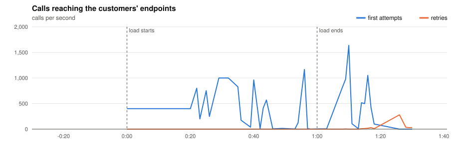

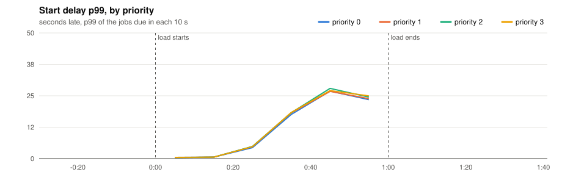

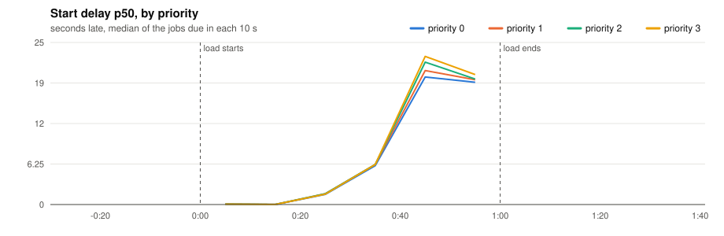

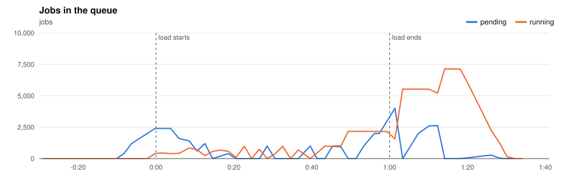

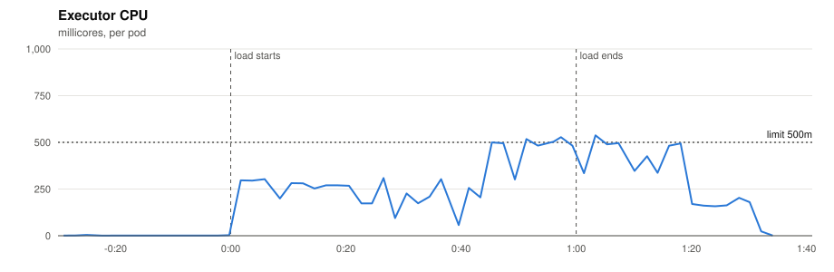

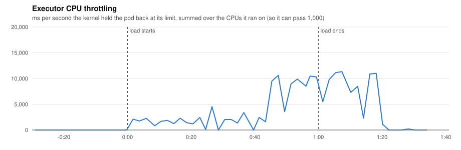

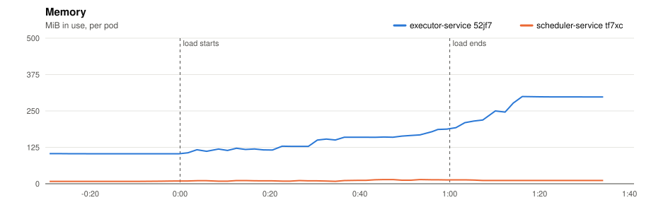

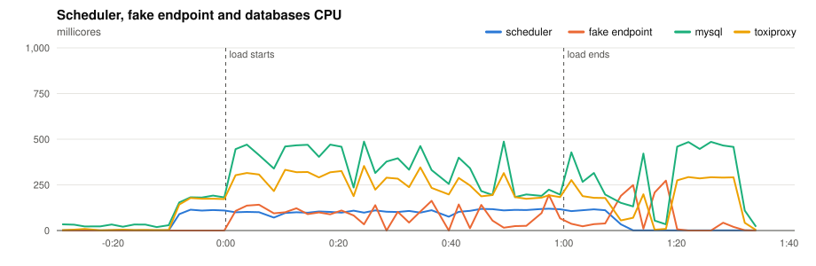

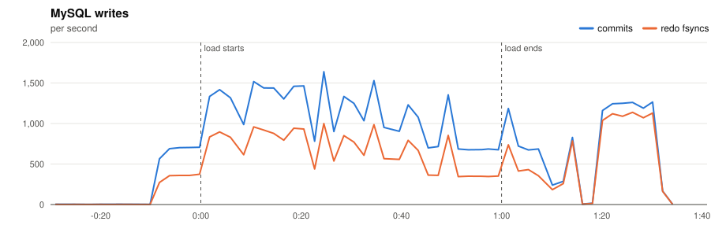

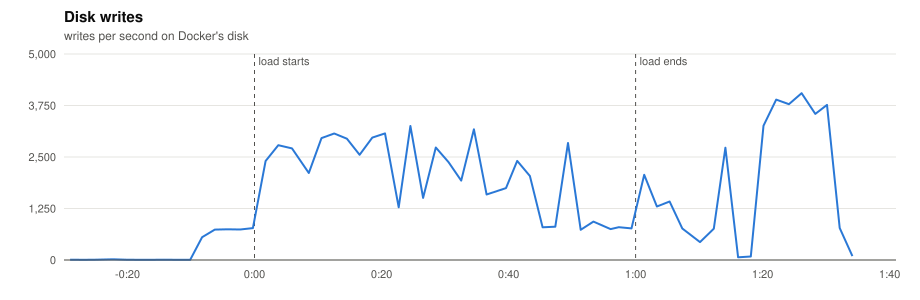

</details>

#### Resources

| Component | CPU avg (millicores) | CPU max | Throttled max (ms/s) | Memory max (MiB) |
|---|---|---|---|---|
| executor-service 52jf7 | 183 | 538 | 11344 | 300 |
| scheduler-service tf7xc | 54 | 119 | 0 | 14 |
| fake-endpoint bcdlv | 49 | 273 | 0 | 93 |
| mysql | 224 | 487 | 0 | 801 |
| cassandra | 93 | 268 | 0 | 803 |
| toxiproxy | 152 | 353 | 0 | 19 |

MySQL: up to 1639 commits/s, 1138 redo fsyncs/s, 1 row lock waits/s, 10 connections.

#### CPU profiles

<details><summary>CPU profile: executor, 20 s from 0:35</summary>

```text
      flat  flat%   sum%        cum   cum%
     3.68s 84.79% 84.79%      3.68s 84.79%  internal/runtime/syscall.Syscall6
     0.08s  1.84% 86.64%      0.08s  1.84%  runtime.futex
     0.04s  0.92% 87.56%      0.04s  0.92%  runtime.step
     0.02s  0.46% 88.02%      0.09s  2.07%  runtime.newobject
     0.02s  0.46% 88.48%      0.03s  0.69%  runtime.scanblock
     0.01s  0.23% 88.71%      0.03s  0.69%  internal/poll.(*FD).Init
     0.01s  0.23% 88.94%      3.43s 79.03%  net.(*netFD).connect
     0.01s  0.23% 89.17%      3.56s 82.03%  net/http.(*Transport).dialConn
     0.01s  0.23% 89.40%      0.03s  0.69%  runtime.(*stkframe).getStackMap
     0.01s  0.23% 89.63%      0.03s  0.69%  runtime.adjustframe
     0.01s  0.23% 89.86%      0.10s  2.30%  runtime.findRunnable
     0.01s  0.23% 90.09%      0.06s  1.38%  runtime.injectglist
```

</details>

<details><summary>CPU profile: scheduler, 20 s from 0:35</summary>

```text
      flat  flat%   sum%        cum   cum%
     0.44s 36.36% 36.36%      0.44s 36.36%  internal/runtime/syscall.Syscall6
     0.38s 31.40% 67.77%      0.38s 31.40%  runtime.futex
     0.02s  1.65% 69.42%      0.19s 15.70%  runtime.findRunnable
     0.02s  1.65% 71.07%      0.02s  1.65%  runtime.gopark
     0.02s  1.65% 72.73%      0.02s  1.65%  runtime.memclrNoHeapPointers
     0.02s  1.65% 74.38%      0.02s  1.65%  runtime.nanotime (inline)
     0.02s  1.65% 76.03%      0.02s  1.65%  runtime.nextFreeFast
     0.02s  1.65% 77.69%      0.02s  1.65%  runtime.releaseSudog
     0.02s  1.65% 79.34%      0.16s 13.22%  runtime.selectgo
     0.02s  1.65% 80.99%      0.04s  3.31%  runtime.stealWork
     0.01s  0.83% 81.82%      0.18s 14.88%  database/sql.withLock
     0.01s  0.83% 82.64%      0.41s 33.88%  github.com/go-sql-driver/mysql.(*mysqlConn).writePacket
```

</details>

Run page: [reports/20261110T193042Z-1x-400/report.md](reports/20261110T193042Z-1x-400/report.md)

### 2x-400

- **Load:** 60 s of 400 one-off jobs per second, endpoint `lat=50&dist=lognormal`, timeout 30 s; 24,000 tasks seeded.
- **Deployment:** 2 executors; executor-service: `JOB_TIME_LIMIT_SECONDS=1 WORKER_COUNT=10000 JOB_QUEUE_SIZE=10000 PPROF_ADDR=:6060`; scheduler-service: `SCHEDULE_INTERVAL=1s SCHEDULE_LOOKAHEAD=10s PPROF_ADDR=:6060`
- **Raw data:** `bench/results/P2-capacity/runs/20261110T193326Z-2x-400/` (local, not committed)

#### Jobs

| Created | Succeeded | Dead | Still pending or running | Retried | Duplicate successes | Timed out, done anyway | Calls per second (first attempts) |
|---|---|---|---|---|---|---|---|
| 24,000 | 24,000 | 0 | 0 | 0 | 0 | 0 | 336.5 |

*Duplicate successes*: the endpoint answered 200 twice for one job, which only a failure should cause. *Timed out, done anyway*: the executor gave up after the timeout while the endpoint finished the work, so the retry made the customer process the job again.

**Start delay** (when the call reached the endpoint minus when the job was due, first attempts):

| Priority | Jobs | p50 | p90 | p99 | max |
|---|---|---|---|---|---|
| 0 | 6,000 | 3.516 s | 11.724 s | 13.919 s | 14.218 s |
| 1 | 6,000 | 3.334 s | 11.724 s | 13.920 s | 14.218 s |
| 2 | 6,000 | 3.335 s | 11.722 s | 13.921 s | 14.219 s |
| 3 | 6,000 | 3.430 s | 11.820 s | 13.921 s | 14.219 s |
| all | 24,000 | 3.516 s | 11.731 s | 13.920 s | 14.219 s |

<details><summary>Charts</summary>

Time is minutes:seconds from the start of the load.

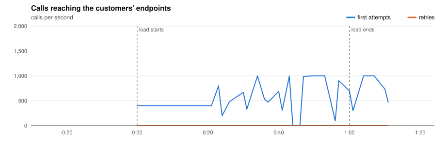

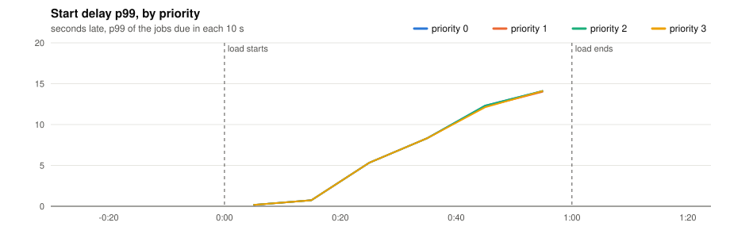

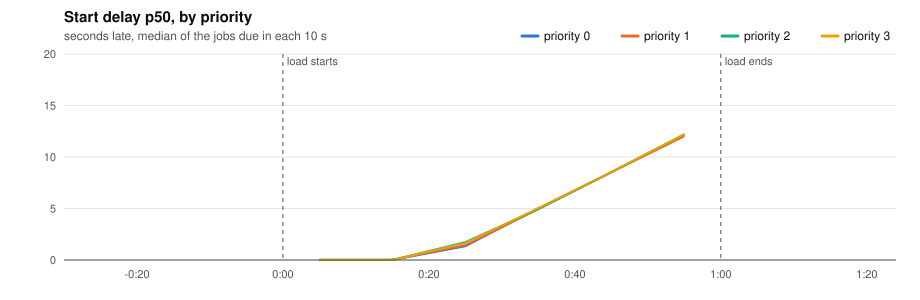

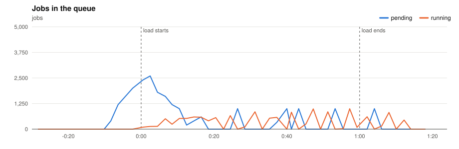

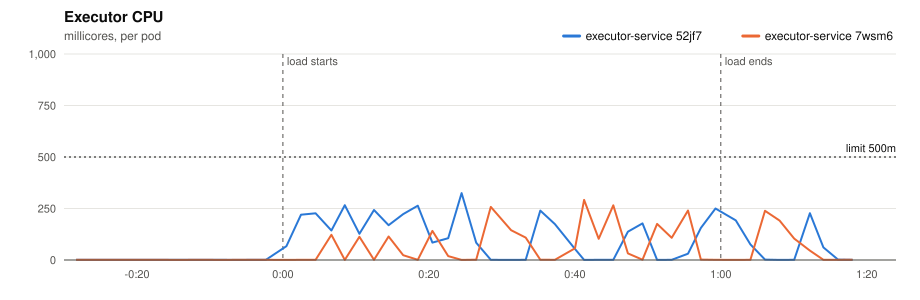

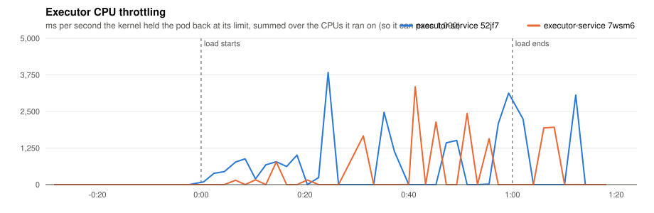

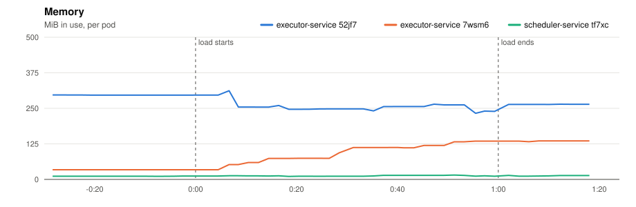

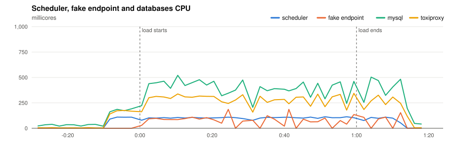

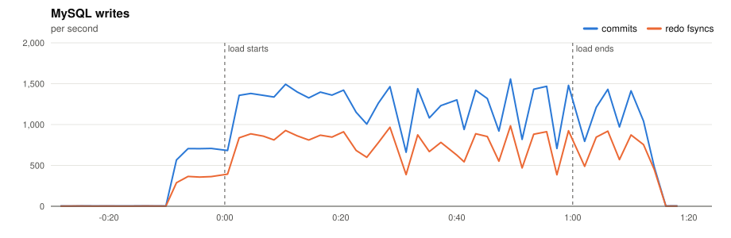


</details>

#### Resources

| Component | CPU avg (millicores) | CPU max | Throttled max (ms/s) | Memory max (MiB) |
|---|---|---|---|---|
| executor-service 52jf7 | 65 | 325 | 3835 | 312 |
| executor-service 7wsm6 | 44 | 292 | 3344 | 136 |
| scheduler-service tf7xc | 61 | 113 | 0 | 15 |
| fake-endpoint bcdlv | 42 | 186 | 0 | 114 |
| mysql | 241 | 521 | 0 | 838 |
| cassandra | 90 | 274 | 0 | 801 |
| toxiproxy | 163 | 344 | 0 | 23 |

MySQL: up to 1557 commits/s, 984 redo fsyncs/s, 1 row lock waits/s, 14 connections.

#### CPU profiles

<details><summary>CPU profile: executor, 20 s from 0:35</summary>

```text
      flat  flat%   sum%        cum   cum%
     300ms 46.15% 46.15%      300ms 46.15%  internal/runtime/syscall.Syscall6
      70ms 10.77% 56.92%       70ms 10.77%  runtime.futex
      20ms  3.08% 60.00%       20ms  3.08%  internal/runtime/atomic.(*Uint32).CompareAndSwap
      20ms  3.08% 63.08%       50ms  7.69%  runtime.mallocgcSmallNoscan
      20ms  3.08% 66.15%       20ms  3.08%  runtime.memclrNoHeapPointers
      20ms  3.08% 69.23%       20ms  3.08%  runtime.pcvalue
      10ms  1.54% 70.77%       10ms  1.54%  database/sql.(*connRequestSet).deleteIndex
      10ms  1.54% 72.31%       50ms  7.69%  github.com/go-sql-driver/mysql.(*mysqlStmt).writeExecutePacket
      10ms  1.54% 73.85%       20ms  3.08%  internal/poll.(*FD).readLock
      10ms  1.54% 75.38%       10ms  1.54%  internal/poll.(*fdMutex).rwlock
      10ms  1.54% 76.92%       10ms  1.54%  internal/poll.runtime_pollSetDeadline
      10ms  1.54% 78.46%      150ms 23.08%  net.(*conn).Write
```

</details>

<details><summary>CPU profile: scheduler, 20 s from 0:35</summary>

```text
      flat  flat%   sum%        cum   cum%
     0.47s 40.17% 40.17%      0.47s 40.17%  internal/runtime/syscall.Syscall6
     0.37s 31.62% 71.79%      0.37s 31.62%  runtime.futex
     0.02s  1.71% 73.50%      0.22s 18.80%  runtime.findRunnable
     0.02s  1.71% 75.21%      0.05s  4.27%  runtime.futexsleep
     0.02s  1.71% 76.92%      0.02s  1.71%  runtime.nextFreeFast (inline)
     0.02s  1.71% 78.63%      0.02s  1.71%  runtime.stealWork
     0.01s  0.85% 79.49%      0.06s  5.13%  database/sql.(*DB).execDC.func2
     0.01s  0.85% 80.34%      0.07s  5.98%  github.com/go-sql-driver/mysql.(*mysqlConn).readWithTimeout
     0.01s  0.85% 81.20%      0.39s 33.33%  github.com/go-sql-driver/mysql.(*mysqlConn).writePacket
     0.01s  0.85% 82.05%      0.29s 24.79%  github.com/go-sql-driver/mysql.(*mysqlStmt).Exec
     0.01s  0.85% 82.91%      0.22s 18.80%  github.com/go-sql-driver/mysql.(*mysqlStmt).writeExecutePacket
     0.01s  0.85% 83.76%      0.04s  3.42%  github.com/go-sql-driver/mysql.(*okHandler).readResultSetHeaderPacket
```

</details>

Run page: [reports/20261110T193326Z-2x-400/report.md](reports/20261110T193326Z-2x-400/report.md)

### 3x-400

- **Load:** 60 s of 400 one-off jobs per second, endpoint `lat=50&dist=lognormal`, timeout 30 s; 24,000 tasks seeded.
- **Deployment:** 3 executors; executor-service: `JOB_TIME_LIMIT_SECONDS=1 WORKER_COUNT=10000 JOB_QUEUE_SIZE=10000 PPROF_ADDR=:6060`; scheduler-service: `SCHEDULE_INTERVAL=1s SCHEDULE_LOOKAHEAD=10s PPROF_ADDR=:6060`
- **Raw data:** `bench/results/P2-capacity/runs/20261110T193552Z-3x-400/` (local, not committed)

#### Jobs

| Created | Succeeded | Dead | Still pending or running | Retried | Duplicate successes | Timed out, done anyway | Calls per second (first attempts) |
|---|---|---|---|---|---|---|---|
| 24,000 | 24,000 | 0 | 0 | 0 | 0 | 0 | 330.3 |

*Duplicate successes*: the endpoint answered 200 twice for one job, which only a failure should cause. *Timed out, done anyway*: the executor gave up after the timeout while the endpoint finished the work, so the retry made the customer process the job again.

**Start delay** (when the call reached the endpoint minus when the job was due, first attempts):

| Priority | Jobs | p50 | p90 | p99 | max |
|---|---|---|---|---|---|
| 0 | 6,000 | 4.285 s | 12.473 s | 14.668 s | 15.668 s |
| 1 | 6,000 | 4.284 s | 12.473 s | 14.668 s | 15.671 s |
| 2 | 6,000 | 4.287 s | 12.474 s | 14.670 s | 15.667 s |
| 3 | 6,000 | 4.181 s | 12.475 s | 14.576 s | 16.073 s |
| all | 24,000 | 4.284 s | 12.475 s | 14.668 s | 16.073 s |

<details><summary>Charts</summary>

Time is minutes:seconds from the start of the load.


</details>

#### Resources

| Component | CPU avg (millicores) | CPU max | Throttled max (ms/s) | Memory max (MiB) |
|---|---|---|---|---|
| executor-service 52jf7 | 46 | 258 | 3110 | 271 |
| executor-service 7wsm6 | 7 | 122 | 324 | 135 |
| executor-service wrgmj | 58 | 356 | 4277 | 135 |
| scheduler-service tf7xc | 60 | 115 | 0 | 15 |
| fake-endpoint bcdlv | 42 | 218 | 0 | 120 |
| mysql | 240 | 553 | 0 | 870 |
| cassandra | 89 | 289 | 0 | 798 |
| toxiproxy | 162 | 379 | 0 | 24 |

MySQL: up to 1775 commits/s, 1105 redo fsyncs/s, 0 row lock waits/s, 20 connections.

#### CPU profiles

<details><summary>CPU profile: executor, 20 s from 0:35</summary>

```text
      flat  flat%   sum%        cum   cum%
     0.50s 48.54% 48.54%      0.50s 48.54%  internal/runtime/syscall.Syscall6
     0.09s  8.74% 57.28%      0.09s  8.74%  runtime.futex
     0.02s  1.94% 59.22%      0.02s  1.94%  runtime.acquireSudog
     0.02s  1.94% 61.17%      0.02s  1.94%  runtime.findObject
     0.02s  1.94% 63.11%      0.05s  4.85%  runtime.pcvalue
     0.02s  1.94% 65.05%      0.02s  1.94%  runtime.runqgrab
     0.02s  1.94% 66.99%      0.03s  2.91%  runtime.scanblock
     0.02s  1.94% 68.93%      0.05s  4.85%  runtime.scanobject
     0.02s  1.94% 70.87%      0.02s  1.94%  runtime.step
     0.01s  0.97% 71.84%      0.02s  1.94%  context.value
     0.01s  0.97% 72.82%      0.23s 22.33%  database/sql.(*DB).execDC
     0.01s  0.97% 73.79%      0.01s  0.97%  database/sql.convertAssignRows
```

</details>

<details><summary>CPU profile: scheduler, 20 s from 0:35</summary>

```text
      flat  flat%   sum%        cum   cum%
     0.37s 33.94% 33.94%      0.37s 33.94%  runtime.futex
     0.36s 33.03% 66.97%      0.36s 33.03%  internal/runtime/syscall.Syscall6
     0.02s  1.83% 68.81%      0.03s  2.75%  runtime.sellock
     0.02s  1.83% 70.64%      0.03s  2.75%  runtime.stealWork
     0.01s  0.92% 71.56%      0.29s 26.61%  database/sql.ctxDriverStmtExec
     0.01s  0.92% 72.48%      0.26s 23.85%  database/sql.withLock
     0.01s  0.92% 73.39%      0.04s  3.67%  github.com/go-sql-driver/mysql.(*mysqlConn).ExecContext
     0.01s  0.92% 74.31%      0.21s 19.27%  github.com/go-sql-driver/mysql.(*mysqlConn).PrepareContext
     0.01s  0.92% 75.23%      0.14s 12.84%  github.com/go-sql-driver/mysql.(*mysqlConn).readNext
     0.01s  0.92% 76.15%      0.34s 31.19%  github.com/go-sql-driver/mysql.(*mysqlConn).writeWithTimeout
     0.01s  0.92% 77.06%      0.17s 15.60%  github.com/go-sql-driver/mysql.(*mysqlStmt).writeExecutePacket
     0.01s  0.92% 77.98%      0.01s  0.92%  github.com/go-sql-driver/mysql.callValuerValue
```

</details>

Run page: [reports/20261110T193552Z-3x-400/report.md](reports/20261110T193552Z-3x-400/report.md)

### r2-1x-50

- **Load:** 60 s of 50 one-off jobs per second, endpoint `lat=50&dist=lognormal`, timeout 30 s; 3,000 tasks seeded.
- **Deployment:** 1 executors; executor-service: `JOB_TIME_LIMIT_SECONDS=1 WORKER_COUNT=10000 JOB_QUEUE_SIZE=10000 PPROF_ADDR=:6060`; scheduler-service: `SCHEDULE_INTERVAL=1s SCHEDULE_LOOKAHEAD=10s PPROF_ADDR=:6060`
- **Raw data:** `bench/results/P2-capacity/runs/20261119T202410Z-r2-1x-50/` (local, not committed)

#### Jobs

| Created | Succeeded | Dead | Still pending or running | Retried | Duplicate successes | Timed out, done anyway | Calls per second (first attempts) |
|---|---|---|---|---|---|---|---|
| 3,000 | 3,000 | 0 | 0 | 0 | 0 | 0 | 50.8 |

*Duplicate successes*: the endpoint answered 200 twice for one job, which only a failure should cause. *Timed out, done anyway*: the executor gave up after the timeout while the endpoint finished the work, so the retry made the customer process the job again.

**Start delay** (when the call reached the endpoint minus when the job was due, first attempts):

| Priority | Jobs | p50 | p90 | p99 | max |
|---|---|---|---|---|---|
| 0 | 750 | 0.003 s | 0.006 s | 0.618 s | 0.619 s |
| 1 | 750 | 0.002 s | 0.006 s | 0.618 s | 0.619 s |
| 2 | 750 | 0.002 s | 0.006 s | 0.618 s | 0.619 s |
| 3 | 750 | 0.002 s | 0.006 s | 0.618 s | 0.619 s |
| all | 3,000 | 0.002 s | 0.006 s | 0.618 s | 0.619 s |

<details><summary>Charts</summary>

Time is minutes:seconds from the start of the load.


</details>

#### Resources

| Component | CPU avg (millicores) | CPU max | Throttled max (ms/s) | Memory max (MiB) |
|---|---|---|---|---|
| executor-service 7c5jv | 22 | 86 | 350 | 63 |
| scheduler-service 7jsfb | 2 | 4 | 0 | 10 |
| fake-endpoint cf55t | 9 | 32 | 0 | 13 |
| mysql | 48 | 87 | 0 | 840 |
| cassandra | 102 | 289 | 0 | 1072 |
| toxiproxy | 16 | 38 | 0 | 14 |

MySQL: up to 145 commits/s, 118 redo fsyncs/s, 0 row lock waits/s, 11 connections.

#### CPU profiles

<details><summary>CPU profile: executor, 20 s from 0:34</summary>

```text
      flat  flat%   sum%        cum   cum%
     140ms 27.45% 27.45%      140ms 27.45%  internal/runtime/syscall.Syscall6
      80ms 15.69% 43.14%       80ms 15.69%  runtime.futex
      50ms  9.80% 52.94%       50ms  9.80%  runtime.findObject
      40ms  7.84% 60.78%       40ms  7.84%  runtime.(*lfstack).pop
      30ms  5.88% 66.67%      100ms 19.61%  runtime.scanobject
      20ms  3.92% 70.59%       30ms  5.88%  runtime.greyobject
      10ms  1.96% 72.55%       10ms  1.96%  github.com/go-sql-driver/mysql.callValuerValue
      10ms  1.96% 74.51%       10ms  1.96%  internal/runtime/atomic.(*Uint32).CompareAndSwap
      10ms  1.96% 76.47%       10ms  1.96%  runtime.(*lfstack).push
      10ms  1.96% 78.43%       10ms  1.96%  runtime.(*stkframe).getStackMap
      10ms  1.96% 80.39%       10ms  1.96%  runtime.binarySearchTree
      10ms  1.96% 82.35%       10ms  1.96%  runtime.checkTimersNoP
```

</details>

<details><summary>CPU profile: scheduler, 20 s from 0:34</summary>

```text
      flat  flat%   sum%        cum   cum%
```

</details>

Run page: [reports/20261119T202410Z-r2-1x-50/report.md](reports/20261119T202410Z-r2-1x-50/report.md)

### r2-1x-100

- **Load:** 60 s of 100 one-off jobs per second, endpoint `lat=50&dist=lognormal`, timeout 30 s; 6,000 tasks seeded.
- **Deployment:** 1 executors; executor-service: `JOB_TIME_LIMIT_SECONDS=1 WORKER_COUNT=10000 JOB_QUEUE_SIZE=10000 PPROF_ADDR=:6060`; scheduler-service: `SCHEDULE_INTERVAL=1s SCHEDULE_LOOKAHEAD=10s PPROF_ADDR=:6060`
- **Raw data:** `bench/results/P2-capacity/runs/20261119T202620Z-r2-1x-100/` (local, not committed)

#### Jobs

| Created | Succeeded | Dead | Still pending or running | Retried | Duplicate successes | Timed out, done anyway | Calls per second (first attempts) |
|---|---|---|---|---|---|---|---|
| 6,000 | 6,000 | 0 | 0 | 0 | 0 | 0 | 101.7 |

*Duplicate successes*: the endpoint answered 200 twice for one job, which only a failure should cause. *Timed out, done anyway*: the executor gave up after the timeout while the endpoint finished the work, so the retry made the customer process the job again.

**Start delay** (when the call reached the endpoint minus when the job was due, first attempts):

| Priority | Jobs | p50 | p90 | p99 | max |
|---|---|---|---|---|---|
| 0 | 1,500 | 0.003 s | 0.009 s | 0.643 s | 0.646 s |
| 1 | 1,500 | 0.004 s | 0.009 s | 0.643 s | 0.646 s |
| 2 | 1,500 | 0.004 s | 0.010 s | 0.643 s | 0.646 s |
| 3 | 1,500 | 0.004 s | 0.011 s | 0.643 s | 0.646 s |
| all | 6,000 | 0.004 s | 0.010 s | 0.643 s | 0.646 s |

<details><summary>Charts</summary>

Time is minutes:seconds from the start of the load.


</details>

#### Resources

| Component | CPU avg (millicores) | CPU max | Throttled max (ms/s) | Memory max (MiB) |
|---|---|---|---|---|
| executor-service 7c5jv | 42 | 176 | 1110 | 86 |
| scheduler-service 7jsfb | 2 | 5 | 0 | 11 |
| fake-endpoint cf55t | 16 | 69 | 0 | 20 |
| mysql | 71 | 140 | 0 | 855 |
| cassandra | 101 | 296 | 0 | 1060 |
| toxiproxy | 28 | 67 | 0 | 16 |

MySQL: up to 292 commits/s, 230 redo fsyncs/s, 0 row lock waits/s, 11 connections.

#### CPU profiles

<details><summary>CPU profile: executor, 20 s from 0:34</summary>

```text
      flat  flat%   sum%        cum   cum%
     140ms 24.56% 24.56%      140ms 24.56%  internal/runtime/syscall.Syscall6
      80ms 14.04% 38.60%       80ms 14.04%  runtime.futex
      30ms  5.26% 43.86%       40ms  7.02%  runtime.stealWork
      20ms  3.51% 47.37%       20ms  3.51%  runtime.(*lfstack).pop
      20ms  3.51% 50.88%      200ms 35.09%  runtime.findRunnable
      20ms  3.51% 54.39%       20ms  3.51%  runtime.nanotime (inline)
      10ms  1.75% 56.14%       10ms  1.75%  database/sql.driverArgsConnLocked
      10ms  1.75% 57.89%       40ms  7.02%  database/sql.resultFromStatement
      10ms  1.75% 59.65%       10ms  1.75%  internal/bytealg.IndexByte
      10ms  1.75% 61.40%       10ms  1.75%  internal/runtime/maps.(*Iter).Next
      10ms  1.75% 63.16%       10ms  1.75%  internal/runtime/maps.rand
      10ms  1.75% 64.91%       50ms  8.77%  internal/runtime/syscall.EpollWait
```

</details>

<details><summary>CPU profile: scheduler, 20 s from 0:34</summary>

```text
      flat  flat%   sum%        cum   cum%
      10ms   100%   100%       10ms   100%  runtime.futex
         0     0%   100%       10ms   100%  github.com/JoelTeoGom/distributed-scheduler/scheduler-service/internal/service.(*SchedulerService).Start
         0     0%   100%       10ms   100%  main.main.func2
         0     0%   100%       10ms   100%  runtime.(*timer).maybeAdd
         0     0%   100%       10ms   100%  runtime.blockTimerChan
         0     0%   100%       10ms   100%  runtime.futexwakeup
         0     0%   100%       10ms   100%  runtime.notewakeup
         0     0%   100%       10ms   100%  runtime.selectgo
         0     0%   100%       10ms   100%  runtime.startm
         0     0%   100%       10ms   100%  runtime.wakeNetPoller
         0     0%   100%       10ms   100%  runtime.wakep
```

</details>

Run page: [reports/20261119T202620Z-r2-1x-100/report.md](reports/20261119T202620Z-r2-1x-100/report.md)

### r2-1x-200

- **Load:** 60 s of 200 one-off jobs per second, endpoint `lat=50&dist=lognormal`, timeout 30 s; 12,000 tasks seeded.
- **Deployment:** 1 executors; executor-service: `JOB_TIME_LIMIT_SECONDS=1 WORKER_COUNT=10000 JOB_QUEUE_SIZE=10000 PPROF_ADDR=:6060`; scheduler-service: `SCHEDULE_INTERVAL=1s SCHEDULE_LOOKAHEAD=10s PPROF_ADDR=:6060`
- **Raw data:** `bench/results/P2-capacity/runs/20261119T202828Z-r2-1x-200/` (local, not committed)

#### Jobs

| Created | Succeeded | Dead | Still pending or running | Retried | Duplicate successes | Timed out, done anyway | Calls per second (first attempts) |
|---|---|---|---|---|---|---|---|
| 12,000 | 12,000 | 0 | 0 | 0 | 0 | 0 | 203.3 |

*Duplicate successes*: the endpoint answered 200 twice for one job, which only a failure should cause. *Timed out, done anyway*: the executor gave up after the timeout while the endpoint finished the work, so the retry made the customer process the job again.

**Start delay** (when the call reached the endpoint minus when the job was due, first attempts):

| Priority | Jobs | p50 | p90 | p99 | max |
|---|---|---|---|---|---|
| 0 | 3,000 | 0.006 s | 0.104 s | 0.529 s | 0.530 s |
| 1 | 3,000 | 0.006 s | 0.105 s | 0.530 s | 0.530 s |
| 2 | 3,000 | 0.007 s | 0.106 s | 0.529 s | 0.531 s |
| 3 | 3,000 | 0.007 s | 0.105 s | 0.529 s | 0.531 s |
| all | 12,000 | 0.007 s | 0.105 s | 0.529 s | 0.531 s |

<details><summary>Charts</summary>

Time is minutes:seconds from the start of the load.


</details>

#### Resources

| Component | CPU avg (millicores) | CPU max | Throttled max (ms/s) | Memory max (MiB) |
|---|---|---|---|---|
| executor-service 7c5jv | 74 | 242 | 2558 | 113 |
| scheduler-service 7jsfb | 2 | 9 | 0 | 12 |
| fake-endpoint cf55t | 30 | 122 | 0 | 30 |
| mysql | 110 | 240 | 0 | 895 |
| cassandra | 103 | 376 | 0 | 1064 |
| toxiproxy | 49 | 122 | 0 | 16 |

MySQL: up to 520 commits/s, 379 redo fsyncs/s, 0 row lock waits/s, 11 connections.

#### CPU profiles

<details><summary>CPU profile: executor, 20 s from 0:33</summary>

```text
      flat  flat%   sum%        cum   cum%
     510ms 35.66% 35.66%      510ms 35.66%  internal/runtime/syscall.Syscall6
     200ms 13.99% 49.65%      200ms 13.99%  runtime.futex
      50ms  3.50% 53.15%       50ms  3.50%  runtime.(*lfstack).pop (inline)
      40ms  2.80% 55.94%       40ms  2.80%  runtime.(*unwinder).resolveInternal
      30ms  2.10% 58.04%       60ms  4.20%  runtime.(*stkframe).getStackMap
      30ms  2.10% 60.14%       80ms  5.59%  runtime.selectgo
      20ms  1.40% 61.54%       20ms  1.40%  runtime.findfunc
      20ms  1.40% 62.94%       20ms  1.40%  runtime.memmove
      20ms  1.40% 64.34%       60ms  4.20%  runtime.newobject
      20ms  1.40% 65.73%       20ms  1.40%  runtime.nextFreeFast
      20ms  1.40% 67.13%       20ms  1.40%  runtime.step
      20ms  1.40% 68.53%       20ms  1.40%  runtime.unlock2
```

</details>

<details><summary>CPU profile: scheduler, 20 s from 0:33</summary>

```text
      flat  flat%   sum%        cum   cum%
      10ms 50.00% 50.00%       10ms 50.00%  internal/runtime/syscall.Syscall6
      10ms 50.00%   100%       10ms 50.00%  runtime.selectgo
         0     0%   100%       20ms   100%  database/sql.(*DB).execDC
         0     0%   100%       10ms 50.00%  database/sql.(*DB).execDC.func3
         0     0%   100%       20ms   100%  database/sql.(*Tx).ExecContext
         0     0%   100%       10ms 50.00%  database/sql.(*driverStmt).Close
         0     0%   100%       10ms 50.00%  database/sql.ctxDriverPrepare
         0     0%   100%       10ms 50.00%  database/sql.withLock
         0     0%   100%       20ms   100%  github.com/JoelTeoGom/distributed-scheduler/scheduler-service/internal/adapters/out/mysql.(*SchedulerRepository).ScheduleJobs
         0     0%   100%       10ms 50.00%  github.com/JoelTeoGom/distributed-scheduler/scheduler-service/internal/adapters/out/mysql.insertJobs
         0     0%   100%       10ms 50.00%  github.com/JoelTeoGom/distributed-scheduler/scheduler-service/internal/adapters/out/mysql.updateNextRuns
         0     0%   100%       20ms   100%  github.com/JoelTeoGom/distributed-scheduler/scheduler-service/internal/service.(*SchedulerService).Start
```

</details>

Run page: [reports/20261119T202828Z-r2-1x-200/report.md](reports/20261119T202828Z-r2-1x-200/report.md)

### r2-1x-400

- **Load:** 60 s of 400 one-off jobs per second, endpoint `lat=50&dist=lognormal`, timeout 30 s; 24,000 tasks seeded.
- **Deployment:** 1 executors; executor-service: `JOB_TIME_LIMIT_SECONDS=1 WORKER_COUNT=10000 JOB_QUEUE_SIZE=10000 PPROF_ADDR=:6060`; scheduler-service: `SCHEDULE_INTERVAL=1s SCHEDULE_LOOKAHEAD=10s PPROF_ADDR=:6060`
- **Raw data:** `bench/results/P2-capacity/runs/20261119T203217Z-r2-1x-400/` (local, not committed)

#### Jobs

| Created | Succeeded | Dead | Still pending or running | Retried | Duplicate successes | Timed out, done anyway | Calls per second (first attempts) |
|---|---|---|---|---|---|---|---|
| 24,000 | 24,000 | 0 | 0 | 96 | 0 | 0 | 327.3 |

*Duplicate successes*: the endpoint answered 200 twice for one job, which only a failure should cause. *Timed out, done anyway*: the executor gave up after the timeout while the endpoint finished the work, so the retry made the customer process the job again.

**Start delay** (when the call reached the endpoint minus when the job was due, first attempts):

| Priority | Jobs | p50 | p90 | p99 | max |
|---|---|---|---|---|---|
| 0 | 5,951 | 3.155 s | 12.647 s | 17.147 s | 19.541 s |
| 1 | 5,973 | 3.350 s | 13.540 s | 18.748 s | 20.345 s |
| 2 | 5,984 | 3.599 s | 14.648 s | 18.449 s | 19.646 s |
| 3 | 5,996 | 3.649 s | 15.345 s | 20.241 s | 20.545 s |
| all | 23,904 | 3.458 s | 13.846 s | 19.345 s | 20.545 s |

<details><summary>Charts</summary>

Time is minutes:seconds from the start of the load.


</details>

#### Resources

| Component | CPU avg (millicores) | CPU max | Throttled max (ms/s) | Memory max (MiB) |
|---|---|---|---|---|
| executor-service 7c5jv | 275 | 532 | 11038 | 258 |
| scheduler-service 7jsfb | 5 | 18 | 0 | 13 |
| fake-endpoint cf55t | 67 | 307 | 0 | 118 |
| mysql | 224 | 537 | 0 | 983 |
| cassandra | 99 | 315 | 0 | 1084 |
| toxiproxy | 111 | 298 | 0 | 17 |

MySQL: up to 1326 commits/s, 1213 redo fsyncs/s, 1 row lock waits/s, 9 connections.

#### CPU profiles

<details><summary>CPU profile: executor, 20 s from 0:33</summary>

```text
      flat  flat%   sum%        cum   cum%
     2.62s 67.01% 67.01%      2.62s 67.01%  internal/runtime/syscall.Syscall6
     0.25s  6.39% 73.40%      0.25s  6.39%  runtime.futex
     0.08s  2.05% 75.45%      0.08s  2.05%  runtime.findObject
     0.06s  1.53% 76.98%      0.06s  1.53%  internal/runtime/atomic.(*Uint32).CompareAndSwap
     0.04s  1.02% 78.01%      0.04s  1.02%  runtime.nextFreeFast (inline)
     0.03s  0.77% 78.77%      0.05s  1.28%  net/http.Header.writeSubset
     0.03s  0.77% 79.54%      0.07s  1.79%  runtime.(*unwinder).resolveInternal
     0.03s  0.77% 80.31%      0.03s  0.77%  runtime.asyncPreempt
     0.03s  0.77% 81.07%      0.23s  5.88%  runtime.mallocgc
     0.03s  0.77% 81.84%      0.06s  1.53%  runtime.pcvalue
     0.03s  0.77% 82.61%      0.10s  2.56%  runtime.selectgo
     0.02s  0.51% 83.12%      0.02s  0.51%  math/rand/v2.(*Rand).uint64n
```

</details>

<details><summary>CPU profile: scheduler, 20 s from 0:33</summary>

```text
      flat  flat%   sum%        cum   cum%
      10ms 11.11% 11.11%       10ms 11.11%  database/sql.(*Rows).close
      10ms 11.11% 22.22%       10ms 11.11%  gcWriteBarrier
      10ms 11.11% 33.33%       10ms 11.11%  runtime.(*mspan).base (inline)
      10ms 11.11% 44.44%       10ms 11.11%  runtime.futex
      10ms 11.11% 55.56%       10ms 11.11%  runtime.gopark
      10ms 11.11% 66.67%       10ms 11.11%  runtime.nextFreeFast
      10ms 11.11% 77.78%       20ms 22.22%  runtime.scanobject
      10ms 11.11% 88.89%       10ms 11.11%  runtime.stealWork
      10ms 11.11%   100%       10ms 11.11%  runtime.typePointers.next
         0     0%   100%       20ms 22.22%  database/sql.(*DB).execDC
         0     0%   100%       20ms 22.22%  database/sql.(*DB).execDC.func2
         0     0%   100%       10ms 11.11%  database/sql.(*Rows).Close
```

</details>

Run page: [reports/20261119T203217Z-r2-1x-400/report.md](reports/20261119T203217Z-r2-1x-400/report.md)

### r2-2x-400

- **Load:** 60 s of 400 one-off jobs per second, endpoint `lat=50&dist=lognormal`, timeout 30 s; 24,000 tasks seeded.
- **Deployment:** 2 executors; executor-service: `JOB_TIME_LIMIT_SECONDS=1 WORKER_COUNT=10000 JOB_QUEUE_SIZE=10000 PPROF_ADDR=:6060`; scheduler-service: `SCHEDULE_INTERVAL=1s SCHEDULE_LOOKAHEAD=10s PPROF_ADDR=:6060`
- **Raw data:** `bench/results/P2-capacity/runs/20261119T203410Z-r2-2x-400/` (local, not committed)

#### Jobs

| Created | Succeeded | Dead | Still pending or running | Retried | Duplicate successes | Timed out, done anyway | Calls per second (first attempts) |
|---|---|---|---|---|---|---|---|
| 24,000 | 24,000 | 0 | 0 | 0 | 0 | 0 | 397.5 |

*Duplicate successes*: the endpoint answered 200 twice for one job, which only a failure should cause. *Timed out, done anyway*: the executor gave up after the timeout while the endpoint finished the work, so the retry made the customer process the job again.

**Start delay** (when the call reached the endpoint minus when the job was due, first attempts):

| Priority | Jobs | p50 | p90 | p99 | max |
|---|---|---|---|---|---|
| 0 | 6,000 | 0.012 s | 0.391 s | 0.994 s | 1.944 s |
| 1 | 6,000 | 0.012 s | 0.390 s | 1.090 s | 1.945 s |
| 2 | 6,000 | 0.011 s | 0.390 s | 0.885 s | 1.942 s |
| 3 | 6,000 | 0.011 s | 0.392 s | 0.993 s | 1.945 s |
| all | 24,000 | 0.011 s | 0.391 s | 1.089 s | 1.945 s |

<details><summary>Charts</summary>

Time is minutes:seconds from the start of the load.


</details>

#### Resources

| Component | CPU avg (millicores) | CPU max | Throttled max (ms/s) | Memory max (MiB) |
|---|---|---|---|---|
| executor-service 7c5jv | 179 | 478 | 11454 | 280 |
| executor-service d2zf2 | 74 | 320 | 2649 | 98 |
| scheduler-service 7jsfb | 5 | 21 | 0 | 12 |
| fake-endpoint cf55t | 75 | 163 | 0 | 120 |
| mysql | 293 | 478 | 0 | 1055 |
| cassandra | 100 | 292 | 0 | 1063 |
| toxiproxy | 145 | 283 | 0 | 18 |

MySQL: up to 1194 commits/s, 950 redo fsyncs/s, 0 row lock waits/s, 14 connections.

#### CPU profiles

<details><summary>CPU profile: executor, 20 s from 0:33</summary>

```text
      flat  flat%   sum%        cum   cum%
     1.66s 60.14% 60.14%      1.66s 60.14%  internal/runtime/syscall.Syscall6
     0.25s  9.06% 69.20%      0.25s  9.06%  runtime.futex
     0.04s  1.45% 70.65%      0.09s  3.26%  runtime.pcvalue
     0.03s  1.09% 71.74%      0.04s  1.45%  runtime.findObject
     0.03s  1.09% 72.83%      0.06s  2.17%  runtime.scanobject
     0.03s  1.09% 73.91%      0.11s  3.99%  runtime.selectgo
     0.03s  1.09% 75.00%      0.04s  1.45%  runtime.step
     0.02s  0.72% 75.72%      0.02s  0.72%  net.(*TCPConn).Write
     0.02s  0.72% 76.45%      0.02s  0.72%  runtime.(*lfstack).pop
     0.02s  0.72% 77.17%      0.02s  0.72%  runtime.(*mspan).writeHeapBitsSmall
     0.02s  0.72% 77.90%      0.02s  0.72%  runtime.interhash
     0.02s  0.72% 78.62%      0.04s  1.45%  runtime.lock2
```

</details>

<details><summary>CPU profile: scheduler, 20 s from 0:33</summary>

```text
      flat  flat%   sum%        cum   cum%
      20ms   100%   100%       20ms   100%  internal/runtime/syscall.Syscall6
         0     0%   100%       10ms 50.00%  crypto/internal/sysrand.Read
         0     0%   100%       10ms 50.00%  crypto/internal/sysrand.read
         0     0%   100%       10ms 50.00%  crypto/rand.(*reader).Read
         0     0%   100%       10ms 50.00%  database/sql.(*DB).execDC
         0     0%   100%       10ms 50.00%  database/sql.(*DB).execDC.func3
         0     0%   100%       10ms 50.00%  database/sql.(*Tx).ExecContext
         0     0%   100%       10ms 50.00%  database/sql.ctxDriverPrepare
         0     0%   100%       10ms 50.00%  database/sql.withLock
         0     0%   100%       20ms   100%  github.com/JoelTeoGom/distributed-scheduler/scheduler-service/internal/adapters/out/mysql.(*SchedulerRepository).ScheduleJobs
         0     0%   100%       20ms   100%  github.com/JoelTeoGom/distributed-scheduler/scheduler-service/internal/adapters/out/mysql.insertJobs
         0     0%   100%       20ms   100%  github.com/JoelTeoGom/distributed-scheduler/scheduler-service/internal/service.(*SchedulerService).Start
```

</details>

Run page: [reports/20261119T203410Z-r2-2x-400/report.md](reports/20261119T203410Z-r2-2x-400/report.md)

### r2-3x-400

- **Load:** 60 s of 400 one-off jobs per second, endpoint `lat=50&dist=lognormal`, timeout 30 s; 24,000 tasks seeded.
- **Deployment:** 3 executors; executor-service: `JOB_TIME_LIMIT_SECONDS=1 WORKER_COUNT=10000 JOB_QUEUE_SIZE=10000 PPROF_ADDR=:6060`; scheduler-service: `SCHEDULE_INTERVAL=1s SCHEDULE_LOOKAHEAD=10s PPROF_ADDR=:6060`
- **Raw data:** `bench/results/P2-capacity/runs/20261119T203538Z-r2-3x-400/` (local, not committed)

#### Jobs

| Created | Succeeded | Dead | Still pending or running | Retried | Duplicate successes | Timed out, done anyway | Calls per second (first attempts) |
|---|---|---|---|---|---|---|---|
| 24,000 | 24,000 | 0 | 0 | 0 | 0 | 0 | 406.7 |

*Duplicate successes*: the endpoint answered 200 twice for one job, which only a failure should cause. *Timed out, done anyway*: the executor gave up after the timeout while the endpoint finished the work, so the retry made the customer process the job again.

**Start delay** (when the call reached the endpoint minus when the job was due, first attempts):

| Priority | Jobs | p50 | p90 | p99 | max |
|---|---|---|---|---|---|
| 0 | 6,000 | 0.008 s | 0.115 s | 0.524 s | 0.831 s |
| 1 | 6,000 | 0.008 s | 0.120 s | 0.823 s | 0.831 s |
| 2 | 6,000 | 0.009 s | 0.121 s | 0.707 s | 0.835 s |
| 3 | 6,000 | 0.009 s | 0.120 s | 0.624 s | 0.837 s |
| all | 24,000 | 0.009 s | 0.120 s | 0.625 s | 0.837 s |

<details><summary>Charts</summary>

Time is minutes:seconds from the start of the load.


</details>

#### Resources

| Component | CPU avg (millicores) | CPU max | Throttled max (ms/s) | Memory max (MiB) |
|---|---|---|---|---|
| executor-service 7c5jv | 111 | 279 | 2299 | 230 |
| executor-service d2zf2 | 30 | 262 | 2593 | 100 |
| executor-service wvfff | 65 | 317 | 2610 | 94 |
| scheduler-service 7jsfb | 5 | 8 | 0 | 13 |
| fake-endpoint cf55t | 77 | 162 | 0 | 116 |
| mysql | 301 | 493 | 0 | 1080 |
| cassandra | 104 | 305 | 0 | 1068 |
| toxiproxy | 150 | 261 | 0 | 22 |

MySQL: up to 1031 commits/s, 828 redo fsyncs/s, 1 row lock waits/s, 20 connections.

#### CPU profiles

<details><summary>CPU profile: executor, 20 s from 0:34</summary>

```text
      flat  flat%   sum%        cum   cum%
     360ms 22.36% 22.36%      360ms 22.36%  internal/runtime/syscall.Syscall6
     310ms 19.25% 41.61%      310ms 19.25%  runtime.futex
     100ms  6.21% 47.83%      100ms  6.21%  runtime.(*lfstack).pop (inline)
      40ms  2.48% 50.31%      330ms 20.50%  runtime.markroot
      30ms  1.86% 52.17%       50ms  3.11%  runtime.pcvalue
      20ms  1.24% 53.42%       20ms  1.24%  internal/runtime/atomic.(*Uint32).CompareAndSwap
      20ms  1.24% 54.66%       20ms  1.24%  runtime.(*gcBits).bitp (inline)
      20ms  1.24% 55.90%       30ms  1.86%  runtime.(*mcache).prepareForSweep
      20ms  1.24% 57.14%       50ms  3.11%  runtime.(*unwinder).resolveInternal
      20ms  1.24% 58.39%       20ms  1.24%  runtime.acquireSudog
      20ms  1.24% 59.63%       20ms  1.24%  runtime.binarySearchTree
      20ms  1.24% 60.87%       20ms  1.24%  runtime.memclrNoHeapPointers
```

</details>

<details><summary>CPU profile: scheduler, 20 s from 0:34</summary>

```text
      flat  flat%   sum%        cum   cum%
      10ms   100%   100%       10ms   100%  runtime.memmove
         0     0%   100%       10ms   100%  github.com/JoelTeoGom/distributed-scheduler/scheduler-service/internal/adapters/out/mysql.(*SchedulerRepository).ScheduleJobs
         0     0%   100%       10ms   100%  github.com/JoelTeoGom/distributed-scheduler/scheduler-service/internal/adapters/out/mysql.insertJobs
         0     0%   100%       10ms   100%  github.com/JoelTeoGom/distributed-scheduler/scheduler-service/internal/service.(*SchedulerService).Start
         0     0%   100%       10ms   100%  main.main.func2
         0     0%   100%       10ms   100%  runtime.convT
         0     0%   100%       10ms   100%  runtime.typedmemmove
```

</details>

Run page: [reports/20261119T203538Z-r2-3x-400/report.md](reports/20261119T203538Z-r2-3x-400/report.md)

### r3-1x-400

- **Load:** 60 s of 400 one-off jobs per second, endpoint `lat=50&dist=lognormal`, timeout 30 s; 24,000 tasks seeded.
- **Deployment:** 1 executors; executor-service: `JOB_TIME_LIMIT_SECONDS=1 WORKER_COUNT=10000 JOB_QUEUE_SIZE=10000 PPROF_ADDR=:6060 GOMAXPROCS=1`; scheduler-service: `SCHEDULE_INTERVAL=1s SCHEDULE_LOOKAHEAD=10s PPROF_ADDR=:6060`
- **Raw data:** `bench/results/P2-capacity/runs/20261119T210827Z-r3-1x-400/` (local, not committed)

#### Jobs

| Created | Succeeded | Dead | Still pending or running | Retried | Duplicate successes | Timed out, done anyway | Calls per second (first attempts) |
|---|---|---|---|---|---|---|---|
| 24,000 | 24,000 | 0 | 0 | 3,928 | 0 | 0 | 260.5 |

*Duplicate successes*: the endpoint answered 200 twice for one job, which only a failure should cause. *Timed out, done anyway*: the executor gave up after the timeout while the endpoint finished the work, so the retry made the customer process the job again.

**Start delay** (when the call reached the endpoint minus when the job was due, first attempts):

| Priority | Jobs | p50 | p90 | p99 | max |
|---|---|---|---|---|---|
| 0 | 4,586 | 0.055 s | 9.619 s | 18.941 s | 21.353 s |
| 1 | 5,689 | 0.062 s | 17.159 s | 20.340 s | 21.148 s |
| 2 | 5,024 | 0.058 s | 11.420 s | 21.245 s | 21.248 s |
| 3 | 4,773 | 0.057 s | 10.316 s | 18.878 s | 19.212 s |
| all | 20,072 | 0.058 s | 11.750 s | 20.252 s | 21.353 s |

<details><summary>Charts</summary>

Time is minutes:seconds from the start of the load.


</details>

#### Resources

| Component | CPU avg (millicores) | CPU max | Throttled max (ms/s) | Memory max (MiB) |
|---|---|---|---|---|
| executor-service c64fn | 202 | 514 | 7308 | 266 |
| scheduler-service f4v45 | 4 | 8 | 0 | 13 |
| fake-endpoint cf55t | 69 | 349 | 0 | 329 |
| mysql | 246 | 493 | 0 | 1493 |
| cassandra | 94 | 266 | 0 | 1068 |
| toxiproxy | 123 | 297 | 0 | 21 |

MySQL: up to 1296 commits/s, 1188 redo fsyncs/s, 2 row lock waits/s, 9 connections.

#### CPU profiles

<details><summary>CPU profile: executor, 20 s from 0:33</summary>

```text
      flat  flat%   sum%        cum   cum%
     4.42s 90.39% 90.39%      4.42s 90.39%  internal/runtime/syscall.Syscall6
     0.04s  0.82% 91.21%      0.08s  1.64%  runtime.(*unwinder).resolveInternal
     0.03s  0.61% 91.82%      0.05s  1.02%  runtime.pcvalue
     0.02s  0.41% 92.23%      0.03s  0.61%  internal/runtime/maps.(*Map).getWithoutKeySmallFastStr
     0.01s   0.2% 92.43%      0.04s  0.82%  net.(*Resolver).internetAddrList
     0.01s   0.2% 92.64%      4.17s 85.28%  net.(*netFD).connect
     0.01s   0.2% 92.84%      0.08s  1.64%  runtime.mallocgc
     0.01s   0.2% 93.05%      0.04s  0.82%  runtime.mapaccess1_faststr
     0.01s   0.2% 93.25%      0.03s  0.61%  runtime.newobject
     0.01s   0.2% 93.46%      0.04s  0.82%  runtime.schedule
     0.01s   0.2% 93.66%      0.03s  0.61%  runtime.selectgo
     0.01s   0.2% 93.87%      4.45s 91.00%  syscall.Syscall
```

</details>

<details><summary>CPU profile: scheduler, 20 s from 0:33</summary>

```text
      flat  flat%   sum%        cum   cum%
      10ms 16.67% 16.67%       10ms 16.67%  github.com/go-sql-driver/mysql.(*mysqlConn).readPacket
      10ms 16.67% 33.33%       10ms 16.67%  github.com/go-sql-driver/mysql.converter.ConvertValue
      10ms 16.67% 50.00%       10ms 16.67%  internal/runtime/atomic.(*Uint32).Add
      10ms 16.67% 66.67%       10ms 16.67%  runtime.(*guintptr).cas
      10ms 16.67% 83.33%       10ms 16.67%  runtime.(*mspan).base
      10ms 16.67%   100%       10ms 16.67%  runtime.futex
         0     0%   100%       20ms 33.33%  database/sql.(*DB).execDC
         0     0%   100%       10ms 16.67%  database/sql.(*DB).execDC.func2
         0     0%   100%       10ms 16.67%  database/sql.(*DB).execDC.func3
         0     0%   100%       20ms 33.33%  database/sql.(*Tx).ExecContext
         0     0%   100%       10ms 16.67%  database/sql.ctxDriverPrepare
         0     0%   100%       10ms 16.67%  database/sql.driverArgsConnLocked
```

</details>

Run page: [reports/20261119T210827Z-r3-1x-400/report.md](reports/20261119T210827Z-r3-1x-400/report.md)

## Conclusions

**About 300 jobs per second, and adding executors does not help, because the limit is the scheduler.** **Fixed:** that limit was an N+1 ([below](#fixed-an-n1-in-the-scheduler)).

- Up to 200 jobs/s one executor keeps up with everything. The p99 of 0.8 s at those rates comes from 2 or 3 seconds out of 60 that start late as a block, not from the load (see [P0](../P0-calibration/README.md)).
- At 400 jobs/s, one executor sustains 301/s, two 336/s and three 330/s. More executors barely move it.
- **The scheduler sets the ceiling.** It turns at most 1,000 tasks into jobs per tick, and updates each task with its own statement, one round trip to MySQL each. ~~A tick of 1,000 tasks takes about 3.3 s, so it creates about 300 jobs per second, however often it ticks.~~ **Fixed:** an N+1, now one statement per tick.
- The telemetry shows it: the pending queue rises and falls in steps of exactly 1,000 and sits at 0 most of the time, so the executors are waiting for jobs, not the other way round. The scheduler used about 100 of its 500 millicores: it waits on the database, it does not run out of CPU.
- A direct probe confirmed it: 10,000 tasks due at 1,000 per second came out as 1,000 jobs every ~~3.3 s~~, the last ones created after their time. **Fixed.**
- With one executor at 400/s, the executor also reached its 0.5 vCPU limit and was throttled, with thousands of jobs claimed and waiting to be fired. That is why one executor stopped at 301/s and not at the scheduler's ~335/s.
- MySQL and the rest of the hardware had room left: MySQL peaked at about 1,800 commits/s with 2 CPUs and at most 1 row lock wait per second.

### Fixed: an N+1 in the scheduler

_2026-11-11, after the run._ `ScheduleJobs` inserted the 1,000 jobs in one statement, then updated each task's `next_run_at` with its own `UPDATE`: 1,000 round trips per tick, each paying the network to MySQL. It now updates the whole batch in one statement, `UPDATE tasks JOIN (VALUES ROW(…), …)`, joined on the primary key.

Re-measured with the scheduler alone and the same load as the probe: 10,000 one-off tasks due at 1,000 per second, `ScheduleJobs` called back to back until every task had its job. Before and after ran on the same machine, MySQL 8.4 in Docker, with and without a Toxiproxy adding 1 ms like the bench. It was not k3d, so compare the two columns with each other, not with the 3.3 s above.

| Network to MySQL | Tick of 1,000, before | After | Jobs/s, before → after |
|---|---|---|---|
| Toxiproxy, +1 ms | 5.50 s | 54 ms | 182 → 18,360 |
| Direct | 380 ms | 40 ms | 2,634 → 24,760 |

Both versions created all 10,000 jobs, 1,000 per tick. With latency the tick is about 100 times faster, because it no longer pays one round trip per task. The conclusions above still hold for that run: the scheduler was the ceiling and more executors could not move it. It should no longer be the ceiling; running P2 again will show the next one, most likely the executors' 0.5 vCPU, which already throttled one executor at 400/s.

### Round 2: measured in the bench

_2026-11-19._ The same ladder with the fix and nothing else changed: same resources, the scheduler still ticking every second, GOMAXPROCS still 12. These are the `r2-` runs above.

| | Round 1 | Round 2 |
|---|---|---|
| 50 to 200 jobs/s, p99 | 0.80 s | 0.53 to 0.64 s |
| 1 executor at 400/s | 301/s, p99 26.7 s | 327/s, p99 19.3 s |
| 2 executors at 400/s | 336/s, p99 13.9 s | 398/s, p99 1.09 s |
| 3 executors at 400/s | 330/s, p99 14.7 s | 407/s, p99 0.62 s |

- **The scheduler is no longer the limit, and executors scale out again.** Two executors now take the whole 400/s, and three do it with a p99 of 0.62 s. The scheduler peaked at ~30 millicores, against ~120 in round 1: it no longer waits on a thousand round trips.
- **The new limit is one executor's 0.5 vCPU, at about 330 jobs/s.** At 400/s it ran at its quota (352 millicores on average during the load, peaks of 525) and was throttled up to 11 s per second, summed over its threads. [P10](../P10-ceiling/README.md) measures how far 2 and 3 go.
- **`GOMAXPROCS=1` made it worse, not better.** The `r3-1x-400` run is the same step with `GOMAXPROCS=1` on the executor, the value Go 1.25 picks for 0.5 vCPU when it can read the limit (in this bench it cannot, see [P0](../P0-calibration/README.md)). Throttling fell from 5.2 to 2.0 s per second on average, but the executor used 250 millicores instead of 352 with jobs waiting, and ran 260 jobs/s instead of 327. It is one run, at overload, but it suggests one P is too few for an executor that keeps thousands of timers and calls open. GOMAXPROCS=2 is the value to test next.
