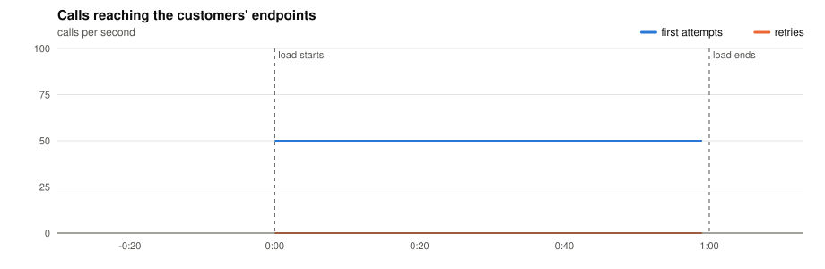
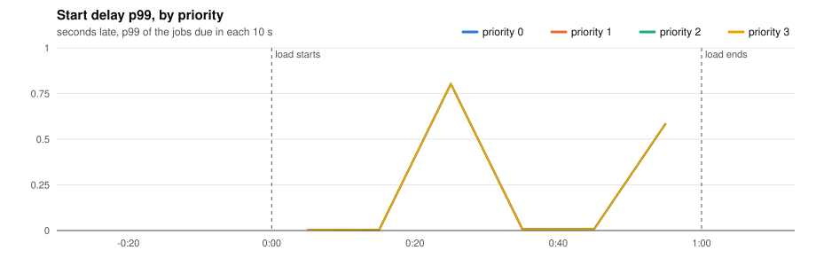
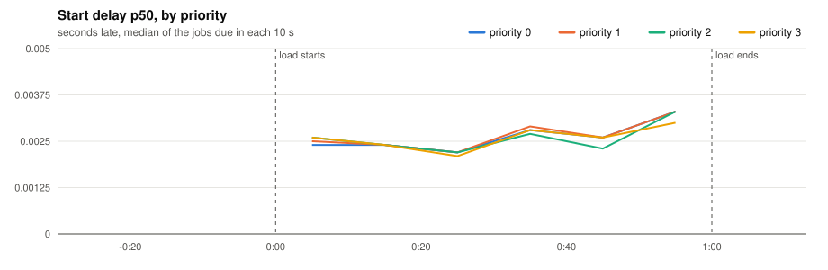
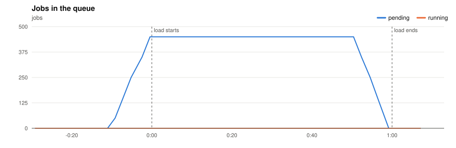
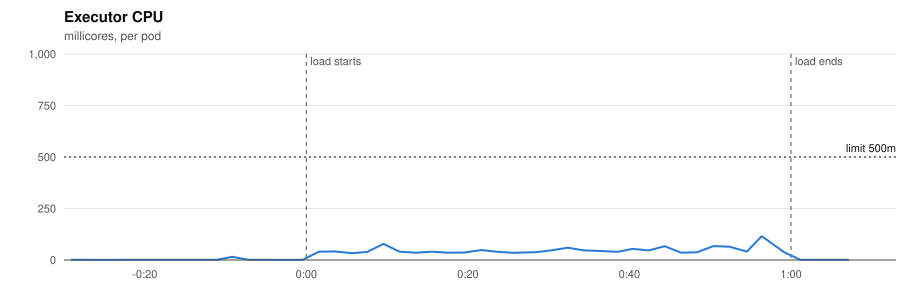
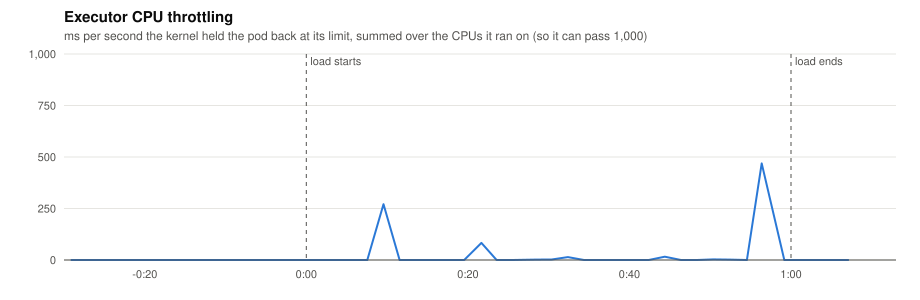
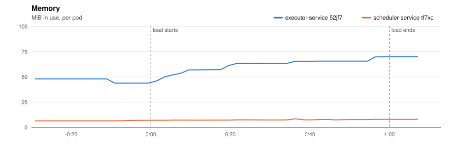
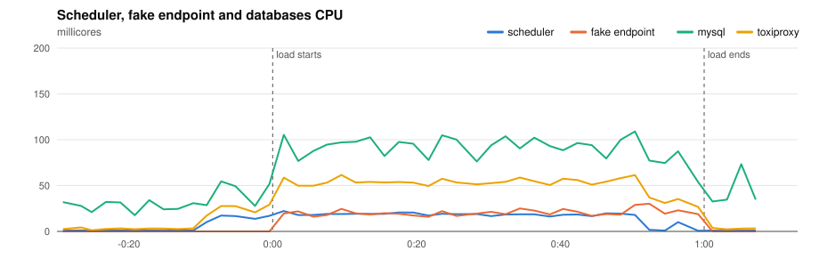
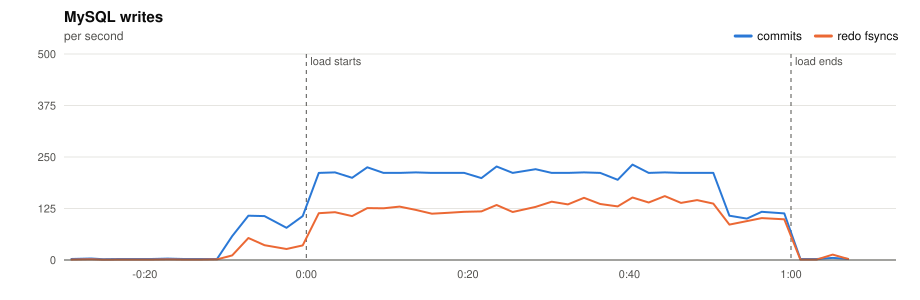
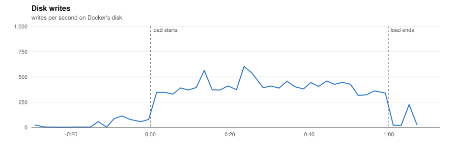

# P2 · 20261110T192413Z-1x-50 (1x-50)

- **Load:** 60 s of 50 one-off jobs per second, endpoint `lat=50&dist=lognormal`, timeout 30 s; 3,000 tasks seeded.
- **Deployment:** 1 executors; executor-service: `JOB_TIME_LIMIT_SECONDS=1 WORKER_COUNT=10000 JOB_QUEUE_SIZE=10000 PPROF_ADDR=:6060`; scheduler-service: `SCHEDULE_INTERVAL=1s SCHEDULE_LOOKAHEAD=10s PPROF_ADDR=:6060`
- **Raw data:** `bench/results/P2-capacity/runs/20261110T192413Z-1x-50/` (local, not committed)

## Jobs

| Created | Succeeded | Dead | Still pending or running | Retried | Duplicate successes | Timed out, done anyway | Calls per second (first attempts) |
|---|---|---|---|---|---|---|---|
| 3,000 | 3,000 | 0 | 0 | 0 | 0 | 0 | 50.8 |

*Duplicate successes*: the endpoint answered 200 twice for one job, which only a failure should cause. *Timed out, done anyway*: the executor gave up after the timeout while the endpoint finished the work, so the retry made the customer process the job again.

**Start delay** (when the call reached the endpoint minus when the job was due, first attempts):

| Priority | Jobs | p50 | p90 | p99 | max |
|---|---|---|---|---|---|
| 0 | 750 | 0.003 s | 0.006 s | 0.802 s | 0.803 s |
| 1 | 750 | 0.003 s | 0.005 s | 0.802 s | 0.803 s |
| 2 | 750 | 0.003 s | 0.005 s | 0.802 s | 0.803 s |
| 3 | 750 | 0.003 s | 0.005 s | 0.802 s | 0.803 s |
| all | 3,000 | 0.003 s | 0.005 s | 0.802 s | 0.803 s |

## Charts

Time is minutes:seconds from the start of the load.





















## Resources

| Component | CPU avg (millicores) | CPU max | Throttled max (ms/s) | Memory max (MiB) |
|---|---|---|---|---|
| executor-service 52jf7 | 23 | 115 | 469 | 70 |
| scheduler-service tf7xc | 9 | 22 | 0 | 8 |
| fake-endpoint bcdlv | 10 | 30 | 0 | 14 |
| mysql | 60 | 109 | 0 | 695 |
| cassandra | 92 | 287 | 0 | 816 |
| toxiproxy | 27 | 62 | 0 | 19 |

MySQL: up to 232 commits/s, 155 redo fsyncs/s, 0 row lock waits/s, 10 connections.

## CPU profile: executor, 20 s from 0:34

```text
      flat  flat%   sum%        cum   cum%
     360ms 52.17% 52.17%      360ms 52.17%  internal/runtime/syscall.Syscall6
     120ms 17.39% 69.57%      120ms 17.39%  runtime.futex
      20ms  2.90% 72.46%       20ms  2.90%  runtime.usleep
      10ms  1.45% 73.91%       20ms  2.90%  context.WithDeadlineCause.func3
      10ms  1.45% 75.36%       10ms  1.45%  internal/runtime/atomic.(*Uint8).Load
      10ms  1.45% 76.81%       10ms  1.45%  net.(*TCPConn).SyscallConn
      10ms  1.45% 78.26%       10ms  1.45%  net.sockaddrToTCP
      10ms  1.45% 79.71%       10ms  1.45%  net/http.(*transferWriter).writeHeader
      10ms  1.45% 81.16%       10ms  1.45%  runtime.(*fixalloc).alloc
      10ms  1.45% 82.61%       10ms  1.45%  runtime.(*mcentral).uncacheSpan
      10ms  1.45% 84.06%       10ms  1.45%  runtime.ifaceeq
      10ms  1.45% 85.51%       10ms  1.45%  runtime.lock2
```

## CPU profile: scheduler, 20 s from 0:34

```text
      flat  flat%   sum%        cum   cum%
      60ms 46.15% 46.15%       60ms 46.15%  internal/runtime/syscall.Syscall6
      30ms 23.08% 69.23%       30ms 23.08%  runtime.futex
      10ms  7.69% 76.92%       10ms  7.69%  runtime.(*limiterEvent).stop
      10ms  7.69% 84.62%       10ms  7.69%  runtime.acquirep
      10ms  7.69% 92.31%       10ms  7.69%  runtime.mPark
      10ms  7.69%   100%       10ms  7.69%  runtime.runqgrab
         0     0%   100%       80ms 61.54%  database/sql.(*DB).execDC
         0     0%   100%       30ms 23.08%  database/sql.(*DB).execDC.func3
         0     0%   100%       80ms 61.54%  database/sql.(*Tx).ExecContext
         0     0%   100%       10ms  7.69%  database/sql.(*driverStmt).Close
         0     0%   100%       30ms 23.08%  database/sql.ctxDriverPrepare
         0     0%   100%       40ms 30.77%  database/sql.ctxDriverStmtExec
```

## Conclusions

*(to be written)*
