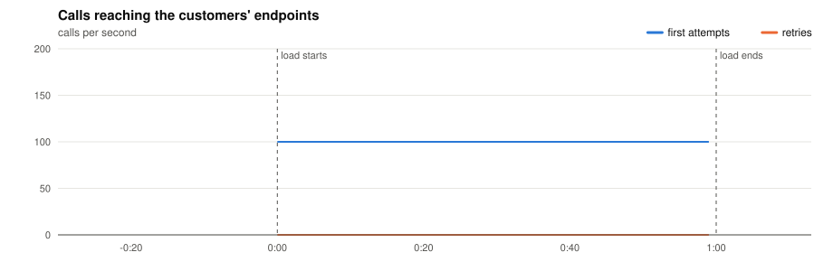
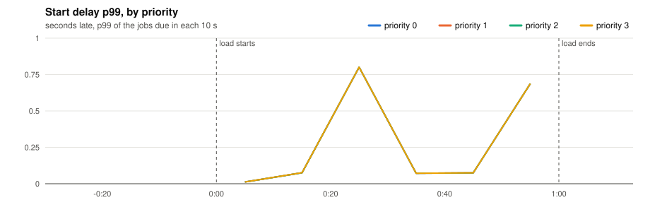
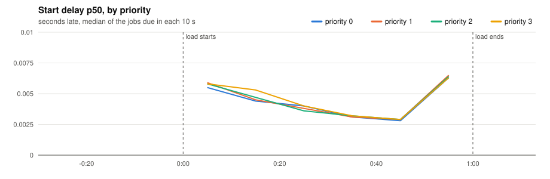
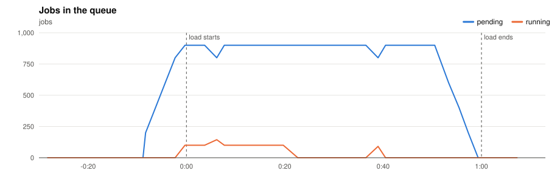
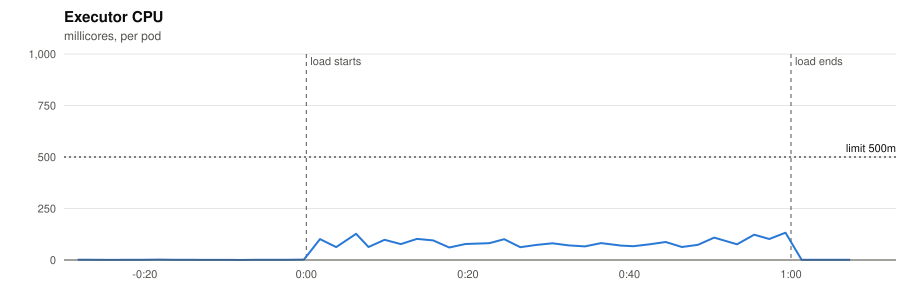
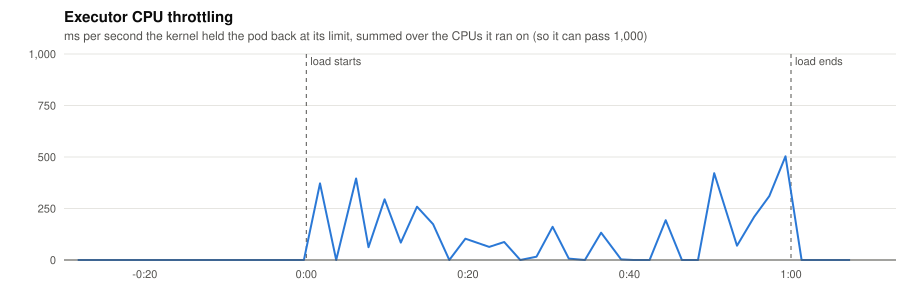
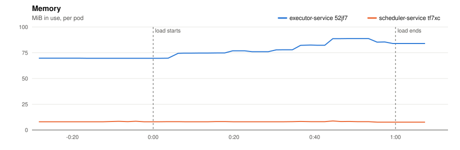
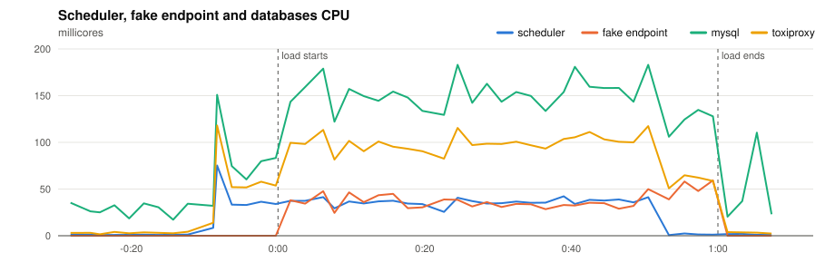
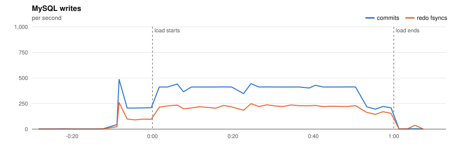
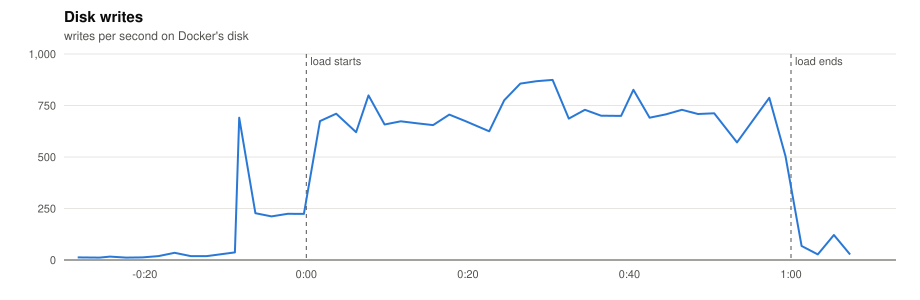

# P2 · 20261110T192623Z-1x-100 (1x-100)

- **Load:** 60 s of 100 one-off jobs per second, endpoint `lat=50&dist=lognormal`, timeout 30 s; 6,000 tasks seeded.
- **Deployment:** 1 executors; executor-service: `JOB_TIME_LIMIT_SECONDS=1 WORKER_COUNT=10000 JOB_QUEUE_SIZE=10000 PPROF_ADDR=:6060`; scheduler-service: `SCHEDULE_INTERVAL=1s SCHEDULE_LOOKAHEAD=10s PPROF_ADDR=:6060`
- **Raw data:** `bench/results/P2-capacity/runs/20261110T192623Z-1x-100/` (local, not committed)

## Jobs

| Created | Succeeded | Dead | Still pending or running | Retried | Duplicate successes | Timed out, done anyway | Calls per second (first attempts) |
|---|---|---|---|---|---|---|---|
| 6,000 | 6,000 | 0 | 0 | 0 | 0 | 0 | 101.7 |

*Duplicate successes*: the endpoint answered 200 twice for one job, which only a failure should cause. *Timed out, done anyway*: the executor gave up after the timeout while the endpoint finished the work, so the retry made the customer process the job again.

**Start delay** (when the call reached the endpoint minus when the job was due, first attempts):

| Priority | Jobs | p50 | p90 | p99 | max |
|---|---|---|---|---|---|
| 0 | 1,500 | 0.004 s | 0.008 s | 0.800 s | 0.801 s |
| 1 | 1,500 | 0.004 s | 0.008 s | 0.800 s | 0.801 s |
| 2 | 1,500 | 0.004 s | 0.008 s | 0.800 s | 0.801 s |
| 3 | 1,500 | 0.004 s | 0.008 s | 0.800 s | 0.800 s |
| all | 6,000 | 0.004 s | 0.008 s | 0.800 s | 0.801 s |

## Charts

Time is minutes:seconds from the start of the load.





















## Resources

| Component | CPU avg (millicores) | CPU max | Throttled max (ms/s) | Memory max (MiB) |
|---|---|---|---|---|
| executor-service 52jf7 | 40 | 132 | 503 | 89 |
| scheduler-service tf7xc | 19 | 75 | 0 | 9 |
| fake-endpoint bcdlv | 18 | 59 | 0 | 19 |
| mysql | 91 | 183 | 0 | 709 |
| cassandra | 90 | 400 | 0 | 818 |
| toxiproxy | 51 | 118 | 0 | 18 |

MySQL: up to 486 commits/s, 261 redo fsyncs/s, 0 row lock waits/s, 9 connections.

## CPU profile: executor, 20 s from 0:34

```text
      flat  flat%   sum%        cum   cum%
     0.28s 24.78% 24.78%      0.28s 24.78%  internal/runtime/syscall.Syscall6
     0.14s 12.39% 37.17%      0.14s 12.39%  runtime.futex
     0.03s  2.65% 39.82%      0.03s  2.65%  runtime.nextFreeFast
     0.03s  2.65% 42.48%      0.03s  2.65%  runtime.step
     0.02s  1.77% 44.25%      0.03s  2.65%  runtime.(*gList).pop (inline)
     0.02s  1.77% 46.02%      0.19s 16.81%  runtime.findRunnable
     0.02s  1.77% 47.79%      0.02s  1.77%  runtime.memclrNoHeapPointers
     0.02s  1.77% 49.56%      0.02s  1.77%  runtime.memmove
     0.02s  1.77% 51.33%      0.02s  1.77%  runtime.usleep
     0.02s  1.77% 53.10%      0.02s  1.77%  runtime.write1
     0.01s  0.88% 53.98%      0.01s  0.88%  database/sql.NullInt64.Value
     0.01s  0.88% 54.87%      0.01s  0.88%  database/sql.driverResult.RowsAffected
```

## CPU profile: scheduler, 20 s from 0:34

```text
      flat  flat%   sum%        cum   cum%
     100ms 30.30% 30.30%      100ms 30.30%  internal/runtime/syscall.Syscall6
      80ms 24.24% 54.55%       80ms 24.24%  runtime.futex
      10ms  3.03% 57.58%       30ms  9.09%  github.com/go-sql-driver/mysql.(*mysqlConn).Prepare
      10ms  3.03% 60.61%      110ms 33.33%  github.com/go-sql-driver/mysql.(*mysqlStmt).ExecContext
      10ms  3.03% 63.64%       50ms 15.15%  github.com/go-sql-driver/mysql.(*mysqlStmt).writeExecutePacket
      10ms  3.03% 66.67%       10ms  3.03%  internal/runtime/atomic.(*Bool).Load (inline)
      10ms  3.03% 69.70%       10ms  3.03%  runtime.(*mspan).writeHeapBitsSmall
      10ms  3.03% 72.73%       10ms  3.03%  runtime.(*timers).wakeTime
      10ms  3.03% 75.76%       10ms  3.03%  runtime.dropg
      10ms  3.03% 78.79%       10ms  3.03%  runtime.getcallerfp
      10ms  3.03% 81.82%       30ms  9.09%  runtime.mPark
      10ms  3.03% 84.85%       20ms  6.06%  runtime.mallocgc
```

## Conclusions

*(to be written)*
