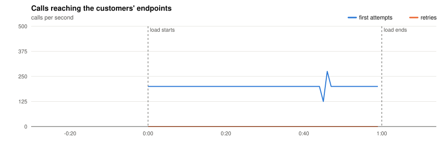
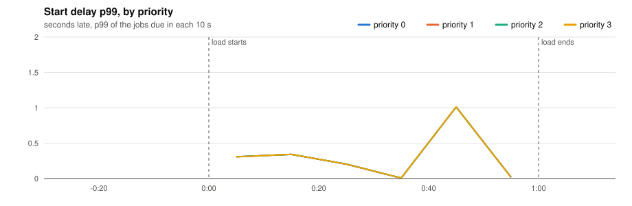
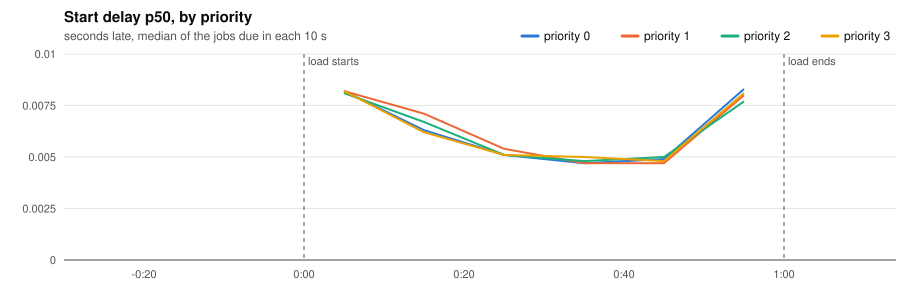
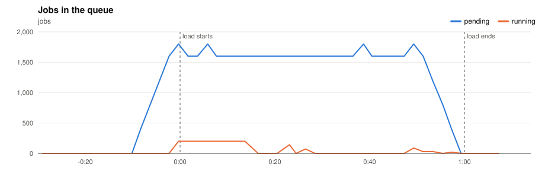
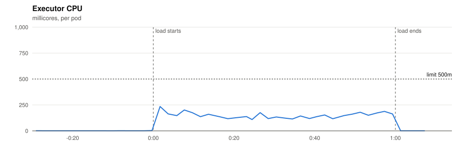
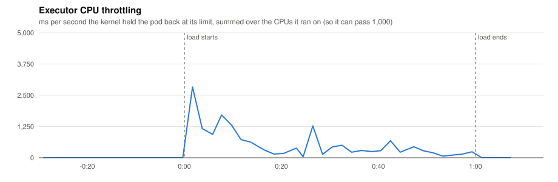
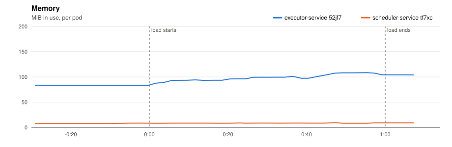
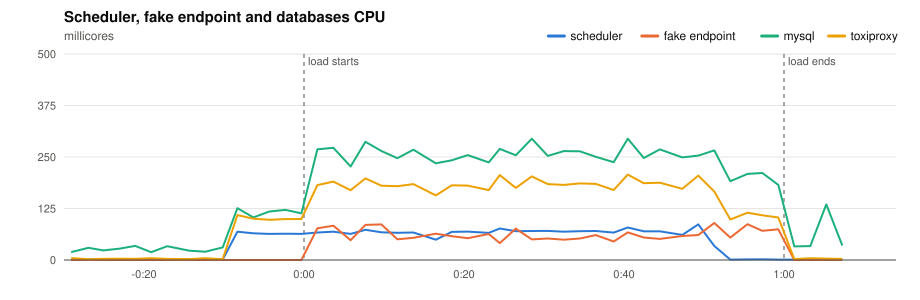
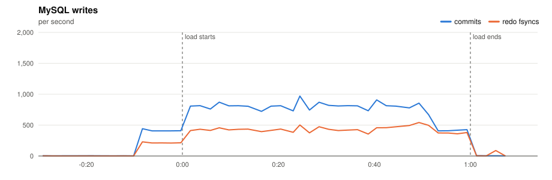
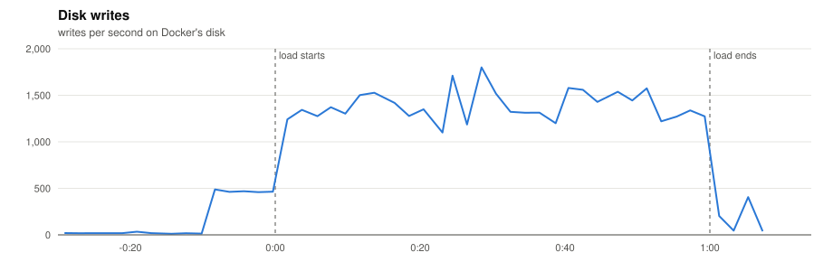

# P2 · 20261110T192832Z-1x-200 (1x-200)

- **Load:** 60 s of 200 one-off jobs per second, endpoint `lat=50&dist=lognormal`, timeout 30 s; 12,000 tasks seeded.
- **Deployment:** 1 executors; executor-service: `JOB_TIME_LIMIT_SECONDS=1 WORKER_COUNT=10000 JOB_QUEUE_SIZE=10000 PPROF_ADDR=:6060`; scheduler-service: `SCHEDULE_INTERVAL=1s SCHEDULE_LOOKAHEAD=10s PPROF_ADDR=:6060`
- **Raw data:** `bench/results/P2-capacity/runs/20261110T192832Z-1x-200/` (local, not committed)

## Jobs

| Created | Succeeded | Dead | Still pending or running | Retried | Duplicate successes | Timed out, done anyway | Calls per second (first attempts) |
|---|---|---|---|---|---|---|---|
| 12,000 | 12,000 | 0 | 0 | 0 | 0 | 0 | 203.4 |

*Duplicate successes*: the endpoint answered 200 twice for one job, which only a failure should cause. *Timed out, done anyway*: the executor gave up after the timeout while the endpoint finished the work, so the retry made the customer process the job again.

**Start delay** (when the call reached the endpoint minus when the job was due, first attempts):

| Priority | Jobs | p50 | p90 | p99 | max |
|---|---|---|---|---|---|
| 0 | 3,000 | 0.006 s | 0.103 s | 0.810 s | 1.012 s |
| 1 | 3,000 | 0.006 s | 0.104 s | 0.811 s | 1.012 s |
| 2 | 3,000 | 0.006 s | 0.103 s | 0.916 s | 1.012 s |
| 3 | 3,000 | 0.006 s | 0.104 s | 0.815 s | 1.012 s |
| all | 12,000 | 0.006 s | 0.104 s | 0.815 s | 1.012 s |

## Charts

Time is minutes:seconds from the start of the load.





















## Resources

| Component | CPU avg (millicores) | CPU max | Throttled max (ms/s) | Memory max (MiB) |
|---|---|---|---|---|
| executor-service 52jf7 | 71 | 235 | 2831 | 108 |
| scheduler-service tf7xc | 33 | 86 | 0 | 10 |
| fake-endpoint bcdlv | 29 | 90 | 0 | 35 |
| mysql | 142 | 294 | 0 | 738 |
| cassandra | 87 | 241 | 0 | 821 |
| toxiproxy | 90 | 207 | 0 | 19 |

MySQL: up to 970 commits/s, 542 redo fsyncs/s, 0 row lock waits/s, 9 connections.

## CPU profile: executor, 20 s from 0:35

```text
      flat  flat%   sum%        cum   cum%
     300ms 24.79% 24.79%      300ms 24.79%  internal/runtime/syscall.Syscall6
     210ms 17.36% 42.15%      210ms 17.36%  runtime.futex
      60ms  4.96% 47.11%       60ms  4.96%  runtime.(*lfstack).pop
      30ms  2.48% 49.59%       30ms  2.48%  internal/runtime/atomic.(*Uint32).CompareAndSwap (inline)
      30ms  2.48% 52.07%       40ms  3.31%  runtime.(*unwinder).resolveInternal
      20ms  1.65% 53.72%       20ms  1.65%  runtime.(*lfstack).push
      20ms  1.65% 55.37%       30ms  2.48%  runtime.execute
      20ms  1.65% 57.02%       30ms  2.48%  runtime.findObject
      20ms  1.65% 58.68%      200ms 16.53%  runtime.findRunnable
      20ms  1.65% 60.33%       20ms  1.65%  runtime.gopark
      20ms  1.65% 61.98%       20ms  1.65%  runtime.nanotime (inline)
      20ms  1.65% 63.64%       60ms  4.96%  runtime.selectgo
```

## CPU profile: scheduler, 20 s from 0:35

```text
      flat  flat%   sum%        cum   cum%
     240ms 41.38% 41.38%      240ms 41.38%  internal/runtime/syscall.Syscall6
     130ms 22.41% 63.79%      130ms 22.41%  runtime.futex
      20ms  3.45% 67.24%      100ms 17.24%  github.com/go-sql-driver/mysql.(*mysqlStmt).writeExecutePacket
      20ms  3.45% 70.69%      100ms 17.24%  runtime.startm
      20ms  3.45% 74.14%       20ms  3.45%  runtime.typedmemclr
      10ms  1.72% 75.86%       90ms 15.52%  database/sql.ctxDriverPrepare
      10ms  1.72% 77.59%       70ms 12.07%  github.com/go-sql-driver/mysql.(*mysqlConn).Prepare
      10ms  1.72% 79.31%       90ms 15.52%  github.com/go-sql-driver/mysql.(*mysqlConn).readPacket
      10ms  1.72% 81.03%       30ms  5.17%  github.com/go-sql-driver/mysql.(*mysqlStmt).readPrepareResultPacket
      10ms  1.72% 82.76%       10ms  1.72%  runtime.(*m).snapshotAllp
      10ms  1.72% 84.48%       10ms  1.72%  runtime.(*sweepLocked).sweep
      10ms  1.72% 86.21%       10ms  1.72%  runtime.acquireSudog
```

## Conclusions

*(to be written)*
