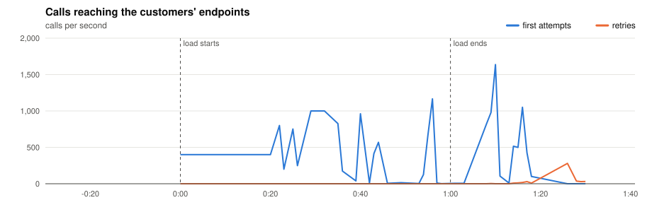
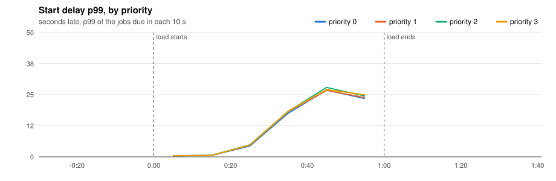
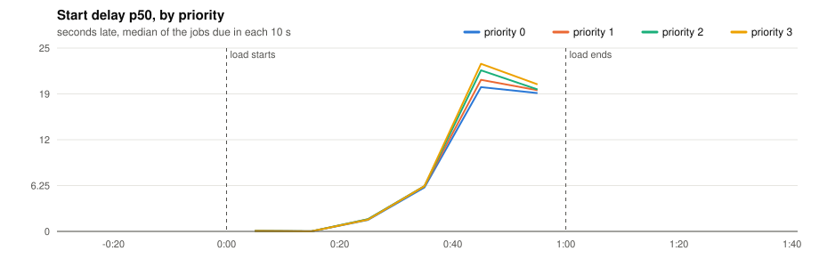
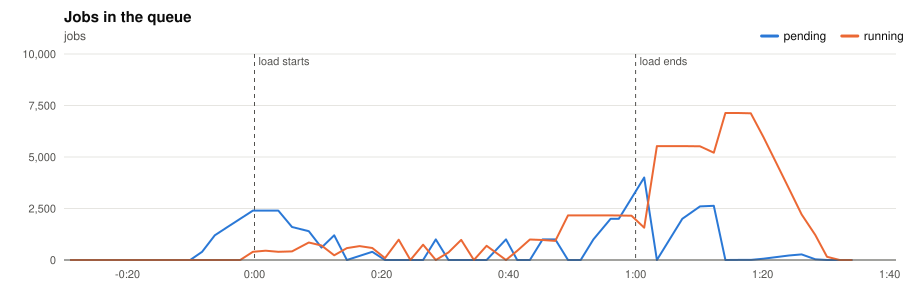
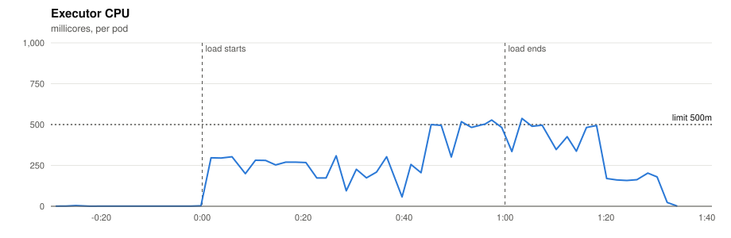
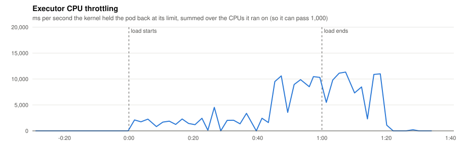
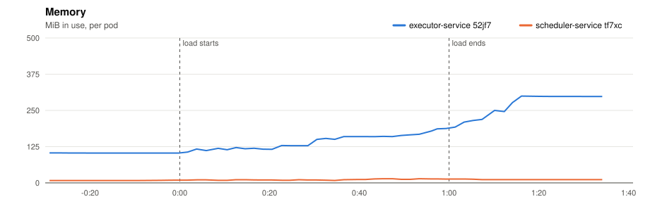
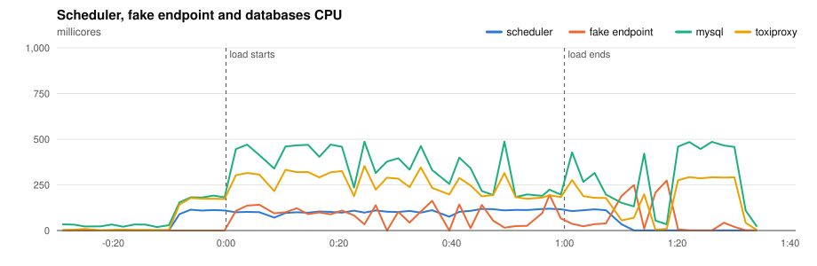
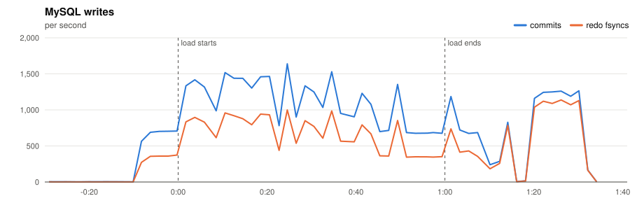
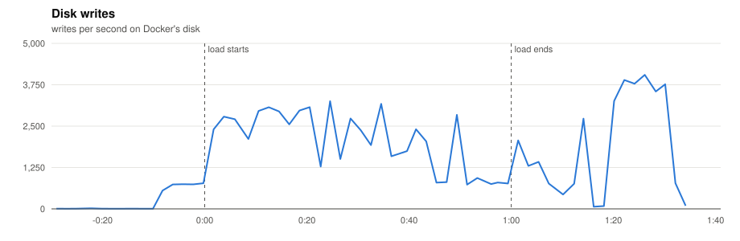

# P2 · 20261110T193042Z-1x-400 (1x-400)

- **Load:** 60 s of 400 one-off jobs per second, endpoint `lat=50&dist=lognormal`, timeout 30 s; 24,000 tasks seeded.
- **Deployment:** 1 executors; executor-service: `JOB_TIME_LIMIT_SECONDS=1 WORKER_COUNT=10000 JOB_QUEUE_SIZE=10000 PPROF_ADDR=:6060`; scheduler-service: `SCHEDULE_INTERVAL=1s SCHEDULE_LOOKAHEAD=10s PPROF_ADDR=:6060`
- **Raw data:** `bench/results/P2-capacity/runs/20261110T193042Z-1x-400/` (local, not committed)

## Jobs

| Created | Succeeded | Dead | Still pending or running | Retried | Duplicate successes | Timed out, done anyway | Calls per second (first attempts) |
|---|---|---|---|---|---|---|---|
| 24,000 | 24,000 | 0 | 0 | 455 | 0 | 0 | 300.9 |

*Duplicate successes*: the endpoint answered 200 twice for one job, which only a failure should cause. *Timed out, done anyway*: the executor gave up after the timeout while the endpoint finished the work, so the retry made the customer process the job again.

**Start delay** (when the call reached the endpoint minus when the job was due, first attempts):

| Priority | Jobs | p50 | p90 | p99 | max |
|---|---|---|---|---|---|
| 0 | 5,726 | 2.765 s | 20.653 s | 25.377 s | 27.854 s |
| 1 | 5,870 | 3.361 s | 21.153 s | 25.087 s | 27.256 s |
| 2 | 5,962 | 3.365 s | 22.049 s | 26.853 s | 27.950 s |
| 3 | 5,987 | 3.366 s | 22.749 s | 26.950 s | 27.952 s |
| all | 23,545 | 3.362 s | 21.851 s | 26.653 s | 27.952 s |

## Charts

Time is minutes:seconds from the start of the load.





















## Resources

| Component | CPU avg (millicores) | CPU max | Throttled max (ms/s) | Memory max (MiB) |
|---|---|---|---|---|
| executor-service 52jf7 | 183 | 538 | 11344 | 300 |
| scheduler-service tf7xc | 54 | 119 | 0 | 14 |
| fake-endpoint bcdlv | 49 | 273 | 0 | 93 |
| mysql | 224 | 487 | 0 | 801 |
| cassandra | 93 | 268 | 0 | 803 |
| toxiproxy | 152 | 353 | 0 | 19 |

MySQL: up to 1639 commits/s, 1138 redo fsyncs/s, 1 row lock waits/s, 10 connections.

## CPU profile: executor, 20 s from 0:35

```text
      flat  flat%   sum%        cum   cum%
     3.68s 84.79% 84.79%      3.68s 84.79%  internal/runtime/syscall.Syscall6
     0.08s  1.84% 86.64%      0.08s  1.84%  runtime.futex
     0.04s  0.92% 87.56%      0.04s  0.92%  runtime.step
     0.02s  0.46% 88.02%      0.09s  2.07%  runtime.newobject
     0.02s  0.46% 88.48%      0.03s  0.69%  runtime.scanblock
     0.01s  0.23% 88.71%      0.03s  0.69%  internal/poll.(*FD).Init
     0.01s  0.23% 88.94%      3.43s 79.03%  net.(*netFD).connect
     0.01s  0.23% 89.17%      3.56s 82.03%  net/http.(*Transport).dialConn
     0.01s  0.23% 89.40%      0.03s  0.69%  runtime.(*stkframe).getStackMap
     0.01s  0.23% 89.63%      0.03s  0.69%  runtime.adjustframe
     0.01s  0.23% 89.86%      0.10s  2.30%  runtime.findRunnable
     0.01s  0.23% 90.09%      0.06s  1.38%  runtime.injectglist
```

## CPU profile: scheduler, 20 s from 0:35

```text
      flat  flat%   sum%        cum   cum%
     0.44s 36.36% 36.36%      0.44s 36.36%  internal/runtime/syscall.Syscall6
     0.38s 31.40% 67.77%      0.38s 31.40%  runtime.futex
     0.02s  1.65% 69.42%      0.19s 15.70%  runtime.findRunnable
     0.02s  1.65% 71.07%      0.02s  1.65%  runtime.gopark
     0.02s  1.65% 72.73%      0.02s  1.65%  runtime.memclrNoHeapPointers
     0.02s  1.65% 74.38%      0.02s  1.65%  runtime.nanotime (inline)
     0.02s  1.65% 76.03%      0.02s  1.65%  runtime.nextFreeFast
     0.02s  1.65% 77.69%      0.02s  1.65%  runtime.releaseSudog
     0.02s  1.65% 79.34%      0.16s 13.22%  runtime.selectgo
     0.02s  1.65% 80.99%      0.04s  3.31%  runtime.stealWork
     0.01s  0.83% 81.82%      0.18s 14.88%  database/sql.withLock
     0.01s  0.83% 82.64%      0.41s 33.88%  github.com/go-sql-driver/mysql.(*mysqlConn).writePacket
```

## Conclusions

*(to be written)*
