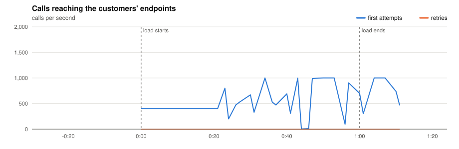
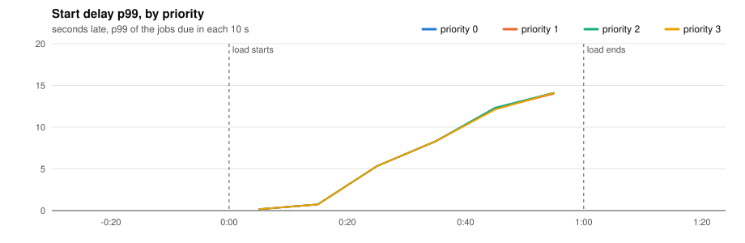
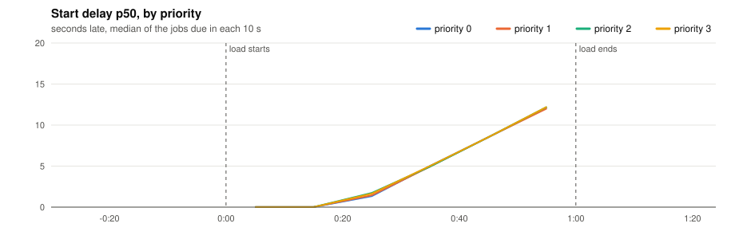
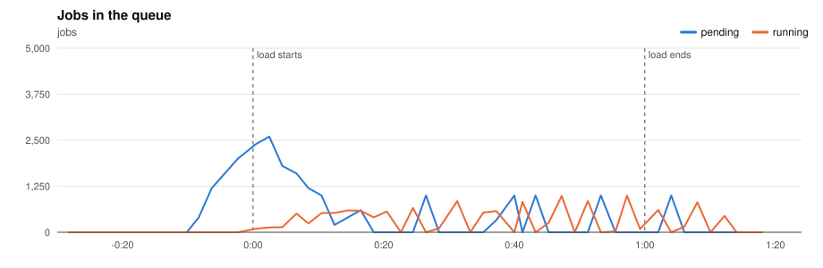
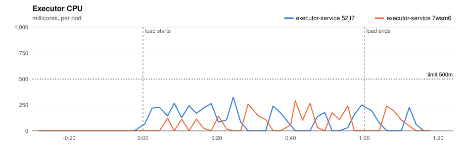
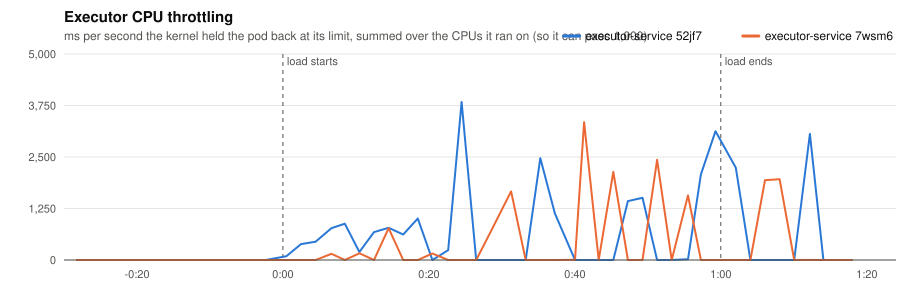
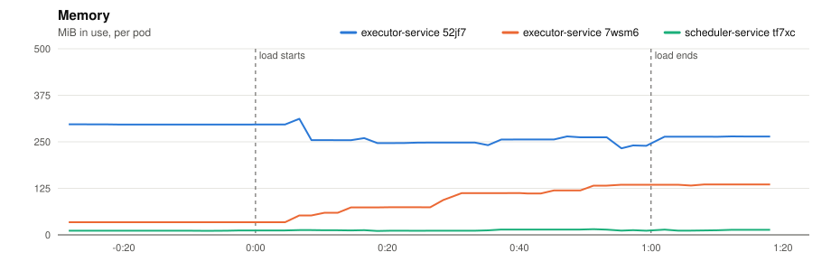
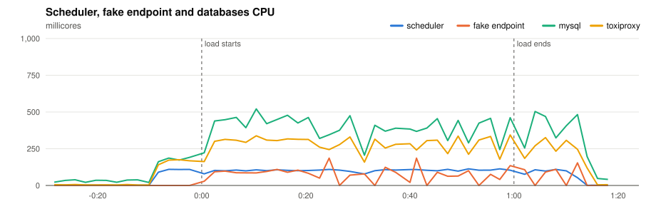
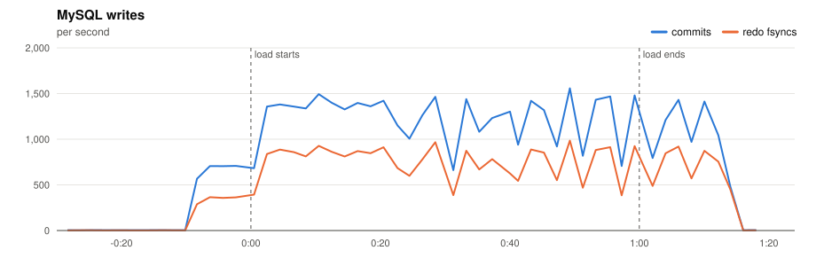
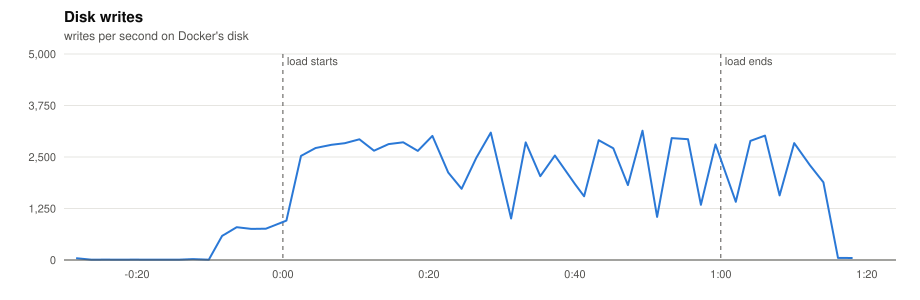

# P2 · 20261110T193326Z-2x-400 (2x-400)

- **Load:** 60 s of 400 one-off jobs per second, endpoint `lat=50&dist=lognormal`, timeout 30 s; 24,000 tasks seeded.
- **Deployment:** 2 executors; executor-service: `JOB_TIME_LIMIT_SECONDS=1 WORKER_COUNT=10000 JOB_QUEUE_SIZE=10000 PPROF_ADDR=:6060`; scheduler-service: `SCHEDULE_INTERVAL=1s SCHEDULE_LOOKAHEAD=10s PPROF_ADDR=:6060`
- **Raw data:** `bench/results/P2-capacity/runs/20261110T193326Z-2x-400/` (local, not committed)

## Jobs

| Created | Succeeded | Dead | Still pending or running | Retried | Duplicate successes | Timed out, done anyway | Calls per second (first attempts) |
|---|---|---|---|---|---|---|---|
| 24,000 | 24,000 | 0 | 0 | 0 | 0 | 0 | 336.5 |

*Duplicate successes*: the endpoint answered 200 twice for one job, which only a failure should cause. *Timed out, done anyway*: the executor gave up after the timeout while the endpoint finished the work, so the retry made the customer process the job again.

**Start delay** (when the call reached the endpoint minus when the job was due, first attempts):

| Priority | Jobs | p50 | p90 | p99 | max |
|---|---|---|---|---|---|
| 0 | 6,000 | 3.516 s | 11.724 s | 13.919 s | 14.218 s |
| 1 | 6,000 | 3.334 s | 11.724 s | 13.920 s | 14.218 s |
| 2 | 6,000 | 3.335 s | 11.722 s | 13.921 s | 14.219 s |
| 3 | 6,000 | 3.430 s | 11.820 s | 13.921 s | 14.219 s |
| all | 24,000 | 3.516 s | 11.731 s | 13.920 s | 14.219 s |

## Charts

Time is minutes:seconds from the start of the load.





















## Resources

| Component | CPU avg (millicores) | CPU max | Throttled max (ms/s) | Memory max (MiB) |
|---|---|---|---|---|
| executor-service 52jf7 | 65 | 325 | 3835 | 312 |
| executor-service 7wsm6 | 44 | 292 | 3344 | 136 |
| scheduler-service tf7xc | 61 | 113 | 0 | 15 |
| fake-endpoint bcdlv | 42 | 186 | 0 | 114 |
| mysql | 241 | 521 | 0 | 838 |
| cassandra | 90 | 274 | 0 | 801 |
| toxiproxy | 163 | 344 | 0 | 23 |

MySQL: up to 1557 commits/s, 984 redo fsyncs/s, 1 row lock waits/s, 14 connections.

## CPU profile: executor, 20 s from 0:35

```text
      flat  flat%   sum%        cum   cum%
     300ms 46.15% 46.15%      300ms 46.15%  internal/runtime/syscall.Syscall6
      70ms 10.77% 56.92%       70ms 10.77%  runtime.futex
      20ms  3.08% 60.00%       20ms  3.08%  internal/runtime/atomic.(*Uint32).CompareAndSwap
      20ms  3.08% 63.08%       50ms  7.69%  runtime.mallocgcSmallNoscan
      20ms  3.08% 66.15%       20ms  3.08%  runtime.memclrNoHeapPointers
      20ms  3.08% 69.23%       20ms  3.08%  runtime.pcvalue
      10ms  1.54% 70.77%       10ms  1.54%  database/sql.(*connRequestSet).deleteIndex
      10ms  1.54% 72.31%       50ms  7.69%  github.com/go-sql-driver/mysql.(*mysqlStmt).writeExecutePacket
      10ms  1.54% 73.85%       20ms  3.08%  internal/poll.(*FD).readLock
      10ms  1.54% 75.38%       10ms  1.54%  internal/poll.(*fdMutex).rwlock
      10ms  1.54% 76.92%       10ms  1.54%  internal/poll.runtime_pollSetDeadline
      10ms  1.54% 78.46%      150ms 23.08%  net.(*conn).Write
```

## CPU profile: scheduler, 20 s from 0:35

```text
      flat  flat%   sum%        cum   cum%
     0.47s 40.17% 40.17%      0.47s 40.17%  internal/runtime/syscall.Syscall6
     0.37s 31.62% 71.79%      0.37s 31.62%  runtime.futex
     0.02s  1.71% 73.50%      0.22s 18.80%  runtime.findRunnable
     0.02s  1.71% 75.21%      0.05s  4.27%  runtime.futexsleep
     0.02s  1.71% 76.92%      0.02s  1.71%  runtime.nextFreeFast (inline)
     0.02s  1.71% 78.63%      0.02s  1.71%  runtime.stealWork
     0.01s  0.85% 79.49%      0.06s  5.13%  database/sql.(*DB).execDC.func2
     0.01s  0.85% 80.34%      0.07s  5.98%  github.com/go-sql-driver/mysql.(*mysqlConn).readWithTimeout
     0.01s  0.85% 81.20%      0.39s 33.33%  github.com/go-sql-driver/mysql.(*mysqlConn).writePacket
     0.01s  0.85% 82.05%      0.29s 24.79%  github.com/go-sql-driver/mysql.(*mysqlStmt).Exec
     0.01s  0.85% 82.91%      0.22s 18.80%  github.com/go-sql-driver/mysql.(*mysqlStmt).writeExecutePacket
     0.01s  0.85% 83.76%      0.04s  3.42%  github.com/go-sql-driver/mysql.(*okHandler).readResultSetHeaderPacket
```

## Conclusions

*(to be written)*
