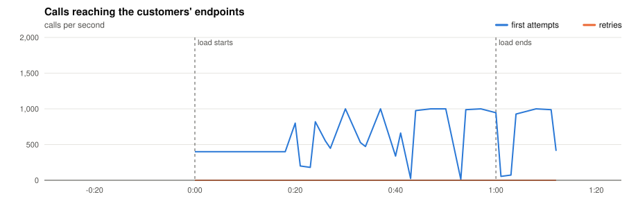
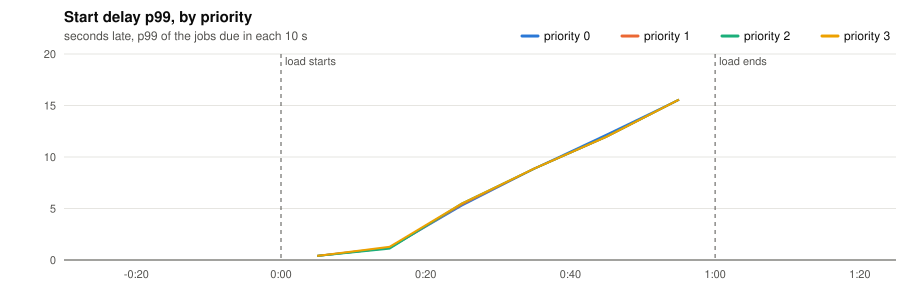
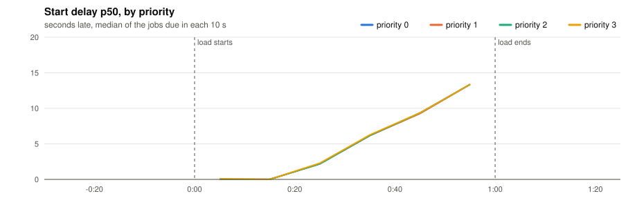
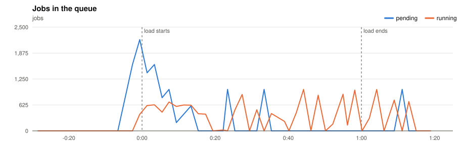
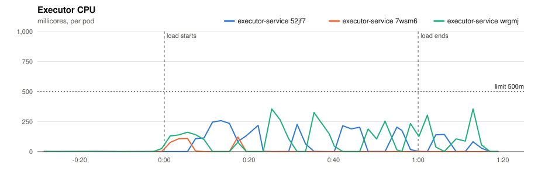
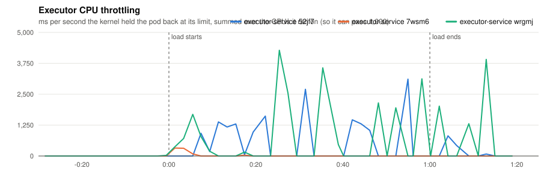
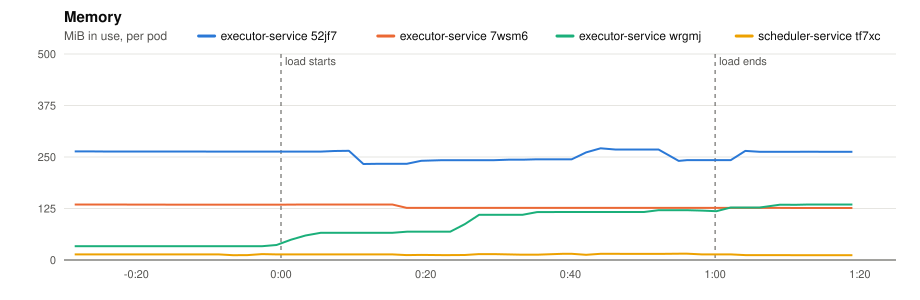
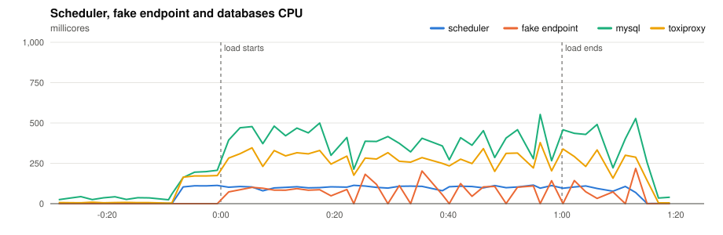
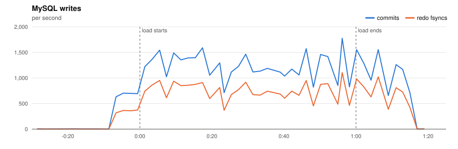
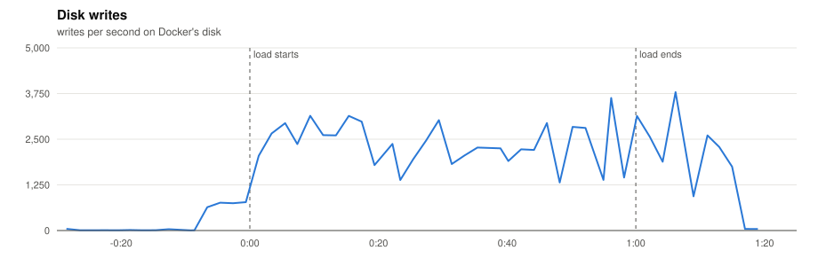

# P2 · 20261110T193552Z-3x-400 (3x-400)

- **Load:** 60 s of 400 one-off jobs per second, endpoint `lat=50&dist=lognormal`, timeout 30 s; 24,000 tasks seeded.
- **Deployment:** 3 executors; executor-service: `JOB_TIME_LIMIT_SECONDS=1 WORKER_COUNT=10000 JOB_QUEUE_SIZE=10000 PPROF_ADDR=:6060`; scheduler-service: `SCHEDULE_INTERVAL=1s SCHEDULE_LOOKAHEAD=10s PPROF_ADDR=:6060`
- **Raw data:** `bench/results/P2-capacity/runs/20261110T193552Z-3x-400/` (local, not committed)

## Jobs

| Created | Succeeded | Dead | Still pending or running | Retried | Duplicate successes | Timed out, done anyway | Calls per second (first attempts) |
|---|---|---|---|---|---|---|---|
| 24,000 | 24,000 | 0 | 0 | 0 | 0 | 0 | 330.3 |

*Duplicate successes*: the endpoint answered 200 twice for one job, which only a failure should cause. *Timed out, done anyway*: the executor gave up after the timeout while the endpoint finished the work, so the retry made the customer process the job again.

**Start delay** (when the call reached the endpoint minus when the job was due, first attempts):

| Priority | Jobs | p50 | p90 | p99 | max |
|---|---|---|---|---|---|
| 0 | 6,000 | 4.285 s | 12.473 s | 14.668 s | 15.668 s |
| 1 | 6,000 | 4.284 s | 12.473 s | 14.668 s | 15.671 s |
| 2 | 6,000 | 4.287 s | 12.474 s | 14.670 s | 15.667 s |
| 3 | 6,000 | 4.181 s | 12.475 s | 14.576 s | 16.073 s |
| all | 24,000 | 4.284 s | 12.475 s | 14.668 s | 16.073 s |

## Charts

Time is minutes:seconds from the start of the load.





















## Resources

| Component | CPU avg (millicores) | CPU max | Throttled max (ms/s) | Memory max (MiB) |
|---|---|---|---|---|
| executor-service 52jf7 | 46 | 258 | 3110 | 271 |
| executor-service 7wsm6 | 7 | 122 | 324 | 135 |
| executor-service wrgmj | 58 | 356 | 4277 | 135 |
| scheduler-service tf7xc | 60 | 115 | 0 | 15 |
| fake-endpoint bcdlv | 42 | 218 | 0 | 120 |
| mysql | 240 | 553 | 0 | 870 |
| cassandra | 89 | 289 | 0 | 798 |
| toxiproxy | 162 | 379 | 0 | 24 |

MySQL: up to 1775 commits/s, 1105 redo fsyncs/s, 0 row lock waits/s, 20 connections.

## CPU profile: executor, 20 s from 0:35

```text
      flat  flat%   sum%        cum   cum%
     0.50s 48.54% 48.54%      0.50s 48.54%  internal/runtime/syscall.Syscall6
     0.09s  8.74% 57.28%      0.09s  8.74%  runtime.futex
     0.02s  1.94% 59.22%      0.02s  1.94%  runtime.acquireSudog
     0.02s  1.94% 61.17%      0.02s  1.94%  runtime.findObject
     0.02s  1.94% 63.11%      0.05s  4.85%  runtime.pcvalue
     0.02s  1.94% 65.05%      0.02s  1.94%  runtime.runqgrab
     0.02s  1.94% 66.99%      0.03s  2.91%  runtime.scanblock
     0.02s  1.94% 68.93%      0.05s  4.85%  runtime.scanobject
     0.02s  1.94% 70.87%      0.02s  1.94%  runtime.step
     0.01s  0.97% 71.84%      0.02s  1.94%  context.value
     0.01s  0.97% 72.82%      0.23s 22.33%  database/sql.(*DB).execDC
     0.01s  0.97% 73.79%      0.01s  0.97%  database/sql.convertAssignRows
```

## CPU profile: scheduler, 20 s from 0:35

```text
      flat  flat%   sum%        cum   cum%
     0.37s 33.94% 33.94%      0.37s 33.94%  runtime.futex
     0.36s 33.03% 66.97%      0.36s 33.03%  internal/runtime/syscall.Syscall6
     0.02s  1.83% 68.81%      0.03s  2.75%  runtime.sellock
     0.02s  1.83% 70.64%      0.03s  2.75%  runtime.stealWork
     0.01s  0.92% 71.56%      0.29s 26.61%  database/sql.ctxDriverStmtExec
     0.01s  0.92% 72.48%      0.26s 23.85%  database/sql.withLock
     0.01s  0.92% 73.39%      0.04s  3.67%  github.com/go-sql-driver/mysql.(*mysqlConn).ExecContext
     0.01s  0.92% 74.31%      0.21s 19.27%  github.com/go-sql-driver/mysql.(*mysqlConn).PrepareContext
     0.01s  0.92% 75.23%      0.14s 12.84%  github.com/go-sql-driver/mysql.(*mysqlConn).readNext
     0.01s  0.92% 76.15%      0.34s 31.19%  github.com/go-sql-driver/mysql.(*mysqlConn).writeWithTimeout
     0.01s  0.92% 77.06%      0.17s 15.60%  github.com/go-sql-driver/mysql.(*mysqlStmt).writeExecutePacket
     0.01s  0.92% 77.98%      0.01s  0.92%  github.com/go-sql-driver/mysql.callValuerValue
```

## Conclusions

*(to be written)*
