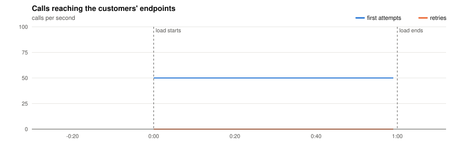
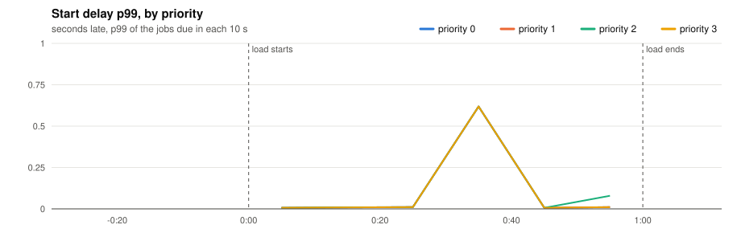
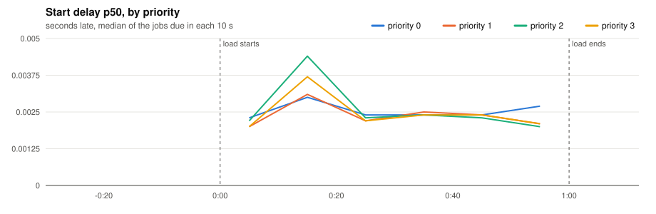
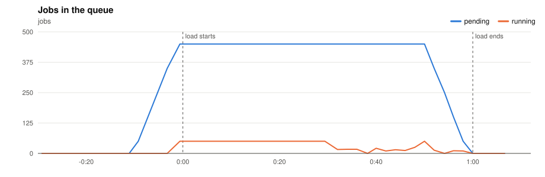
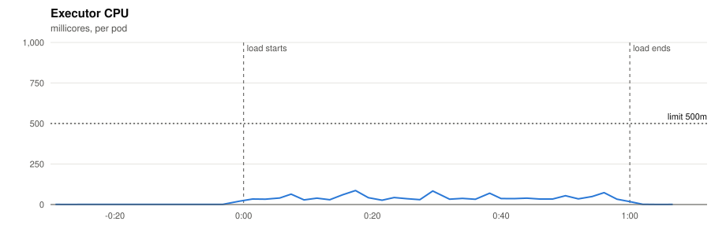
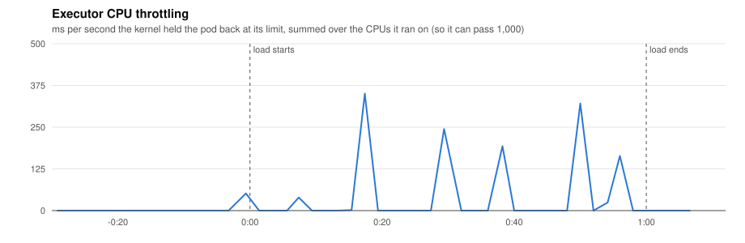
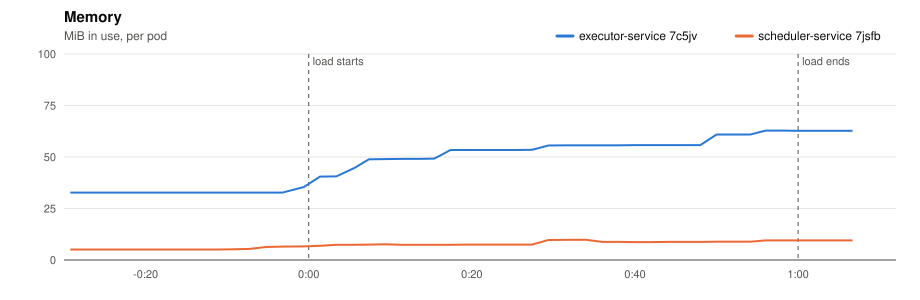
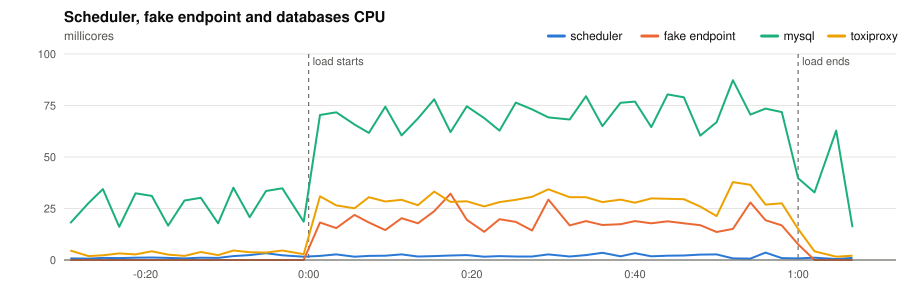
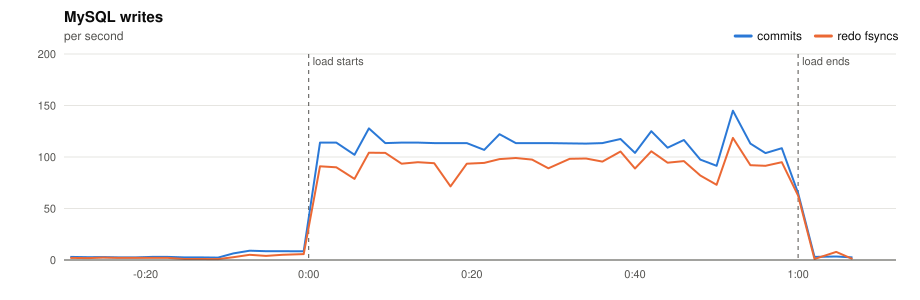
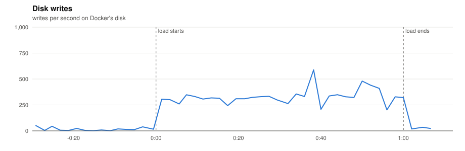

# P2 · 20261119T202410Z-r2-1x-50 (r2-1x-50)

- **Load:** 60 s of 50 one-off jobs per second, endpoint `lat=50&dist=lognormal`, timeout 30 s; 3,000 tasks seeded.
- **Deployment:** 1 executors; executor-service: `JOB_TIME_LIMIT_SECONDS=1 WORKER_COUNT=10000 JOB_QUEUE_SIZE=10000 PPROF_ADDR=:6060`; scheduler-service: `SCHEDULE_INTERVAL=1s SCHEDULE_LOOKAHEAD=10s PPROF_ADDR=:6060`
- **Raw data:** `bench/results/P2-capacity/runs/20261119T202410Z-r2-1x-50/` (local, not committed)

## Jobs

| Created | Succeeded | Dead | Still pending or running | Retried | Duplicate successes | Timed out, done anyway | Calls per second (first attempts) |
|---|---|---|---|---|---|---|---|
| 3,000 | 3,000 | 0 | 0 | 0 | 0 | 0 | 50.8 |

*Duplicate successes*: the endpoint answered 200 twice for one job, which only a failure should cause. *Timed out, done anyway*: the executor gave up after the timeout while the endpoint finished the work, so the retry made the customer process the job again.

**Start delay** (when the call reached the endpoint minus when the job was due, first attempts):

| Priority | Jobs | p50 | p90 | p99 | max |
|---|---|---|---|---|---|
| 0 | 750 | 0.003 s | 0.006 s | 0.618 s | 0.619 s |
| 1 | 750 | 0.002 s | 0.006 s | 0.618 s | 0.619 s |
| 2 | 750 | 0.002 s | 0.006 s | 0.618 s | 0.619 s |
| 3 | 750 | 0.002 s | 0.006 s | 0.618 s | 0.619 s |
| all | 3,000 | 0.002 s | 0.006 s | 0.618 s | 0.619 s |

## Charts

Time is minutes:seconds from the start of the load.





















## Resources

| Component | CPU avg (millicores) | CPU max | Throttled max (ms/s) | Memory max (MiB) |
|---|---|---|---|---|
| executor-service 7c5jv | 22 | 86 | 350 | 63 |
| scheduler-service 7jsfb | 2 | 4 | 0 | 10 |
| fake-endpoint cf55t | 9 | 32 | 0 | 13 |
| mysql | 48 | 87 | 0 | 840 |
| cassandra | 102 | 289 | 0 | 1072 |
| toxiproxy | 16 | 38 | 0 | 14 |

MySQL: up to 145 commits/s, 118 redo fsyncs/s, 0 row lock waits/s, 11 connections.

## CPU profile: executor, 20 s from 0:34

```text
      flat  flat%   sum%        cum   cum%
     140ms 27.45% 27.45%      140ms 27.45%  internal/runtime/syscall.Syscall6
      80ms 15.69% 43.14%       80ms 15.69%  runtime.futex
      50ms  9.80% 52.94%       50ms  9.80%  runtime.findObject
      40ms  7.84% 60.78%       40ms  7.84%  runtime.(*lfstack).pop
      30ms  5.88% 66.67%      100ms 19.61%  runtime.scanobject
      20ms  3.92% 70.59%       30ms  5.88%  runtime.greyobject
      10ms  1.96% 72.55%       10ms  1.96%  github.com/go-sql-driver/mysql.callValuerValue
      10ms  1.96% 74.51%       10ms  1.96%  internal/runtime/atomic.(*Uint32).CompareAndSwap
      10ms  1.96% 76.47%       10ms  1.96%  runtime.(*lfstack).push
      10ms  1.96% 78.43%       10ms  1.96%  runtime.(*stkframe).getStackMap
      10ms  1.96% 80.39%       10ms  1.96%  runtime.binarySearchTree
      10ms  1.96% 82.35%       10ms  1.96%  runtime.checkTimersNoP
```

## CPU profile: scheduler, 20 s from 0:34

```text
      flat  flat%   sum%        cum   cum%
```
