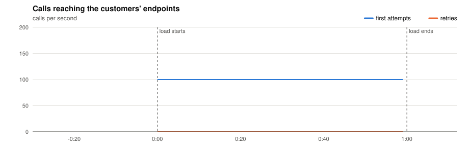
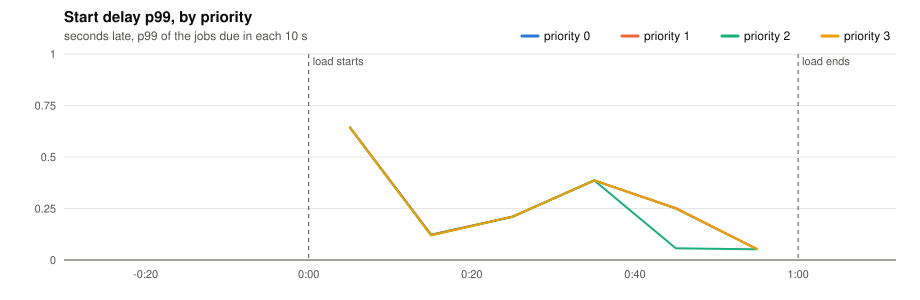
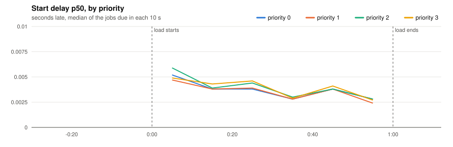
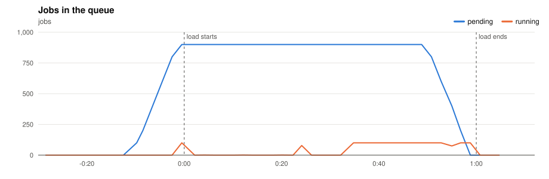
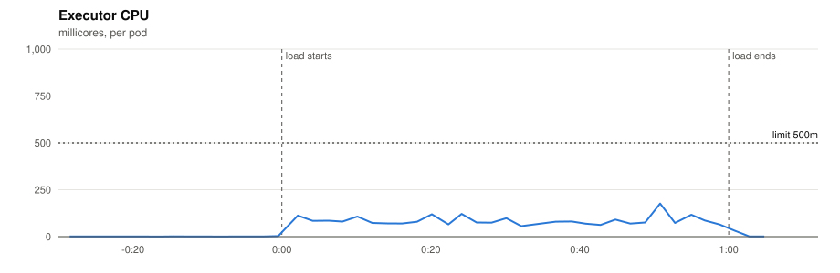
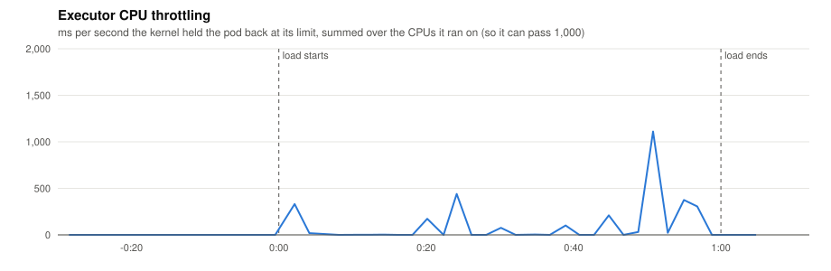
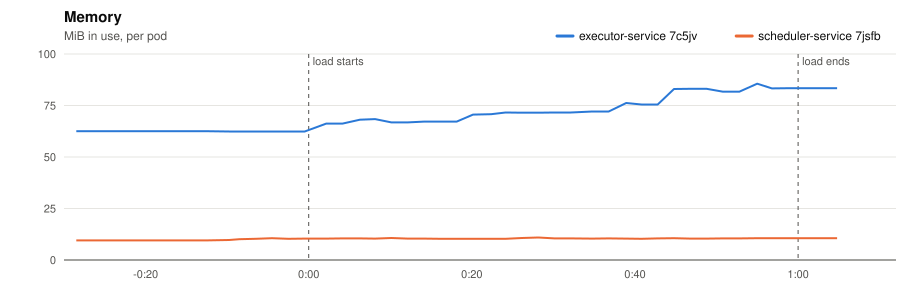
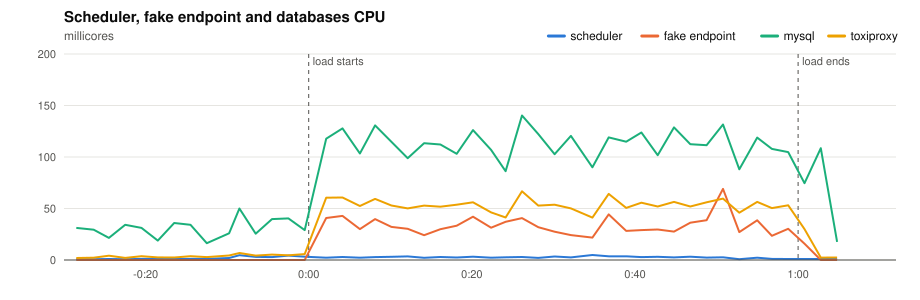
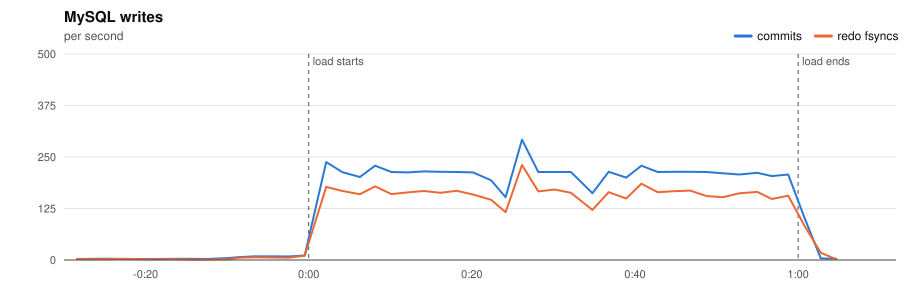
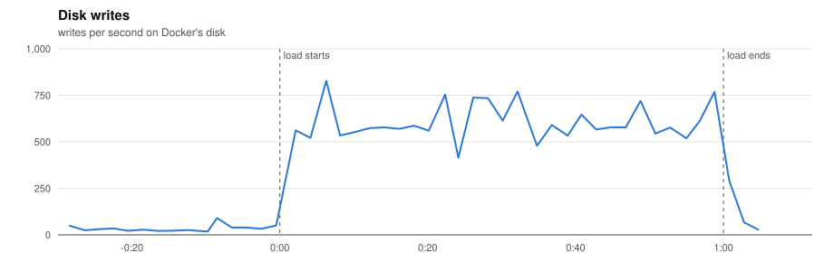

# P2 · 20261119T202620Z-r2-1x-100 (r2-1x-100)

- **Load:** 60 s of 100 one-off jobs per second, endpoint `lat=50&dist=lognormal`, timeout 30 s; 6,000 tasks seeded.
- **Deployment:** 1 executors; executor-service: `JOB_TIME_LIMIT_SECONDS=1 WORKER_COUNT=10000 JOB_QUEUE_SIZE=10000 PPROF_ADDR=:6060`; scheduler-service: `SCHEDULE_INTERVAL=1s SCHEDULE_LOOKAHEAD=10s PPROF_ADDR=:6060`
- **Raw data:** `bench/results/P2-capacity/runs/20261119T202620Z-r2-1x-100/` (local, not committed)

## Jobs

| Created | Succeeded | Dead | Still pending or running | Retried | Duplicate successes | Timed out, done anyway | Calls per second (first attempts) |
|---|---|---|---|---|---|---|---|
| 6,000 | 6,000 | 0 | 0 | 0 | 0 | 0 | 101.7 |

*Duplicate successes*: the endpoint answered 200 twice for one job, which only a failure should cause. *Timed out, done anyway*: the executor gave up after the timeout while the endpoint finished the work, so the retry made the customer process the job again.

**Start delay** (when the call reached the endpoint minus when the job was due, first attempts):

| Priority | Jobs | p50 | p90 | p99 | max |
|---|---|---|---|---|---|
| 0 | 1,500 | 0.003 s | 0.009 s | 0.643 s | 0.646 s |
| 1 | 1,500 | 0.004 s | 0.009 s | 0.643 s | 0.646 s |
| 2 | 1,500 | 0.004 s | 0.010 s | 0.643 s | 0.646 s |
| 3 | 1,500 | 0.004 s | 0.011 s | 0.643 s | 0.646 s |
| all | 6,000 | 0.004 s | 0.010 s | 0.643 s | 0.646 s |

## Charts

Time is minutes:seconds from the start of the load.





















## Resources

| Component | CPU avg (millicores) | CPU max | Throttled max (ms/s) | Memory max (MiB) |
|---|---|---|---|---|
| executor-service 7c5jv | 42 | 176 | 1110 | 86 |
| scheduler-service 7jsfb | 2 | 5 | 0 | 11 |
| fake-endpoint cf55t | 16 | 69 | 0 | 20 |
| mysql | 71 | 140 | 0 | 855 |
| cassandra | 101 | 296 | 0 | 1060 |
| toxiproxy | 28 | 67 | 0 | 16 |

MySQL: up to 292 commits/s, 230 redo fsyncs/s, 0 row lock waits/s, 11 connections.

## CPU profile: executor, 20 s from 0:34

```text
      flat  flat%   sum%        cum   cum%
     140ms 24.56% 24.56%      140ms 24.56%  internal/runtime/syscall.Syscall6
      80ms 14.04% 38.60%       80ms 14.04%  runtime.futex
      30ms  5.26% 43.86%       40ms  7.02%  runtime.stealWork
      20ms  3.51% 47.37%       20ms  3.51%  runtime.(*lfstack).pop
      20ms  3.51% 50.88%      200ms 35.09%  runtime.findRunnable
      20ms  3.51% 54.39%       20ms  3.51%  runtime.nanotime (inline)
      10ms  1.75% 56.14%       10ms  1.75%  database/sql.driverArgsConnLocked
      10ms  1.75% 57.89%       40ms  7.02%  database/sql.resultFromStatement
      10ms  1.75% 59.65%       10ms  1.75%  internal/bytealg.IndexByte
      10ms  1.75% 61.40%       10ms  1.75%  internal/runtime/maps.(*Iter).Next
      10ms  1.75% 63.16%       10ms  1.75%  internal/runtime/maps.rand
      10ms  1.75% 64.91%       50ms  8.77%  internal/runtime/syscall.EpollWait
```

## CPU profile: scheduler, 20 s from 0:34

```text
      flat  flat%   sum%        cum   cum%
      10ms   100%   100%       10ms   100%  runtime.futex
         0     0%   100%       10ms   100%  github.com/JoelTeoGom/distributed-scheduler/scheduler-service/internal/service.(*SchedulerService).Start
         0     0%   100%       10ms   100%  main.main.func2
         0     0%   100%       10ms   100%  runtime.(*timer).maybeAdd
         0     0%   100%       10ms   100%  runtime.blockTimerChan
         0     0%   100%       10ms   100%  runtime.futexwakeup
         0     0%   100%       10ms   100%  runtime.notewakeup
         0     0%   100%       10ms   100%  runtime.selectgo
         0     0%   100%       10ms   100%  runtime.startm
         0     0%   100%       10ms   100%  runtime.wakeNetPoller
         0     0%   100%       10ms   100%  runtime.wakep
```
