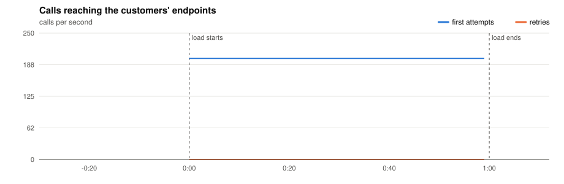
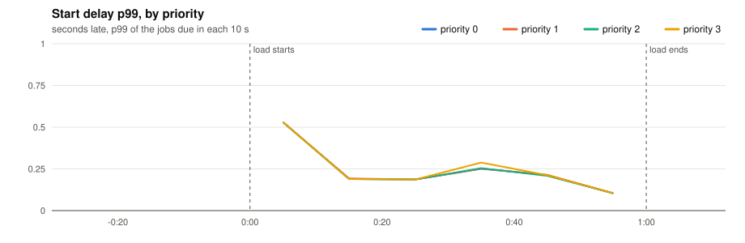
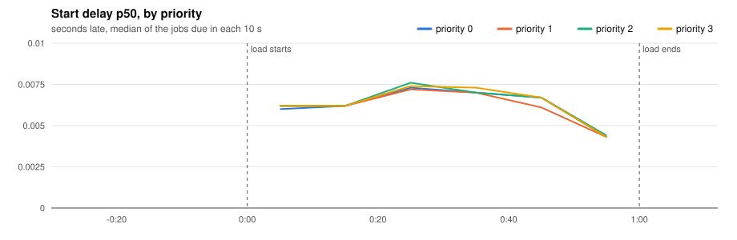
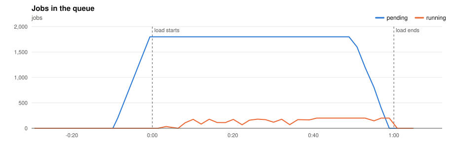
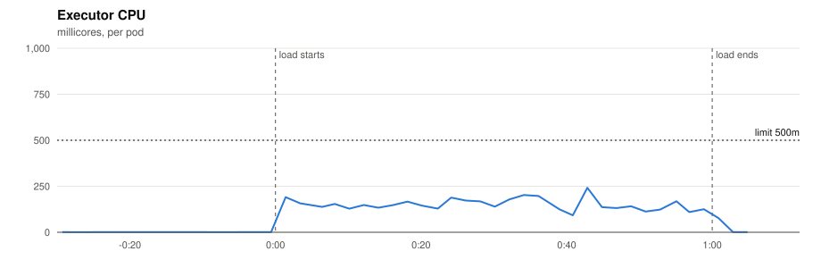
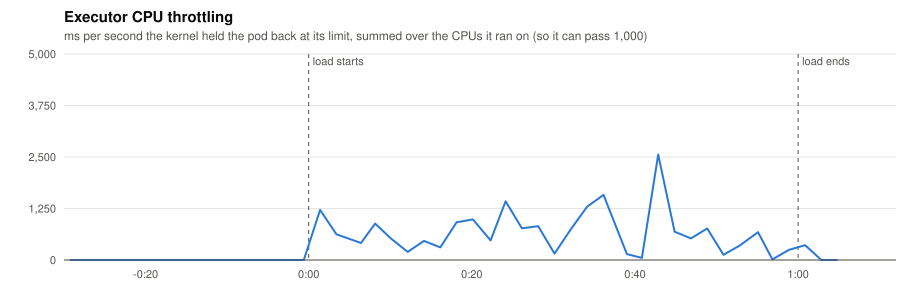
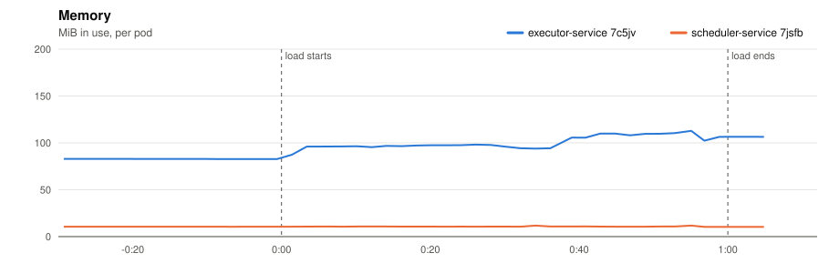
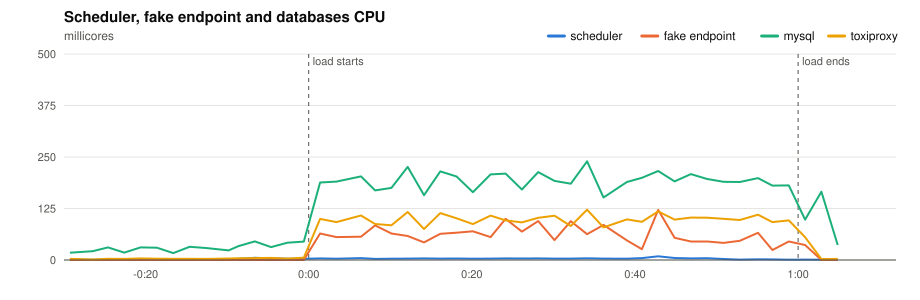
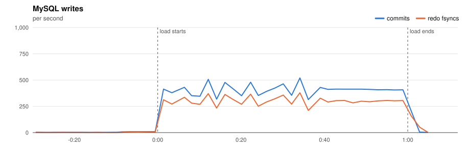
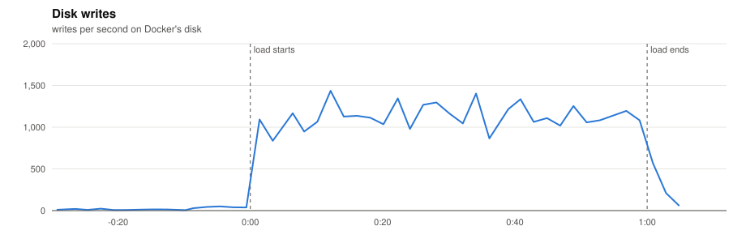

# P2 · 20261119T202828Z-r2-1x-200 (r2-1x-200)

- **Load:** 60 s of 200 one-off jobs per second, endpoint `lat=50&dist=lognormal`, timeout 30 s; 12,000 tasks seeded.
- **Deployment:** 1 executors; executor-service: `JOB_TIME_LIMIT_SECONDS=1 WORKER_COUNT=10000 JOB_QUEUE_SIZE=10000 PPROF_ADDR=:6060`; scheduler-service: `SCHEDULE_INTERVAL=1s SCHEDULE_LOOKAHEAD=10s PPROF_ADDR=:6060`
- **Raw data:** `bench/results/P2-capacity/runs/20261119T202828Z-r2-1x-200/` (local, not committed)

## Jobs

| Created | Succeeded | Dead | Still pending or running | Retried | Duplicate successes | Timed out, done anyway | Calls per second (first attempts) |
|---|---|---|---|---|---|---|---|
| 12,000 | 12,000 | 0 | 0 | 0 | 0 | 0 | 203.3 |

*Duplicate successes*: the endpoint answered 200 twice for one job, which only a failure should cause. *Timed out, done anyway*: the executor gave up after the timeout while the endpoint finished the work, so the retry made the customer process the job again.

**Start delay** (when the call reached the endpoint minus when the job was due, first attempts):

| Priority | Jobs | p50 | p90 | p99 | max |
|---|---|---|---|---|---|
| 0 | 3,000 | 0.006 s | 0.104 s | 0.529 s | 0.530 s |
| 1 | 3,000 | 0.006 s | 0.105 s | 0.530 s | 0.530 s |
| 2 | 3,000 | 0.007 s | 0.106 s | 0.529 s | 0.531 s |
| 3 | 3,000 | 0.007 s | 0.105 s | 0.529 s | 0.531 s |
| all | 12,000 | 0.007 s | 0.105 s | 0.529 s | 0.531 s |

## Charts

Time is minutes:seconds from the start of the load.





















## Resources

| Component | CPU avg (millicores) | CPU max | Throttled max (ms/s) | Memory max (MiB) |
|---|---|---|---|---|
| executor-service 7c5jv | 74 | 242 | 2558 | 113 |
| scheduler-service 7jsfb | 2 | 9 | 0 | 12 |
| fake-endpoint cf55t | 30 | 122 | 0 | 30 |
| mysql | 110 | 240 | 0 | 895 |
| cassandra | 103 | 376 | 0 | 1064 |
| toxiproxy | 49 | 122 | 0 | 16 |

MySQL: up to 520 commits/s, 379 redo fsyncs/s, 0 row lock waits/s, 11 connections.

## CPU profile: executor, 20 s from 0:33

```text
      flat  flat%   sum%        cum   cum%
     510ms 35.66% 35.66%      510ms 35.66%  internal/runtime/syscall.Syscall6
     200ms 13.99% 49.65%      200ms 13.99%  runtime.futex
      50ms  3.50% 53.15%       50ms  3.50%  runtime.(*lfstack).pop (inline)
      40ms  2.80% 55.94%       40ms  2.80%  runtime.(*unwinder).resolveInternal
      30ms  2.10% 58.04%       60ms  4.20%  runtime.(*stkframe).getStackMap
      30ms  2.10% 60.14%       80ms  5.59%  runtime.selectgo
      20ms  1.40% 61.54%       20ms  1.40%  runtime.findfunc
      20ms  1.40% 62.94%       20ms  1.40%  runtime.memmove
      20ms  1.40% 64.34%       60ms  4.20%  runtime.newobject
      20ms  1.40% 65.73%       20ms  1.40%  runtime.nextFreeFast
      20ms  1.40% 67.13%       20ms  1.40%  runtime.step
      20ms  1.40% 68.53%       20ms  1.40%  runtime.unlock2
```

## CPU profile: scheduler, 20 s from 0:33

```text
      flat  flat%   sum%        cum   cum%
      10ms 50.00% 50.00%       10ms 50.00%  internal/runtime/syscall.Syscall6
      10ms 50.00%   100%       10ms 50.00%  runtime.selectgo
         0     0%   100%       20ms   100%  database/sql.(*DB).execDC
         0     0%   100%       10ms 50.00%  database/sql.(*DB).execDC.func3
         0     0%   100%       20ms   100%  database/sql.(*Tx).ExecContext
         0     0%   100%       10ms 50.00%  database/sql.(*driverStmt).Close
         0     0%   100%       10ms 50.00%  database/sql.ctxDriverPrepare
         0     0%   100%       10ms 50.00%  database/sql.withLock
         0     0%   100%       20ms   100%  github.com/JoelTeoGom/distributed-scheduler/scheduler-service/internal/adapters/out/mysql.(*SchedulerRepository).ScheduleJobs
         0     0%   100%       10ms 50.00%  github.com/JoelTeoGom/distributed-scheduler/scheduler-service/internal/adapters/out/mysql.insertJobs
         0     0%   100%       10ms 50.00%  github.com/JoelTeoGom/distributed-scheduler/scheduler-service/internal/adapters/out/mysql.updateNextRuns
         0     0%   100%       20ms   100%  github.com/JoelTeoGom/distributed-scheduler/scheduler-service/internal/service.(*SchedulerService).Start
```
