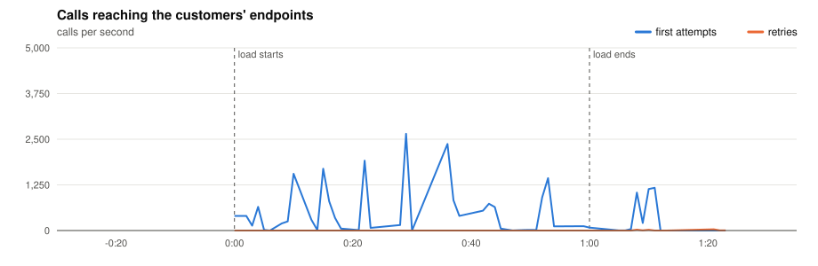
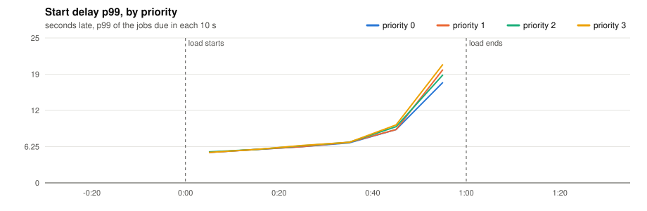
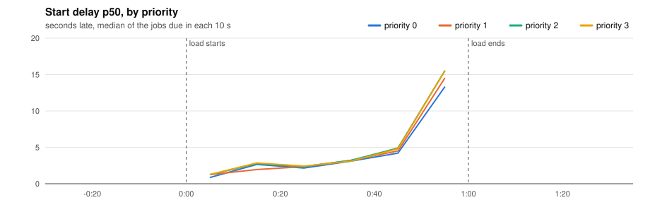
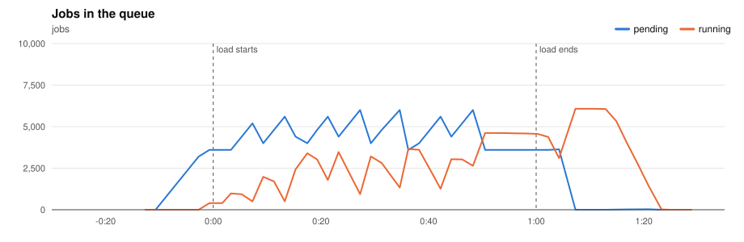
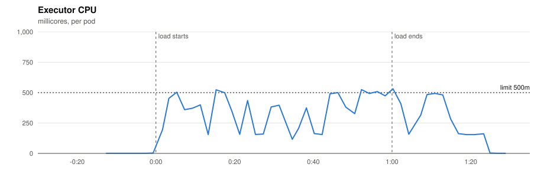
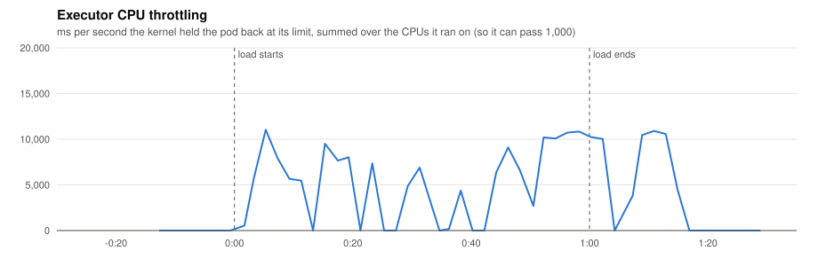
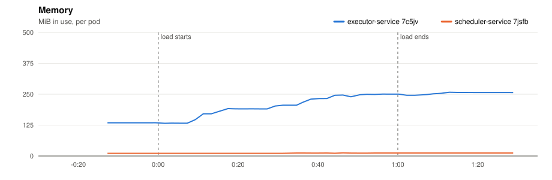
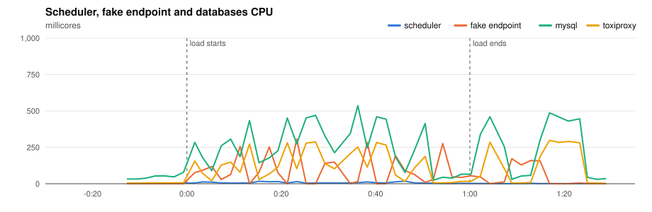
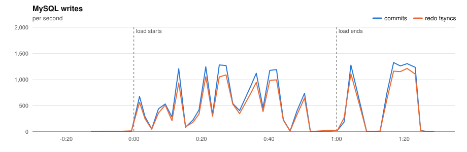
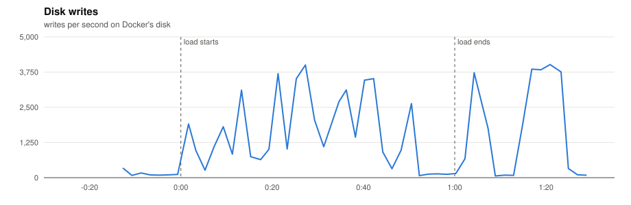

# P2 · 20261119T203217Z-r2-1x-400 (r2-1x-400)

- **Load:** 60 s of 400 one-off jobs per second, endpoint `lat=50&dist=lognormal`, timeout 30 s; 24,000 tasks seeded.
- **Deployment:** 1 executors; executor-service: `JOB_TIME_LIMIT_SECONDS=1 WORKER_COUNT=10000 JOB_QUEUE_SIZE=10000 PPROF_ADDR=:6060`; scheduler-service: `SCHEDULE_INTERVAL=1s SCHEDULE_LOOKAHEAD=10s PPROF_ADDR=:6060`
- **Raw data:** `bench/results/P2-capacity/runs/20261119T203217Z-r2-1x-400/` (local, not committed)

## Jobs

| Created | Succeeded | Dead | Still pending or running | Retried | Duplicate successes | Timed out, done anyway | Calls per second (first attempts) |
|---|---|---|---|---|---|---|---|
| 24,000 | 24,000 | 0 | 0 | 96 | 0 | 0 | 327.3 |

*Duplicate successes*: the endpoint answered 200 twice for one job, which only a failure should cause. *Timed out, done anyway*: the executor gave up after the timeout while the endpoint finished the work, so the retry made the customer process the job again.

**Start delay** (when the call reached the endpoint minus when the job was due, first attempts):

| Priority | Jobs | p50 | p90 | p99 | max |
|---|---|---|---|---|---|
| 0 | 5,951 | 3.155 s | 12.647 s | 17.147 s | 19.541 s |
| 1 | 5,973 | 3.350 s | 13.540 s | 18.748 s | 20.345 s |
| 2 | 5,984 | 3.599 s | 14.648 s | 18.449 s | 19.646 s |
| 3 | 5,996 | 3.649 s | 15.345 s | 20.241 s | 20.545 s |
| all | 23,904 | 3.458 s | 13.846 s | 19.345 s | 20.545 s |

## Charts

Time is minutes:seconds from the start of the load.





















## Resources

| Component | CPU avg (millicores) | CPU max | Throttled max (ms/s) | Memory max (MiB) |
|---|---|---|---|---|
| executor-service 7c5jv | 275 | 532 | 11038 | 258 |
| scheduler-service 7jsfb | 5 | 18 | 0 | 13 |
| fake-endpoint cf55t | 67 | 307 | 0 | 118 |
| mysql | 224 | 537 | 0 | 983 |
| cassandra | 99 | 315 | 0 | 1084 |
| toxiproxy | 111 | 298 | 0 | 17 |

MySQL: up to 1326 commits/s, 1213 redo fsyncs/s, 1 row lock waits/s, 9 connections.

## CPU profile: executor, 20 s from 0:33

```text
      flat  flat%   sum%        cum   cum%
     2.62s 67.01% 67.01%      2.62s 67.01%  internal/runtime/syscall.Syscall6
     0.25s  6.39% 73.40%      0.25s  6.39%  runtime.futex
     0.08s  2.05% 75.45%      0.08s  2.05%  runtime.findObject
     0.06s  1.53% 76.98%      0.06s  1.53%  internal/runtime/atomic.(*Uint32).CompareAndSwap
     0.04s  1.02% 78.01%      0.04s  1.02%  runtime.nextFreeFast (inline)
     0.03s  0.77% 78.77%      0.05s  1.28%  net/http.Header.writeSubset
     0.03s  0.77% 79.54%      0.07s  1.79%  runtime.(*unwinder).resolveInternal
     0.03s  0.77% 80.31%      0.03s  0.77%  runtime.asyncPreempt
     0.03s  0.77% 81.07%      0.23s  5.88%  runtime.mallocgc
     0.03s  0.77% 81.84%      0.06s  1.53%  runtime.pcvalue
     0.03s  0.77% 82.61%      0.10s  2.56%  runtime.selectgo
     0.02s  0.51% 83.12%      0.02s  0.51%  math/rand/v2.(*Rand).uint64n
```

## CPU profile: scheduler, 20 s from 0:33

```text
      flat  flat%   sum%        cum   cum%
      10ms 11.11% 11.11%       10ms 11.11%  database/sql.(*Rows).close
      10ms 11.11% 22.22%       10ms 11.11%  gcWriteBarrier
      10ms 11.11% 33.33%       10ms 11.11%  runtime.(*mspan).base (inline)
      10ms 11.11% 44.44%       10ms 11.11%  runtime.futex
      10ms 11.11% 55.56%       10ms 11.11%  runtime.gopark
      10ms 11.11% 66.67%       10ms 11.11%  runtime.nextFreeFast
      10ms 11.11% 77.78%       20ms 22.22%  runtime.scanobject
      10ms 11.11% 88.89%       10ms 11.11%  runtime.stealWork
      10ms 11.11%   100%       10ms 11.11%  runtime.typePointers.next
         0     0%   100%       20ms 22.22%  database/sql.(*DB).execDC
         0     0%   100%       20ms 22.22%  database/sql.(*DB).execDC.func2
         0     0%   100%       10ms 11.11%  database/sql.(*Rows).Close
```
