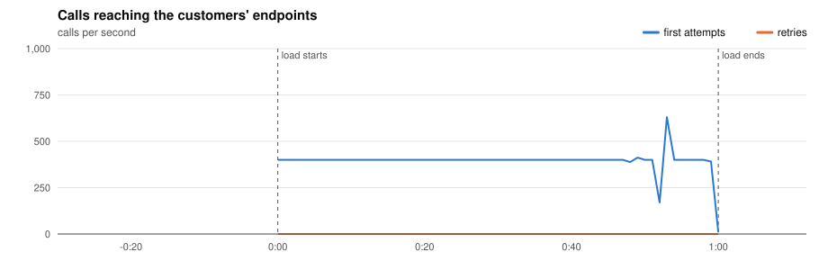
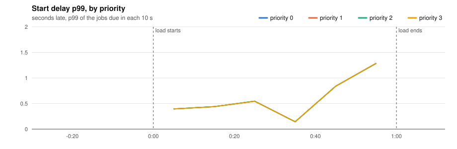
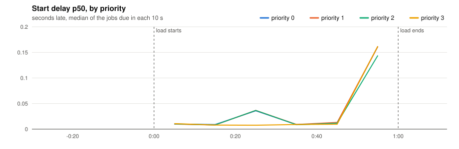
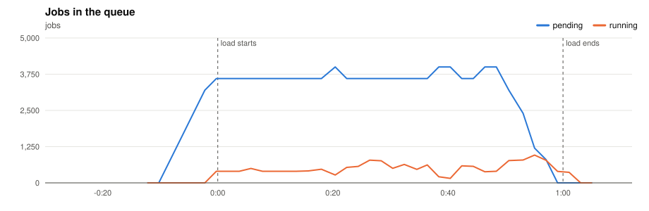
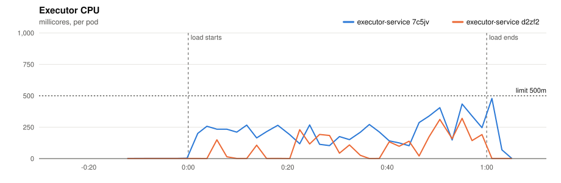
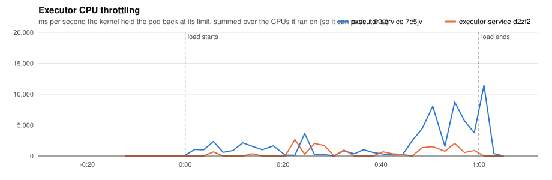
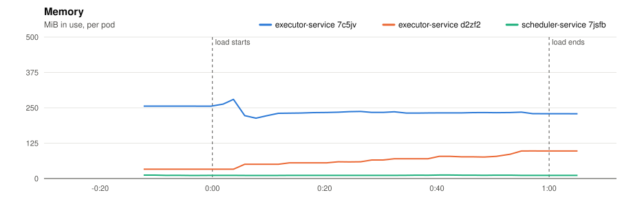
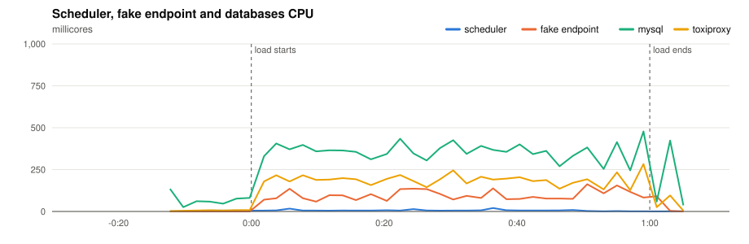
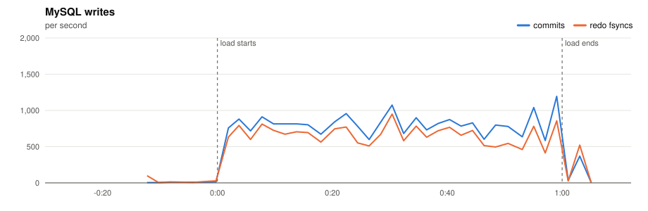
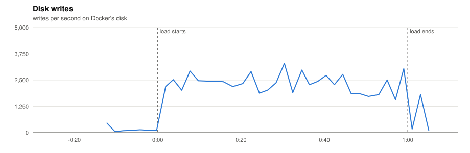

# P2 · 20261119T203410Z-r2-2x-400 (r2-2x-400)

- **Load:** 60 s of 400 one-off jobs per second, endpoint `lat=50&dist=lognormal`, timeout 30 s; 24,000 tasks seeded.
- **Deployment:** 2 executors; executor-service: `JOB_TIME_LIMIT_SECONDS=1 WORKER_COUNT=10000 JOB_QUEUE_SIZE=10000 PPROF_ADDR=:6060`; scheduler-service: `SCHEDULE_INTERVAL=1s SCHEDULE_LOOKAHEAD=10s PPROF_ADDR=:6060`
- **Raw data:** `bench/results/P2-capacity/runs/20261119T203410Z-r2-2x-400/` (local, not committed)

## Jobs

| Created | Succeeded | Dead | Still pending or running | Retried | Duplicate successes | Timed out, done anyway | Calls per second (first attempts) |
|---|---|---|---|---|---|---|---|
| 24,000 | 24,000 | 0 | 0 | 0 | 0 | 0 | 397.5 |

*Duplicate successes*: the endpoint answered 200 twice for one job, which only a failure should cause. *Timed out, done anyway*: the executor gave up after the timeout while the endpoint finished the work, so the retry made the customer process the job again.

**Start delay** (when the call reached the endpoint minus when the job was due, first attempts):

| Priority | Jobs | p50 | p90 | p99 | max |
|---|---|---|---|---|---|
| 0 | 6,000 | 0.012 s | 0.391 s | 0.994 s | 1.944 s |
| 1 | 6,000 | 0.012 s | 0.390 s | 1.090 s | 1.945 s |
| 2 | 6,000 | 0.011 s | 0.390 s | 0.885 s | 1.942 s |
| 3 | 6,000 | 0.011 s | 0.392 s | 0.993 s | 1.945 s |
| all | 24,000 | 0.011 s | 0.391 s | 1.089 s | 1.945 s |

## Charts

Time is minutes:seconds from the start of the load.





















## Resources

| Component | CPU avg (millicores) | CPU max | Throttled max (ms/s) | Memory max (MiB) |
|---|---|---|---|---|
| executor-service 7c5jv | 179 | 478 | 11454 | 280 |
| executor-service d2zf2 | 74 | 320 | 2649 | 98 |
| scheduler-service 7jsfb | 5 | 21 | 0 | 12 |
| fake-endpoint cf55t | 75 | 163 | 0 | 120 |
| mysql | 293 | 478 | 0 | 1055 |
| cassandra | 100 | 292 | 0 | 1063 |
| toxiproxy | 145 | 283 | 0 | 18 |

MySQL: up to 1194 commits/s, 950 redo fsyncs/s, 0 row lock waits/s, 14 connections.

## CPU profile: executor, 20 s from 0:33

```text
      flat  flat%   sum%        cum   cum%
     1.66s 60.14% 60.14%      1.66s 60.14%  internal/runtime/syscall.Syscall6
     0.25s  9.06% 69.20%      0.25s  9.06%  runtime.futex
     0.04s  1.45% 70.65%      0.09s  3.26%  runtime.pcvalue
     0.03s  1.09% 71.74%      0.04s  1.45%  runtime.findObject
     0.03s  1.09% 72.83%      0.06s  2.17%  runtime.scanobject
     0.03s  1.09% 73.91%      0.11s  3.99%  runtime.selectgo
     0.03s  1.09% 75.00%      0.04s  1.45%  runtime.step
     0.02s  0.72% 75.72%      0.02s  0.72%  net.(*TCPConn).Write
     0.02s  0.72% 76.45%      0.02s  0.72%  runtime.(*lfstack).pop
     0.02s  0.72% 77.17%      0.02s  0.72%  runtime.(*mspan).writeHeapBitsSmall
     0.02s  0.72% 77.90%      0.02s  0.72%  runtime.interhash
     0.02s  0.72% 78.62%      0.04s  1.45%  runtime.lock2
```

## CPU profile: scheduler, 20 s from 0:33

```text
      flat  flat%   sum%        cum   cum%
      20ms   100%   100%       20ms   100%  internal/runtime/syscall.Syscall6
         0     0%   100%       10ms 50.00%  crypto/internal/sysrand.Read
         0     0%   100%       10ms 50.00%  crypto/internal/sysrand.read
         0     0%   100%       10ms 50.00%  crypto/rand.(*reader).Read
         0     0%   100%       10ms 50.00%  database/sql.(*DB).execDC
         0     0%   100%       10ms 50.00%  database/sql.(*DB).execDC.func3
         0     0%   100%       10ms 50.00%  database/sql.(*Tx).ExecContext
         0     0%   100%       10ms 50.00%  database/sql.ctxDriverPrepare
         0     0%   100%       10ms 50.00%  database/sql.withLock
         0     0%   100%       20ms   100%  github.com/JoelTeoGom/distributed-scheduler/scheduler-service/internal/adapters/out/mysql.(*SchedulerRepository).ScheduleJobs
         0     0%   100%       20ms   100%  github.com/JoelTeoGom/distributed-scheduler/scheduler-service/internal/adapters/out/mysql.insertJobs
         0     0%   100%       20ms   100%  github.com/JoelTeoGom/distributed-scheduler/scheduler-service/internal/service.(*SchedulerService).Start
```
