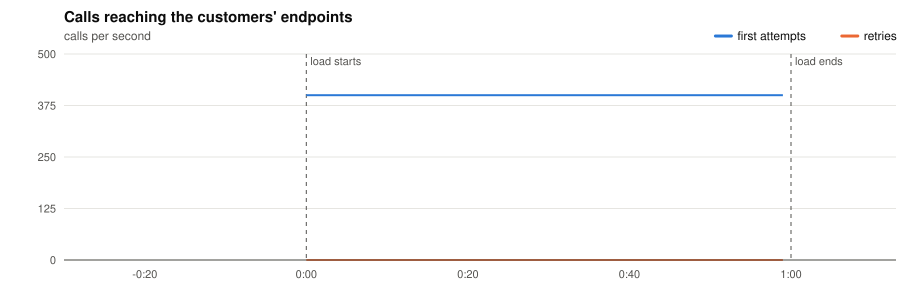
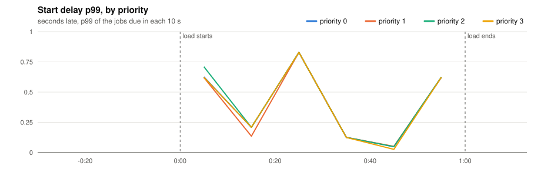
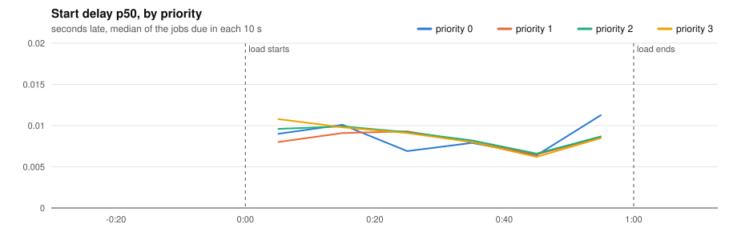
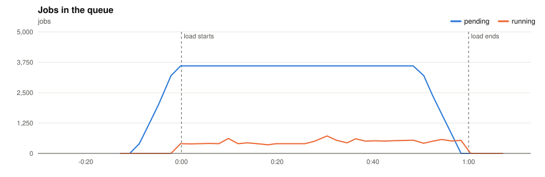
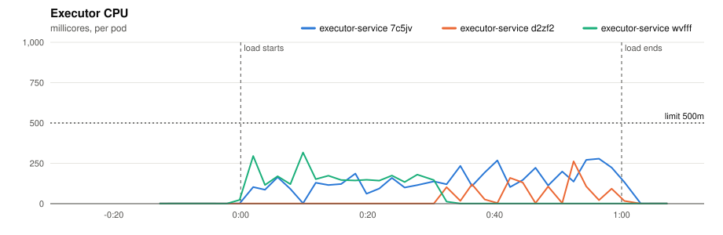
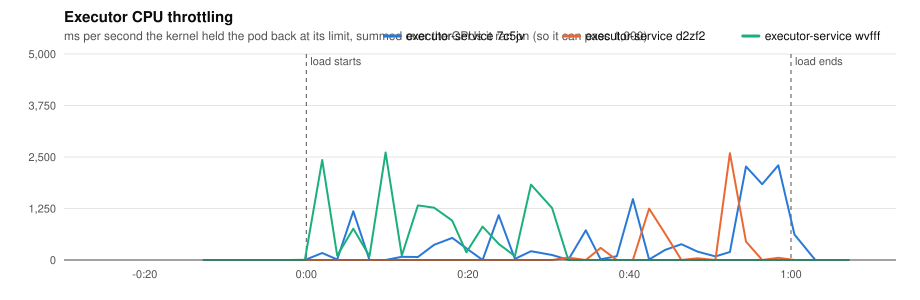
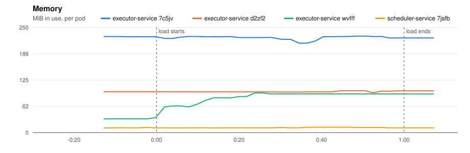
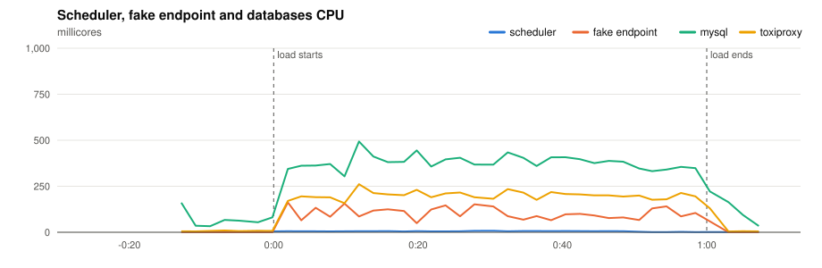
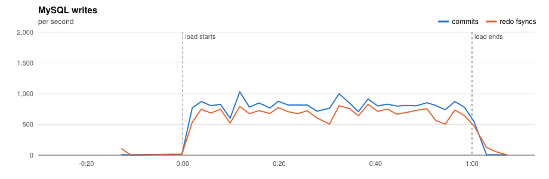
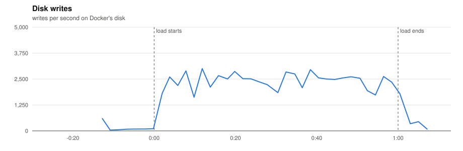

# P2 · 20261119T203538Z-r2-3x-400 (r2-3x-400)

- **Load:** 60 s of 400 one-off jobs per second, endpoint `lat=50&dist=lognormal`, timeout 30 s; 24,000 tasks seeded.
- **Deployment:** 3 executors; executor-service: `JOB_TIME_LIMIT_SECONDS=1 WORKER_COUNT=10000 JOB_QUEUE_SIZE=10000 PPROF_ADDR=:6060`; scheduler-service: `SCHEDULE_INTERVAL=1s SCHEDULE_LOOKAHEAD=10s PPROF_ADDR=:6060`
- **Raw data:** `bench/results/P2-capacity/runs/20261119T203538Z-r2-3x-400/` (local, not committed)

## Jobs

| Created | Succeeded | Dead | Still pending or running | Retried | Duplicate successes | Timed out, done anyway | Calls per second (first attempts) |
|---|---|---|---|---|---|---|---|
| 24,000 | 24,000 | 0 | 0 | 0 | 0 | 0 | 406.7 |

*Duplicate successes*: the endpoint answered 200 twice for one job, which only a failure should cause. *Timed out, done anyway*: the executor gave up after the timeout while the endpoint finished the work, so the retry made the customer process the job again.

**Start delay** (when the call reached the endpoint minus when the job was due, first attempts):

| Priority | Jobs | p50 | p90 | p99 | max |
|---|---|---|---|---|---|
| 0 | 6,000 | 0.008 s | 0.115 s | 0.524 s | 0.831 s |
| 1 | 6,000 | 0.008 s | 0.120 s | 0.823 s | 0.831 s |
| 2 | 6,000 | 0.009 s | 0.121 s | 0.707 s | 0.835 s |
| 3 | 6,000 | 0.009 s | 0.120 s | 0.624 s | 0.837 s |
| all | 24,000 | 0.009 s | 0.120 s | 0.625 s | 0.837 s |

## Charts

Time is minutes:seconds from the start of the load.





















## Resources

| Component | CPU avg (millicores) | CPU max | Throttled max (ms/s) | Memory max (MiB) |
|---|---|---|---|---|
| executor-service 7c5jv | 111 | 279 | 2299 | 230 |
| executor-service d2zf2 | 30 | 262 | 2593 | 100 |
| executor-service wvfff | 65 | 317 | 2610 | 94 |
| scheduler-service 7jsfb | 5 | 8 | 0 | 13 |
| fake-endpoint cf55t | 77 | 162 | 0 | 116 |
| mysql | 301 | 493 | 0 | 1080 |
| cassandra | 104 | 305 | 0 | 1068 |
| toxiproxy | 150 | 261 | 0 | 22 |

MySQL: up to 1031 commits/s, 828 redo fsyncs/s, 1 row lock waits/s, 20 connections.

## CPU profile: executor, 20 s from 0:34

```text
      flat  flat%   sum%        cum   cum%
     360ms 22.36% 22.36%      360ms 22.36%  internal/runtime/syscall.Syscall6
     310ms 19.25% 41.61%      310ms 19.25%  runtime.futex
     100ms  6.21% 47.83%      100ms  6.21%  runtime.(*lfstack).pop (inline)
      40ms  2.48% 50.31%      330ms 20.50%  runtime.markroot
      30ms  1.86% 52.17%       50ms  3.11%  runtime.pcvalue
      20ms  1.24% 53.42%       20ms  1.24%  internal/runtime/atomic.(*Uint32).CompareAndSwap
      20ms  1.24% 54.66%       20ms  1.24%  runtime.(*gcBits).bitp (inline)
      20ms  1.24% 55.90%       30ms  1.86%  runtime.(*mcache).prepareForSweep
      20ms  1.24% 57.14%       50ms  3.11%  runtime.(*unwinder).resolveInternal
      20ms  1.24% 58.39%       20ms  1.24%  runtime.acquireSudog
      20ms  1.24% 59.63%       20ms  1.24%  runtime.binarySearchTree
      20ms  1.24% 60.87%       20ms  1.24%  runtime.memclrNoHeapPointers
```

## CPU profile: scheduler, 20 s from 0:34

```text
      flat  flat%   sum%        cum   cum%
      10ms   100%   100%       10ms   100%  runtime.memmove
         0     0%   100%       10ms   100%  github.com/JoelTeoGom/distributed-scheduler/scheduler-service/internal/adapters/out/mysql.(*SchedulerRepository).ScheduleJobs
         0     0%   100%       10ms   100%  github.com/JoelTeoGom/distributed-scheduler/scheduler-service/internal/adapters/out/mysql.insertJobs
         0     0%   100%       10ms   100%  github.com/JoelTeoGom/distributed-scheduler/scheduler-service/internal/service.(*SchedulerService).Start
         0     0%   100%       10ms   100%  main.main.func2
         0     0%   100%       10ms   100%  runtime.convT
         0     0%   100%       10ms   100%  runtime.typedmemmove
```
