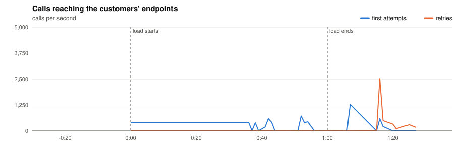
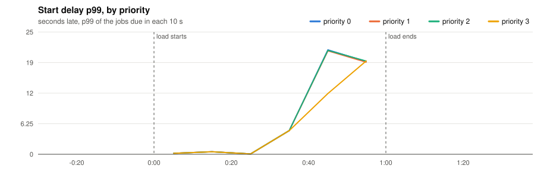
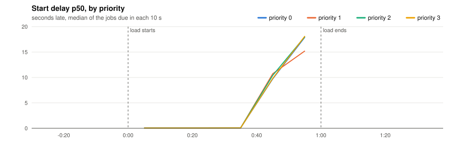
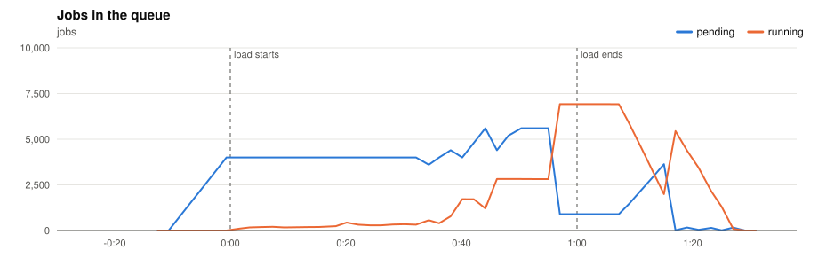
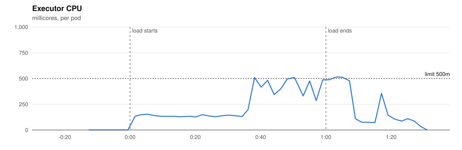
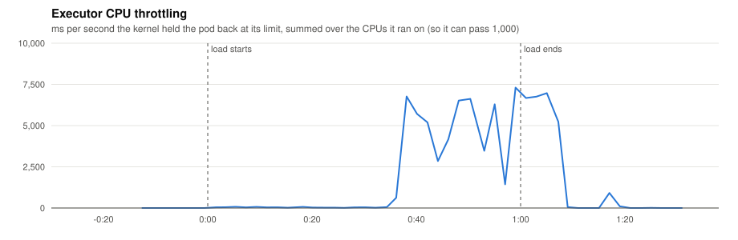
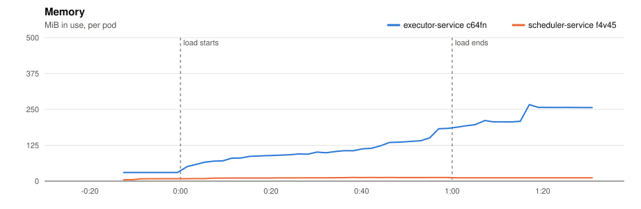
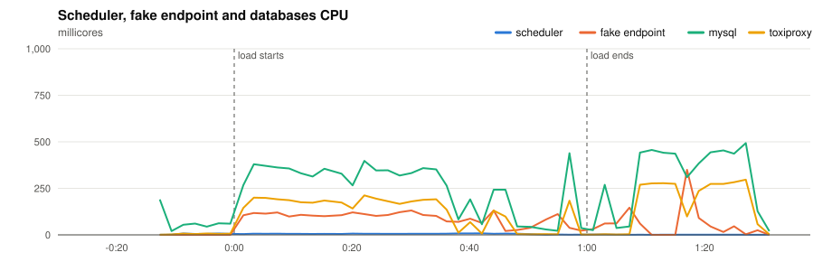
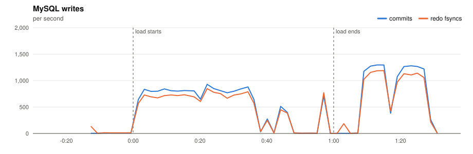
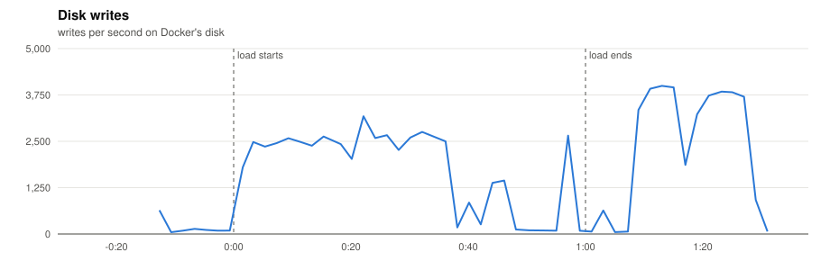

# P2 · 20261119T210827Z-r3-1x-400 (r3-1x-400)

- **Load:** 60 s of 400 one-off jobs per second, endpoint `lat=50&dist=lognormal`, timeout 30 s; 24,000 tasks seeded.
- **Deployment:** 1 executors; executor-service: `JOB_TIME_LIMIT_SECONDS=1 WORKER_COUNT=10000 JOB_QUEUE_SIZE=10000 PPROF_ADDR=:6060 GOMAXPROCS=1`; scheduler-service: `SCHEDULE_INTERVAL=1s SCHEDULE_LOOKAHEAD=10s PPROF_ADDR=:6060`
- **Raw data:** `bench/results/P2-capacity/runs/20261119T210827Z-r3-1x-400/` (local, not committed)

## Jobs

| Created | Succeeded | Dead | Still pending or running | Retried | Duplicate successes | Timed out, done anyway | Calls per second (first attempts) |
|---|---|---|---|---|---|---|---|
| 24,000 | 24,000 | 0 | 0 | 3,928 | 0 | 0 | 260.5 |

*Duplicate successes*: the endpoint answered 200 twice for one job, which only a failure should cause. *Timed out, done anyway*: the executor gave up after the timeout while the endpoint finished the work, so the retry made the customer process the job again.

**Start delay** (when the call reached the endpoint minus when the job was due, first attempts):

| Priority | Jobs | p50 | p90 | p99 | max |
|---|---|---|---|---|---|
| 0 | 4,586 | 0.055 s | 9.619 s | 18.941 s | 21.353 s |
| 1 | 5,689 | 0.062 s | 17.159 s | 20.340 s | 21.148 s |
| 2 | 5,024 | 0.058 s | 11.420 s | 21.245 s | 21.248 s |
| 3 | 4,773 | 0.057 s | 10.316 s | 18.878 s | 19.212 s |
| all | 20,072 | 0.058 s | 11.750 s | 20.252 s | 21.353 s |

## Charts

Time is minutes:seconds from the start of the load.





















## Resources

| Component | CPU avg (millicores) | CPU max | Throttled max (ms/s) | Memory max (MiB) |
|---|---|---|---|---|
| executor-service c64fn | 202 | 514 | 7308 | 266 |
| scheduler-service f4v45 | 4 | 8 | 0 | 13 |
| fake-endpoint cf55t | 69 | 349 | 0 | 329 |
| mysql | 246 | 493 | 0 | 1493 |
| cassandra | 94 | 266 | 0 | 1068 |
| toxiproxy | 123 | 297 | 0 | 21 |

MySQL: up to 1296 commits/s, 1188 redo fsyncs/s, 2 row lock waits/s, 9 connections.

## CPU profile: executor, 20 s from 0:33

```text
      flat  flat%   sum%        cum   cum%
     4.42s 90.39% 90.39%      4.42s 90.39%  internal/runtime/syscall.Syscall6
     0.04s  0.82% 91.21%      0.08s  1.64%  runtime.(*unwinder).resolveInternal
     0.03s  0.61% 91.82%      0.05s  1.02%  runtime.pcvalue
     0.02s  0.41% 92.23%      0.03s  0.61%  internal/runtime/maps.(*Map).getWithoutKeySmallFastStr
     0.01s   0.2% 92.43%      0.04s  0.82%  net.(*Resolver).internetAddrList
     0.01s   0.2% 92.64%      4.17s 85.28%  net.(*netFD).connect
     0.01s   0.2% 92.84%      0.08s  1.64%  runtime.mallocgc
     0.01s   0.2% 93.05%      0.04s  0.82%  runtime.mapaccess1_faststr
     0.01s   0.2% 93.25%      0.03s  0.61%  runtime.newobject
     0.01s   0.2% 93.46%      0.04s  0.82%  runtime.schedule
     0.01s   0.2% 93.66%      0.03s  0.61%  runtime.selectgo
     0.01s   0.2% 93.87%      4.45s 91.00%  syscall.Syscall
```

## CPU profile: scheduler, 20 s from 0:33

```text
      flat  flat%   sum%        cum   cum%
      10ms 16.67% 16.67%       10ms 16.67%  github.com/go-sql-driver/mysql.(*mysqlConn).readPacket
      10ms 16.67% 33.33%       10ms 16.67%  github.com/go-sql-driver/mysql.converter.ConvertValue
      10ms 16.67% 50.00%       10ms 16.67%  internal/runtime/atomic.(*Uint32).Add
      10ms 16.67% 66.67%       10ms 16.67%  runtime.(*guintptr).cas
      10ms 16.67% 83.33%       10ms 16.67%  runtime.(*mspan).base
      10ms 16.67%   100%       10ms 16.67%  runtime.futex
         0     0%   100%       20ms 33.33%  database/sql.(*DB).execDC
         0     0%   100%       10ms 16.67%  database/sql.(*DB).execDC.func2
         0     0%   100%       10ms 16.67%  database/sql.(*DB).execDC.func3
         0     0%   100%       20ms 33.33%  database/sql.(*Tx).ExecContext
         0     0%   100%       10ms 16.67%  database/sql.ctxDriverPrepare
         0     0%   100%       10ms 16.67%  database/sql.driverArgsConnLocked
```
