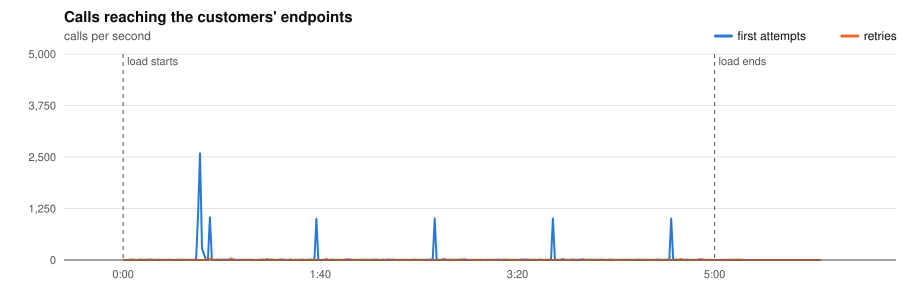
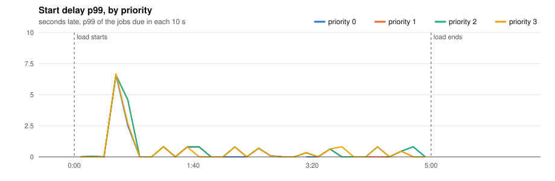
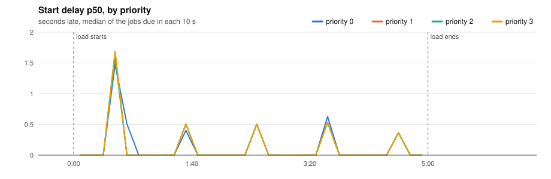
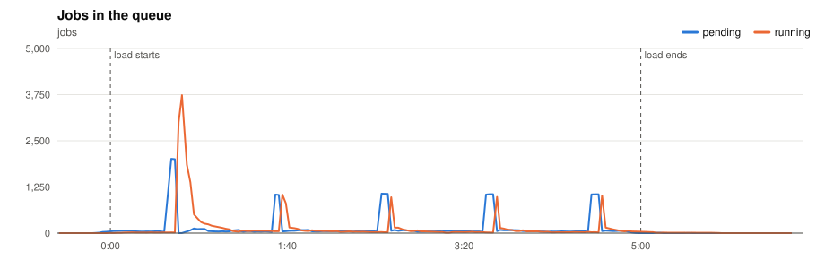
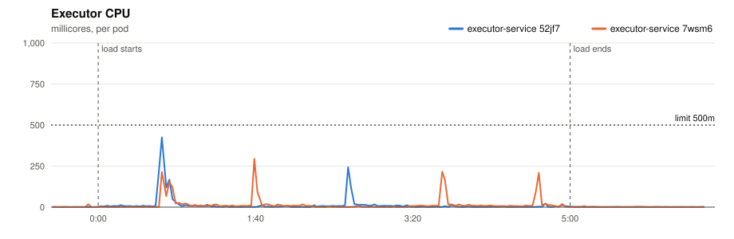
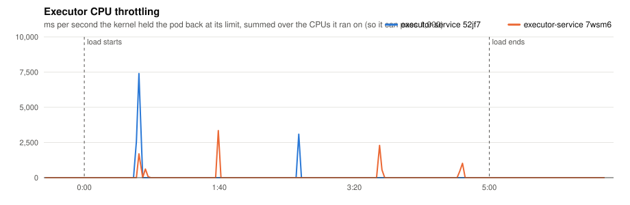
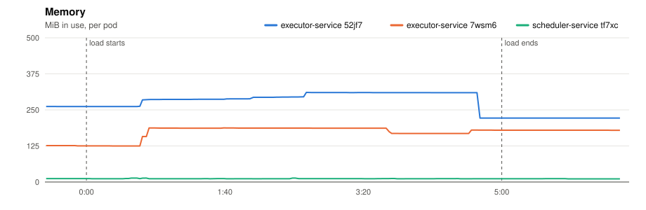
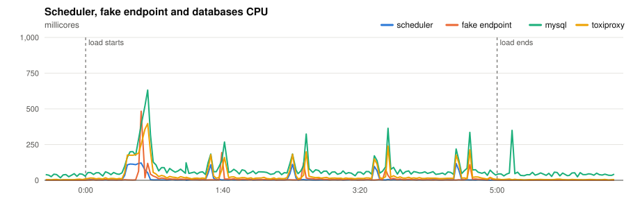
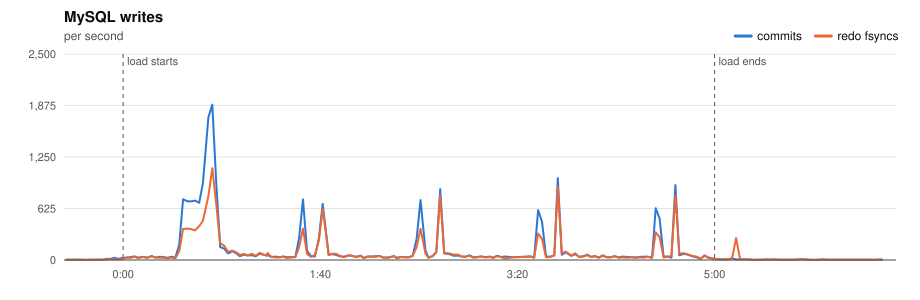
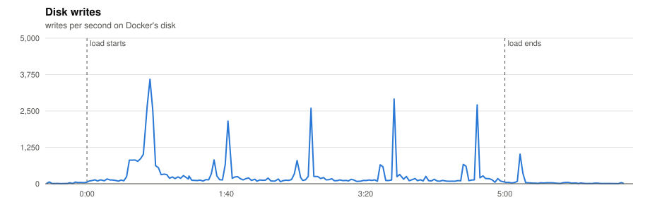

# P3 · Normal day

> On a normal day, do jobs start when they should?

**Load:** the model, 5 min
**Status:** run on 2026-11-10.

## What we test

The whole platform model for 5 minutes on 2 executors: 1,000 crons fire on second :00 of every minute, 4,000 more at the 5-minute mark, and one-off tasks arrive at random, ~5.5 per second. The endpoints have the usual mix: 80% fast, 12% slow, 5% very slow, 2% flaky, 1% down.

It is the reference for P6, P7 and P8, which add one problem to this same load.

**What to look at:**

- p99 start delay ≤ 1 s for every priority, including at the :00 bursts.
- The queue empties after each burst.
- Dead jobs come only from the down endpoints and from the flaky ones that failed 3 times.

## Results

- **Load:** 300 s of the platform model at scale 1.0: 1,000 minute, 4,000 five, 10,000 hour, 15,000 day, 1,667 at tasks; 31,667 tasks seeded.
- **Deployment:** 2 executors; executor-service: `JOB_TIME_LIMIT_SECONDS=1 WORKER_COUNT=10000 JOB_QUEUE_SIZE=10000 PPROF_ADDR=:6060`; scheduler-service: `SCHEDULE_INTERVAL=1s SCHEDULE_LOOKAHEAD=10s PPROF_ADDR=:6060`
- **Raw data:** `bench/results/P3-normal-day/runs/20261110T193822Z/` (local, not committed)

### Jobs

| Created | Succeeded | Dead | Still pending or running | Retried | Duplicate successes | Timed out, done anyway | Calls per second (first attempts) |
|---|---|---|---|---|---|---|---|
| 10,667 | 10,496 | 171 | 0 | 327 | 0 | 140 | 35.7 |

*Duplicate successes*: the endpoint answered 200 twice for one job, which only a failure should cause. *Timed out, done anyway*: the executor gave up after the timeout while the endpoint finished the work, so the retry made the customer process the job again.

**Start delay** (when the call reached the endpoint minus when the job was due, first attempts):

| Priority | Jobs | p50 | p90 | p99 | max |
|---|---|---|---|---|---|
| 0 | 505 | 0.629 s | 6.504 s | 6.507 s | 6.580 s |
| 1 | 1,515 | 0.631 s | 2.191 s | 6.584 s | 6.679 s |
| 2 | 6,503 | 0.600 s | 2.190 s | 6.585 s | 6.680 s |
| 3 | 2,144 | 0.600 s | 2.194 s | 6.679 s | 6.680 s |
| all | 10,667 | 0.604 s | 2.193 s | 6.667 s | 6.680 s |

### Charts

Time is minutes:seconds from the start of the load.





















### Resources

| Component | CPU avg (millicores) | CPU max | Throttled max (ms/s) | Memory max (MiB) |
|---|---|---|---|---|
| executor-service 52jf7 | 10 | 425 | 7399 | 311 |
| executor-service 7wsm6 | 12 | 294 | 3344 | 188 |
| scheduler-service tf7xc | 9 | 121 | 0 | 14 |
| fake-endpoint bcdlv | 9 | 483 | 0 | 130 |
| mysql | 75 | 632 | 0 | 907 |
| cassandra | 86 | 281 | 0 | 814 |
| toxiproxy | 30 | 397 | 0 | 24 |

MySQL: up to 1884 commits/s, 1114 redo fsyncs/s, 1 row lock waits/s, 14 connections.

### CPU profiles

<details><summary>CPU profile: executor, 20 s from 1:39</summary>

```text
      flat  flat%   sum%        cum   cum%
      10ms 50.00% 50.00%       10ms 50.00%  internal/runtime/syscall.Syscall6
      10ms 50.00%   100%       10ms 50.00%  runtime.(*m).snapshotAllp
         0     0%   100%       10ms 50.00%  database/sql.(*DB).execDC
         0     0%   100%       10ms 50.00%  database/sql.(*Tx).ExecContext
         0     0%   100%       10ms 50.00%  database/sql.ctxDriverStmtExec
         0     0%   100%       10ms 50.00%  database/sql.resultFromStatement
         0     0%   100%       10ms 50.00%  github.com/JoelTeoGom/distributed-scheduler/executor-service/internal/adapters/out/mysql.(*JobRepository).ClaimJobs
         0     0%   100%       10ms 50.00%  github.com/JoelTeoGom/distributed-scheduler/executor-service/internal/service.(*WorkerService).StartWorkerPool
         0     0%   100%       10ms 50.00%  github.com/go-sql-driver/mysql.(*mysqlConn).writePacket
         0     0%   100%       10ms 50.00%  github.com/go-sql-driver/mysql.(*mysqlConn).writeWithTimeout
         0     0%   100%       10ms 50.00%  github.com/go-sql-driver/mysql.(*mysqlStmt).Exec
         0     0%   100%       10ms 50.00%  github.com/go-sql-driver/mysql.(*mysqlStmt).ExecContext
```

</details>

<details><summary>CPU profile: scheduler, 20 s from 1:39</summary>

```text
      flat  flat%   sum%        cum   cum%
      20ms 40.00% 40.00%       20ms 40.00%  runtime.futex
      10ms 20.00% 60.00%       10ms 20.00%  internal/runtime/atomic.(*Uint8).Load
      10ms 20.00% 80.00%       10ms 20.00%  internal/runtime/atomic.(*Uintptr).Swap (inline)
      10ms 20.00%   100%       10ms 20.00%  internal/runtime/syscall.Syscall6
         0     0%   100%       20ms 40.00%  database/sql.(*DB).BeginTx
         0     0%   100%       20ms 40.00%  database/sql.(*DB).BeginTx.func1
         0     0%   100%       20ms 40.00%  database/sql.(*DB).begin
         0     0%   100%       20ms 40.00%  database/sql.(*DB).beginDC
         0     0%   100%       20ms 40.00%  database/sql.(*DB).beginDC.func1
         0     0%   100%       10ms 20.00%  database/sql.(*DB).execDC
         0     0%   100%       10ms 20.00%  database/sql.(*DB).execDC.func3
         0     0%   100%       20ms 40.00%  database/sql.(*DB).retry
```

</details>

Run page: [reports/20261110T193822Z/report.md](reports/20261110T193822Z/report.md)

## Conclusions

**On ordinary seconds yes, at the 5-minute mark no.**

| Seconds | Jobs due | Worst start delay |
|---|---|---|
| Every minute (:00) | ~1,000 | 0.46 to 0.90 s |
| The 5-minute mark (minute + five-minute crons) | 5,005 | 6.68 s |
| One-off jobs in between | 1,637 | p99 3.58 s |

The p99 of 6.67 s is that one second. Its 5,005 jobs were late for two reasons:

- **2,919 were claimed on time and still started up to 2 s late.** Two executors at 0.5 vCPU take about 2 s to fire some 3,000 calls at once.
- **About 2,000 were created late** by the scheduler's last two batches of 1,000, 1.6 s and 6.4 s after their time. Five batches of ~3.3 s do not fit in the scheduler's 10 s lookahead (see P2).

The objective of p99 ≤ 1 s holds for ordinary seconds and fails at every 5-minute burst. The one-off jobs that land on a burst wait behind it, which is where their 3.6 s p99 comes from.
