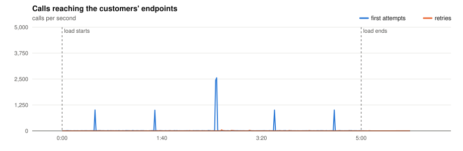
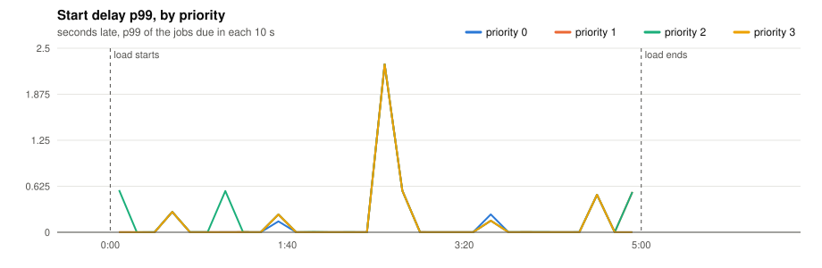
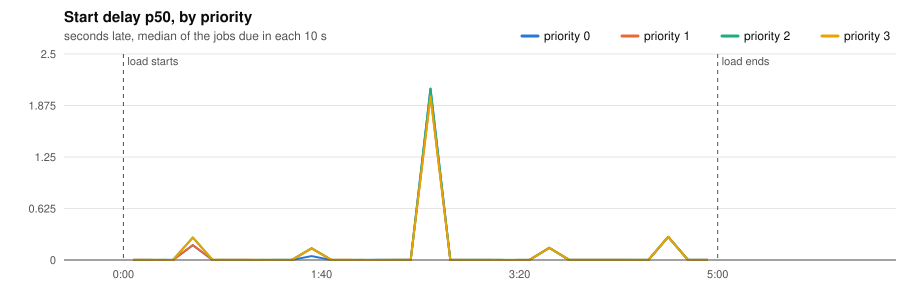
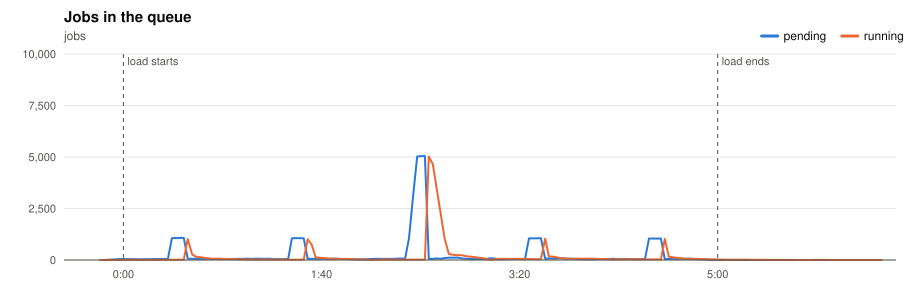
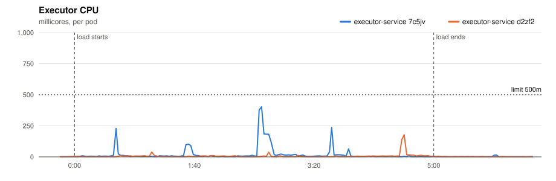
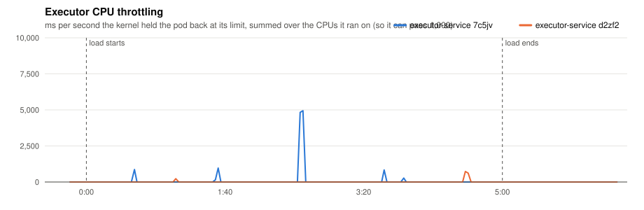
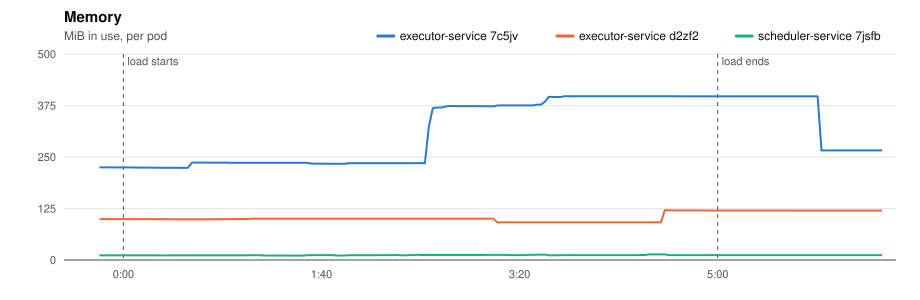
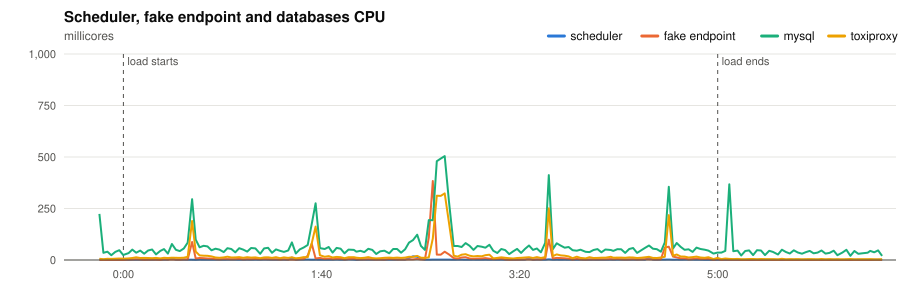
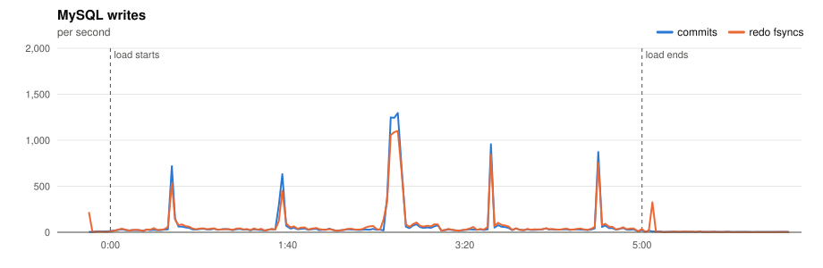
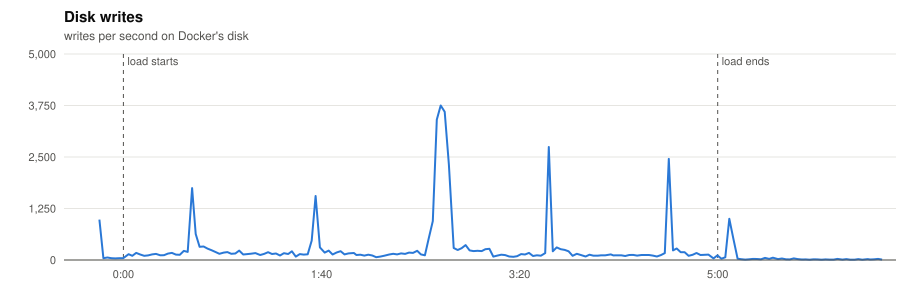

# P3 · 20261119T203712Z-r2 (r2)

- **Load:** 300 s of the platform model at scale 1.0: 1,000 minute, 4,000 five, 10,000 hour, 15,000 day, 1,667 at tasks; 31,667 tasks seeded.
- **Deployment:** 2 executors; executor-service: `JOB_TIME_LIMIT_SECONDS=1 WORKER_COUNT=10000 JOB_QUEUE_SIZE=10000 PPROF_ADDR=:6060`; scheduler-service: `SCHEDULE_INTERVAL=1s SCHEDULE_LOOKAHEAD=10s PPROF_ADDR=:6060`
- **Raw data:** `bench/results/P3-normal-day/runs/20261119T203712Z-r2/` (local, not committed)

## Jobs

| Created | Succeeded | Dead | Still pending or running | Retried | Duplicate successes | Timed out, done anyway | Calls per second (first attempts) |
|---|---|---|---|---|---|---|---|
| 10,667 | 10,576 | 91 | 0 | 248 | 0 | 118 | 35.7 |

*Duplicate successes*: the endpoint answered 200 twice for one job, which only a failure should cause. *Timed out, done anyway*: the executor gave up after the timeout while the endpoint finished the work, so the retry made the customer process the job again.

**Start delay** (when the call reached the endpoint minus when the job was due, first attempts):

| Priority | Jobs | p50 | p90 | p99 | max |
|---|---|---|---|---|---|
| 0 | 565 | 0.286 s | 2.180 s | 2.281 s | 2.282 s |
| 1 | 1,617 | 0.310 s | 2.179 s | 2.280 s | 2.281 s |
| 2 | 6,466 | 0.287 s | 2.181 s | 2.281 s | 2.283 s |
| 3 | 2,019 | 0.313 s | 2.179 s | 2.280 s | 2.283 s |
| all | 10,667 | 0.308 s | 2.180 s | 2.281 s | 2.283 s |

## Charts

Time is minutes:seconds from the start of the load.





















## Resources

| Component | CPU avg (millicores) | CPU max | Throttled max (ms/s) | Memory max (MiB) |
|---|---|---|---|---|
| executor-service 7c5jv | 17 | 403 | 4943 | 398 |
| executor-service d2zf2 | 6 | 178 | 726 | 121 |
| scheduler-service 7jsfb | 2 | 18 | 0 | 14 |
| fake-endpoint cf55t | 8 | 383 | 0 | 188 |
| mysql | 67 | 504 | 0 | 1130 |
| cassandra | 102 | 374 | 0 | 1086 |
| toxiproxy | 21 | 324 | 0 | 22 |

MySQL: up to 1296 commits/s, 1101 redo fsyncs/s, 1 row lock waits/s, 14 connections.

## CPU profile: executor, 20 s from 1:32

```text
      flat  flat%   sum%        cum   cum%
     120ms 42.86% 42.86%      120ms 42.86%  internal/runtime/syscall.Syscall6
      20ms  7.14% 50.00%       20ms  7.14%  runtime.gopark
      10ms  3.57% 53.57%       50ms 17.86%  database/sql.ctxDriverStmtExec
      10ms  3.57% 57.14%       70ms 25.00%  database/sql.resultFromStatement
      10ms  3.57% 60.71%       10ms  3.57%  github.com/go-sql-driver/mysql.(*mysqlConn).skipColumns
      10ms  3.57% 64.29%       30ms 10.71%  internal/poll.(*FD).Read
      10ms  3.57% 67.86%       10ms  3.57%  internal/sync.(*Mutex).Lock
      10ms  3.57% 71.43%       10ms  3.57%  net/http.(*persistConn).wroteRequest
      10ms  3.57% 75.00%       10ms  3.57%  runtime.convT
      10ms  3.57% 78.57%       10ms  3.57%  runtime.futex
      10ms  3.57% 82.14%       10ms  3.57%  runtime.futexsleep
      10ms  3.57% 85.71%       30ms 10.71%  runtime.netpoll
```

## CPU profile: scheduler, 20 s from 1:32

```text
      flat  flat%   sum%        cum   cum%
```
